# Dogfood: activity-tracker.io

Leo, 20 Oct 2026: "can dogfood on activity-tracker.io, see if the results are something like 20261020-084813, 20261020-085100". Those are his two screen recordings of Fastlane drafting a campaign for the same brand. This file holds that benchmark and how we run ours. The page shows it at /north-star#dogfood (data: `NS_DOGFOOD` in src/data/northStar.ts).

## The benchmark

Fastlane planned one campaign for "Sales-oriented self-employed professionals and coaches": 28 posts over 4 weeks, one a day at 6pm on TikTok to @activity_tracker_io. There are 12 slideshows and 12 walls of text, alternating at 5 credits each, plus 4 AI videos (Felt, Skeleton, Street interview, News anchor) at about 195 to 210 credits each, 945 credits in all. Five angles rotate in strict order: Make Consistency Visible, Turn Tasks Into Momentum, See Your Work Clearly, Outcomes Are Not Enough, Accountability Without Management (6/6/6/5/5 posts).

Every slide that was readable is quoted in [the review notes](videos/fastlane-2026-10-20-review/notes.md), section 2.3; the settings, angles and calendar are in [the settings notes](videos/fastlane-2026-10-20-settings/notes.md).

| # | Date | Format | Angle | Hook as drafted |
| --- | --- | --- | --- | --- |
| 1 | Tue 20 Oct | Slideshow, 8 slides | Make Consistency Visible | 6 ways to make your sales consistency impossible to ignore |
| 2 | Wed 21 Oct | Wall of text | Turn Tasks Into Momentum | your next prospecting session doesn't have to feel like a grind. log the work in ActivityTracker, protect your streak, and watch your virtual corgi progress. yo |
| 3 | Thu 22 Oct | Slideshow, 6 slides | See Your Work Clearly | 5 signs you can't see your sales work clearly |
| 4 | Fri 23 Oct | Wall of text | Outcomes Are Not Enough | when sales are slow you're going to be tempted to stare at the number. it's very important that you don't, track the calls, follow-ups, and prospecting instead. |
| 5 | Sat 24 Oct | Felt | Accountability Without Management | (stock example only until Make) |
| 6 | Sun 25 Oct | Slideshow, 8 slides | Make Consistency Visible | You finish a client call, then wonder: what did I actually do to build tomorrow's pipeline? |
| 7 | Mon 26 Oct | Wall of text | Turn Tasks Into Momentum | you've got one follow-up left before you close your laptop. it's very easy to leave it for tomorrow, but ActivityTracker turns it into a streak, and your virtua |
| 8 | Tue 27 Oct | Slideshow, 5 slides | See Your Work Clearly | You finish a busy Tuesday and can't remember who you followed up with |
| 9 | Wed 28 Oct | Wall of text | Outcomes Are Not Enough | you check your inbox, no new deal yet. instead of judging the day by the close, log the prospecting that creates it. ActivityTracker turns outreach and follow-u |
| 10 | Thu 29 Oct | Slideshow, 8 slides | Accountability Without Management | Are you doing enough outreach this week, or just hoping you are |
| 11 | Fri 30 Oct | Wall of text | Make Consistency Visible | a virtual corgi grows when you complete your daily sales tasks. ActivityTracker makes prospecting, follow-ups, and outreach visible, so you're not only measurin |
| 12 | Sat 31 Oct | Skeleton | Turn Tasks Into Momentum | (stock example only until Make) |
| 13 | Sun 1 Nov | Slideshow, 6 slides | See Your Work Clearly | prospecting, follow-ups, outreach: 3 daily activities that are easier to improve when you can actually see them |
| 14 | Mon 2 Nov | Wall of text | Outcomes Are Not Enough | sales teams can track streaks, leaderboards, even a virtual corgi, but somehow we're still only staring at closed deals. I WANT THE DAILY WORK TO COUNT. prospec |
| 15 | Tue 3 Nov | Slideshow, 5 slides | Accountability Without Management | You open your laptop at 9... and suddenly it's 4 things independent sales pros should track |
| 16 | Wed 4 Nov | Wall of text | Make Consistency Visible | the mistake is only tracking closed deals. track the work that creates them instead: 10 prospects, 6 follow-ups, 3 outreach messages, every day. i think my pipe |
| 17 | Thu 5 Nov | Slideshow, 5 slides | Turn Tasks Into Momentum | A virtual corgi progresses when you complete daily sales activity |
| 18 | Fri 6 Nov | Street interview | See Your Work Clearly | (stock example only until Make) |
| 19 | Sat 7 Nov | Wall of text | Outcomes Are Not Enough | POV: checking your sales results once a month, then realizing you've got no clue whether you actually did the prospecting and follow-ups that feed them [emoji:  |
| 20 | Sun 8 Nov | Slideshow, 6 slides | Accountability Without Management | ActivityTracker turns 4 daily actions into a streak worth protecting |
| 21 | Mon 9 Nov | Wall of text | Make Consistency Visible | solo sellers, what's more annoying than having a busy week and nothing to point to except  |
| 22 | Tue 10 Nov | Slideshow, 6 slides | Turn Tasks Into Momentum | the mistake: treating every sales task like a chore |
| 23 | Wed 11 Nov | Wall of text | See Your Work Clearly | Treating your sales work like a blur, then wondering why your pipeline feels unclear, is a different kind of stress. Log the calls, follow-ups, and outreach in  |
| 24 | Thu 12 Nov | Slideshow, 4 slides | Outcomes Are Not Enough | Your day was full, but you still can't tell what moved your pipeline |
| 25 | Fri 13 Nov | News anchor | Accountability Without Management | (stock example only until Make) |
| 26 | Sat 14 Nov | Wall of text | Make Consistency Visible | "Do I really need to track every prospecting task?" if closed deals are the only thing you can see, you'll miss the follow-ups and outreach building them. |
| 27 | Sun 15 Nov | Slideshow, 4 slides | Turn Tasks Into Momentum | your to-do list keeps getting longer, but the routine sales work still feels too easy to skip |
| 28 | Mon 16 Nov | Wall of text | See Your Work Clearly | self-employed to self-employed, what's worse than doing outreach all week then having no clue what actually got done?? not a bigger spreadsheet. one place to lo |

## What we have to beat

- No post shows the app, its screens, its logo or the corgi. Every picture is a generic lifestyle stock photo, mostly young women, gyms, yoga and books.
- 11 photos repeat across slideshows: the promenade run and the downward dog three times each.
- Slideshow captions are the slide text cut at about 85 characters, mid-sentence, with no call to action, hashtag or link.
- Post 13 promises 3 daily activities and lists 4; post 15's hook is garbled ("You open your laptop at 9... and suddenly it's 4 things independent sales pros should track").
- The 4 AI video slots show stock examples (a felt puppy, a skeleton taking a gummy) until 210 credits are spent; nothing in them is about the brand.
- What it does well, and we should match: one clear angle per post, hooks in proven shapes (N signs, N ways, POV, the mistake, a quoted objection), a chatty lowercase voice on walls of text, and posts drafted for free with the charge only at Make.

## How we run ours

1. When: once remix-everywhere, remix-any-format, formats-slideshow, formats-wall-of-text, edit-slideshow and edit-text-video ship (phase 1).
2. Who: a QA sign-in added to REMIX_USERS for the run and taken off afterwards. Not Leo's login, and not a @demo.com address (a real domain).
3. Brand: /brands/new from https://activity-tracker.io, then set the audience to the same one and add the same five angles.
4. Make: 12 slideshows and 12 walls of text, one per angle in the same rotation, each remixed from a proven post in /swipe or /trends that suits the angle. Record the source of each.
5. Compare:
   - Hooks head to head with Jev: `hook-check --h2h` on each pair (ours against Fastlane's for the same angle and format), reader = a self-employed salesperson in Singapore.
   - The list above, post by post: app or product visible, repeated pictures, caption complete with a call to action, facts that add up, a readable hook.
   - Cost per post and time per post.
6. Record: fill `NS_DOGFOOD.ours` in src/data/northStar.ts and add a Results section here with the scores, in the same commit.

## Phase 2 results (round 1, 21 Oct 2026)

Round 1 ran on 21 Oct 2026 from 00:29 to 01:10 Singapore time, on a localhost build of main at 8f2d5a6 with the demo sign-in and ?asLeo=1. Every POST, PATCH and DELETE to the shared database was stopped in the browser (365 write attempts stopped), so the brand, the six competitors, every check, save and draft live only in the browser profile kept for round 2. The edge functions ran for real.

Brand: /brands/new read activity-tracker.io in 6 s and found the name, logo, colour, one-liner and five topics ("Sales follow-ups", "WhatsApp workflows", "Client management", "Activity tracking", "Sales goals") but no social accounts. "Exactly who" in the brand kit and "Who you serve" in Your market were both set to "Sales-oriented self-employed professionals and coaches". Your market itself is not switched on for this sign-in: saving its set-up started a market check that answered 404 and spent nothing.

The six were added by site on Their ads, one at a time, so the first ads could be timed. The site read found the social pages of Pipedrive, Apollo.io and Sunsama; for SleekFlow, respond.io and SPOTIO it found none, so their Facebook and Instagram pages were typed into the editor that "Add their page" opens, using the handles in the brief. Apollo.io's row was named "The AI GTM System for Go-to-Market Teams" (its page title), so it was renamed and its TikTok added by hand.

### The ten Good lines

| # | Line | Result | Evidence |
| --- | --- | --- | --- |
| 1 | Every watched competitor is accounted for | Pass | All 6 show a count or a reason: Apollo.io 26, Sunsama 26, respond.io 17, SleekFlow 12, Pipedrive 8, and "Not running Meta ads: SPOTIO" after Look anywhere (Meta's keyword search for "spotio" finds no SPOTIO page either). Before their pages were added, SleekFlow, respond.io and SPOTIO each read "Add ...'s Facebook page to see their ads." with "Add their page". Fastlane showed pills for 2 of 6. |
| 2 | At least 4 of 6 have Meta ads | Pass | 5 of 6, 89 ads. Fastlane had 2 (104 ads). But Meta's own Singapore view shows active ads for SleekFlow (about 13) and respond.io (about 28) only; Pipedrive, Apollo.io and Sunsama have none in Singapore, and their 60 ads here are worldwide ads under a row set to Singapore (defect 2). |
| 3 | Your space: 14 of 20 sampled ads sell to salespeople, none from a tracked competitor | Fail | The three prefilled words ("Sales follow-ups", "WhatsApp workflows", "Client management") brought back 12 ads after the 0.6 fit cut, so 20 could not be sampled. Of the 12, 10 sell to salespeople or small sales teams (Catalyst Outsourcing SG x3, Sales Closer AI x3, Wati, MomBoss Academy's sales webinar, Sales Mentoring by Aaron, Explee AI) and 2 do not (Snowie.Ai, a white-label voice AI for agencies; Ajit Nawalkha, an AI system for business owners). None came from a tracked competitor: all five tracked page ids were sent as excluded. The share passes (83%); the volume does not. 12 ads from 8 advertisers. |
| 4 | Labels come from fixed lists only | Pass | 122 labelled ads, every value a list id or empty. Hook: desire 36, problem 30, offer 14, audience 12, proof 10, curiosity 9, instruction 2, none 9. Feeling: relief 43, curiosity 28, hope 18, urgency 11, worry 7, trust 6, none 9. Audience: business owners 82, general 21, young adults 11, families 1, none 7. The Emotion and Audience filters list only the fixed options. |
| 5 | On 5 sampled ads the drawer's run length, rank, placement and proof line match the Meta Ad Library page | Fail | Read with Scrapling's DynamicFetcher (the plain Fetcher gets a page without the ad). Start date, run length and "running" matched on 5 of 5. Placement matched on 4 of 5: Pipedrive 1092039757056593 runs on WhatsApp too, which the drawer drops. Rank and proof were wrong on 5 of 5, because they rank each ad only among the 30 newest that were read: Sunsama 1723268295542969 says "Longest of their 26 ads" and "Their longest running ad right now", while Meta lists active Sunsama ads from 16 Oct 2025 and 5 Dec 2025; respond.io 1125686443249862 says "Joint longest of their 17" (started 19 Oct) while Meta's Singapore view has respond.io ads from 12 Oct; SleekFlow 1123483220388030 says "#4 of their 15" while 8 of its Singapore ads on Meta started earlier (6 and 15 Oct); Pipedrive 1092039757056593 and Apollo.io 1075280991926367 say "Joint longest" while Meta lists active ads from 31 Mar 2026 (Pipedrive, about 440 running) and 4 Mar 2026 (Apollo.io, about 60). |
| 6 | Every card has Remix and its price shows before anything is spent | Pass for Remix; the make price not measured | Remix on 122 of 122 ad library cards, 89 of 89 Their ads cards and 210 of 210 Their posts cards. Opening the sheet spends nothing but the free fit check; the Breakdown chip ("About US$0.01 | 38 left after this") and the video formats' chips ("Up to US$5.56", "About US$0.08") show before the press. The text post's own price was not seen: the button read "No remixes left today" (see line 8). Fastlane hid the price until the composer. |
| 7 | Their posts: badges, "Too new to judge", pace table, 3x posts listed | Pass | 210 posts from 7 accounts (6 Instagram, Apollo.io's TikTok), every card badged: 34 at 3x or more (Apollo.io TikTok 37x, Pipedrive 25x, SleekFlow 25x at the top), 43 more above usual, 98 about usual, 32 below, and 3 Apollo.io posts from 19 Oct read "Too new to judge". The pace table is filled for all 7 rows (followers, posts a week, best lately; growth reads "next check" on a first read). |
| 8 | The 6 drafts read as the business in ActivityTracker's voice, no copied runs, claim or invented flags, each with its source trail | Not measured | No drafts were made. When the first Remix was pressed (Sunsama 1723268295542969, fit "Good fit for ActivityTracker."), the sheet read "No remixes left today": the demo uid's remix-make counter for 20 Oct (UTC) was already at 30 of 30 from other runs. The uid came off NORTH_STAR_USERS at 04:25, before the 8am reset, so the 3 ads and 3 posts picked for it (ads: Sunsama 1723268295542969, Sales Mentoring by Aaron 2972139646506607, Apollo.io 1075280991926367; posts: Apollo.io TikTok 7685781265122938126 at 37x, Pipedrive DdWQIxpRQb7 and SleekFlow DdsjSosgWYL at 25x) are left for round 2. |
| 9 | First ads arrive within about a minute of adding a competitor | Pass | Apollo.io 25 s, Sunsama 36 s and Pipedrive 62 s from pressing Add (site read under 1 s, then the check). SleekFlow 40 s and respond.io 47 s from saving their page in the editor. SPOTIO's empty answer came in 11 s. |
| 10 | Cost from Apify's run log and the DataForSEO balance, under US$3 | Not measured | Counted at about US$1.76 (at most US$2.65), under US$3, without the six remixes (about US$0.18 more), but not measured: Apify's run log is not readable from here (the token is server-side), and the DataForSEO account in ~/.config/agents.env is shared with other jobs, so its balance cannot isolate this run (see Cost). |

### Suggest's picks beside Fastlane's

One press of Suggest competitors, after the six were added (they are excluded), took 11 s and returned 2 of a possible 6. The 72 candidates it was sent were almost all Singapore finance advisers and brands from the shared lists, plus WATI, so both picks came from the model's own proposals.

| Suggest (score, why) | Fastlane |
| --- | --- |
| Kommo, 0.79: "A seller who manages client chats and follow-ups on WhatsApp may compare Kommo for its messaging tools and sales pipeline." | Outfield |
| Zoho CRM, 0.64: "A self-employed seller or coach managing clients and sales activity may compare Zoho CRM for its broader business and sales tools." | Salesforce |
| | Outreach |
| | Apollo.io (already on our list, so excluded) |
| | Wise Agent |
| | Finch |

No overlap beyond Apollo.io. Fastlane leans to field and outbound sales (Outfield, Outreach); Suggest leans to WhatsApp CRMs, which follows the one-liner brand-dna wrote ("a shared WhatsApp inbox").

### The other steps

- Their posts: 7 handles read one at a time in 6 minutes (31 to 56 s each). Apollo.io's Instagram timed out at 92 s with a 502 (the use was given back); the one retry worked in 31 s.
- Your space: one check of 3 words, 36 s.
- Ad drawers: 5 opened (the five above), each with the Breakdown chip, What Remix does, Remix, Save and Open on Meta.
- Viral searches: "sales prospecting" 39 results (20 TikTok, 19 YouTube) in 13 s, "cold calling" 40 in 10 s, "sales habits" 40 in 16 s. With the default "Last 90 days" the screen showed 9, 14 and 12 of them, and YouTube 0, 0 and 2.
- Search topics: one check of the 5 brand topics in 10 s gave 6 keywords, all small (client management 30 searches a month, client management system 20, four at 10).
- Saved 5 TikTok posts from the "sales habits" results. All 5 were read; 4 were broken down and tagged; @angelo.toure's "10/10 Habits to Sell Anything" failed twice at 40 s (502, given back).
- What worked: followed @riadmourssali and @theanthonynatoli on TikTok (12 posts each), then ran What worked on both (8 s and 5 s). Natoli gave one pattern ("Short and blunt hooks", 2 of 3 best against 1 of 7 rest) and 3 ideas; Mourssali gave no pattern and 3 ideas from his best posts. The ideas stay on the brand's topics (follow-ups, WhatsApp chats, tracking activity), though Natoli's hooks are thin ("Follow up simply.", "Keep chats moving.", "Track the work.").
- Remixes: not made, see line 8. Nothing was spent on them; only the free fit check ran.

### What broke or read badly

1. The site read misses social pages whose links sit past the first 300 KB of the home page, and never reads JSON-LD sameAs. Page: /competitors, Add with "sleekflow.io", "respond.io" or "spotio.com". What happened: the row was added with no handles and Their ads said "Add SleekFlow's Facebook page to see their ads." SleekFlow's footer link is at about 431 KB, respond.io's at 845 KB and SPOTIO's at 390 KB, while SleekFlow's sameAs list (at 7.6 KB) names its Facebook page. Apollo.io's TikTok was missed the same way.
2. A first ads check ignores the Singapore setting. Page: /competitors?view=ads after adding any competitor whose read found a Facebook handle. The request goes out with the page's handle and no page id, so the Ad Library URL is the Facebook page itself with no country, and the answer is worldwide. Pipedrive, Apollo.io and Sunsama show 60 ads, all "running", while Meta's Singapore view has none for them; the next weekly check, now with the page id and SG, will likely drop them to "no Meta ads in Singapore". For SPOTIO, "Look anywhere" re-ran the identical page URL.
3. Rank and proof in the drawer are computed among the 30 newest ads only (the actor's sort is most recent), so "Longest", "Joint longest" and "Their longest running ad right now" were wrong on all 5 drawers checked, and the long runners the brief cared about (Sunsama's ad of about 370 days) were never read. Page: /swipe?tab=ads&ad=1723268295542969.
4. WhatsApp placement is dropped. supabase/functions/competitors/logic.ts keeps only facebook, instagram, messenger, threads and audience_network, so /swipe?tab=ads&ad=1092039757056593 reads "Facebook, Instagram, Audience Network and Threads" where Meta lists WhatsApp too.
5. Apollo.io was named from its page title. Page: /competitors, Add with "apollo.io". The row read "The AI GTM System for Go-to-Market Teams" until renamed by hand.
6. "Most relevant" on /swipe?tab=ads opens with the shared Singapore picks (Thomson Medical's MRI scan, Prudential) above the brand's competitors and space, and the page heading still says "Real high-performing posts from 47 SG finance creators." The same heading shows on the Search tab.
7. Finance-only lists label a sales brand: the ad audience list has no salespeople or self-employed option (82 of 122 ads went to Business owners), and saved TikToks about sales habits were tagged "Career / FA Life" and "Advisers and recruits". Following's "Engage this week" lists Singapore finance creators for ActivityTracker.
8. "Everyone was checked in the last 7 days. Pick one to check it again." shows under Their ads when nobody has been checked yet (only SleekFlow on the list, with no page).
9. Their posts dates carry no year: Sunsama's 20x photo reads "29 Aug" and its "Best lately 20x" is a post from Aug 2024; another reads "7 Nov", which looks like next month. The outlier order is weighted by account size, so 2.8x sits above 3.6x and a 20x below 3.4x, which the sort's InfoTip does not say.
10. Viral search's default "Last 90 days" hid all 19 YouTube results of "sales prospecting" ("YouTube 0"), which reads as YouTube failing. YouTube dates are whole years back from today, so most fall outside 90 days.
11. Search topics: "client management skills" reads "10 searches a month" and "Down 100% in 3 months" side by side, and the check is dated "Tue 20 Oct" (UTC) at 00:50 on Wed 21 Oct in Singapore.
12. Two breakdowns failed with a 502 after 40 s on the same saved TikTok; uses were given back.
13. The demo sign-in's counters were shared with other runs that day: remix-make was already at 30 of 30, and viral-search (2), space-ads (1), competitor-suggest (1) and competitor-read (4) were partly used, before this run pressed anything. The remixes could not run, and the uid came off the allowlist before the 8am reset.

### Cost

| Spend | How it was counted | US$ |
| --- | --- | --- |
| Apify, competitor ads | 7 runs, 89 ads returned at US$5.80 per 1,000 (each run may bill up to 30 before the app dedupes: at most 0.87) | 0.52 |
| Apify, your space | 3 keyword runs; 12 ads kept after the fit cut (the runs may have billed up to 90: at most 0.52) | 0.07 |
| Apify, competitor posts | 6 Instagram reads of 30 posts plus a profile (0.50) and 1 TikTok read of 30 (0.11); the Instagram read that timed out may also have billed (at most 0.09) | 0.61 |
| Apify, viral searches | 3 TikTok searches, 60 results | 0.23 |
| Apify, Following | 2 TikTok accounts, 24 posts | 0.09 |
| Apify, saves | 5 TikTok post reads | 0.02 |
| DataForSEO | 3 YouTube blocks and one search topics check (5 Labs tasks and their YouTube pages), at list price | 0.10 |
| OpenAI and Jev | brand-dna, Suggest, labels, space fit, fit checks, 6 breakdowns, What worked x2; no remix makes | 0.12 (estimate) |
| Total | a count, not a bill | 1.76 (at most 2.65) |

DataForSEO measured: the balance went from US$33.857 to US$33.336 (US$0.52) between 00:29 and 01:06, but that account's day total was already US$5.92 when the run started, so other jobs were spending on it at the same time and the delta is not this run's. Whether the server's DATAFORSEO_LOGIN is this same account is not checked. Apify is a count from the items each run returned, at the brief's Free-plan prices, not a bill.

### Screenshots

| View | Ours, 1440 px | Ours, 390 px | Fastlane |
| --- | --- | --- | --- |
| /competitors (Their ads) | 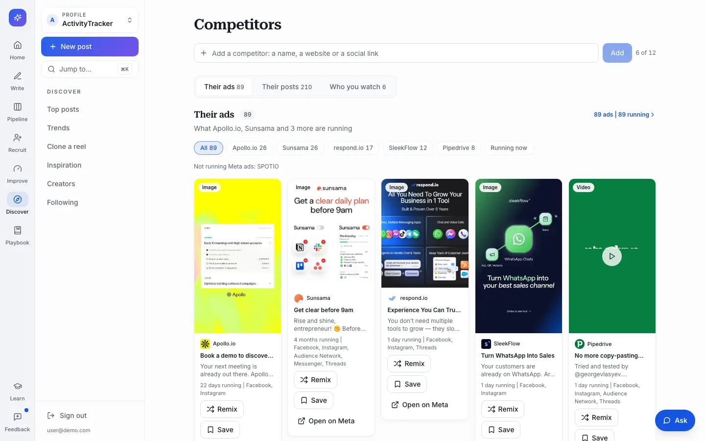 | 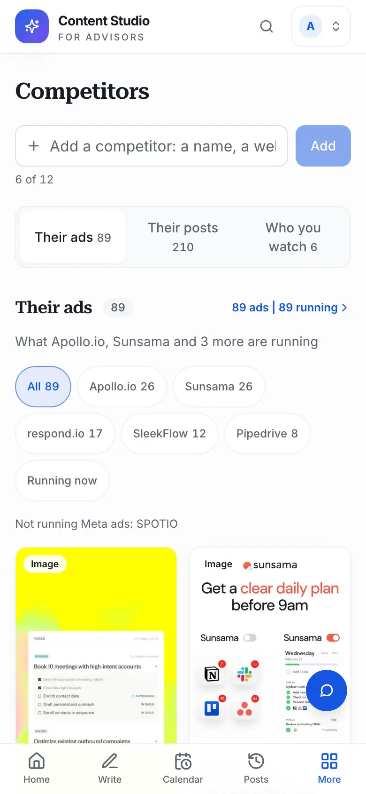 | 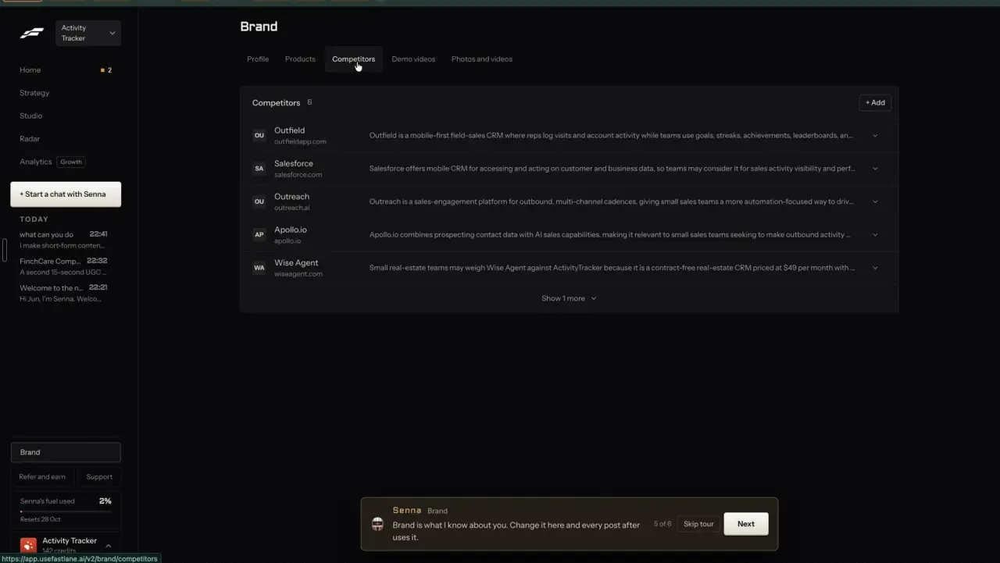  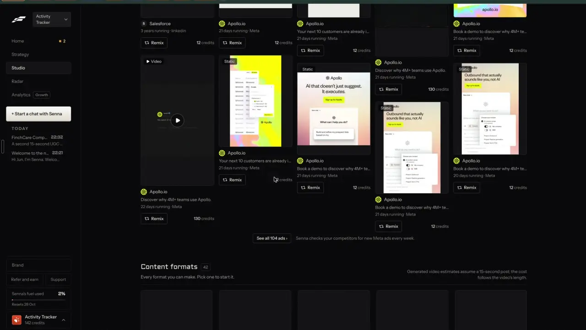 |
| /swipe?tab=ads | 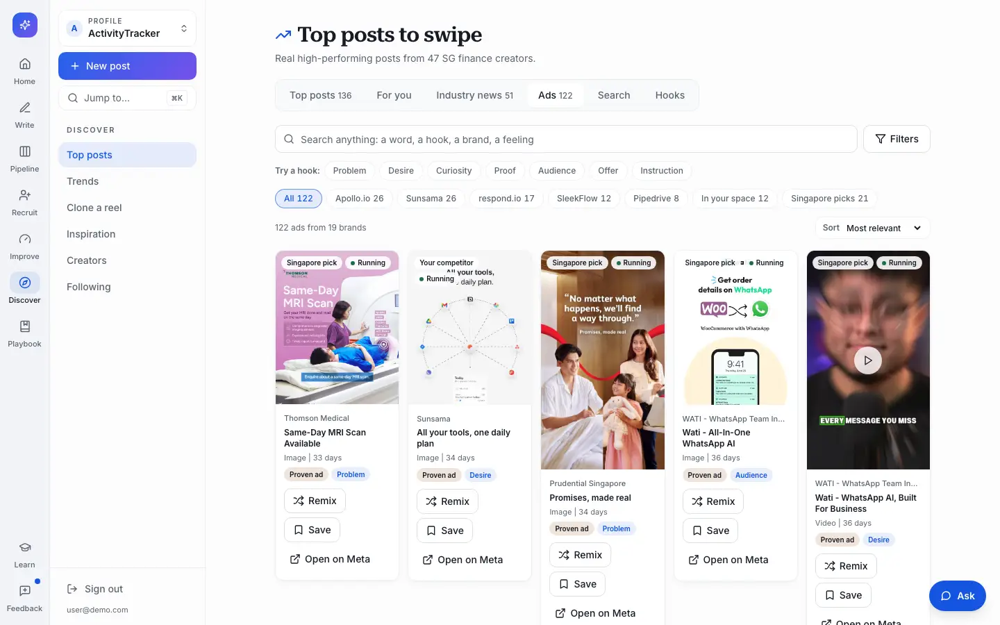 | 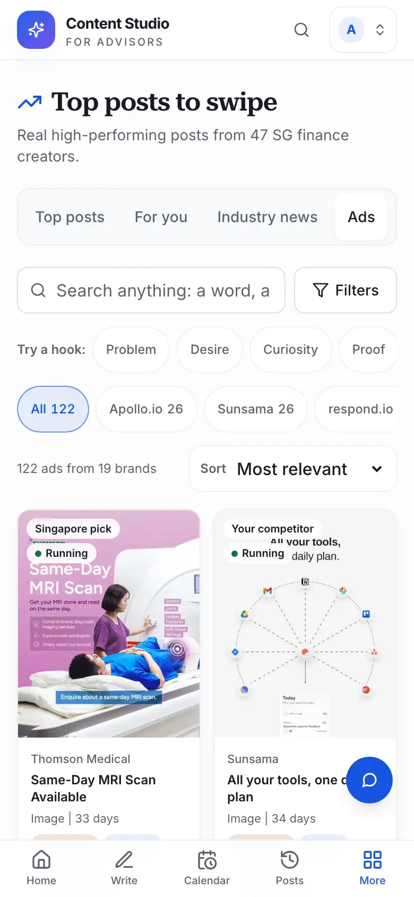 | 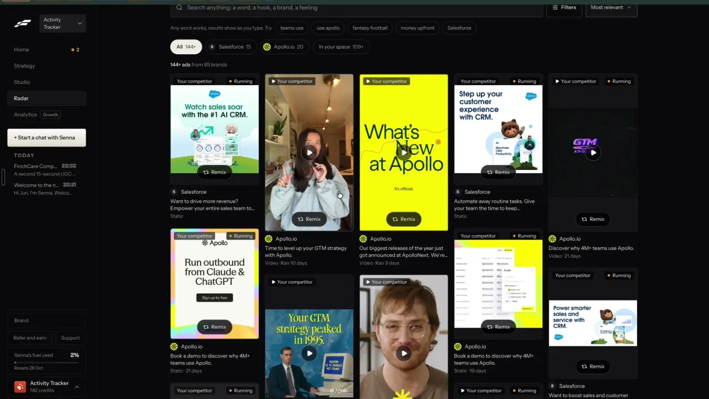 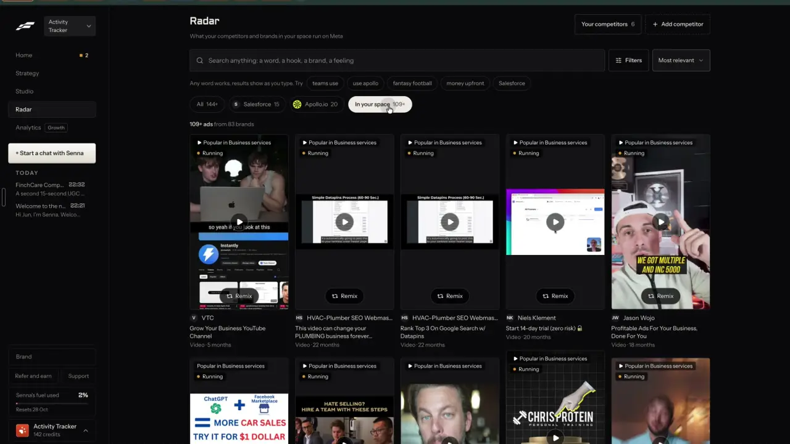 |
| Ad drawer | 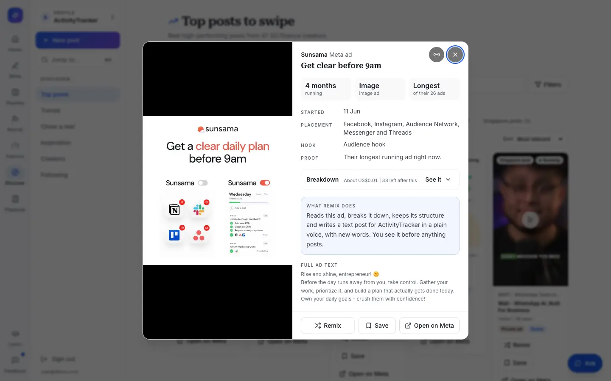 | |  |
| Their posts | 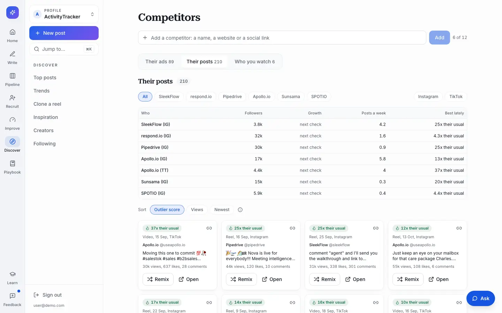 | | |
| Who you watch and Suggest | 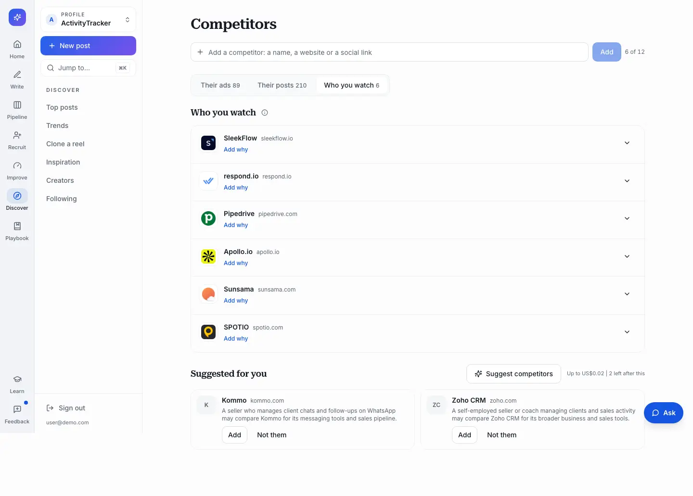 | | |
| Remix sheet | 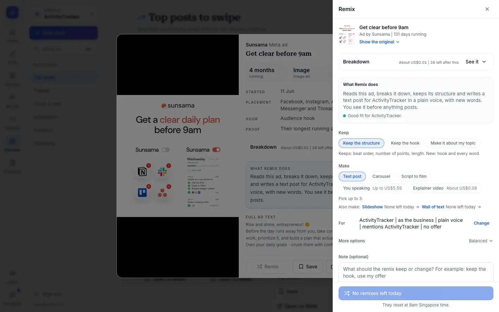 | |  |

Round 2 reloads the browser state saved at /private/tmp/claude-501/-Users-leo-Documents/09d7ec9a-aa1f-464a-b80f-0a08336e13c4/scratchpad/dogfood2/round1-state.json (open with ?asLeo=1 again, since that flag lives in the tab).
