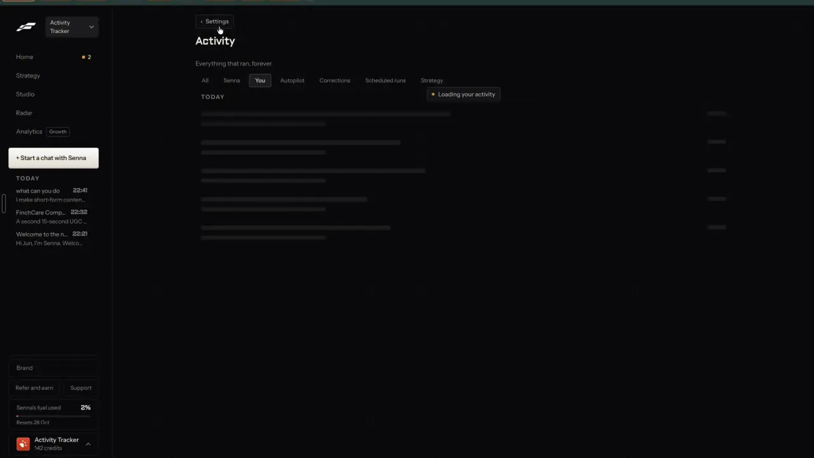

# Everything that ran

`agent-activity` | agent | phase 6 | status: partial | /north-star#agent-activity

## Leo asked

No direct ask; from the competitor research.

## How the best do it

Fastlane keeps one log for the whole workspace at Settings > Activity, reached from the Settings index or from "All activity >" in the right-hand Your work panel (notes-4, 2.13 and 2.16).

- Title "Activity", sub "Everything that ran, forever.", a back button "< Settings".
- Filter tabs: "All" (default), "Senna", "You", "Autopilot", "Corrections", "Scheduled runs", "Strategy". Switching tabs shows the chip "Loading your activity" over skeleton rows.
- The table has four columns, "WHEN", "WHAT HAPPENED", "WHO" and "DETAILS", grouped under "TODAY" and "EARLIER", and the WHO column is a grey pill that reads "You", "Credits" or "Blitz" (apparently their older generator; the rows say "Carried from classic"), while hovering a row brings up "Details >" at the far right (seen on the "Goal set" row in t342). The Settings tile for this page reads "Activity" / "Everything that ran, and who ran it." (t346).
- Rows read like receipts. "5 min ago" | "Plan added: Sales-oriented self-employed professionals and coaches | October" | "You" | "5 angles, 1 account, 1 a day each for 1 month, 28 posts. 24 templated, 4 generated..."; "14 min ago" | "Paid for a video" | "You" | "210 credits | Talking Head UGC: UGC content creation for..."; "15 min ago" | "Competitor added" | "You" | "Added Finch to your competitors..."; "10 min ago" | "Learning recorded" | "You" | "For future AI UGC content, generally use Asian creators."
- The credit ledger sits in the same list: "Plan credits added" "250 credits | Added with the plan", "Paid for an image" "4 credits | From the credit balance", "Credits added" "100 credits | Added to the credit balance." The rows add up to the balance on screen (10 + 250 - 4 - 4 + 100 - 210 = 142).




Others:

- InVideo shows the credits each agent exchange used from a three-dots menu on the message, a "Project Usage" total, and a credit limit per project ([source](https://help.invideo.io/en/articles/14718313-how-credits-are-charged-when-using-ai-agents)).
- Typefully's "Draft Activity" logs every change to a draft with who made it and where it came from ([source](https://typefully.com/changelog)).
- Klap lists an activity log of who clipped what in team workspaces, and full audit logs on Enterprise ([source](https://klap.app/tools/ai-video-clipping-tool)).
- Ocoya keeps a run history for each automated workflow ([source](https://www.ocoya.com/features/workflows)).
- Virlo's recurring research agents log what changed on each run, for example "self-healed: +2 keywords" or "stable" ([source](https://virlo.ai/features/content-research-agent)).

## What we have today

- No page lists what ran. Each piece keeps its own trace, in its own place:
  - AI use: `cs_ai_usage` (migration `supabase/hub/009_ai_usage.sql`) holds one row per user, feature and UTC day with a count. RLS lets a person read their own rows, and `src/lib/aiUsage.ts` (`readUsage`, `useUsesLeft`) reads only today's to show `<n> left today` beside AI buttons. Failed paid jobs give the use back (`refundUsage` in `supabase/functions/_shared/usageCaps.ts`), so counts are net. The same table holds `claimOnce` rows (keys with a colon, such as `refund:<token>` from ai-video and `market-check:<profile>`) and, on Leo's account 13b28b1d (`GLOBAL_COUNTER_USER`), the across-everyone `-global` counters. This is the closest thing to a credit history, and nothing shows past days.
  - The assistant dock keeps its chat on the device only (`fb_asst_<board key tail>` in localStorage, last 20 messages), in `src/components/feedback/AssistantDock.tsx`, a copy of the feedback-board repo's file. Confirmed acts (`src/lib/assistantActs.ts`: move and paste carry Undo, write hands over to Write) leave no other record.
  - Team review keeps an append-only audit trail (`cs_review_events`, SQL 011 to 014). Leaders see it as the `Audit trail` card on `/team`, with a CSV download (`src/components/team/AuditTrail.tsx`, mounted in `LeaderView.tsx`). It is the one existing activity table in the app and the layout to copy.
  - Auto-DM shows a log of who got each DM (`/recruit/auto-dm?log=`), behind the social allowlist.
  - Drafts Claude saves through MCP land as `content-studio-mcpdraft-claude-sNN-<scope>` rows and are absorbed into My posts by `absorbClaudeDrafts` in `src/lib/draftHistory.ts`, which then removes the rows. Nothing in the UI says where they came from; only the `claude-` id prefix does.
  - The notify sent log `cs_notify_sent` is service-role only and pruned after 90 days.
- Not built yet: agent-chat (`/agent` threads, `AgentDock`) and agent-approvals (ActionCards and receipts) are specs. This item logs their acts once they ship; until then it logs the dock's acts.
- Long AI jobs run outside React with listeners: `onImageJob` in `src/lib/aiImage.ts` (states working, saving, done, failed) and `onAiJob` in `src/lib/aiVideo.ts` (kinds presenter, avatar, explainer, template; states working, done, failed).
- Gate pattern: `/north-star` sits in the home nav section with `owners: LEO_EMAILS` (`src/lib/leoOnly.ts`).

## Build

Gate with `leoOnly(email)`: the nav entry carries `owners: LEO_EMAILS`, and `ActivityPage` renders `NotFoundPage` for anyone else. Logging is gated too, so nobody else gets new synced rows: `ActivityRecorder` calls `setActivityOn(leoOnly(email))` once the session's email is known, and `logActivity` returns at once while that flag is off.

Files:

- New `src/lib/activity.ts`: types, `setActivityOn`, `logActivity`, `loadActivity`, `absorbActivityInbox`, `deviceTag`, `groupByWhen`, `whenWords`, `aiUseRows`, `ACTIVITY_VIEWS`.
- New `src/pages/ActivityPage.tsx`.
- New `src/components/ActivityRecorder.tsx`, mounted once in `src/pages/StudioLayout.tsx` beside `<AssistantMount />`: subscribes to `onImageJob` and `onAiJob` and logs only a change from working (or saving) to done or failed, remembering the last state it saw. Both stores re-emit the same state (a failed "Fix it" sets the picture back to `done` with `fixError`), so a repeat never logs twice. A finished fix logs `Fixed a picture`; a failed fix logs nothing, since the picture before it stays.
- `src/App.tsx`: lazy route `/activity`. `src/lib/nav.ts`: `{ to: "/activity", label: "Activity", icon: History, owners: LEO_EMAILS }` in the home section after North star. `src/lib/nav.test.ts`: add `/activity` to its routes list. `src/lib/jumpTo.ts` KEYWORDS: `"/activity": "log history what ran usage credits"`. `src/lib/links.ts`: `activity({ view, month, event })`. `docs/deep-links.md`: the rows below.
- Calls to `logActivity` in: `src/lib/assistantActs.ts` (each `run` and each `undo`, which agent-approvals' cards also call), `absorbClaudeDrafts` in `src/lib/draftHistory.ts`, `src/components/PostItForMe.tsx` (after `schedulePost`, `cancelPost`, `retryPost` succeed or fail), `src/pages/ConnectPage.tsx` (link made, link turned off). Items that ship later log their own events: remixes (remix-everywhere), competitors (find-competitors), learnings (agent-memory), plans and goals (plan-campaign, plan-goal), skills and scheduled runs (agent-skills, agent-autonomy), autopilot drafts (plan-autopilot). A make started from the agent chat is logged once, where its job runs (the remix job, or `ActivityRecorder` for pictures and videos), so agent-chat adds no logging of its own.

### Screens and states

```
Activity
[All] [Agent] [You] [Claude] [Scheduled runs] [Learnings] [Plan] [AI use]

WHEN        WHAT HAPPENED                         WHO         DETAILS
TODAY
5 min ago   Moved "3 CPF myths at 55"             Agent       To Tue 21 Oct, 9am.          Open >
12 min ago  Made a picture                        You         Hawker centre at dusk, ...   Open >
YESTERDAY
9:14 pm     Added a draft: "Why I stopped..."     Claude      Saved as a draft in My posts. Open >
SEPTEMBER 2026
...
                       [Show August 2026]
```

- Tabs are `ACTIVITY_VIEWS`. A tab shows only when the loaded months hold at least one event for it; All and AI use always show. The tab row scrolls sideways inside its own box at 390 px.
- Loading: the page reads local data, so rows draw at once. The AI use tab fetches; while it does, the chip `Loading your AI use` sits over 5 skeleton rows.
- Rows: WHEN comes from `whenWords(at, now)`, which gives "just now", "5 min ago" or "3 h ago" for today, "9:14 pm" for yesterday and "Mon 13 Oct" for anything older, with the full date and time in `title`. The WHO pill reads `You`, `Agent`, `Claude`, `Autopilot` or `Scheduled`, and DETAILS clamps at 2 lines with `More` to open the rest. A row with a `link` ends in `Open >`, always visible and 44 px tall on touch, which goes to the thing it names.
- At 390 px each row stacks: title, then the WHO pill and WHEN on one line, then details.
- Groups: `Today`, `Yesterday`, `Earlier this month`, then one per month (`September 2026`).
- Older months: the page loads the current and last month. `Show <Month YYYY>` loads one more month, and the button disappears when no older month holds events, replaced by `That's everything.`
- `?event=<id>` scrolls to that row, opens its details and gives it a ring for 2 seconds.
- Empty (All, nothing logged): `Nothing here yet. What you make, schedule or ask the agent to do shows up here.` with the button `Write a post` (`/generate`).
- Empty filtered tab (reached by link): `Nothing from <who> yet.` with `Show everything` (clears `view`).
- AI use tab: a table `Day` | `What` | `Uses` | `Daily limit` for the last 30 days, newest first, from `cs_ai_usage` (`select feature, day, count` where `day >= today - 29`). Rows come from `aiUseRows`: labels from `AI_USE_LABELS` (one plain label per `DAILY_LIMITS` key, such as `Pictures` for `ai-image`), and rows whose feature ends in `-global` or holds `:` are dropped (Leo's account 13b28b1d also holds the across-everyone counters and the `claimOnce` rows). When business-cost-preview ships its price table, a `Cost` column shows `about US$<x>` per row.
  - Under the table: `Counts reset at 8am Singapore time. Failed jobs give their use back, so they are not counted.`
  - Failed read: `Couldn't read your AI use.` with `Try again`.
  - No rows: `No AI used in the last 30 days.`

### Copy

- Page title and h1: `Activity`. Tab title `Activity - Content Studio`.
- Tabs: `All`, `Agent`, `You`, `Claude`, `Autopilot`, `Scheduled runs`, `Learnings`, `Plan`, `AI use`.
- Event titles written by this item (others add their own in the same shape: past tense, what changed, the thing's name in quotes):
  - Agent move: `Moved "<title>"` or `Scheduled "<title>"`, details `To <Tue 21 Oct, 9am>.`, link `/calendar?post=<id>`; pressing its Undo logs `Undid the move of "<title>"` as `You`.
  - Agent write: `Opened "<title>" in Write to rewrite`, with the ask clipped to 160 characters as details and `/generate?draft=<id>` as the link.
  - Agent paste: `Pasted into Reply drafts > <name>`, linking to the Engage path it pasted into.
  - Claude draft: `Added a draft: "<hook>"` with `Saved as a draft in My posts.` or `Scheduled for <Tue 21 Oct, 9am>.`, timed at the entry's `createdAt` rather than the moment it was absorbed, and linked to `/generate?draft=<id>`. The event id is the draft id (`claude-<base36>`, never a uuid), so two devices absorbing the same row, or agent-mcp-api's server-written row for the same draft, still make one event.
  - Picture: `Made a picture` with the prompt clipped to 120 and a link to `/media?folder=AI%20images`, or `A picture could not be made` with the job's error when it fails.
  - AI video, by kind: `Made an avatar video`, `Made an explainer video`, `Made a template clip` or `Made a presenter picture`, linked to `/edit`; a failure reads `The <avatar video> could not be made` with `<error> Your use was given back.`
  - Post it for me: `Set "<title>" to post on <LinkedIn, Instagram>` with `Goes out <when>.`, then `"<title>" could not be posted` with the error, or `Cancelled posting "<title>"`.
  - Connect Claude: `Made a Claude connection link` and `Turned off a Claude connection link`, both linked to `/connect`.

### Data

```ts
export type ActivityWho = "you" | "agent" | "claude" | "autopilot" | "schedule";
export type ActivityKind = "post" | "make" | "remix" | "brand" | "learning" | "plan" | "run" | "connect";
export interface ActivityEvent {
  id: string;        // "a" + Date.now().toString(36) + 4 random [a-z0-9], or the source's own id when it has one (a Claude draft's); never a uuid (cloudSync reads a uuid as a user id)
  at: string;        // ISO time
  who: ActivityWho;
  kind: ActivityKind;
  title: string;     // up to 120 characters
  detail?: string;   // up to 300
  link?: string;     // same-origin path only, checked like the dock's go chips
  uses?: { feature: UsageFeature; n: number }; // a paid use, for later cost rows
}
```

- Events live per brand, per month, per device: `content-studio-activity-<YYYY-MM>-<device>-<scoped(uid)>`, a JSON array newest first, at most 1,000 events (the oldest drop). `<device>` is 6 characters `[a-z0-9]` made once and kept in the device key `cs-device-tag`. Each device writes only its own row, so two devices never overwrite each other's events under cloudSync's last-write-wins. `loadActivity` merges every device's row for the months asked, de-duplicates by `id` and sorts by `at`.
- Server-written events (scheduled runs, MCP calls) arrive as insert-only rows `content-studio-activityin-<id>-<scope>`, the shape the MCP inbox uses. `absorbActivityInbox` moves them into this device's month row on load and removes the inbox rows; a copy that syncs back later is dropped by the `id` check.
- Views map: `agent` = who agent; `you` = who you; `claude` = who claude; `autopilot` = who autopilot; `schedule` = who schedule; `learnings` = kind learning; `plan` = kind plan; `ai-use` = the table.
- Nothing here needs a table or a migration: the AI use tab reads the `cs_ai_usage` rows each person may already read.

### AI and cost

None. No model call, no Jev question, no cap: the page reads local rows and one existing table.

### Deep links

- `/activity?view=<all|agent|you|claude|autopilot|schedule|learnings|plan|ai-use>` (replace; default `all`, left out of links).
- `/activity?month=YYYY-MM`: loads back to that month and scrolls to its group (replace).
- `/activity?event=<id>`: opens that event's row (push, so Back closes it). Items that link to one event (skills results, the Your work panel in publish-library) use `links.activity({ event })`.
- Rows in `docs/deep-links.md` under the settings pages.

## Done when

- [ ] `/activity` shows for Leo's two sign-ins only; a typed URL on another account shows the 404 page.
- [ ] Confirming each agent act (move, write, paste) and its Undo adds a row with the right WHO pill and an `Open` link that lands on the thing.
- [ ] A draft added from Claude Code with `add_draft` shows as a `Claude` row at the time Claude saved it, once, even after a second device syncs.
- [ ] A picture and an AI video (done and failed) each log one row, also when the user left the page during the job.
- [ ] Two browsers signed in to the same account each log events and both sets show on either device after sync.
- [ ] `Show <Month>` reaches the oldest month and ends with `That's everything.`
- [ ] The AI use tab lists the last 30 days with no `-global` or `:` rows on Leo's 13b28b1d account.
- [ ] `?view=`, `?month=` and `?event=` work from a pasted link.
- [ ] 390 px and 1440 px checked by eye; no page overflow; tab row scrolls in its box.
- [ ] `npm run build` and the full `npx vitest run` pass; the item flips in `src/data/northStar.ts`.

## Tests

`src/lib/activity.test.ts` (node, fake localStorage):

- `logActivity` writes nothing while `setActivityOn(false)`; once on, it writes to `content-studio-activity-<YYYY-MM>-<device>-<scope>` with the device tag from `cs-device-tag`, newest first, and keeps 1,000.
- `loadActivity` merges two device rows and two months, drops duplicate ids, sorts by `at`.
- `absorbActivityInbox` moves inbox rows into the month row, removes them, and ignores an inbox row whose id is already logged.
- An event with a link that is not a same-origin path (`https://x`, `//x`, `/\x`) is stored without the link.
- `groupByWhen` puts events under Today, Yesterday, Earlier this month and month names around midnight and month ends.
- `whenWords` gives "just now", "5 min ago", "3 h ago", "9:14 pm", "Mon 13 Oct".
- `aiUseRows` drops `ai-video-global`, `market-check:pabc` and `refund:abc` rows, and labels the rest; every key of `DAILY_LIMITS` has an entry in `AI_USE_LABELS`, so a new cap cannot ship without a label.
- `src/components/ActivityRecorder.test.tsx` (fake job stores): working then done logs one row; done emitted twice logs one; a failed fix that re-emits `done` logs nothing.
- Filters: each view returns only its events.
- `src/lib/assistantActs.test.ts` (extend): confirming a move logs one agent event and its undo logs one you event.
- `nav.test.ts` and `navRoutes.test.ts` stay green with `/activity` added and owner-gated.

## Open questions

- "Forever" on synced rows: about 300 bytes an event, so a busy month is a few hundred KB, and cloudSync pulls every row at sign-in in one unpaged select (`supabaseBackend` in `src/lib/cloudSync.ts`), so the log also adds two or three rows a month to that pull. A `cs_activity` table (insert-only, RLS read own) would scale better; that is a schema change, so Leo decides. Recommendation: ship on rows, and move to a table if Leo's own rows pass 2 MB.
- Should the page show every brand at once? It shows the active brand today (AI use is account-wide, since the counter is per account). Leo decides; one brand keeps it simple.
- When business-credits ships, the AI use tab becomes the credit ledger (credits added, paid for, refunded). That item owns the wording and the balance.

## New evidence (20 Oct 2026)

Settings > Activity with the Strategy, Scheduled runs, Corrections, Autopilot, You and All filters, and the goal panel's "All 15 changes": [settings notes](../videos/fastlane-2026-10-20-settings/notes.md).

## Related

agent-chat, agent-approvals, agent-memory, agent-budget, agent-autonomy, agent-skills, agent-mcp-api, publish-library, plan-autopilot, business-credits, business-cost-preview, trust-archive
