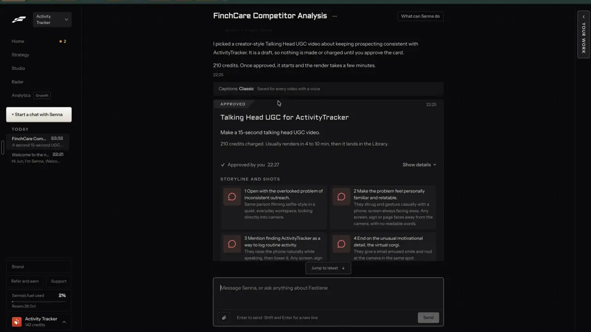
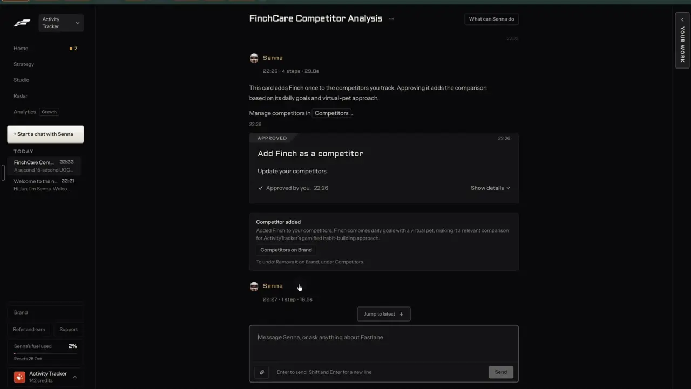

# Approve before it spends

`agent-approvals` | agent | phase 6 | status: partial | /north-star#agent-approvals

## Leo asked

No direct ask; from the competitor research.

## How the best do it

Fastlane routes every side effect through a card in the chat: a paid make, a data change (adding a competitor) and a saved preference (notes-4.md 2.3). Senna writes a line first, then the card. On the video card the line was "I picked a creator-style Talking Head UGC video about keeping prospecting consistent with ActivityTracker. It is a draft, so nothing is made or charged until you approve the card." / "210 credits. Once approved, it starts and the render takes a few minutes."

A settings row sits above that card: "Captions: Classic   Saved for every video with a voice". The card itself reads, top to bottom:

- a tab "APPROVED" with the proposal time "22:25" on the right
- the title "Talking Head UGC for ActivityTracker" and the line "Make a 15-second talking head UGC video."
- price and wait: "210 credits charged. Usually renders in 4 to 10 min, then it lands in the Library."
- "Approved by you 22:27" with a check, and "Show details" on the right
- "STORYLINE AND SHOTS": four numbered beats, each with a shot direction, such as "1 Open with the overlooked problem of inconsistent outreach." / "Same person filming selfie-style in a quiet, everyday workspace, looking directly into camera." Shots 2 and 3 add "Any screen, sign or page faces away from the camera, with no readable words."
- footer buttons "Change the script" and "Try another format", greyed once approved, with a not-allowed cursor on hover (t272)




After a data change, a receipt follows the card: "Competitor added" / "Added Finch to your competitors. Finch combines daily goals with a virtual pet, making it a relevant comparison for ActivityTracker's gamified habit-building approach." / a button "Competitors on Brand" / "To undo: Remove it on Brand, under Competitors." A learning's receipt says "To undo: Say undo in chat to remove it." Every receipt says how and where to undo (notes-4.md 2.4). Senna also de-duplicated a repeated name: "This card adds Finch once to the competitors you track."



Only approved cards were on screen in the recording, so the pending card's buttons and wording are unknown (notes-4.md open question 1). The campaign flow uses the same rule on a page. Strategy's campaign card reads "Press Start to review the schedule and cost. Nothing posts or is charged until you approve it." (notes-4.md 2.11, t290), and the wizard's last step says "Start then shows the schedule and cost for your approval" (notes-1.md F5.5).

Others:

- InVideo lets you choose when its agent may spend: "Always allow" (the default), "Ask before generating videos" or "Always ask before generating". The approval popup shows the prompt, model, duration and aspect ratio, all editable before you confirm, and a credit limit can be set per project. [help](https://help.invideo.io/en/articles/14718313-how-credits-are-charged-when-using-ai-agents)
- Kapwing's Kai returns a storyboard to change script, b-roll, aspect ratio and voice-over before generating, with a credit estimate; failed jobs are refunded. [help](https://www.kapwing.com/help/ai-video-generator)
- OpusClip's Agent Opus prices each edit separately and quotes it before approval; failed generations release reserved credits. [faq](https://help.opus.pro/agent-opus/article/ao-faq.md)
- HeyGen's Video Agent shows a scene-by-scene preview before render. [video-agent](https://www.heygen.com/video-agent)
- PostNitro's chat drafts an outline and waits for approval before it edits slides. [postnitro](https://postnitro.ai/)
- Revid.ai shows an estimated cost before every render. [pricing](https://revid.ai/pricing)

## What we have today

- The dock's confirm card (`src/components/feedback/AssistantDock.tsx`): `DockAct` `{ ask, yes, run }` shows one sentence with a primary button and "Cancel", and Cancel answers "Nothing changed." `run` returns `{ done, open?, go?, undo? }`. A `run` that throws shows "That did not work: <reason>", and an Undo that throws shows "Couldn't undo that. Change it back on the page." The card and its Undo chip live in React memory only, so a reload loses both; only one card exists at a time, and sending a new message drops a waiting card.
- The acts that use it (`src/lib/assistantActs.ts`) move a post (undo through `restoreDraft`, Calendar's own), open Write with a rewrite (Write's Use this and Discard are the undo), or paste into Reply drafts (undo restores the old paste), and none of them spends money. A move refuses posts marked posted and posts already queued in Post it for me, with a line pointing to My posts.
- Paid buttons outside the chat show their price and uses left before running: AiVideo shows "N Higgsfield credits (about US$X)" and "<n> left today" (`src/components/AiVideo.tsx`, `CREDIT_USD` 0.0625 in `supabase/functions/ai-video/logic.ts`), and `useUsesLeft` (`src/lib/aiUsage.ts`) feeds the other AI buttons. The server is the last word: `consumeUsage` fails closed and `refundUsage` gives a use back when a paid job fails.
- Missing: a card with a price, a plan to read and edit before approving, a kept approved state with time and "by you", receipts that survive a reload, and undo instructions for things undone elsewhere.

## Build

Gate with `leoOnly(email)`; cards render only in the agent (agent-chat). Everyone else keeps today's dock card.

Files:

- `src/lib/agentCards.ts` holds the pure parts: `needsCard(pick)`, the card builders per kind, `priceLine`, `canEdit(card)`, `approve(card, budget)` and `runUndo(userId, undo)`.
- `src/components/agent/ActionCard.tsx` and `src/components/agent/Receipt.tsx` draw them inside agent-chat's `AgentThread`, and agent-chat's `src/lib/agentRun.ts` runs an approved plan through the makers that already exist.

### When a card is needed

`needsCard` returns true when the action:

1. spends from a prepaid pool or a paid API beyond one text call: an AI video, an AI picture, an AI clip, a voiceover, a competitor look-up;
2. changes something already saved: a post's day or time, the competitor list, a learning (brand-voice-memory's remember) or a brand field.

agent-autonomy's "Do it, then tell me" switch lets a sure move (and later a picture) skip its card, so `needsCard` takes that setting as an argument and returns false when it applies.

No card for a new draft written by the LLM (text post, carousel, script). It only adds, costs about a cent, and its receipt carries an Undo that deletes it. Undo and forget (agent-memory) run at once too, because they put something back and show their own Undo. Nothing in this phase posts to a network; Post it for me stays its own dialog.

### Screens and states

A paid video card, proposed:

```
Here's the script. Nothing is made or charged until you approve it.

+-- PROPOSED ------------------------------------------ 22:25 --+
| Talking video: "Most people never check what CPF LIFE..."     |
| A 20-second video of you saying this script.                  |
| About US$3.44 | about 55 Higgsfield credits | 1 of 2 videos left today
| It takes a few minutes and opens in the video editor.         |
| SCRIPT                                                        |
|  1  Most people never check what CPF LIFE will pay them.      |
|  2  Here's where to see your own estimate.                    |
|  3  ...                                                       |
| Show details v                                                |
| [Approve and make | About US$3.44]  [Change the script]       |
| [Try another format]  [Not now]                               |
+---------------------------------------------------------------+
```

"Show details" opens rows: "Who appears" (Your face, or "AI presenter, labelled on the post" until people-my-face ships), "Voice" (the brand's saved voice, else Alice, the first of the 7 premade voices in `VOICES`, `supabase/functions/text-voice/logic.ts`, with a select of all 7), "Length" ("about 20 seconds", from the script), "Made with" ("Higgsfield Speak and ElevenLabs"), and, once agent-memory ships, "Following" with up to 2 learnings that shaped it.

The card's states:

- `proposed`: tag "PROPOSED", all buttons live. Approve is the one primary button, and a paid card's Approve carries its price: "Approve and make | About US$3.44".
- Editing the script: "Change the script" turns the lines into one text box (70 words at most, with a counter), with "Save" and "Cancel". Save re-estimates the length at 2.5 words a second, cuts it into slices of at most 9.5 seconds (`MAX_SLICE`) and prices them with `avatarCredits`. The real length is only known once the voiceover exists, after Approve, so the card says "About" and the receipt shows what was used. Typed text lives in `sessionStorage` key `cs-agent-card-<cardId>` until Save or Cancel.
- Another format: "Try another format" shows the format chips from remix-any-format; picking one writes it again (one more `remix-make` use) and replaces the card. A free format turns the card into a MADE block and a receipt.
- `starting`: Approve reads "Starting..." and every button on the card is disabled, within 400 ms of the press.
- `approved`: tag "APPROVED", the line "Approved by you 22:27" with a check. Edit buttons stay visible but disabled, with the title "Approved. Ask for a new one to change it." The job's step line runs under the card ("Making the voiceover...", "Making your video, 1 of 2 parts ready"), then the MADE block (agent-chat) and the receipt.
- `declined` ("Not now", or "no" typed while it is the only proposed card): tag "NOT MADE" and the line "Nothing was made or charged."
- `failed`: tag "DIDN'T GO THROUGH", the job's error, then "Your use was given back." (ai-video refunds today), with "Try again", which goes back to `proposed` with the price re-read.
- Approve blocked (agent-budget): the primary button is disabled and the reason shows under it: "No AI videos left today. Back at 8am Singapore time.", "No AI pictures left today. Back at 8am Singapore time." (a talking video that needs a new AI presenter uses one `ai-image`) or "Another video is being made. Approve this one when it's done." The check runs on render and again on press, since a card can sit for a day.

Other cards use the same frame and fewer parts:

| Kind | Title | Line | Price line | Buttons |
| --- | --- | --- | --- | --- |
| explainer | "Explainer video: <hook>" | "<n> pictures with your voiceover, about <s> seconds." | "About US$0.05 \| 1 of 2 videos left today" | "Approve and make \| About US$0.05", "Change the script", "Not now" |
| image | "Picture: <first 40 characters>" | "One picture, 3:4, saved to Media under AI images." | "About US$0.01 \| 4 of 5 pictures left today" | "Approve and make \| About US$0.01", "Change the prompt", "Not now" |
| competitor | "Add <name> as a competitor" | "<site or @handle>" | none | "Add them", "Not now" |
| move | "Move \"<title>\"" | "To <Tue 21 Oct, 8pm>." | none | "Move it", "Not now" |
| learning | brand-voice-memory's "Remember this for your <posts \| videos \| pictures \| posts, videos and pictures>?" | the user's own sentence, and "This replaces: \"<old>\"" when its conflict check finds one | none | "Remember", "Not now" |

The line the agent writes before each card is a template: video "Here's the script. Nothing is made or charged until you approve it.", explainer the same, image "Here's what I'd make. Nothing is made until you approve it.", competitor "This adds <name> once to the competitors you track." (the name is checked against the list first, as Fastlane does), move and learning none.

Receipts (one bordered box under the card or the MADE block):

| After | Title | Line | Button | Undo |
| --- | --- | --- | --- | --- |
| A free draft | "<Format> written" | "<hook>. It's in My posts." | "Open" | Undo: deletes the draft and its saved carousel |
| A video | "Video made" | "<hook>. It used <n> Higgsfield credits, about US$<x>." | "Open in the video editor" | "Paid makes can't be undone. Delete the draft in My posts if you don't want it." |
| A picture | "Picture made" | "Saved to Media under AI images." | "Open Media" | same as video |
| Competitor | "Competitor added" | "<name> is on your list." | "Competitors" | Undo: removes it |
| Move | "Moved" | "\"<title>\" now goes out <when>." | "Open Calendar" | Undo: restores the post as it was |
| Learning | "Learning recorded" | agent-memory | "See what the AI has learned" | Undo: switches it off |

After Undo the button becomes "Undone." If the thing changed since (the post was moved again, the competitor already removed), Undo says "It changed since. Change it on <page>." and does nothing.

Typed approval: when exactly one card in the thread is `proposed`, a message such as "yes go ahead" or "not now" acts on it (the `approve` and `decline` acts below). It runs the same checks as the button and shows the same states. With two or more proposed cards the message is treated as a new request.

### Copy

All strings above are exact. The rest:

- Tags: "PROPOSED", "APPROVED", "NOT MADE", "DIDN'T GO THROUGH"
- "Approved by you <HH:MM>", "Show details", "Hide details", "Who appears", "Voice", "Length", "Made with", "Following"
- "Approve and make | <price>" (paid cards; competitor and move cards use "Add them" and "Move it" from the table), "Starting...", "Change the script", "Change the prompt", "Try another format", "Not now", "Save", "Cancel", "Try again"
- "Approved. Ask for a new one to change it."
- "Nothing was made or charged.", "Your use was given back."
- "Undo", "Undone.", "It changed since. Change it on <page>.", "Couldn't undo that. Change it back on <page>."

Prices are always US$ with the Higgsfield credits beside them, formatted by `priceLine`. Where no script exists yet (the Remix composer, the budget answer) it reads "Up to US$5.50 | 88 Higgsfield credits". On a card it is the estimate from the script, such as "About US$2.75 | about 44 Higgsfield credits", and the receipt then gives the real figure from the job; the cheap ones read "About US$0.05" and "About US$0.01".

### Data

Cards and receipts live inside the thread messages (agent-chat's `content-studio-agent-threads-${scoped(userId)}`), so they survive a reload and show on both devices:

```ts
type AgentCard = {
  id: string; kind: "video" | "explainer" | "image" | "competitor" | "move" | "learning";
  title: string; line: string; script?: string[]; prompt?: string;
  details?: { label: string; value: string }[];
  price?: { credits?: number; usd: string; needs: { feature: UsageFeature; n: number }[] };
  plan: Record<string, unknown>;   // what the run needs: draft id, as, voice, look, competitor fields
  status: "proposed" | "starting" | "approved" | "declined" | "failed";
  proposedAt: string; decidedAt?: string; error?: string;
};
type Receipt = {
  title: string; line: string; button?: { label: string; path: string };
  undo?: { kind: "delete-drafts"; ids: string[] } | { kind: "restore-draft"; draft: DraftEntry; was: string }
       | { kind: "remove-competitor"; id: string } | { kind: "learning-off"; id: string };
  undoText?: string;               // the "can't be undone" or "change it on" line
  undone?: string;                 // ISO time
};
```

`runUndo` works from the stored payload, so Undo still works after a reload or on the other device, and `restore-draft` checks that the post's `scheduledFor` still equals `was` before it restores anything. This needs no new key and no table.

### AI and cost

- The card adds no AI of its own. Its words are templates, and the script on a video card is the remix job's output (remix-any-format, `remix-make`).
- "Try another format" spends one more `remix-make` use, and the button says so in its title: "Writes it again: 1 of your 30 remixes today."
- Approve runs the paid step on its existing caps: video `ai-voice`, `ai-video`, `ai-video-global`; picture `ai-image`; competitor `competitor-read` (find-competitors). Failed jobs refund through the existing `refundUsage` paths.
- Two Jev acts in agent mode, criteria sent only when `pending` is set (exactly one proposed card):
  - `approve`: "Say yes to the proposal waiting for them, `pending`: approve it, go ahead, do it, make it."
  - `decline`: "Say no to the proposal waiting for them, `pending`: not now, cancel it, don't make it."
  - APPROVE_MIN 0.8, higher than ACT_MIN because it spends money; `decline` at ACT_MIN 0.6. Below either, the message is a new request. Comment: `// shortcut: thresholds not read off real replies; check 30 of Leo's yes and no messages before trusting them.`
- No new cap; the Jev call is the turn's existing `agent-act` use.

### Deep links

- A card or a receipt: `/agent/<threadId>?m=<msgId>` (agent-chat), which scrolls to it and rings it for 2 seconds. agent-home's Next up and agent-activity link here.
- "Show details" open state is not a view worth a URL; it resets on reload.

## Done when

- [ ] A talking-video request shows a PROPOSED card with the script, the estimated price on its line and on Approve, the credits and the uses left; the network panel shows no ai-video, ai-image or text-voice call before Approve.
- [ ] Editing the script to 40 words updates the price line to "About US$2.75 | about 44 Higgsfield credits", and the edit survives leaving the page before Save.
- [ ] Approve shows "Starting..." within 400 ms, then APPROVED with "Approved by you <time>", the step line, the MADE block and a "Video made" receipt.
- [ ] A forced failure (stubbed `callFn` on a branch) shows DIDN'T GO THROUGH and "Your use was given back.", and `cs_ai_usage` shows the use returned.
- [ ] With 0 videos left, Approve is disabled with its reason, and no paid call can start from the card.
- [ ] "yes go ahead" with one proposed card approves it; with two proposed cards it does not.
- [ ] Undo on a free draft, a competitor and a move each work after a page reload; a move made again by hand makes Undo say "It changed since. Change it on Calendar."
- [ ] 390 px and 1440 px checked by eye; card buttons wrap and stay 44 px on touch.
- [ ] Build and the full vitest pass; the item flips in `src/data/northStar.ts`.

## Tests

- `src/lib/agentCards.test.ts`:
  - `needsCard`: true for speaking, explainer, image, competitor, move, remember; false for post, carousel, script, forget and undo.
  - `priceLine`: no script with 1 of 2 left gives "Up to US$5.50 | 88 Higgsfield credits | 1 of 2 videos left today"; a 40-word script (16 s, slices 9.5 and 6.5) gives "About US$2.75 | about 44 Higgsfield credits"; a 20 s script (slices 9.5, 9.5, 1) gives "About US$3.44 | about 55 Higgsfield credits".
  - transitions: proposed to starting to approved; proposed to declined; approved refuses edits (`canEdit` false); failed to proposed on Try again.
  - `approve` with a budget that is short returns the blocked reason and never calls `run`.
  - `runUndo` for each undo kind against fake stores, including the "changed since" case for `restore-draft`.
- `supabase/functions/assistant-act/logic.test.ts`: `approve` and `decline` criteria appear only with `pending`; approve at 0.79 gives no pick and at 0.8 gives one.
- Break each case once to see it fail.

## Open questions

- Should videos ever skip the card, as InVideo's "Always allow" does? agent-autonomy keeps "Videos and voiceovers" fixed on asking and offers the switch for moves and pictures only. Leo decides if that changes.
- Should the same card appear outside the chat, on the Remix sheet's paid run and plan-campaign-page's Start? remix-any-format runs "You speaking" in one press today. Leo decides; the component is reusable either way.
- Fastlane bans readable screens and signs in its shot directions. Our explainer pictures come from Soul v2; whether its prompts already forbid readable text is not checked here and belongs to formats-faceless-video.

## Related

agent-chat, agent-budget, agent-memory, agent-activity, agent-autonomy, business-cost-preview, remix-any-format, people-my-face, people-presenters, find-competitors, brand-voice-memory, plan-campaign-page, plan-review-queue
