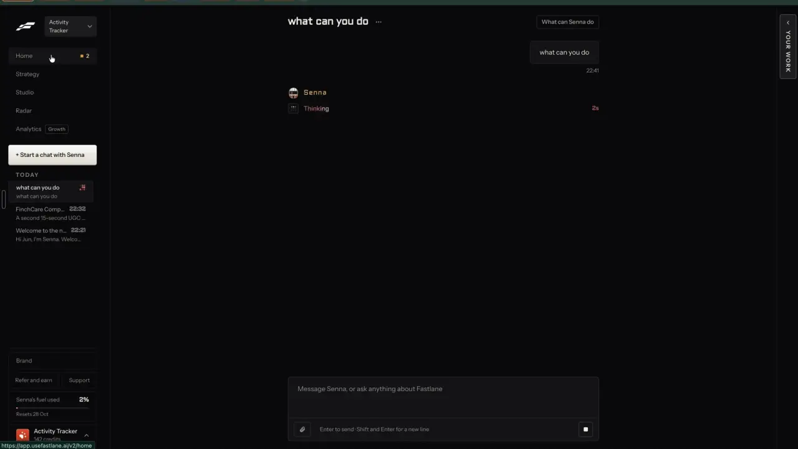

# A chat that makes things

`agent-chat` | agent | phase 6 | status: partial | /north-star#agent-chat

## Leo asked

19 Oct 2026: "the idea is that one can remix any content format and the ai will regenerate". The chat is the second way in: type "remix this into a carousel" or "make a 20-second video about CPF LIFE" and get the finished piece back in the thread.

## How the best do it

Fastlane's agent is called Senna. Any composer in the app opens a thread at `/v2/home/<threadId>`, whether you type on Home, in Studio or after pressing "+ Start a chat with Senna" in the sidebar (notes-4.md 2.2).

A new thread (notes-3.md F11) is titled "Start a chat with Senna" and shows a helmet avatar over the heading "What are we working on?". The composer below it reads "Ask Senna for an ad, a campaign, or anything about Fastlane" and carries a paperclip, four chips ("Image", "Video", "Script", "Campaign") and "Send". Below sit 8 starters under "OR START WITH ONE OF THESE", built from the brand's own audiences and angles: they run from "Make an image for Sales-oriented self-employed professionals and coaches" and "Write a script for Make Consistency Visible" to "How did last week go?" and "Which post did best?".


Run states (notes-4.md 2.2, t302 to t313):

1. Send creates the thread; the agent row reads "Starting".
2. The title renames itself to the first message ("what can you do").
3. "Thinking" with a red timer ("2s", "4s", "8s"). Send turns into a square Stop button. The paperclip still works.
4. "Writing" with its own timer while the answer streams in sentence by sentence. The composer takes typing meanwhile.
5. Done: a meta line "22:41 | 8.1s", or "22:26 | 4 steps | 29.0s" when tools ran. The sidebar row shows the time and the first words of the answer, and an animated dot grid replaces the time while a thread is running.



The answer to "what can you do" was: "I make short-form content, post it, read the numbers, and do more of what worked." / "Here, I can make slideshows and wall-of-text posts, plus images, static ads, clips, and remixes. I can post to TikTok, plan campaigns, manage Meta ads when an ad account is connected, and review results." / "Want a first post made in [Studio]?". "Studio" is a bordered link chip inside the text. A "What can Senna do" button sits top right of every thread.


When a make finishes, a block lands in the thread: "MADE" with the render time "3m 43s", a 9:16 thumbnail with "0:15", the title "Talking Head UGC for ActivityTracker" and "Here it is." A chip at the end of the thread, "Your Talking Head UGC for ActivityTracker is ready", jumps up to it, and the output also goes to Studio > Library (notes-4.md 2.5). "Jump to latest" floats above the composer when you scroll up.


Remix hands off into chat too (notes-3.md F10): "Remix this" on an ad opens a new thread with the ad attached to the composer as a card ("REMIX", thumbnail, title, "Video ad - Newo.ai - Meta - 7 months running", "Show the original", an X to detach), a note box "What should the remix keep or change? For example: keep the hook, use my product", the helper "This remix makes a video, like the original. Remove it to make something else." and the button "Remix, 130 credits". The empty thread says "Charged once, when you press Remix. If the post is a weak fit for you, Senna asks first."

Others:

- Kapwing's Kai answers a prompt with a storyboard (script, b-roll, aspect ratio, voice-over) and a credit estimate before it generates, and you can ask it for a cheaper plan. Since May 2026 a prompt takes more than 10 attached files. [help](https://www.kapwing.com/help/ai-video-generator), [May 2026 notes](https://www.kapwing.com/help/kapwing-release-notes-may-2026/)
- InVideo Agent Two lets you pick Lite, Pro or Ultra per task, and the "..." menu on any message shows the credits that exchange used. [agent-two](https://invideo.io/agent-two/), [credits](https://help.invideo.io/en/articles/14718313-how-credits-are-charged-when-using-ai-agents)
- HeyGen's Video Agent takes a prompt of up to 500 characters plus length and orientation, writes the script, shows a scene-by-scene preview before render, and is refined by conversation. [video-agent](https://www.heygen.com/video-agent)
- Descript's Underlord charges AI credits per prompt plus the cost of each tool it runs, listed under "Underlord" in the Usage tab. It cannot open a URL. [help](https://help.descript.com/hc/en-us/articles/36803785502221-Underlord-beta-Your-AI-co-editor-in-Descript)
- Creatify's agent takes a brief or a URL and has format skills (/ugc, /street-interview, /podcast and more), picked by you or by the agent. [agent](https://creatify.ai/features/agent)
- Arcads' Mark takes a plain brief ("20-second UGC-style ad for our protein bar, 9:16, US audience"), and chat turns are charged by tokens. [help](https://help.arcads.ai/en/articles/17594959-ai-ad-agent-mark)
- Hootsuite's Wisdom drafts posts, briefs, images and captions for review and offers cards such as "Recommend next steps". [wisdom-ai](https://www.hootsuite.com/wisdom-ai)
- Taplio's assistant offers "What's working in my niche" and "Remix my posts that worked" as starters. [taplio](https://taplio.com/)
- For advisers, FMG Suite's Sidekick answers how-to and marketing questions with a hand-off to live help. [fmgsuite](https://fmgsuite.com/features/ai-tools/)

## What we have today

Checked against 08537d1 plus the north-star worktree on 2026-10-20. origin/main is at f2cb275 and none of its 13 newer commits touch the files below.

- The in-app assistant: `src/components/feedback/AssistantDock.tsx`, mounted on every studio page by `src/components/feedback/AssistantMount.tsx` from `src/pages/StudioLayout.tsx`. The dock file is a copy of github.com/leotansingapore/feedback-board's `client/AssistantDock.tsx` (its header says so), so a sync from there overwrites local edits. One floating panel, one thread: the last 20 messages in the device-only key `fb_asst_<last 8 of the board key>`, the unsent text in `..._draft` and the feedback service's thread id in `..._id`. While it waits, a spinner reads "thinking..."; there is no thread list, no timer, no Stop and no step count.
- Before the chat answers, `proposeAct` in `src/lib/assistantActs.ts` sends the message to `supabase/functions/assistant-act` (Jev only through `_shared/jev.ts`, pinned jev-1.13.0, cap `assistant-act` 30 a day, ACT_MIN 0.6, PICK_MIN 0.5). A message that is mostly not English skips Jev and costs nothing. The acts are move, write, week, engage_replies, engage_dms, engage_thread, engage_comment and none. A pick becomes a confirm card (`ask`, `yes`, `run`) with Cancel and an in-memory Undo, or an answer (`say`, `go`). `proposeAct` catches every error, a 429 included, and returns null, so over the cap the chat answers in words.
- Anything else goes to the feedback service (`https://leotan-feedback.vercel.app/api/v1/assistant/chat`, outside this repo) with the last 12 messages. It answers how the app works and returns chips: post to the feedback board, message the team, or open a same-origin page (`runAction` inside AssistantDock).
- What the chat could call to make things. In the repo today: AI video in `src/lib/aiVideo.ts` (`makePresenter`, `sliceVoiceover`, `makeAvatar`, `writeExplainer`, `makeExplainer`, `resumeAvatar`, `onAiJob`, `aiBusy`, `LOOKS`) and AI pictures in `src/lib/aiImage.ts` (`makeImage`, `onImageJob`, `imageBusy`). Specced, not built: the remix job (`src/lib/remixJob.ts`, `supabase/functions/remix`, cap `remix-make`, from remix-everywhere and remix-any-format) and competitors (`addCompetitor` in `src/lib/competitors.ts`, cap `competitor-read`, from find-competitors). None of these four names exist on main yet.
- `callFn` in `src/lib/edgeFn.ts` takes no AbortSignal today. The installed `@supabase/functions-js` 2.105.1 accepts `signal` in `functions.invoke`, so a Stop can be wired with one optional argument.
- Jobs outside React follow `runCheck` in `src/lib/following.ts`: module-level state, a listener set and an `on...` subscribe.
- There is no chat page or `/agent` route yet. The gate helper is `leoOnly(email)` in `src/lib/leoOnly.ts`, which lives in the north-star worktree and is not on origin/main yet.

## Build

Gate everything with `leoOnly(email)`. Everyone else keeps today's dock, acts and copy untouched.

Build after remix-everywhere and remix-any-format (the words and video steps), and alongside agent-approvals (cards and receipts) and agent-budget (the checks before a card). agent-memory and agent-home build on this.

Files:

- `src/lib/agentThreads.ts`: the thread store (below).
- `src/lib/agentRun.ts`: one turn at a time per thread, run outside React like `runCheck` in `src/lib/following.ts`: `send(userId, threadId | null, text, opts)` returns the thread id, `stop(threadId)`, `turnOf(threadId)`, `onAgent(fn)`. It listens to `onRemixJob`, `onAiJob` and `onImageJob` and writes results into the thread, so leaving the page loses nothing.
- `src/lib/assistantActs.ts`: `proposeAct` takes a fourth argument `ctx?: { agent: true; pending?: string; source?: string; chip?: string }` and returns the new kinds below as well as today's two.
- `src/components/agent/AgentThread.tsx`, `Composer.tsx`, `MadeBlock.tsx`, `ThreadList.tsx`. ActionCard and Receipt come from agent-approvals.
- `src/pages/AgentPage.tsx`: routes `/agent` and `/agent/:thread`.
- `src/components/agent/AgentDock.tsx`: the floating launcher and panel for Leo, hosting `<AgentThread compact />`. `AssistantMount` already reads the user; it renders AgentDock when `leoOnly(user?.email)` and AssistantDock otherwise. AssistantDock.tsx is not edited, because it is synced from feedback-board.
- `src/components/agent/dockActions.ts`: a copy of AssistantDock's `runAction` (post to the board, message the team, open a page only when the path matches `^\/(?![\/\\])` and has no `:` or `\`), with a header naming the source file, so the agent renders the feedback service's chips the same way.
- `src/lib/edgeFn.ts`: `callFn` gains an optional fourth argument `opts?: { signal?: AbortSignal }`, passed to `supabase.functions.invoke`, so existing callers keep working untouched.
- Nav: `{ to: "/agent", label: "Agent", icon: MessageSquare, owners: LEO_EMAILS }` in the `home` section of `src/lib/nav.ts`, after North star. Add `"/agent/:thread": "a thread of /agent"` to EXCEPTIONS in `src/lib/navRoutes.test.ts`, and `"/agent": "chat assistant ask make remix"` to KEYWORDS in `src/lib/jumpTo.ts`. The page reads the email with `getSession` as `src/pages/NorthStarPage.tsx` does and renders `<NotFoundPage />` when `!leoOnly(email)`.
- Remix sheet (remix-everywhere): for Leo, a quiet link under the main button, "Ask the agent instead", that opens `/agent?remix=<key>`.

### Screens and states

`/agent` at 1440 px:

```
+--------------------+----------------------------------------------+
| [+ New chat]       |  CPF LIFE carousel  ...      [What can you make?]
| Today              |                                  make a carousel about CPF LIFE
|  CPF LIFE car  .:. |                                                   22:41
|  make a carousel...|  Agent   22:41 | 2 steps | 14.2s
| Yesterday          |  Here's your carousel. It's in My posts.
|  Remix @sgmoney... |  +-- MADE -------------------------- 14s --+
| Earlier            |  | [slide 1]  CPF LIFE pays for life, ...  |
|  ...               |  |            Here it is.        [Open]    |
|                    |  +-----------------------------------------+
|                    |  [ Ask for a post, a remix, a video ... ]   |
|                    |  [clip] [Post][Carousel][Video][Campaign] [Send]
|                    |  97 of 100 agent messages left today        |
+--------------------+----------------------------------------------+
```

At 390 px the thread list hides behind a "Chats" button at the top left. It opens a sheet held in the URL as `?panel=chats` (`useUrlItem("panel")` from `src/lib/urlState.ts`, push, so Back closes it). The composer is pinned above the bottom nav, and the dock launcher is hidden on `/agent` and `/home` because those pages carry their own composer.

Empty thread (`/agent`):

- The agent's mark, the heading "What are we making?", the composer, then "OR START WITH ONE OF THESE" and up to 6 starters from `starterChips(userId)`, each shown only when its data exists:
  - "Remix a post from my Swipe file" (shown when `/swipe` holds at least one saved item)
  - "Make a carousel about <topics[0]>" and "Write a script about <topics[1]>" (`topics` in `loadPositioning(userId)`, `src/lib/positioning.ts`)
  - "Make a 20-second video about <topics[0]>"
  - "How did last week go?" and "What can you make?" (always)
- A starter fills the composer and focuses it. It does not send, so the person can finish the sentence, as the dock's openers do today.

A turn, step by step:

1. Within 400 ms: the user bubble (right, with time) and an agent row reading "Starting". A new thread takes the first message as its title (48 characters, cut at a word) and shows at the top of the list with a pulsing dot.
2. "Thinking 3s", counting up, while `assistant-act` decides. Send becomes a square Stop button (`aria-label="Stop"`). The composer stays editable.
3. "Writing 9s" while words are written (remix make).
4. "Making" plus the job's own step line ("Making the voiceover...", "Making your video, 1 of 2 parts ready") while a paid job runs, after its card was approved.
5. Done: the meta line under the agent's name, "22:41 | 2 steps | 14.2s". Steps count the server calls this turn made (the Jev decision, the make, a video start). A turn with none shows "22:41 | 1.2s".

What a pick does:

- `remix` or `make` with a free format (post, carousel, script): runs at once through the remix job and lands as a MADE block plus a receipt with Undo (agent-approvals). No card: it adds a draft, costs about a cent, and one tap removes it.
- `remix` or `make` with a paid format (speaking, explainer, image): agent-budget checks first; if it fits, the words are written (for videos, the script) and an ActionCard shows them with the price. Approve runs the paid step.
- `competitor`: an ActionCard "Add <name> as a competitor" (find-competitors' `addCompetitor`).
- `campaign`: the answer "I'll set it up in the campaign planner." with a chip "Plan a campaign" to `/campaigns/new` (plan-campaign). Until that ships: "Campaign planning isn't here yet. Plan a week instead?" with "Open Plan" (`/plan`).
- `capabilities`, or the header button "What can you make?": the fixed answer under Copy, no AI.
- `move`, `write`, `week`, `engage_*`: today's behaviour, drawn as an ActionCard instead of the dock's plain card.
- `refuse`: the fixed refusal line under Copy.
- `none`: the feedback service answers, and its chips render as they do in the dock.
- `remember`, `forget`, `memory`: agent-memory. `budget`: agent-budget. `approve`, `decline`: agent-approvals.

Remix with a source attached (`/agent?remix=<key>`): the composer shows the source as a card above the text box: "REMIX", the cover, the title, a meta line "<format> | <author> | <platform>", "Show the original" (expands the 400-character caption) and an X to detach, with the note box under it holding the placeholder "What should the remix keep or change? For example: keep the hook, make it about CPF LIFE". The helper reads "This remix makes a <format>, like the original. Remove it to make something else." The format comes from `defaultOutput(source)`; the chips change it. The send button reads "Remix": it only writes the words (about 1 to 2 US cents), so it carries no price. For a talking video the helper adds "You see the script and its price, up to US$5.50, before anything is paid." ("about US$0.05" for an explainer, "about US$0.01" for a picture).

A `remix` pick with nothing attached and no link: the fixed line "Which post? Press Remix on one in Swipe file or Analytics, then Ask the agent instead." with chips "Open Swipe file" (`/swipe`) and "Open Analytics" (`/analytics`, where the account audit lists your best posts), with no function called.

A link typed in a message (`https?://` found by a plain regex): when remix-any-link has shipped, it resolves the link into a source and runs as above. Until then the agent answers "I can't open links yet. Press Remix on a post in Swipe file, then Ask the agent instead." with a chip "Open Swipe file" (`/swipe`).

MADE block: "MADE" left, the time it took right ("14s", "3m 43s"), a thumbnail (a carousel's first slide drawn with `layoutSlide` and `renderSvg`, a play tile for video, the picture for an image, the hook in a box for text), the title (the hook), "Here it is." and one primary button: "Open" (`/generate?draft=<id>`, `/carousel?draft=<id>`, `/media`) or "Open in the video editor" (`/edit?panel=ai&kind=avatar` or `kind=explainer`). When the person has scrolled up, a chip appears at the bottom: "Your <format> is ready" with an up arrow that scrolls to the block.

Other states:

- Stopped before any paid call: the turn ends with "Stopped. Nothing was made." and no further calls. `stop` aborts the `callFn` fetch through an AbortController passed as `opts.signal`. The server may already have counted the `agent-act` use and asked Jev; the abort only stops the next call. A remix make already answered is still saved, so the line then reads "Stopped. The words were already written and are in My posts."
- Stopped while a Higgsfield job runs: "It's already being made, so it will finish. It shows here when it's ready." There is no cancel in `ai-video` today.
- Failed: "That didn't go through. Nothing was used." with "Try again", which sends the same message again. The remix and ai-video functions already refund on failure.
- Over the agent cap (429 from `agent-act`): "I've acted on 100 messages today. Until 8am Singapore time I can answer questions, but I can't make or change anything." The message then goes to the feedback service as today.
- Over another cap: agent-budget's refusal and its cheaper offer.
- Another remix is being written (the remix job runs one at a time): "Another remix is being written. Try this again when it's done."
- Interrupted (the tab closed mid-turn; a turn found in state "starting", "thinking" or "writing" on load): "This was interrupted." with "Send again". Jobs already started resume through `resumeAvatar` and the remix job's own resume.
- Loading a thread: grey bubbles shaped like messages, then the thread. Most threads load from localStorage at once.
- "Jump to latest" shows when scrolled more than 200 px from the bottom.

Attach (paperclip, `aria-label="Attach pictures"`): pictures only, kept on the device with `storePicture` and `addMedia` in folder "From chat" (`src/lib/mediaLibrary.ts`). The message keeps `{ key, name }` and the remix request passes them as slide pictures for a carousel. Errors: "Pictures only: JPG, PNG or WebP." / "That one is over 10 MB." / "4 pictures at a time." A video gets "Videos open in the video editor." with a chip "Open the video editor" (`/edit`). A face in an attached photo is never used as the speaker: the face comes from people-my-face, or a labelled AI presenter.

Thread list: "New chat" at the top, then groups "Today", "Yesterday", "Earlier". Each row has the title, the time (or the pulsing dot while a turn or job runs) and the last message's first 60 characters. Hover or long press shows a "..." menu with "Rename" and "Delete". Delete asks "Delete this chat? What it made stays in My posts." with "Delete" and "Cancel".

The dock for Leo: the same thread view, compact, with "Open full chat" in its header linking to `/agent/<threadId>`. The dock and the page share the same threads.

### Copy

| Where | String |
| --- | --- |
| Nav, title | "Agent", "Agent - Content Studio" |
| Empty | "What are we making?", "OR START WITH ONE OF THESE" |
| Composer | placeholder "Ask for a post, a remix, a video or a campaign", hint "Enter to send \| Shift and Enter for a new line", chips "Post", "Carousel", "Video", "Campaign", button "Send" |
| Run | "Starting", "Thinking <n>s", "Writing <n>s", "Making" |
| Meta | "<HH:MM> \| <n> steps \| <s>s", "<HH:MM> \| <s>s" |
| Header | "What can you make?", dock "Open full chat", phone "Chats" |
| List | "New chat", "Today", "Yesterday", "Earlier", "Rename", "Delete", "Delete this chat? What it made stays in My posts." |
| MADE | "MADE", "Here it is.", "Open", "Open in the video editor", "Your <format> is ready", "Jump to latest" |
| Stop | "Stopped. Nothing was made.", "Stopped. The words were already written and are in My posts.", "It's already being made, so it will finish. It shows here when it's ready." |
| Errors | "That didn't go through. Nothing was used.", "Try again", "This was interrupted.", "Send again", "Another remix is being written. Try this again when it's done." |
| Cap | "I've acted on 100 messages today. Until 8am Singapore time I can answer questions, but I can't make or change anything." |
| Refuse | "I can't make that. Posts can't promise returns or name an insurer's products, and a remix copies the structure, never the words or another person's face." |
| Links | "I can't open links yet. Press Remix on a post in Swipe file, then Ask the agent instead.", "Open Swipe file" |
| No source | "Which post? Press Remix on one in Swipe file or Analytics, then Ask the agent instead.", "Open Swipe file", "Open Analytics" |
| Remix card | "REMIX", "Show the original", "What should the remix keep or change? For example: keep the hook, make it about CPF LIFE", "This remix makes a <format>, like the original. Remove it to make something else.", "You see the script and its price, up to US$5.50, before anything is paid.", "Remix", sheet link "Ask the agent instead" |
| Capabilities | "I make posts, carousels, scripts you film, talking videos, explainer videos and pictures, from a topic or from a post you want remixed. I can also move a post on your calendar, rewrite one in Write, add a competitor, show last week's numbers and paste comments or DMs into Reply drafts. Anything paid shows its price first, and nothing gets posted without you." with chips "Open Swipe file", "Open My posts". Leave "add a competitor" out until find-competitors ships. |
| Attach | "Pictures only: JPG, PNG or WebP.", "That one is over 10 MB.", "4 pictures at a time.", "Videos open in the video editor.", "Open the video editor" |
| Campaign | "I'll set it up in the campaign planner.", "Plan a campaign"; before plan-campaign: "Campaign planning isn't here yet. Plan a week instead?", "Open Plan" |

The agent's own lines are fixed templates in `src/lib/agentRun.ts`. The LLM writes the content only.

### Data

- `content-studio-agent-threads-${scoped(userId)}`, synced by cloudSync, one array per brand, newest first, written whole:

```ts
type AgentMsg = {
  id: string; at: string; role: "user" | "agent";
  text?: string;                       // 2,000 characters at most
  media?: { key: string; name: string }[];
  source?: string;                     // a remix source key
  go?: { path: string; label: string }[];
  meta?: { steps: number; ms: number };
  turn?: "starting" | "thinking" | "writing" | "making" | "done" | "stopped" | "failed";
  job?: { kind: "remix" | "video" | "image"; state: "running" | "done" | "failed"; drafts?: string[]; open?: string; title?: string; startedAt: string; endedAt?: string };
  card?: AgentCard;                    // agent-approvals
  receipt?: Receipt;                   // agent-approvals
  error?: boolean;
};
type AgentThread = { id: string; title: string; createdAt: string; updatedAt: string; messages: AgentMsg[] };
```

- Limits, enforced by `trimThreads`: 20 threads, 60 messages each, and the whole JSON under 300,000 characters (oldest threads go first). Delete rewrites the array without the thread; nothing hangs on a tombstone.
- The key starts with `content-studio-`, so `src/lib/cloudSync.ts` syncs it with no table change. cloudSync keeps the last write of the whole key, so a turn written on the phone while the laptop also writes can drop one side's message. Comment it: `// shortcut: one synced array, last write wins across devices; split per thread if Leo uses two devices at once.`
- Device only: the unsent composer text in `cs-agent-draft-${scoped(userId)}-<threadId>`, cleared on send. Pictures stay in IndexedDB as today; on another device a picture shows "On another device".
- Drafts the agent makes carry `agent: { thread, msg }` beside remix-everywhere's `source` and `remix`, so My posts and agent-home can tell them apart without a table or a migration.

### AI and cost

One Jev call per message, the existing `assistant-act` function with an agent mode:

- Body gains `agent: true`, `pending?: string` (the title of the one card waiting, for agent-approvals), `source?: { kind, format, title }` and `chip?: "post" | "carousel" | "video" | "campaign"`. The server honours `agent` only when the caller passes the north-star server gate on this function: the `leo` flag brand-voice-memory adds to `actAsk(body, leo)`, set in index.ts from `isAllowed(Deno.env.get("NORTH_STAR_USERS"), uid)` (`isAllowed` from `supabase/functions/market/logic.ts`). If brand-voice-memory has not shipped, add that flag here exactly as its spec says. Anyone else gets today's questions and cap, because a new option on the `act` question changes Jev's routing for every message.
- Cap: agent turns count `agent-act` instead of `assistant-act`. Add to DAILY_LIMITS: `// The agent chat's decisions (agent-chat): one Jev call per message, about US$0.0002 each. "agent-act": 100,`
- New `act` criteria, added only in agent mode:
  - `remix`: "Make their own version of a post, ad, reel or video someone else made: remix it, copy its idea or format, or do one like it. The message has a link, or a post is attached to it."
  - `make`: "Make a new piece of content from a topic or idea: a post, a carousel, a script, a talking video, an explainer video or a picture."
  - `competitor`: "Add a business, brand or social account to the competitors they track."
  - `campaign`: "Plan a campaign, a month of posts or several weeks of content."
  - `capabilities`: "Ask what the assistant can do, make or help with."
  - `refuse`: "Ask for something that must not be made: a post that promises returns or guaranteed results, names an insurer's product, copies another person's words exactly, or uses another real person's face or voice."
  - agent-approvals adds `approve` and `decline`, agent-memory adds `forget` and `memory`, agent-budget adds `budget`, brand-voice-memory adds `remember`.
- New `format` question in agent mode: instructions "If the message asks the app to make or remix something, what should it make? Pick none when it does not say." Criteria: `post` "A written post or caption.", `carousel` "A carousel: several slides to swipe through.", `script` "A script or shot list they film themselves.", `speaking` "A video of them or a presenter talking to camera.", `explainer` "A narrated video made of pictures, with no one on camera.", `image` "One picture.", `none` "The message does not say what to make." State adds `chip` ("The person pressed the Video chip") and `source` when present.
- Thresholds: ACT_MIN 0.6 as today; FORMAT_MIN 0.5, else `defaultOutput(source)` for a remix and `post` for a make. Comment both: `// shortcut: thresholds not read off real agent messages; set them from 50 of Leo's own messages run side by side with his labels.`
- Words: the `remix` function, mode `make` (remix-everywhere), cap `remix-make` 30, behind its own `REMIX_USERS` server gate. A make from a topic sends `source: { kind: "topic", text: <message, 2,000 characters> }`; add that kind to `supabase/functions/remix/logic.ts` with the prompt line "There is no source post. Write from the topic in the brand's voice." The remix prompts already forbid promised returns, named insurer products and invented numbers. About 1 to 2 US cents a make on OPENAI_MODEL through `openaiChat` (unverified; log the first 20).
- Paid steps keep their own caps and prices: talking video `ai-voice` 10, `ai-video` 2, `ai-video-global` 20, up to 88 Higgsfield credits (US$5.50), plus one `ai-image` use (about US$0.006) when it makes an AI presenter because no face is saved; explainer about US$0.05 on `ai-voice`, `ai-video` and `ai-video-global`; picture `ai-image` 5, about US$0.006 (Soul v2). The picture prompt is sent as typed: ai-image already appends its people rule ("Set in Singapore. Any people shown are Singaporean or other Asian...") and returns 3:4 at 1080p.
- How-to answers stay on the feedback service, outside this repo.
- Per turn: Jev with the posts, 60 days and 48 times in its criteria is about 4,000 input tokens, about US$0.0002 at US$0.042 per million. A free make adds 1 to 2 US cents. The agent's own lines cost nothing.

### Deep links

| URL | What it opens | History |
| --- | --- | --- |
| `/agent` | a new, empty chat | |
| `/agent/<threadId>` | that thread | push |
| `/agent/<threadId>?m=<msgId>` | scrolls to that message and rings it for 2 seconds (receipts, Activity and Home link here) | push |
| `/agent/<threadId>?panel=chats` | the thread list sheet at phone width | push |
| `/agent?ask=<text>` | a new chat with the composer filled, not sent; the param is removed once read | replace |
| `/agent?remix=<key>` | a new chat with that source attached to the composer | replace |

Add `links.agent({ thread, m, ask, remix, panel })` to `src/lib/links.ts`, rows to `docs/deep-links.md`, and a CopyLinkButton (`src/components/CopyLinkButton.tsx`) in the thread header. `?profile=<id>` keeps working; threads are per brand.

## Done when

- [ ] Signed in as tanjunsing@gmail.com, "Agent" shows in the nav and `/agent` opens; a demo sign-in sees no nav entry, gets NotFoundPage on `/agent`, and keeps the old dock word for word.
- [ ] A call to assistant-act with `agent: true` from a uid outside `NORTH_STAR_USERS` gets today's eight acts and counts on `assistant-act`, not `agent-act`.
- [ ] "make a carousel about CPF LIFE for young parents" shows Starting, Thinking with a running timer, Writing, then a MADE block whose Open lands on `/carousel?draft=<id>` with the slides; the meta line counts 2 steps.
- [ ] A remix from `/agent?remix=<key>` with the note "keep the hook" makes the format on the chip, and the draft carries `source`, `remix` and `agent`.
- [ ] "make a video of me explaining MediShield Life" stops at a card with the script and its estimated price ("About US$...", agent-approvals); nothing paid runs until Approve.
- [ ] Stop during Thinking ends the turn with "Stopped. Nothing was made." and the network panel shows no remix call.
- [ ] Leaving `/agent` mid-make and coming back after it finishes shows the MADE block; a reload mid-Thinking shows "This was interrupted." with "Send again".
- [ ] The 101st message of the day gets the cap line and an answer from the feedback service.
- [ ] "write a post saying my plan guarantees 8% a year" gets the refusal line.
- [ ] Threads list by day, rename and delete work, and a thread made on the laptop opens on the phone.
- [ ] 390 px and 1440 px checked by eye; no page overflow; the Stop button and chips are at least 44 px on touch.
- [ ] `npm run build` and the full `npx vitest run` pass; `src/data/northStar.ts` flips this item in the same commit.

## Tests

- `src/lib/agentThreads.test.ts`: the key is `content-studio-agent-threads-` + `scoped(userId)`; a new thread's title is the first message cut to 48 characters at a word; `trimThreads` keeps 20 threads of 60 messages under 300,000 characters and drops the oldest first; delete writes the array without the thread.
- `src/lib/agentRun.test.ts` (fake `callFn`, fake remix and AI jobs): a turn moves starting, thinking, done and records steps and ms; `stop` before Jev answers makes no further call; a free-format pick starts exactly one remix and writes a MADE block when it resolves; a rejected job writes the failed line; a 429 from `agent-act` writes the cap line; a turn left in "thinking" reads as interrupted on load; a refuse pick writes the refusal and calls nothing else.
- `supabase/functions/assistant-act/logic.test.ts`: agent criteria and the format question appear only with `agent` and the gate; a format below 0.5 gives null; the agent body is counted on `agent-act`.
- `src/lib/agentStarters.test.ts`: `starterChips` leaves out chips whose data is missing and never shows more than 6.
- `src/lib/links.test.ts`: `links.agent` builds each row above and drops empty params.
- `src/lib/edgeFn.test.ts`: `callFn` passes `opts.signal` to `invoke`, and a call with three arguments sends no `signal`.
- `src/lib/nav.test.ts`, `src/lib/navRoutes.test.ts` and `src/lib/jumpTo.test.ts`: `/agent` is owner-gated, `/agent/:thread` is an exception, Jump to lists Agent only for Leo, and the More sheet for someone@example.com is unchanged.
- `usageCaps` test: `agent-act` is 100.
- Break each case once to see it fail.

## Open questions

- Is 100 agent messages a day the right cap while it is Leo-only? Leo decides. agent-autonomy's limits list shows "Assistant actions" from `assistant-act`; once `agent-act` ships, that row should read `agent-act` on Leo's sign-ins.
- Should the shared AssistantDock in feedback-board get the agent view too, or stay the feedback dock it is? This spec leaves the shared file alone. Leo decides.
- Cancelling a running Higgsfield job needs a cancel call in `ai-video`; whether the API offers one is unverified.
- Fastlane streams the answer word by word. This spec streams nothing, because the agent's lines are templates and the content lands as a draft. Revisit if the feedback-service answers feel slow.

## Related

agent-approvals, agent-budget, agent-memory, agent-home, agent-activity, agent-autonomy, agent-skills, remix-everywhere, remix-any-format, remix-any-link, remix-your-brand, people-my-face, people-presenters, find-competitors, plan-campaign, edit-by-chat
