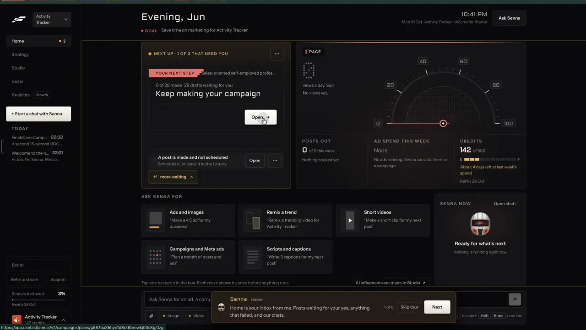
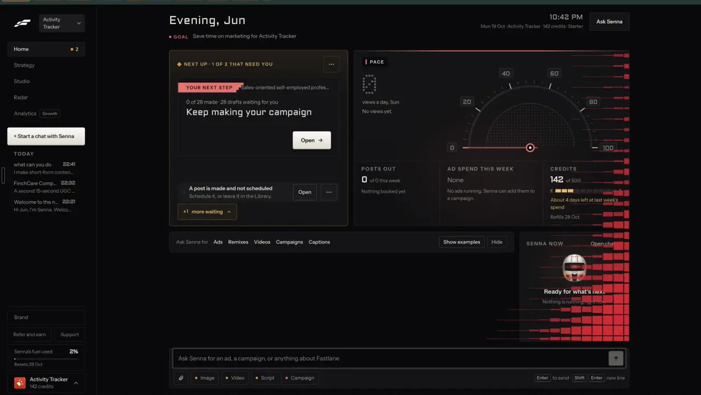

# Home: the one thing that needs you

`agent-home` | agent | phase 6 | status: partial | /north-star#agent-home

## Leo asked

8 Oct 2026: "an all in one tool for my social media management, and for each person too". Home is where that shows: one screen that says what needs you today and takes any request in one box.

## How the best do it

Fastlane's Home is an inbox from the agent. The tour's first step says so: "Home is your inbox from me. Posts waiting for your yes, anything that failed, and our chats." (notes-4.md 2.9).


Header (notes-1.md F2): a greeting with the first name ("Evening, Jun"), then a red square, "GOAL" and "Save time on marketing for Activity Tracker". On the right sit a clock ("10:36 PM"), a meta line "Mon 19 Oct | Activity Tracker | 142 credits | Starter" and an "Ask Senna" button.

The Next up card holds the one thing that needs you:

- With one item the label reads "NEXT UP | THE 1 THING THAT NEEDS YOU", over the title "A post is made and not scheduled" and "Schedule it, or leave it in the Library." Under it come "READY TO POST" with the video, "Not posted anywhere yet.", "Open" and "Schedule".
- After a campaign was added the label became "NEXT UP | 1 OF 2 THAT NEED YOU". The top item turned into a highlighted block: a red tag "YOUR NEXT STEP" with the audience name, "0 of 28 made | 28 drafts waiting for you", the big title "Keep making your campaign" and "Open" to the campaign. The older item dropped to a row with "Open" and a "..." menu, and a toggle "+1 more waiting" sits under it (notes-4.md 2.10).
- The sidebar's Home badge counts these items. It went from 1 to 2 the moment the campaign was added (notes-1.md F1, t027).



"ASK SENNA FOR" has five tiles, each an icon, a title and a quoted example: "Ads and images" / "Make a 4:5 ad for my business", "Remix a trend" / "Remix a trending video for Activity Tracker", "Short videos" / "Make a short clip for my next post", "Campaigns and Meta ads" / "Plan a month of posts and ads", "Scripts and captions" / "Write 3 captions for my next post". The helper under them reads "Tap one to start it in the box. Each make shows its price before anything runs." Collapsed, the tiles become one line, "Ask Senna for  Ads  Remixes  Videos  Campaigns  Captions", with "Show examples" and "Hide".



The right column has PACE (views a day, posts out, ad spend, credits; that is learn-pace) and "SENNA NOW" with "Open chat", the idle line "Ready for what's next" / "Nothing is running right now." The composer is pinned to the bottom: "Ask Senna for an ad, a campaign, or anything about Fastlane", a paperclip, chips "Image", "Video", "Script", "Campaign" and the keycap hint "Enter to send | Shift Enter new line". While Home loads, a chip "Loading your home" floats over grey tiles. Leo's full-page capture shows the same layout ([013-Home-1](../research/fastlane-pdf/013-Home-1.webp)).

Others:

- SuperX's "Ready To Post" queue holds drafts that mix your writing style with current trends, "crafted to sound like you", so you start from a queue instead of a blank editor. [superx](https://superx.so/)
- Taplio's homepage shows a weekly brief of trends with lifts such as "+212%" and an action "Draft a post on trend 2, in your voice". The brief is behind "Request early access", so whether it is live is unverified. [taplio](https://taplio.com/)
- Hootsuite's Wisdom opens on cards such as "Predict trends", "Recommend next steps" and "Spot risks early". [wisdom-ai](https://www.hootsuite.com/wisdom-ai)
- Motion's home page leads with "your top 10 ads of the week" and the ads scaling or declining week over week. [faq](https://motionapp.com/faq)
- Snappy Kraken's assistant suggests "Review account readiness", "Find the right campaign" and "Prioritize the next opportunity". [snappy-ai](https://snappykraken.com/snappy-ai)
- Kapwing's homepage is a prompt: "What are you creating today". [help](https://www.kapwing.com/help/ai-video-generator)

## What we have today

`/home` is `src/pages/HomePage.tsx` (loaded eagerly, reads localStorage at once). Top to bottom:

- A warning-coloured card for posts due today or overdue: up to 3 rows, each with "Open" (`/generate?draft=<id>`), "Reschedule" (`/calendar#overdue`, overdue rows only) and "Mark posted" (a toast with Undo), then "See all <n> on the calendar" past 3. Mark posted is disabled with its reason when the team approval rule blocks it (`useDraftReviews`, `reviews.blockReason`).
- The greeting: "Good morning", "Good afternoon" or "Good evening", plus the email prefix when it is 2 to 18 letters, shown capitalised. On tanjunsing@gmail.com that reads "Good evening, Tanjunsing"; leotanjs95@gmail.com has digits, so no name shows. No goal line yet (plan-goal adds it). The effect reads the email from `getUser` but keeps only the name.
- "Your next move" from the Content Diagnosis (`nextAction` in `src/lib/diagnosis.ts`), in one of three kinds: a mission, "Get your Content Score" (diagnose) or a maintain card.
- Three buttons, "Write a post", "Plan a week", "Weekly batch", then a "Get set up" checklist until all 5 are done: "Set your voice", "Set up your brand kit", "Write your first post", "Schedule a post", "Check your content in Coach".
- "Coming up", the weekly goal card, "Pick up where you left off" and "Need an idea?".

The Pipeline rail badge, drawn in `src/pages/StudioLayout.tsx`, counts overdue posts plus team posts waiting (`countNeedsYou` in `src/lib/needsYou.ts`), and the dock floats over Home as it does on every page. Home has no composer of its own, and nothing on it ranks what needs you across sources, starts a request from a tile or shows what the agent is doing.

## Build

Gate with `leoOnly(email)`. Everyone else keeps today's Home exactly.

Build after agent-chat (the composer and threads) and agent-approvals (cards waiting). Items that read campaigns or failed posts appear only once those exist; the list skips any source that is not there yet.

Files:

- `src/pages/HomePage.tsx`: keep the email from `getUser` in a new `email` state (today only the name is kept); when `leoOnly(email)`, render `<AgentHome />` in place of the due card, "Your next move", the three buttons and "Get set up". "Coming up", the weekly goal card, "Pick up where you left off" and "Need an idea?" stay below it.
- `src/components/home/AgentHome.tsx` holds the header line, `NextUp.tsx`, `AskFor.tsx`, `AgentNow.tsx` and the shared `Composer` from agent-chat.
- `src/lib/needsYou.ts`: add the pure `needsYouItems(input, today)`; `countNeedsYou` is left alone.
- `src/components/agent/AgentDock.tsx` (agent-chat): hide the launcher on `/home`, since Home has its own composer.

### Screens and states

1440 px:

```
Good evening, Tanjunsing                     Mon 20 Oct | Leo Tan | 2 of 2 AI videos left today
GOAL  Win 2 new clients a month                                          [Ask the agent]
+-- NEXT UP | 1 OF 3 THAT NEED YOU ------------------ ... -+  +-- AGENT NOW ---- Open chat -+
| A video is waiting for your yes                          |  | Making your video,          |
| Talking video: "Most people find out what CPF LIFE..."   |  | 1 of 2 parts ready          |
|                                                [Open]    |  |                     [Open]  |
|  2 posts are overdue           [Reschedule] [...]        |  +-----------------------------+
|  A post is made and not scheduled   [Open] [...]         |
|  +1 more waiting                                         |
+----------------------------------------------------------+
ASK THE AGENT FOR                                                               [Hide]
[Remix a post]  [Carousels]  [Videos]  [Campaigns]  [Hooks and scripts]
Tap one to start it in the box. Anything paid shows its price first.
[ Ask the agent for a post, a remix, a video or a campaign                       (^) ]
[clip] [Post] [Carousel] [Video] [Campaign]                  Enter to send | Shift Enter new line
```

At 390 px: the header meta wraps under the greeting, Next up is full width, the tiles become a single column of rows, Agent now sits under the tiles, and the composer is pinned above the bottom nav. Every button is at least 44 px on touch and nothing scrolls sideways.

Header: the greeting as today, plan-goal's GOAL line when set, and on the right a meta line "<Dow D Mon> | <brand name> | <n> of 2 AI videos left today" (`activeProfile(userId).name`, `useUsesLeft` for `ai-video`; the last part is left out until the count is read) and an "Ask the agent" button to `/agent`.

Next up, from `needsYouItems`. A fixed order is a product rule, not a judgment on text, so no Jev:

| # | Kind | Shows when | Title | Line | Buttons |
| --- | --- | --- | --- | --- | --- |
| 1 | card | an agent card is `proposed` | "A video is waiting for your yes" ("A picture...", "A change...") | the card's title and price line | "Open" to `/agent/<thread>?m=<msg>` |
| 2 | failed | a Post it for me post with `zernio.status` "failed", or an agent job failed in the last 24 h | "A post didn't go out" / "Something you asked for wasn't made" | the hook, then "Try it again or post it yourself." / "Nothing was used." | "Open" to `/generate?draft=<id>&panel=post` or the thread |
| 3 | overdue | scheduled posts whose day has passed | "1 post is overdue" / "<n> posts are overdue" | the newest one's hook and its day | "Reschedule" (`/calendar#overdue`), "Mark posted" (today's handler with Undo and approval rules) |
| 4 | today | scheduled for today | "1 post goes out today" / "<n> posts go out today" | the first hook and its time | "Open" (`/generate?draft=<id>`) |
| 5 | team | team posts waiting (Leo's account) | "<n> team posts wait for you" | "Approve or skip each one." | "Review" to `/calendar?business=team-posts&teampost=<first id>` |
| 6 | unscheduled | a draft with `agent` or `remix` made in the last 7 days, still a draft | "A post is made and not scheduled" | "Schedule it, or leave it in My posts." | "Open", "Schedule" (`/generate?draft=<id>&panel=post`) |
| 7 | campaign | a campaign with posts not made (plan-campaign) | "Keep making your campaign" | "<m> of <n> made \| <k> drafts waiting for you" | "Open" to `/campaigns/<id>` |
| 8 | setup | the first undone item of today's "Get set up" list | its label ("Set your voice") | none | "Open" to its page |

- The label reads "NEXT UP | THE 1 THING THAT NEEDS YOU" with one item and "NEXT UP | 1 OF <n> THAT NEED YOU" with more.
- The first item is drawn large, with its title as the card's h2, the line under it and its buttons on the right, while the next two sit below it as rows and the rest hide behind "+<k> more waiting". Opened, that toggle reads "Show fewer" and the URL gains `?waiting=all`.
- Each row's "..." menu has "Hide for today". The toast "Hidden until tomorrow." carries Undo. Hidden ids are kept per day on the device.
- Empty: only the label "NEXT UP" and the line "Nothing needs you right now." The composer under it is the way forward, so no hint line.

Ask the agent for: five tiles, each a title and a quoted example built by `askForExamples(positioning)`:

| Tile | Example | Falls back to |
| --- | --- | --- |
| "Remix a post" | "Remix a post from my Swipe file" | same |
| "Carousels" | "Make a carousel about <topics[0]>" | "Make a carousel about a money mistake my clients make" |
| "Videos" | "Make a 20-second video of me explaining <topics[0]>" | "...explaining how I help my clients" |
| "Campaigns" | "Plan a month of posts for <audienceDetail>" | "Plan a month of posts for young families" |
| "Hooks and scripts" | "Write 3 hooks for my next post" | same |

- A tile fills the Home composer with its example and focuses it; it never sends. Hover lightens the tile. Sent as is, the Remix example gets agent-chat's "Which post?" reply with its Swipe file and Analytics chips, since nothing is attached.
- Under the tiles: "Tap one to start it in the box. Anything paid shows its price first."
- "Hide" folds them into one line: "Ask the agent for  Remixes  Carousels  Videos  Campaigns  Scripts" with "Show examples". The fold is remembered on the device.

Agent now (right column at 1440 px):

- Idle: "Ready for what's next" / "Nothing is running right now." and "Open chat" (`/agent`).
- A turn or job running: the step line from agent-chat's `turnOf` or the job ("Writing your carousel", "Making your video, 1 of 2 parts ready") with "Open" to its thread.
- A card waiting for approval: "Waiting for your yes", with "Open" going to the card in its thread.
- Something finished in the last hour: "<Format> ready", with "Open" going to the MADE block.

Composer: agent-chat's `Composer` with the placeholder "Ask the agent for a post, a remix, a video or a campaign". Its chips "Post", "Carousel", "Video", "Campaign" toggle one at a time and travel to Jev as `chip` (agent-chat). Enter sends: `agentRun.send` creates a thread and Home navigates to `/agent/<threadId>`, where the turn is already running. Unsent text is kept in `cs-agent-draft-${scoped(userId)}-home`.

Loading: Home reads from the device at once, so the only thing that waits is the uses-left count, and its part of the meta line appears once read without any skeleton.

### Copy

All strings in the tables and lists above are exact. Also: "Ask the agent", "ASK THE AGENT FOR", "Hide", "Show examples", "AGENT NOW", "Open chat", "Ready for what's next", "Nothing is running right now.", "Waiting for your yes", "+<k> more waiting", "Show fewer", "Hide for today", "Hidden until tomorrow.", "Undo", "Nothing needs you right now.", "Enter to send | Shift Enter new line".

### Data

- Nothing new is synced. `needsYouItems` reads what the device holds: drafts (`loadDrafts`), team posts and reviews (`src/lib/teamPosts.ts`), agent threads (agent-chat), campaigns (plan-campaign, when present), the "Get set up" checks HomePage already computes, and today's usage.
- Device only: `cs-home-askfor-${scoped(userId)}` ("compact" or absent) and `cs-home-hidden-${scoped(userId)}` (`{ [itemId]: "YYYY-MM-DD" }`, entries older than today dropped on read). Item ids are stable per thing (`card:<cardId>`, `overdue`, `draft:<id>`, `campaign:<id>`), so hiding one never hides another.

### AI and cost

None. Home makes no AI call and asks Jev nothing; reading `cs_ai_usage` is a plain row read under RLS. Requests typed here cost what agent-chat says they cost, counted on `agent-act`.

### Deep links

- `/home?waiting=all` opens the full Next up list (replace; the default is left out of links).
- `/home#next-up` and `/home#ask` scroll to those blocks (useScrollToHash).
- Every Next up button goes to the item's own deep link (table above).
- Replace the `/home` "(none)" entry in `docs/deep-links.md` with these rows and add `links.home({ waiting })` to `src/lib/links.ts`.

## Done when

- [ ] Signed in as tanjunsing@gmail.com, Home shows the header meta, Next up, the tiles, Agent now and the composer; a demo sign-in sees today's Home unchanged.
- [ ] With an overdue post, a proposed video card and an unscheduled remix draft, Next up reads "1 OF 3 THAT NEED YOU" with the card first; "Hide for today" on a row hides only that row until tomorrow, and Undo brings it back.
- [ ] "Mark posted" in Next up still blocks a post that needs team approval.
- [ ] A tile fills the composer without sending; Enter sends, lands on `/agent/<id>` and the turn is already running.
- [ ] Agent now shows a running video's step line while on Home, and "Video ready" after it ends.
- [ ] `?waiting=all` survives a reload; Hide and Show examples are remembered on the device.
- [ ] 390 px and 1440 px checked by eye in Leo's theme; no sideways scroll.
- [ ] Build and the full vitest pass; the item flips in `src/data/northStar.ts`.

## Tests

- `src/lib/needsYou.test.ts`:
  - `needsYouItems` orders the eight kinds as the table says and leaves out kinds whose source is missing.
  - Overdue and today counts use the Singapore day; a post due today is never also overdue.
  - Hidden ids for today are dropped and yesterday's hidden ids are ignored.
  - The label helper gives "THE 1 THING THAT NEEDS YOU" for one item and "1 OF 3 THAT NEED YOU" for three.
  - `countNeedsYou` gives the same numbers as before.
- `src/lib/askFor.test.ts`: `askForExamples` uses the first topic and the audience detail, and each fallback when they are empty.
- `src/lib/links.test.ts`: `links.home({ waiting: "all" })` and the default.
- Break each case once to see it fail.

## Open questions

- Should the Pipeline badge (or a Home badge) count these items for Leo, as Fastlane's sidebar badge does? Today it counts only overdue and team posts. Leo decides.
- The Pace panel (views a day, posts out) is learn-pace's. Leave its space empty or show "Coming up" there until it ships? This spec keeps "Coming up" below.
- Should the agent pick a post from Swipe file itself when asked to "remix a post", as Fastlane's "Remix a trending video" tile implies? This spec has it ask which post. Leo decides; picking would be one more Jev choice over saved items.
- Should "Your next move" (the diagnosis mission) stay for Leo? This spec folds it into item 8 through the setup list and leaves the diagnosis on `/coach`.

## Related

agent-chat, agent-approvals, agent-budget, agent-activity, agent-tour, plan-goal, plan-campaign, plan-campaign-page, learn-pace, publish-calendar, business-onboarding
