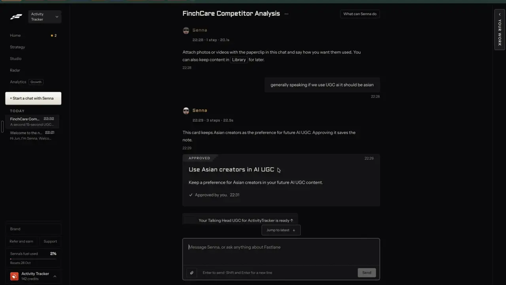
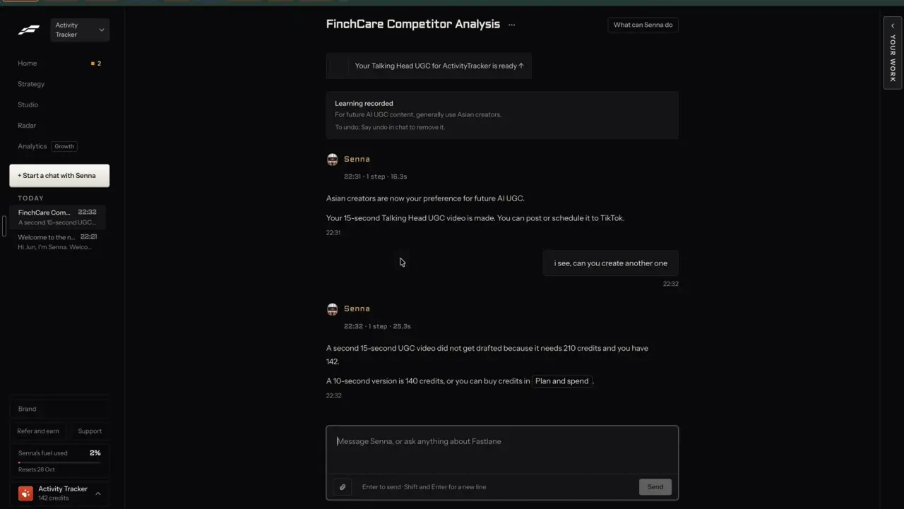
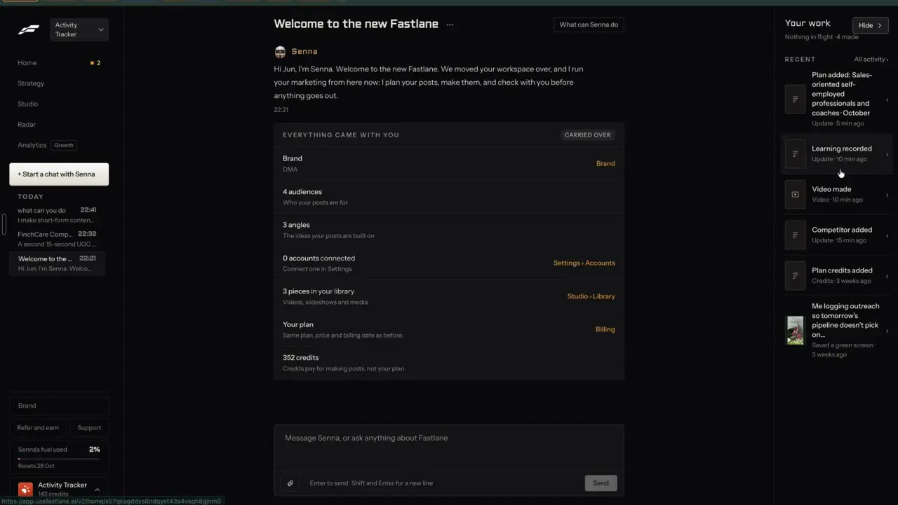

# It remembers what you like

`agent-memory` | agent | phase 6 | status: missing | /north-star#agent-memory

## Leo asked

No direct ask; from the competitor research.

## How the best do it

Fastlane turns a passing remark in chat into a saved preference (notes-4.md 2.3 and 2.4, notes-3.md F12). When Leo typed "generally speaking if we use UGC ai it should be asian" at 22:28, Senna answered a minute later, after "3 steps | 22.5s", with "This card keeps Asian creators as the preference for future AI UGC. Approving it saves the note." The card under that line read "Use Asian creators in AI UGC" / "Keep a preference for Asian creators in your future AI UGC content.", and once approved it showed "Approved by you. 22:31".



A receipt then sits in the thread: "Learning recorded" / "For future AI UGC content, generally use Asian creators." / "To undo: Say undo in chat to remove it." Senna confirms in prose: "Asian creators are now your preference for future AI UGC." The video made just before was of a white woman; the learning applies to later makes only.



The learning also shows as a row in the "Your work" panel ("Learning recorded", "Update | 10 min ago"). Hovering that row shows a thread URL in the status bar, inferred to be the thread where it was saved (t340). Settings > Activity logs "Learning recorded" by "You" with the text (t342), under filter tabs that include one called "Corrections" (t341), whose contents were not shown. No page in the recording lists all learnings (notes-4.md open question 17), and the Brand page's banner says "Senna reads these before making anything. Change one here, or ask Senna in a thread."



Others:

- Creatify's agent keeps a "readable memory of approvals, rejections, brand facts, product specs and team decisions" across edits. [agent](https://creatify.ai/features/agent)
- Arcads fills a "Brain panel" from the website (overview, products, voice, audience), editable, plus Custom Instructions of up to 2,000 characters applied to every message. [help](https://help.arcads.ai/en/articles/17594959-ai-ad-agent-mark)
- InVideo's Playbooks hold standing rules applied on every project, and project Context keeps uploads and characters so new inputs are read against them. [agent-two](https://invideo.io/agent-two/)
- Kleo's "Automatic memories" learn from each post you create and persist across sessions. [kleo](https://wf.kleo.so/)
- Blaze's "Blaze Brain" learns from your edits and post performance. [help](https://help.blaze.ai/en/articles/12313537-what-is-the-difference-between-blaze-autopilot-and-blaze-copilot)

## What we have today

- Nothing in the assistant remembers a preference. The dock keeps its last 20 messages on the device (`fb_asst_*`), and `assistant-act` has no remember, forget or "what do you remember" act.
- Standing preferences live in other places, typed by hand: Coach's "Lean into" and "Steer clear of" lists (`src/pages/CoachPage.tsx`, stored as `likes` and `dislikes` and printed into prompts as "Lean into" and "Avoid" by `src/lib/coachProfile.ts`), brand rules and avoid words on `/brand` (`src/lib/brandRules.ts`, `brandRulesLine`), the voice profile on `/voice` (`src/lib/voiceProfile.ts`) and caption fixes in the video editor.
- brand-voice-memory (specced, not built; `src/lib/voiceMemory.ts` does not exist yet) adds the store this item uses: `content-studio-learnings-${scoped(userId)}` with `{ id, text, scope: "posts" | "videos" | "pictures" | "all", source: "assistant" | "rewrite" | "typed", createdAt, offAt?, replacedBy? }`, 30 active and 60 rows kept, a `remember` act in `assistant-act` behind the `NORTH_STAR_USERS` gate, a card in the dock that asks "Remember this for your <scope>?", `memoryLine(userId, scope)` in `src/lib/voiceMemory.ts` added next to every `brandRulesLine` call, and the "What the AI has learned" list at `/voice#learned`, while leaving "undo by saying it" to this item.
- AI presenters: `src/components/AiVideo.tsx` picks one of the 6 `LOOKS` (`src/lib/aiVideo.ts`) at random and offers "Another look" to cycle them, whatever the person has said before. All six are already Singaporean (Leo's rule), so a preference like Fastlane's "use Asian creators" changes nothing here; the ones that matter are about gender and age.

## Build

Gate with `leoOnly(email)`. Build after brand-voice-memory, agent-chat and agent-approvals.

This item is the chat side of memory: saving a learning from a thread with a receipt, removing it by saying "undo" or "forget that", answering "what do you remember about me", learning from repeated corrections on cards, and showing on each card which learnings shaped it.

Files:

- `src/lib/agentMemory.ts` (new): `forgetPick`, `memoryAnswer`, `noteCorrection`, `correctionNudge`, `followingLine`.
- `src/lib/voiceMemory.ts` (brand-voice-memory): learnings gain optional `thread?: string` and `msg?: string`, and `source` gains `"correction"`.
- `src/lib/agentRun.ts` and `src/lib/assistantActs.ts` (agent-chat): the new acts.
- `supabase/functions/assistant-act/logic.ts`: the acts and questions below.
- `/voice#learned` rows saved from a chat get a link "From a chat" to `/agent/<thread>?m=<msg>`.

### Screens and states

Saving (the `remember` act from brand-voice-memory, drawn as agent-approvals' learning card):

```
+-- PROPOSED ------------------------------------ 22:29 -+
| Remember this for your videos?                         |
| "use an older man as my presenter"                     |
| This replaces: "use a woman presenter"                 |
| [Remember]  [Not now]                                  |
+--------------------------------------------------------+
+-- Learning recorded ----------------------------------+
| use an older man as my presenter                       |
| [See what the AI has learned]                          |
| To undo: say undo, or tap Undo.               [Undo]   |
+--------------------------------------------------------+
```

The card shows the person's own sentence, trimmed to 140 characters and never reworded, under brand-voice-memory's exact question with the scope Jev picked ("posts", "videos", "pictures", or "posts, videos and pictures" for all). The "This replaces" line comes from brand-voice-memory's conflict check. Remember saves the learning with `source: "assistant"`, `thread` and `msg`.

Undo by saying it (the `forget` act). No card, because it only switches a note off and its receipt carries an Undo that switches it back on:

- The message names one active learning (`which` = `l<k>`): that learning gets `offAt`. The receipt reads "Learning removed" / "<text>" with Undo, which clears `offAt`.
- The message means the last change here (`which` = `last`): the newest receipt in this thread with an Undo runs it (agent-approvals' `runUndo`), its button turns to "Undone." and the agent says "Undid: <receipt title>."
- Nothing fits, or Jev is not sure: "Which one should I forget?" with chips for the 3 newest active learnings. A chip removes that one straight away, with no second Jev call.
- Nothing to undo and no learnings: "There's nothing to undo here."

"What do you remember about me?" (the `memory` act), a fixed answer with no LLM:

```
Here's what I follow when I make things:
- use an older man as my presenter (videos)
- Never open a post with a question. (posts)
...
And 4 facts you gave me.
[See what the AI has learned]
```

Up to 10 active learnings, newest first, with Coach's lists marked "(from Coach)". With none: "Nothing yet. Tell me something like \"always end with a question\" and I'll keep to it."

Learning from corrections: agent-approvals' cards let the person change the format ("Try another format") and who appears ("Who appears" in details). `noteCorrection` counts each change on the device. When the same change happens on 3 different cards within 14 days, the receipt of the third gets one more line with two buttons:

| Change seen 3 times | Line | Learning saved (scope) |
| --- | --- | --- |
| video to carousel | "You often turn videos into carousels. Make carousels first?" | "Make carousels unless I ask for something else." (all) |
| video to script | "You often swap the video for a script you film. Start with scripts?" | "Write scripts I film myself unless I ask for a video." (videos) |
| AI presenter to your face | "You often switch to your own face. Use it every time?" | "Use my own face in videos." (videos) |
| your face to AI presenter | "You often switch to an AI presenter. Use one every time?" | "Use an AI presenter in my videos." (videos) |

The buttons are "Remember" (saves with `source: "correction"`) and "No thanks", which hides that line for 30 days.

Learnings applied to the agent's makes:

- Words: the remix request already carries `memoryLine(userId, scope)` once brand-voice-memory ships, because agent-chat builds it with the same request builder as the Remix sheet. Check it in the request body; nothing else is added here.
- Who appears: when a talking video is planned, no face is saved (people-my-face) and active learnings in scope "videos" or "all" exist, the agent uses Jev's `look` answer (below) to pick one of the 6 `LOOKS`. A sure pick goes to `makePresenter(look)`; anything else keeps today's random look.
- On the card: when learnings shaped a make, the details gain "Following" with up to 2 of them, for example "Following: use an older man as my presenter". That is the person's proof the note was used.

States:

- Saving fails (storage blocked): "Couldn't save that. Try again." and the card stays PROPOSED.
- Over the learnings cap (30 active): Remember is disabled with "30 is the most. Remove one on Your voice to add another." and a chip "Open Your voice".
- Over the agent cap: agent-chat's cap line; nothing is saved or removed.
- A learning removed on `/voice` disappears from the next "what do you remember" answer, and its receipt's Undo in the old thread restores it.

### Copy

- Receipts: "Learning recorded", "Learning removed", "To undo: say undo, or tap Undo.", "Undo", "Undone.", "See what the AI has learned"
- Lines: "Undid: <receipt title>.", "Which one should I forget?", "There's nothing to undo here.", "Here's what I follow when I make things:", "And <n> facts you gave me.", "Nothing yet. Tell me something like \"always end with a question\" and I'll keep to it.", "(from Coach)"
- Card details: "Following: <learning>; <learning>"
- Nudges and saved learnings are exactly as in the table above, with the buttons "Remember" and "No thanks".
- Errors: "Couldn't save that. Try again.", "30 is the most. Remove one on Your voice to add another.", "Open Your voice"
- On `/voice#learned`: the source label "From a chat, <d MMM>" links to the thread.

### Data

- Learnings: brand-voice-memory's synced `content-studio-learnings-${scoped(userId)}`, plus the optional `thread` and `msg` fields and the source `"correction"`. Remove sets `offAt` and never deletes the row, so Undo and the conflict history keep working with no tombstone.
- Device only: `cs-agent-corrections-${scoped(userId)}`, the last 30 `{ kind: "format" | "face", from, to, card, at }`; and `cs-agent-nudge-off-${scoped(userId)}`, `{ [nudgeId]: ISO }`.
- No table and no migration.

### AI and cost

All of it rides on the turn's existing Jev call (`agent-act`, agent-chat). No LLM and no new cap.

- `act` criteria added in agent mode:
  - `forget`: "Take something back: undo the last change, forget a preference they gave earlier, or stop doing something the app was told to do."
  - `memory`: "Ask what the app remembers, has learned or follows about them and their preferences."
- State added in agent mode: `learnings` (the active ones as "l1: <text> (<scope>)", newest 10), `last_change` (the newest undoable receipt's title in this thread, or "none") and `video_preferences` (active video and all-scope learnings joined by "; ").
- `which` (choice), asked when learnings or a last change exist: instructions "If the message asks the app to forget or undo something, which one does it mean?" Criteria: `l1` to `l10` as "<text> (<scope>)", `last` "The most recent change made in this chat: `last_change`.", `none` "None of these fits." Pick at PICK_MIN 0.5, else the chips.
- `look` (choice), asked on every agent turn while `video_preferences` is not empty (the format is only known from the same call) and used only when the plan is a talking video: instructions "Which presenter fits the person's standing preferences in `video_preferences` best? Pick any when the preferences say nothing about who appears." Criteria: `look1` to `look6` as the `LOOKS` strings, `any` "The preferences say nothing about who appears." Pick at 0.5, else random as today. Comment both thresholds: `// shortcut: not read off real messages; check 20 of Leo's undo messages and 10 presenter preferences side by side first.`
- Cost: the extra criteria add about 400 input tokens to a call, under US$0.00002.
- The conflict check on Remember stays brand-voice-memory's (`writing-judge` mode "conflict", its own cap).

### Deep links

- `/voice#learned` and `/voice?learning=<id>` (brand-voice-memory).
- `/agent/<thread>?m=<msg>` from a learning row's "From a chat" link (agent-chat).

## Done when

- [ ] In the agent, "from now on use an older man as my presenter" shows "Remember this for your videos?"; Remember adds the row to `/voice#learned` with a "From a chat" link back to the message.
- [ ] Typing "undo" right after removes that learning, the receipt says "Learning removed", and its Undo brings it back.
- [ ] "forget the presenter thing" with three learnings saved removes the right one; "forget it" with no clear match shows the 3 chips.
- [ ] "undo" after a moved post restores the post (agent-approvals' undo) and the old receipt shows "Undone."
- [ ] "what do you remember about me" lists the active learnings and Coach's lists, and no removed ones.
- [ ] With "use an older man as my presenter" saved and no face, a planned talking video's card shows "Following: use an older man as my presenter" and the look "A Chinese Singaporean man in his 50s...".
- [ ] Turning 3 video cards into carousels within 14 days shows the nudge once on the third receipt; No thanks hides it for 30 days.
- [ ] No new cap and no new paid provider; `agent-act` moves by one per message.
- [ ] Build and the full vitest pass; checked at 390 px and 1440 px; the item flips in `src/data/northStar.ts`.

## Tests

- `src/lib/agentMemory.test.ts`:
  - `forgetPick`: `l2` switches that learning off; `last` returns the newest undoable receipt; `none` returns the 3 newest active learnings as chips; nothing saved gives the "nothing to undo" line.
  - `memoryAnswer`: at most 10 active learnings newest first, Coach items labelled, removed ones left out, and the empty text when there are none.
  - `noteCorrection` and `correctionNudge`: 3 of the same change on 3 cards within 14 days nudge; 2 do not; the same card 3 times does not; a 15-day spread does not; a dismissal inside 30 days does not.
  - `followingLine`: up to 2 learnings in the make's scope or "all", and "" when none apply.
- `supabase/functions/assistant-act/logic.test.ts`: `forget` and `memory` criteria and the `which` question appear only in agent mode; `which` at 0.49 gives the chips path; `look` is asked only with video preferences and falls back to random below 0.5.
- Break each case once to see it fail.

## Open questions

- Fastlane asks for approval before saving a learning; this spec does too (through brand-voice-memory's card). Leo may want learnings saved at once with Undo. Leo decides.
- Should Claude's connector (`get_brand` in content-studio-mcp) return learnings? brand-voice-memory leaves this to Leo as well.
- Corrections inside Write and the video editor (beyond rewrites, which brand-voice-memory covers) are left out until the agent's own corrections prove useful.

## Related

brand-voice-memory, agent-chat, agent-approvals, agent-activity, people-presenters, people-my-face, remix-your-brand, brand-rules
