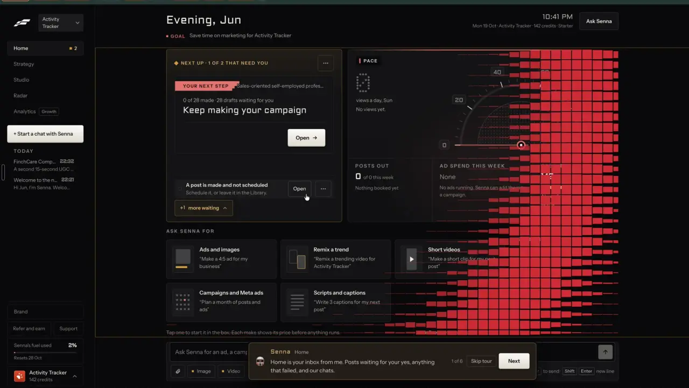
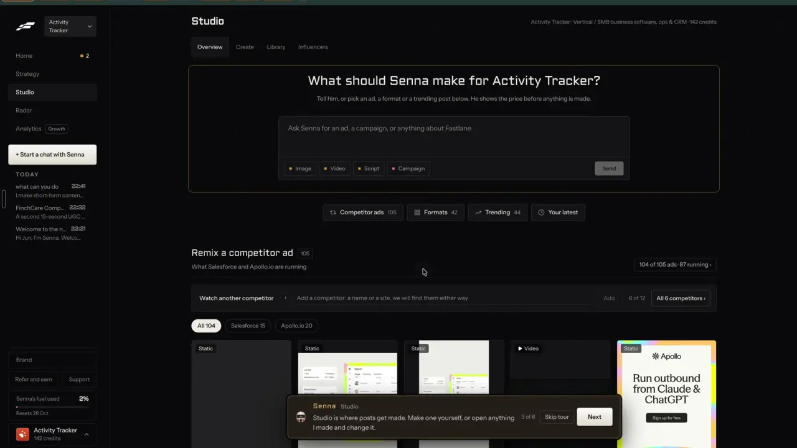
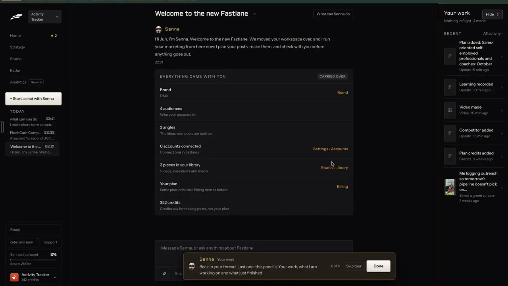

# A tour led by the agent

`agent-tour` | agent | phase 6 | status: missing | /north-star#agent-tour

## Leo asked

No direct ask; from the competitor research.

## How the best do it

Fastlane is the only product in the research with a tour its agent leads. Leo ran it end to end (notes-4, 2.8 and 2.9).

- Start: the welcome thread "Welcome to the new Fastlane" ends with three buttons, "Show me around" (white, the main one), "What's different?" and "Got it". "Show me around" starts the tour. The buttons are still there after the tour ends.
- Replay: Settings has a footer row "Tour of Fastlane" / "A one-minute look at Home, Strategy, Studio, Radar and Brand, led by Senna." with the button "Replay the tour".
- The popover sits bottom centre: Senna's avatar, "Senna" in orange and the page name in grey, one or two sentences, the counter "N of 6", a "Skip tour" button and a white "Next", which reads "Done" on the last step.
- Each Next moves the real app to the next page, which loads with its usual loading state first. The page stays usable underneath: Leo typed into the Studio composer and clicked through Brand tabs with the popover open.
- During step 3 Leo sent "what can you do" from Studio, which opened a chat thread where the popover was gone; when he clicked back into Studio the popover came back at "3 of 6", so the tour survives a detour.
- The six steps, verbatim:
  1. "Senna  Home" / "Home is your inbox from me. Posts waiting for your yes, anything that failed, and our chats." / "1 of 6"
  2. "Senna  Strategy" / "Strategy is the plan: who we are talking to, and the campaigns aimed at each of them." / "2 of 6"
  3. "Senna  Studio" / "Studio is where posts get made. Make one yourself, or open anything I made and change it." / "3 of 6"
  4. "Senna  Radar" / "Radar shows the ads your competitors are running. Remix one that is working for them." / "4 of 6"
  5. "Senna  Brand" / "Brand is what I know about you. Change it here and every post after uses it." / "5 of 6"
  6. "Senna  Your work" / "Back in your thread. Last one: this panel is Your work, what I am working on and what just finished." / "6 of 6" / "Skip tour" / "Done". Step 6 goes back to the welcome thread and opens the Your work panel.

Step 1 on Home, with the pixel wipe still running on the right:



Back at step 3 after the detour into a chat:



Step 6 opens the Your work panel beside the welcome thread:



The replay row at the foot of Settings:


No other competitor in the research (126 products) documents a guided tour that moves page to page; the nearest are InVideo's "Guided Workflows", which walk one production task rather than the app ([source](https://invideo.io/news/introducing-workflows-invideo-agent-two/)).

## What we have today

- `/welcome` (`src/pages/WelcomePage.tsx`, nav "Getting started" in the home section): three step cards (`Set your voice`, `Write your first post`, `Plan your week`), the main button `Start with my first post` and a skip link to the dashboard. Each goes through `go(to)`, which calls `markOnboarded` (`content-studio-onboarded-<uid>`, `src/lib/onboarding.ts`) before it navigates.
- `/home` (`src/pages/HomePage.tsx`) sends a first-run account (no drafts, no usable voice profile, not onboarded) to `/welcome` with a replace, so a tour that starts on `/home` for such an account would bounce.
- `/tutorial` (`src/pages/TutorialPage.tsx`): a long how-to page with sections `#why`, `#voice`, `#guided-flow`, `#after`, `#tabs`, `#rules`, `#rhythm`, `#first-action`. Also `/create-guide`, `/academy` and QuickTip cards.
- The assistant dock (`src/components/feedback/AssistantDock.tsx`) is mounted on every studio page through `<AssistantMount />` in `src/pages/StudioLayout.tsx`; its button is labelled `Ask the Content Studio assistant` and sits bottom right, 20 px up at 1024 px and wider and 88 px up below that (`offsetY`, `mobileOffsetY`, `mobileBreakpoint` in `AssistantMount.tsx`), so it clears the bottom nav.
- Not built yet: agent-chat, whose spec swaps the dock for `AgentDock` on Leo's sign-ins, adds the chat page `/agent` and hides the launcher on `/agent` and `/home`. Step 6 below stands on that page.
- Nothing walks a person through the app page to page, and no tour state is stored anywhere. No popover or tour library is installed, and none is needed: the popover is a fixed box.
- Pages the tour can stand on today: `/home`, `/swipe` (cards carry `Remix this`), `/generate`, `/calendar` (drag a post to another day; the posting time is kept), `/brand`.

## Build

Gate with `leoOnly(email)`: the popover, the two buttons below and the `?tour=` param do nothing for anyone else. Build after agent-chat, since the last step stands on its `/agent` page.

Files:

- New `src/lib/tour.ts`: `TOUR_STEPS`, a module-level store (`tourState`, `onTour`) so the state survives page changes and remounts, `startTour(stepId?)`, `nextStep()`, `pauseTour()`, `skipTour()`, `finishTour()`, `stepForPath(pathname)`, and persistence in a device key.
- New `src/components/TourPopover.tsx`, mounted once in `src/pages/StudioLayout.tsx` next to `<AssistantMount />`. It reads the store and `useLocation()`, and handles `?tour=`.
- `src/pages/WelcomePage.tsx`: a secondary button `Show me around` beside `Start with my first post`. It calls `startTour()` and then `go("/home")`, so the account is marked onboarded first and `/home` does not send it back to `/welcome`. business-onboarding's spec also adds a `Show me around` button to its first-run card; whichever ships second calls the same `startTour()`.
- `src/pages/TutorialPage.tsx`: a button `Replay the tour` at the top, above the section tabs.
- `docs/deep-links.md`: the `?tour=` row, next to the `?profile=` note that also applies on every page.

### Screens and states

```
                         (the page, fully usable)

          +------------------------------------------------------+
          | (*) Agent  Top posts                                  |
          | These are posts that worked for other advisers.       |
          | Press Remix this on one to write your own version.    |
          |                              2 of 6  [Skip tour] [Next]|
          +------------------------------------------------------+
```

- Steps, in `TOUR_STEPS` (`id`, `path`, `page`, `text`, optional `target`):
  1. `home`, `/home`, `Home`
  2. `top-posts`, `/swipe`, `Top posts`
  3. `write`, `/generate` (exact match, so `/generate/batch` does not count), `Write`
  4. `calendar`, `/calendar`, `Calendar`
  5. `brand`, `/brand`, `Brand kit`
  6. `agent`, `/agent` (also `/agent/<thread>`), `Agent`, with `target` the chat composer (`data-tour="agent-composer"` on agent-chat's `Composer.tsx`): while step 6 shows, the composer gets a 2 px ring in the primary colour (a class added and removed by `TourPopover`).
- Showing: while the tour runs and the current path matches the step, the popover shows at bottom centre, `max-width: 520px`, `width: calc(100vw - 32px)`. It sits 24 px from the bottom at 1024 px and wider, and 144 px up below that, so it clears both the bottom nav and the dock button. It enters with a 150 ms fade and rise, and has no motion under `prefers-reduced-motion`. Its z-index is below the dock's, so an opened dock covers it.
- Next: moves the store to the next step and navigates to its path. The new page shows its own loading state; the popover appears as soon as the path matches and focus moves to its `Next` button (only after a Next, so it never takes focus from someone typing).
- Detour: when the person goes to any other page mid-tour, the state stays `running` and a small pill takes the popover's spot, `Tour paused at step 3 of 6` with `Resume` (goes back to the step's page) and a close button labelled `Skip tour`. Coming back to the step's page by any route shows the popover again at the same step, as Fastlane did at t316.
- Esc inside the popover sets the state to `paused`: the pill shows on every page, the step's page included, until `Resume`.
- Reload: the store reads the device key, so a reload or a brand switch comes back at the same step.
- Skip: ends the tour, then toasts `Tour closed. Replay it from How the studio works.`
- Done (step 6): ends the tour and removes the ring, then toasts `That's the tour. Replay it any time from How the studio works.`
- Replay or `Show me around`: starts at step 1 whatever the state was, and navigates to `/home`.
- A typed `?tour=` link by someone outside the gate is ignored and the param removed.

The popover is `role="dialog"`, `aria-modal="false"`, labelled `Tour, step <n> of 6`, its text `aria-live="polite"`; both buttons are at least 44 px tall on touch.

### Copy

- Header: `Agent` with the page name after it in muted text, as agent-chat names it.
- Step text, exact:
  1. `Home shows what's coming up, where you left off, and your goal for the week.`
  2. `These are posts that worked for other advisers. Press Remix this on one to write your own version.`
  3. `Write turns an idea or a remix into a post in your voice, and flags risky words before you post.`
  4. `Calendar holds every post you've planned. Drag one to another day to move it.`
  5. `Brand kit is your name, colours, logo and sign-off. Every carousel, video and caption uses it.`
  6. `Last one: ask me here for a post, a remix or a video. Anything paid shows its price first, and nothing posts without you.`
- Counter `<n> of 6`; buttons `Skip tour`, `Next`, and `Done` on step 6.
- Paused pill `Tour paused at step <n> of 6`, button `Resume`.
- `/welcome` button `Show me around`; `/tutorial` button `Replay the tour`.
- Toasts as above.

Each step is one or two plain sentences that say what the page is for and the one thing to do there. Steps 1 to 5 name the page; step 6 speaks as the agent ("ask me"), as Senna's last step does. When a later item adds a main page such as the format gallery or the library, it edits `TOUR_STEPS` in the same commit, and the tour stays at six steps or fewer.

### Data

- Device key `cs-tour-<uid>`: `{ step: "write", state: "running" | "paused" | "done" | "skipped", at: ISO }`. A tour belongs to the device it runs on, so it stays out of sync and out of the database: there is no table, server call or migration.

### AI and cost

None. The steps are fixed copy in the agent's voice; no model runs, no Jev question, no cap.

### Deep links

- `?tour=1` on any studio page starts the tour at step 1; `?tour=<step id>` (`home`, `top-posts`, `write`, `calendar`, `brand`, `agent`) starts at that step. An unknown value starts at step 1. The param is read once and removed with a replace, like `?profile=`.
- The agent or a help article can link `/home?tour=1`.
- The steps themselves add no params: each is the page's own URL.

## Done when

- [ ] On Leo's sign-in, `Show me around` on `/welcome` runs all six steps, each Next lands on the right page, and Done leaves him on `/agent` with the toast.
- [ ] Leaving the tour's page shows the paused pill; `Resume`, or opening the step's page from the nav, brings the popover back at the same step; a reload mid-tour comes back at the same step.
- [ ] A first-run account that presses `Show me around` lands on `/home` with step 1, not back on `/welcome`.
- [ ] Typing into Write's fields and dragging a post on Calendar work while the popover is open.
- [ ] Step 6 lands on `/agent` with its composer ringed, and the ring is gone after Done or Skip.
- [ ] `Replay the tour` on `/tutorial` and `/home?tour=calendar` both work; the same links do nothing on a non-Leo account.
- [ ] At 390 px the popover clears the bottom nav and the dock button and never causes page overflow; at 1440 px it sits bottom centre.
- [ ] Keyboard only: Tab reaches `Skip tour` and `Next`, Enter moves on, Esc pauses.
- [ ] `npm run build` and the full `npx vitest run` pass; the item flips in `src/data/northStar.ts`.

## Tests

`src/lib/tour.test.ts` (node, fake localStorage):

- `startTour()` sets step `home` and state `running`; `nextStep()` walks all six; `nextStep()` on step 6 finishes.
- `skipTour()` and `finishTour()` store their states; `startTour()` after either begins again at step 1.
- `pauseTour()` keeps the step and sets `paused`; a path change alone leaves the state `running`; `startTour("calendar")` starts at step 4; an unknown id starts at step 1.
- Reading the store back from `cs-tour-<uid>` restores step and state; a malformed value reads as no tour.
- `stepForPath`: `/generate` matches `write`, `/generate/batch` matches nothing, `/home` matches `home`, and `/agent` and `/agent/t1` match `agent`.
- `tourParam("?tour=brand&profile=me")` returns `brand` and a search string that has lost `tour` and still has `profile`.

## Open questions

- Should the tour start by itself on a first sign-in? Fastlane only offers it from the welcome thread. Recommendation: offer it on `/welcome` and never auto-start; Leo decides.
- When north-star pages ship (remix, format gallery, library, competitor ads), which six pages should the tour show? The owner of each new page proposes the swap; Leo picks.
- Once the tour goes to everyone, should Getting started link it for all users? Leo's call, in his words.

## Related

agent-chat, agent-home, business-onboarding, remix-everywhere, formats-gallery, publish-library, find-competitor-ads
