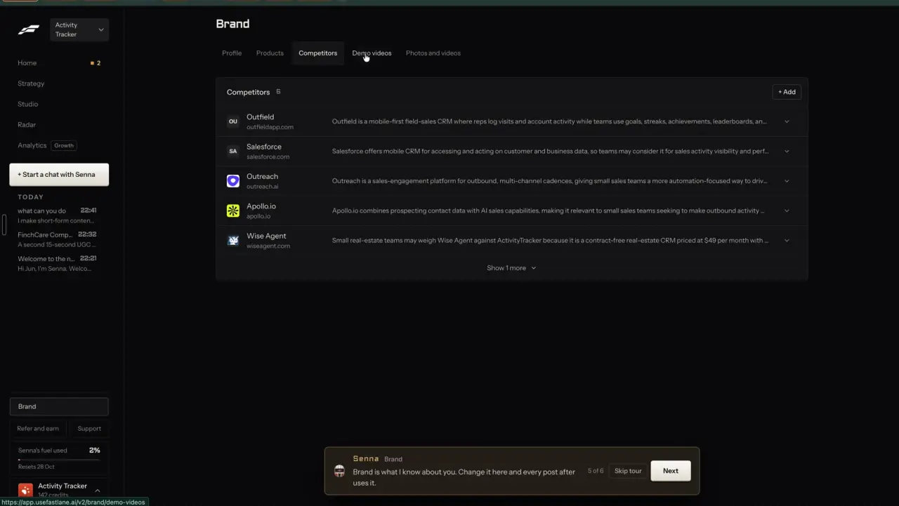

# Your brand from your website

`brand-from-website` | brand | phase 4 | status: partial | /north-star#brand-from-website

## Leo asked

15 Oct 2026: "embed it within the tool so it depends on the person's market/website"

8 Oct 2026: "an all in one tool for my social media management, and for each person too"

## How the best do it

Fastlane reads one website and keeps what it learned on a Brand page with five tabs: "Profile", "Products", "Competitors", "Demo videos", "Photos and videos". The tour line on that page says "Brand is what I know about you. Change it here and every post after uses it." Profile opens with the banner "Senna reads these before making anything. Change one here, or ask Senna in a thread." and a "Set 19 Oct" date beside IDENTITY. Each row has an edit chevron:

- IDENTITY: "Name", "What you do", "Brand voice" (shown "Not set"), "Country" ("Singapore").
- OFFER: "What you sell", "Price point" ("Not set"), "Why they choose you".
- AVATARS: "Who buys" as four pills, "Niche" ("Vertical / SMB business software, ops & CRM").
- LOOK: "Logo" with "Senna has it on file. It is not added to your pieces.", "Colours" as named swatches ("Chocolate", "Rust", "Red"), "Other links", "Assets" ("Not set").


The same setup listed 6 competitors under Brand > Competitors ("Competitors 6", "+ Add"), each with a logo, a domain and one line on why a buyer would compare them, for example "Small real-estate teams may weigh Wise Agent against ActivityTracker because it is a contract-free real-estate CRM priced at $49 per month with ..." (notes-4.md 2.15.3); five rows show and "Show 1 more" opens the sixth.



Its public site calls this "Brand learned from one URL" and shows observations it derived, such as "discount-led" and "no captions" ([usefastlane.ai](https://usefastlane.ai)).

Other competitors:

- Blaze asks for the website at onboarding and builds a starting Brand Kit with "Media Library", "Brand Styles", "Brand Voice", "Brand Profile" (business, offerings, audience) and "Source Materials". One Brand Kit per workspace ([help.blaze.ai](https://help.blaze.ai/en/articles/9535151-getting-started-with-blaze)).
- VEED "Brand Fetch" pulls the logo, fonts and colours from a homepage URL into a brand kit. It shows on marketing pages only, so its current status is unverified ([veed.io](https://www.veed.io/learn/branded-videos-at-scale)).
- Revid.ai Auto-Mode reads a product link for the offer, buyers, benefits, pain points, competitors and tone, shows a brand profile, then drafts a 7-day calendar ([revid.ai](https://www.revid.ai/auto-mode)).
- Creatify's agent takes a brief or just a URL; Shopify, Amazon and App Store links bring in assets, copy and pricing ([creatify.ai](https://creatify.ai/features/agent)).
- Atria keeps brand profiles (name, industries, logo, website, colours, fonts) that generation uses as defaults: 3 on Core, 8 on Plus ([docs.tryatria.com](https://docs.tryatria.com/llms.txt), [pricing](https://www.tryatria.com/pricing)).

## What we have today

Checked against origin/main f2cb275 on 20 Oct (08537d1 plus 88efc12, which changed /brands/new).

- /brands/new (`src/pages/AddBrandPage.tsx`) adds a new brand from its website, on every account. The `brand-dna` edge function (`supabase/functions/brand-dna/index.ts`, `logic.ts`) has no allow-list, only its cap. It reads the first 300 KB of the home page, following up to 3 redirects, with the public-address check (`publicHost`, `fetchCapped`, both private to `index.ts`) on every hop and every logo. It returns the origin it landed on (`url`), the name, colour, the first usable logo of up to 3 candidates (PNG, JPEG or WebP under 250 KB, checked by its bytes) and the Instagram, Facebook, LinkedIn and TikTok handles in the markup. One `openaiChat` call (`OPENAI_MODEL`, default gpt-6-luna, 700 tokens out) writes oneLiner, audienceDetail, 3 to 6 topics, edge and voice from at most 6,000 characters of the page's words, fenced as data. Jev picks the life stage (`audienceAsk`, `who: "brand-dna"`). Cap `brand-dna` 10 a day. A page it cannot open answers 422 "We couldn't open <host>. Check the address, or start with just a name."
- While it reads, six steps tick over every 2.5 s. The person then confirms six cards ("Looks right"), and `create()` fills the new brand's stores: brand kit (`saveBrand`, `content-studio-carousel-brand-<scoped>`), positioning (`savePositioning`, `content-studio-positioning-<scoped>`), social accounts and voice profile (`saveVoiceProfile` with `posts: []`).
- Since 88efc12 the half-done form (address, read result and checked cards) is kept for the tab in sessionStorage `cs-addbrand-form-<uid>` (`keptBrand` in `src/lib/addBrand.ts`, which now also holds the `BrandDna` type), and "Read a different site" starts over. Create clears it, so the address is still not saved anywhere once the brand exists.
- /market (`src/pages/MarketPage.tsx`, `src/lib/market.ts`, Leo only through the market function's `MARKET_USERS`) keeps a typed `site` per brand in `content-studio-market-<scoped>`. Only the weekly check and the set-up suggestions (`suggestSetup`) read it.
- /following (`src/lib/following.ts`) watches up to 5 Instagram or TikTok handles per brand (`MAX_FOLLOWED` 5). Handles only, no businesses or reasons.
- /plan and Write take up to 3 competitor creators picked by hand from the 66 in `src/data/advisors.json` (`CompetitorReference.tsx`) as style references for one plan or post. Nothing suggests them from the brand.
- docs/brand-isolation.md records the shape and the known DNS rebinding limit.

What is missing:

- The open brand cannot be read again. Leo's default brand, and every brand someone added by typing just a name, has no way in, because /brand has no website field at all.
- The read stops at the home page; the about page and the services page never reach the LLM.
- Nothing finds what the brand sells (brand-products) or who it competes with (find-competitors).
- /brands/new forgets which site it read and when, once the brand is created.

## Build

Three commits, in this order: the multi-page read in brand-dna; the Website section on /brand with its review; the Competitors card in the review, once find-competitors has shipped `src/lib/competitors.ts` and its `suggest` mode. /brands/new keeps working for every account as it does today.

### Screens and states

A "Website" section is the first section on /brand (`src/pages/BrandPage.tsx`, id `website`). It renders only when `leoOnly(email)` from `src/lib/leoOnly.ts` is true.

Idle, site saved:

```
Website                                      [Read it again]   About US$0.03 | 9 left today
activity-tracker.io, read 19 Oct
```

Idle, no site saved. The input starts with `loadMarket(uid).site` when /market has one:

```
Website
[ acme.sg                        ] [Read it]  About US$0.03 | 10 left today
```

Reading. The job runs outside React in `src/lib/brandRead.ts` (module-level job plus listeners, like `src/lib/montage.ts`), so leaving /brand keeps it going and a toast says when it is done. The steps tick over every 2.5 s as /brands/new does; the last one waits for the answer.

```
[check] Opening the site
[check] Finding your about, services and pricing pages
[spin]  Reading 4 pages
        What you do and for whom
        How you sound
```

Review, at /brand?website=review, shows one card per field with the current value beside the found one and two buttons, "Keep mine" and "Use this". The fields are Name, Logo, Colour, Social accounts, What you do, Who it's for, Topics, Why people pick you and How you sound. A field that is empty today starts on "Use this"; a field with a value starts on "Keep mine". That matters most for Name: on an adviser's kit it is usually their own name ("You > Name"), and the site gives the business name. Fields where nothing changed fold into one line such as "Same as before: Name, Colour", and a bar on top counts "3 of 9 checked". The main button, "Save to <brand name>", sits beside a quiet "Discard" and writes only the fields set to "Use this".

Competitors card, last in the review, only once find-competitors has shipped. It shows "Suggest competitors" with find-competitors' chip "Up to US$0.02 | <n> left today". Pressing it runs find-competitors' suggestion with the facts from this read and lists up to 6 rows in its own row shape ("<name>, <site>. <why>", buttons "Add" and "Not them"). Add writes at once through `addCompetitor()`; a `duplicate` answer shows "You already watch <name>." and a `cap` answer shows "12 of 12. Remove one to add another." Nothing kept: "No clear competitors found. Add one you know." When the answer carries find-competitors' `note` (Jev unavailable, use refunded), the card shows that note instead. Until find-competitors ships, the card is left out.

Done: toast "Saved to <brand name>. Your next post uses it." The section line updates to "read <date>".

Partial: the home page was read but the other pages failed. The review still shows, with the line "Read the home page only. The other pages didn't open."

Failed: on a 422 the typed address stays and the section shows its own line under the input, "We couldn't open acme.sg. Check the address and try again." brand-dna's 422 text ends "or start with just a name", and that only makes sense on /brands/new.

Refused: brand-dna answers 403 for `deep` when the account is not in `NORTH_STAR_USERS`, and the section shows "This isn't on for your account yet."

Over the daily cap: `usageRefusal` copy, "You've used all 10 for today. It resets at 8am Singapore time." The button is disabled and the chip reads "None left today".

Jev unavailable: the page pick falls back to the home page alone (no keyword list) and the life stage keeps the brand's current one. No message, since the review still works.

/brands/new on Leo's sign-in sends `deep: true`, and `create()` also saves `website` (the `url` brand-dna returned) and `websiteReadAt` in the new brand kit, so the Website section opens on "read <date>". On any other account the page sends and saves nothing new.

The "<n> left today" figure on every chip comes from `useUsesLeft` in `src/lib/aiUsage.ts`, as AiVideo's chips do.

### Copy

- Section title: "Website"
- Input placeholder: "acme.sg"
- Buttons: "Read it", "Read it again", "Keep mine", "Use this", "Save to <brand name>", "Discard", "Suggest competitors", "Add", "Not them"
- Status line: "<host>, read <d Mon>"
- Price chips: "About US$0.03 | <n> left today", or "None left today"; Competitors card "Up to US$0.02 | <n> left today"
- Steps: "Opening the site", "Finding your about, services and pricing pages", "Reading <n> pages", "What you do and for whom", "How you sound"
- Review field titles: "Name", "Logo", "Colour", "Social accounts", "What you do", "Who it's for", "Topics", "Why people pick you", "How you sound", "Competitors"
- Folded line: "Same as before: <fields>"
- Progress: "<n> of <m> checked"
- Partial: "Read the home page only. The other pages didn't open."
- Failed: "We couldn't open <host>. Check the address and try again."
- Competitor row: "<name>, <site>. <why>"; row answers "You already watch <name>.", "12 of 12. Remove one to add another."
- No competitors found: "No clear competitors found. Add one you know."
- Done toast: "Saved to <brand name>. Your next post uses it."
- Refused: "This isn't on for your account yet."
- InfoTip on the section title: "We read your home page and up to 4 more of your pages."

### Data

- Brand kit (`CarouselBrand` in `src/lib/carousel.ts`, key `content-studio-carousel-brand-<scoped>`): add `website?: string` (an http or https origin, at most 200 characters) and `websiteReadAt?: string` (ISO). `sanitizeBrand` keeps both and drops anything else.
- The last read waits on this device in `cs-brand-read-<scoped>` (the brand-dna answer plus `readAt`) until Save or Discard clears it, so the review survives leaving the page and a reload; as a draft it stays device-only.
- Where each review field writes, on Save, only when it is set to "Use this":

| Field | Store and field |
| --- | --- |
| Name | brand kit `name` |
| Logo | brand kit `logo` |
| Colour | brand kit `color` |
| Social accounts | `saveSocialAccounts` per network, plus brand kit `instagram`, `facebook` and `handle`, as /brands/new does |
| What you do | positioning `oneLiner` |
| Who it's for | positioning `audience` (Jev's life stage) and `audienceDetail` |
| Topics | positioning `topics` |
| Why people pick you | positioning `edge` |
| How you sound | voice profile `voiceSummary`; the pasted `posts` are kept, unlike /brands/new, which starts them empty |

- Positioning keeps every other field (`platform`, `cadence` and the rest) as it is and gets a new `updatedAt`.
- When /market has no `site` yet, Save also sets it through `saveMarket`, so the weekly check and the kit use the same address.
- Competitors go to the list find-competitors owns, `content-studio-competitors-<scoped>`, through its `addCompetitor()` in `src/lib/competitors.ts` with `{ name, site (host only), logo: null, why, fbPageId: null, handles: {}, adsCountry: "SG", source: "website" }`. One shape and one limit of 12 (Fastlane shows "6 of 12"). This item never creates `competitors.ts` itself.
- Every store above is a synced `content-studio-` key or a device `cs-` key, so the database schema does not change.

### AI and cost

brand-dna takes one new request field, `deep?: boolean`. It answers 403 `{ code: "not_allowed" }` unless `isAllowed(Deno.env.get("NORTH_STAR_USERS"), uid)` passes, with `isAllowed` from `supabase/functions/market/logic.ts`. find-competitors adds the `NORTH_STAR_USERS` secret (Leo's two uids); if this ships first, it adds the secret instead. The fetch helpers come from `supabase/functions/_shared/safeFetch.ts` once find-competitors moves `publicHost` and `fetchCapped` there; until then they stay in brand-dna.

Deep read (counts once against `brand-dna`):

1. `readSite` also returns `links`: same-host http and https links from `<a>` tags in the first 300 KB, as `{ text, path }`, de-duplicated, at most 40, with no `mailto:`, `tel:` or bare `#` links.
2. Jev picks the pages in one `askJev` call, `who: "brand-dna pages"`, `timeoutMs: 15_000`. Jev takes one state per call, so the state is `{ site: <name>, home: <origin> }` and each link rides in its own question, the way `pickQuestions` in `supabase/functions/video-assist/montage.ts` carries a beat: question `p<i>`, type `noul`, instructions `{ link: { text, path }, question: "Does \`link\` lead to a page about what the business sells, who it serves, what it charges or who runs it, such as an about, services, products, plans or pricing page?" }`. Keep the 4 highest at 0.5 or more (`pickPages`). When Jev returns null, read the home page only.
3. Fetch those pages in parallel through `fetchCapped` (300 KB each, the same guards, 8 s each, 20 s for all of them).
4. `writeMessages` strips any `</page>` from each page's text, then fences each page in its own `<page url="...">` block: at most 6,000 characters a page and 18,000 in all.
5. The response gains `pagesRead: string[]`, the addresses that made it into the prompt.

Competitors: brand-dna does nothing new. The review's card calls the `competitors` edge function in `mode: "suggest"` through the client helper behind find-competitors' own "Suggest competitors" button. The brand it sends comes from this read, `{ name, site, sells: oneLiner, serves: audienceDetail, topics }`, and `exclude` holds the current list plus `dismissed`. Each press uses one of find-competitors' `competitor-suggest` cap (5 a day); its Jev questions and refunds stay as that spec sets them.

Cost, estimated: the deep read is one OPENAI_MODEL call of about 6,000 input tokens (today about 2,000), roughly 1 to 3 US cents, given as a range because the gpt-6-luna price is not in the repo. Jev's 41 questions at most (40 links and the life stage) cost well under 0.1 US cent at USD 0.042 per million input tokens, so the chip says "About US$0.03". Competitor suggestions cost up to about US$0.02 on find-competitors' own estimate.

Caps in `supabase/functions/_shared/usageCaps.ts` DAILY_LIMITS:

- `"brand-dna": 10` stays; a deep read counts once. Change its comment to "Adding a brand from its website, or reading it again on /brand (brand-dna): up to 5 pages, one LLM call and two Jev calls."
- No new cap.

### Deep links

- /brand#website opens the section.
- /brand?website=review opens this device's waiting review. With nothing waiting it shows the section and drops the param (replace).
- `links.brand` in `src/lib/links.ts`: add `"website"` to `BrandSection` and an option `review?: true` that adds `website=review`.
- docs/deep-links.md: add `website=review` and `#website` to the /brand rows.

## Done when

- [ ] On Leo's sign-in /brand shows Website first; on another account the section does not render, and brand-dna with `deep` answers 403.
- [ ] Reading activity-tracker.io into the default brand logs more than one page in `pagesRead`, and the review shows current beside found for every field.
- [ ] "Keep mine" leaves a field as it was; Save writes only "Use this" fields plus `website` and `websiteReadAt`, and fills /market's site when it was empty.
- [ ] Leaving /brand during a read and coming back shows the review; a reload keeps it.
- [ ] Once find-competitors has shipped, "Suggest competitors" in the review adds rows to `content-studio-competitors-<scoped>` through `addCompetitor()` with `source: "website"`, at most 12, one per site.
- [ ] Over the cap shows the 8am reset copy; with Jev switched off (no key) the read returns the home page result with no error.
- [ ] A brand added on Leo's sign-in at /brands/new has `website` and `websiteReadAt` in its kit, and /brand#website shows "<host>, read <date>".
- [ ] Saving with "Use this" on How you sound keeps the voice profile's pasted posts.
- [ ] /brands/new on a non-Leo account behaves exactly as before.
- [ ] Checked by eye at 390 px and 1440 px; `npm run build` and the full `npx vitest run` pass.
- [ ] The item's `status` and `ours` line in `src/data/northStar.ts` are flipped in the same commit.

## Tests

- `supabase/functions/brand-dna/logic.test.ts`: `readSite` returns same-host links only, at most 40, de-duplicated, without `mailto:`, `tel:` or `#`. `writeMessages` caps each page and the total and removes `</page>` from page text.
- Same file: `pageQuestions(links)` puts each link in its own question's instructions and nothing per link in the state; `pickPages(answers, links)` keeps the 4 highest at 0.5 or more and returns an empty list for null answers.
- `supabase/functions/brand-dna/index.test.ts`: `deep` answers 403 for a uid missing from `NORTH_STAR_USERS` while a plain read still works; one extra page failing still returns the home page result.
- `src/lib/carousel.test.ts`: `sanitizeBrand` keeps `website` as an origin, drops `javascript:` and other non-http values, and keeps `websiteReadAt` only as an ISO date.
- `src/lib/brandRead.test.ts`: `mergeRead(current, found, picks)` writes only picked fields to the stores in the Data table, starts empty current fields on "Use this" and set ones on "Keep mine", keeps the voice profile's `posts`, and fills /market's site only when it is empty.
- Calibration before the threshold is final: run the deep read on Leo's three brand sites and 7 SG adviser sites, print every Jev answer for the pages, mark where a person would pick differently, and set the 0.5 from that run. Put the numbers in the commit message.

## Open questions

- Many SG advisers compete with people who have only an Instagram account and no website. find-competitors' suggestions already draw on the 66 creators in `src/data/advisors.json`. Should a competitor added here with an Instagram or TikTok handle also go on Following (5 at most), so their posts show on /following and /market? Leo decides.
- Fastlane's Offer block has "What you sell" and "Price point". This spec leaves both to brand-products, since advisers rarely post fees on their sites.
- The 10-a-day `brand-dna` cap now covers reads of up to 5 pages. Keep 10 while it is Leo-only.
- An earlier draft of this spec ran its own Google search (DataForSEO) for competitors with a separate `brand-competitors` cap. That duplicated find-competitors' `suggest` mode, so this version reuses it. Adding Google results as suggestion candidates belongs in find-competitors.
- Two server gates are proposed across the specs: brand-audiences names an email list in `_shared/leoOnly.ts`, while find-competitors and this spec use the `NORTH_STAR_USERS` uid secret with `isAllowed`. The first of these items to ship picks one and the rest follow it; `NORTH_STAR_USERS` matches the existing `MARKET_USERS` pattern.

## New evidence (20 Oct 2026)

Brand > Profile's Website card with "Edit" and "Refresh brand profile", and the inline competitor add row: [settings notes](../videos/fastlane-2026-10-20-settings/notes.md).

## Related

brand-products, find-competitors, brand-audiences, brand-voice-memory, brand-kit, remix-your-brand, business-onboarding, business-cost-preview
