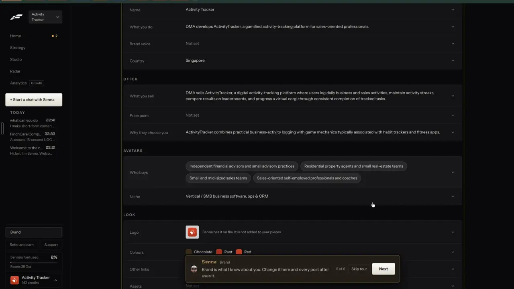

# Brand kit on every post and video

`brand-kit` | brand | phase 4 | status: partial | /north-star#brand-kit

## Leo asked

No direct ask; from the competitor research.

## How the best do it

Fastlane keeps a light kit under Brand > Profile > LOOK: a "Logo" tile with the note "Senna has it on file. It is not added to your pieces.", "Colours" as named swatches ("Chocolate", "Rust", "Red"), "Other links" and "Assets" ("Not set"). So Fastlane knows the logo but leaves it off what it makes by default. (notes-4.md 2.15.1)



The caption look is saved once per workspace: above a video proposal in chat, a row reads "Captions: Classic   Saved for every video with a voice". (notes-4.md 2.3)


The tools that apply a kit to everything they make:

- PostNitro: per brand a name, logo and handle, saved palettes (flat or gradient), a font pairing from 100+ typefaces or your own licensed font, and several headshots per kit "so any team member can sign a post". Brands: 1 Free, 2 Starter, 5 Creator+, 15 Team+. [site](https://postnitro.ai/), [pricing](https://postnitro.ai/pricing)
- VEED Brand Kits hold fonts, colours (HEX, RGB, HSL), images, video, audio and saved groups such as lower thirds, intros and outros. You add to a kit by bulk upload or by right-clicking a timeline item > "Save to Brand Kit". Free has none; Creator has one kit with fonts and colours only; Pro and up have several kits with every asset type. [help](https://support.veed.io/en/articles/9616498-how-to-create-and-manage-brand-kits)
- OpusClip Brand Template is one preset applied when a video is submitted: aspect ratio, layout, caption colour, position, animation and custom font. Free and Starter get 1 template, Pro 2 (4 with an add-on). Intro and outro cards come from "Add as Intro" / "Add as Outro", up to 1 minute and 200 MB each. [template](https://help.opus.pro/docs/article/how-to-add-a-brand-template.md), [intro and outro](https://help.opus.pro/docs/article/intro-outro-cards.md)
- Submagic: sidebar "Brand Kits" > "+ Create brand kit", one per brand or client, holding logos, colours, backgrounds, overlays and templates; Pro and Business. [help](https://care.submagic.co/en/article/how-to-use-brand-kit-in-submagic-16031pe/)
- Descript Brand Studio: uploaded .ttf, .otf or .woff fonts, named brand colours in every colour picker, a logo, and a default layout pack for new projects; Business and Enterprise only. [help](https://help.descript.com/branding/brand-studio.md)
- Klap applies each workspace's kit to all clips automatically; the export watermark is an image with x and y from 0 to 1 and a scale. [docs](https://docs.klap.app/styling)
- Publer adds a watermark to photos automatically on Professional and to videos on Business. [help](https://publer.com/help/en/article/what-is-included-in-publer-business-1c57hsq.md)
- Broadridge Advisor Video Studio personalises 30+ FINRA-reviewed adviser videos with the adviser's photo, colours, logo and contact details (Growth tier). [article](https://wealthprofessional.ca/investments/wealth-technology/broadridge-empowers-advisors-to-make-their-mark-with-video/361314)

## What we have today

Checked against the code on 2026-10-20 (worktree at origin/main 08537d1).

- One kit per brand at /brand (src/pages/BrandPage.tsx), stored as `CarouselBrand` in `content-studio-carousel-brand-${scoped(userId)}` (src/lib/carousel.ts). Each brand profile has its own, so an agency or Leo with three brands already has several kits.
- Kit fields: name, handle, role, one headshot (256 px square JPEG), a logo (PNG, WebP or JPEG upload, shrunk to 400 px and stored as WebP, PNG where WebP is missing), one colour (6 presets or any hex), the sign-off and link tagging, DM links and offers, the writing rules and posting times. Images are capped at 350,000 characters each (MAX_IMAGE_CHARS). Sections: you, dm-links, offers, emoji-and-hashtags, avoid-words, colour, sign-off, posting-times, logo; the aside shows "On your carousels" with one slide preview.
- Carousels (src/lib/carouselLayout.ts) fill the cover and the last (CTA) slide with the colour, put it in the top bar of the point slides and use it for the accent rule (`accentOnPaper`); the footer shows the headshot, name and handle. The slide font pairing (`SlideFont` classic, modern, serif, shown as Classic, Modern, Editorial) and paper (light, dark, tint) are not in the kit: a new carousel starts from the device's last pick (`cs-carousel-look`, localStorage), and each saved carousel keeps its own `font` and `paper` (`SavedCarousel`, synced in `content-studio-carousels-`). The carousel maker also edits the kit's name, handle and colour and saves them back with `saveBrand`.
- Videos: the logo (top right) and an end card (photo, name, handle, role, sign-off line, `END_CARD_SECONDS` 2.5, `drawEndCard` in src/lib/videoMedia.ts) are per-video toggles, both false in `defaultSettings`. Saved video skills (`content-studio-videoskills-`, up to 12) store a look through `lookOf`, which copies every defined look key, `logo` and `endCard` included. The skill marked "New videos start with it" applies to every new project, AI clips included (VideoEditPage `withLook(defaultSettings("bold"), defaultSkill(...)?.look)`, in two places in `upload`). So any saved default skill carries `logo: false` unless the person turned it on before saving.
- Caption fonts are `FONTS` heavy, clean and serif ("Heavy", "Clean", "Serif"), from 3 web fonts (Archivo Black, DM Sans, Fraunces) loaded by `ensureCaptionFonts`. Carousels use system fonts because an SVG drawn to a canvas cannot load web fonts.
- AI pictures (src/lib/aiImage.ts, Higgsfield Soul, saved to Media folder "AI images" through `storePicture`) carry nothing from the kit. PostPreview shows the headshot.
- Missing: more than one colour, a brand font, more than one person who can sign, an intro card, a kit-level choice to put the logo and cards on everything, and the carousel look saved per brand.

## Build

Gate: the new kit sections and the new defaults apply only when `leoOnly(email)`. Other users' /brand and new videos behave as today.

### Screens and states

/brand gains four parts; existing anchors stay.

```
You (#you)                      [photo] Name  Handle  Role
  People who sign (#people)     [photo] Sarah Lim, Adviser   [x]
                                + Add a person (up to 4)
Colours (#colour)               Main [Navy]   + Add a colour (up to 3)
                                Rust #B7410E [x]   Sand #E9D8A6 [x]
Font (#font)                    Your font: Inter Tight   [Remove]
                                [Upload a font]  WOFF2, TTF or OTF, up to 300 KB
Put on every post (#on-every-post)
  [x] Logo on every video        [ ] End card on every video
  [ ] Intro card on every video  [ ] Logo on AI pictures
  Carousel look: Classic, light paper   (set from the carousel maker)
Preview aside: [Slide] [End card]
```

- People who sign: each has a photo (same 256 px crop as the headshot, `shrinkImage(file, "photo")`), name, role and an optional handle. Carousel and video end card get a "Signed by" select when at least one person exists; it defaults to the kit's own name. Up to 4.
- Colours: the main colour as today, plus up to 3 named colours. A name defaults to the preset name when the hex matches one in BRAND_PRESETS, else "Colour 2", "Colour 3", "Colour 4".
- Font: upload reads the file in the browser, checks its first bytes, registers it with `new FontFace("BrandFont", buffer)` and `document.fonts.add`, then shows a sample line in it.
- Put on every post: four switches. "Logo on every video" starts on when a logo exists; the rest start off. Logo switches are disabled without a logo, with the reason beside them.
- Carousel look: shows the brand's saved pairing and paper. The carousel maker sets it.
- Preview aside: the slide preview as today, plus an "End card" tab that paints `drawEndCard` at t = 1 on a 270 x 480 canvas.

Where the kit lands:
- Carousel (src/pages/CarouselPage.tsx, src/lib/carouselLayout.ts): a new carousel's look starts from the kit's `slideFont` and `slidePaper`, then `cs-carousel-look`, then classic and light. A saved carousel reopens in its own saved `font` and `paper`, as today. When the picked look differs from the kit, a link "Make this my brand's look" saves it to the kit. The second colour (`palette[0]`), when set, takes the accent rule and the CTA slide background; the main colour keeps the cover and the top bar. A "Signed by" select sets the footer person, saved on the carousel as `signer`.
- Brand font on carousels: spike first (below). If it works, the SVG carries an inline `@font-face` with the data URL and titles use it; if not, carousels keep system fonts.
- Video (src/pages/VideoEditPage.tsx, src/lib/videoEdit.ts): one helper builds a new project's settings in both places in `upload`: `withKit(withLook(defaultSettings("bold"), defaultSkill(skills)?.look), kit)`, with the montage's `...extra?.settings` still spread after it in the short-video path. `withKit` runs after the skill and sets `logo`, `endCard` and the new `introCard` from the kit's switches, because every saved skill carries `logo` and `endCard` (see above) and would otherwise always switch the kit off. A skill tapped on an open video still changes them for that video, and so does the per-video toggle. `FontId` gains "brand" and FONTS gains `brand: { label: "Your font", css: '600 {px}px BrandFont, "DM Sans", system-ui, sans-serif' }` when a brand font exists; the end card and name tag use it. The caption colour picker gets a "Your colours" row.
- Intro card: new `drawIntroCard(g, art, t)` beside `drawEndCard`: 1.5 s (`INTRO_CARD_SECONDS`) on the main colour with the logo (or the signer's photo when there is no logo) and the brand name. `fullLength` adds it when on.
- AI pictures (src/lib/aiImage.ts): with "Logo on AI pictures" on, the logo is drawn bottom right at 12% of the width onto the downloaded picture before `storePicture`. "Fix it" edits Higgsfield's unstamped original, so its result is stamped the same way before it is saved.
- AI avatar, explainer, template and montage videos reach the editor through the same `upload` path, so they get the video switches with no extra code.

States:
- Empty: no logo turns the logo switches off and disabled; no people hides "Signed by".
- Loading: the form waits for the account, as today.
- Saving: the header "Saved" tick, as today.
- Failed font: wrong type or unreadable shows the font error; too big shows the size error; nothing is saved.
- Failed image: the existing "That logo is too detailed to store" path covers people's photos too.
- Full: "Add a person" and "Add a colour" are hidden at their limits, with the limit line.
- There is no AI call, so no making, refused or over-the-cap state.

### Copy

- Section labels: "People who sign", "Colours", "Font", "Put on every post"
- InfoTip on People who sign: "Pick who signs each carousel or video."
- InfoTip on Put on every post: "New videos and pictures start with these. Change any one per video."
- Buttons: "Add a person", "Add a colour", "Upload a font", "Remove", "Make this my brand's look"
- Switches: "Logo on every video", "End card on every video", "Intro card on every video", "Logo on AI pictures"
- Disabled reason: "Add a logo first"
- Font help (requirement, visible): "WOFF2, TTF or OTF, up to 300 KB. Only upload a font you have the right to use."
- Font errors: "That file isn't a font this browser can read. Use WOFF2, TTF or OTF." and "Fonts up to 300 KB. Try the WOFF2 version."
- Limits: "Up to 4 people." and "Up to 3 more colours."
- Select label: "Signed by"; first option: the kit's own name
- Carousel look line: "Carousel look: {Classic | Modern | Editorial}, {light | dark | tint} paper"
- Video font option: "Your font"; colour row label: "Your colours"
- Preview tabs: "Slide", "End card"

### Data

All per brand and synced, no schema change:

- `CarouselBrand` (src/lib/carousel.ts) gains:
  - `palette?: { name: string; hex: string }[]`: up to 3, name 20 characters, hex through `normalizeHex`.
  - `people?: { id: string; name: string; role?: string; handle?: string; photo: string }[]`: up to 4, photo through `sanitizeImage`.
  - `stamp?: { videoLogo?: boolean; videoEnd?: boolean; videoIntro?: boolean; pictureLogo?: boolean }`: `videoLogo` unset reads as "on when a logo exists".
  - `slideFont?: SlideFont; slidePaper?: SlidePaper`.
- The brand font lives in its own key so editing the kit does not re-upload it: `content-studio-brandfont-${scoped(userId)}` = `{ name: string; data: string; addedAt: string }`. `data` is a base64 data URL, accepted only when its first bytes are `wOF2`, `OTTO`, `true` or `00 01 00 00`.
- `SavedCarousel` gains `signer?: string`; `EditSettings` gains `introCard?: boolean` and `signer?: string`, both added to LOOK_KEYS and the boolean list in `applyPatch`.

### AI and cost

None. No model, no Jev question, no cap, no provider cost. The kit is drawn in the browser.

### Spike before the carousel font

An SVG with an inline `@font-face { src: url(data:font/woff2;base64,...) }`, drawn into a canvas the way `svgDataUrl` and the PNG export do, in Chrome, Safari and Firefox on desktop and Safari on iOS. Write the result into this spec's Open questions. If any browser draws the fallback face, carousels keep system fonts and the brand font applies to video only.

### Deep links

- `/brand#people`, `/brand#colour` (existing), `/brand#font`, `/brand#on-every-post`. Add them to `BrandSection` in src/lib/links.ts and to the /brand row in docs/deep-links.md.
- No new params, since the signer and the switches are form values inside a page.

## Done when

- [ ] On Leo's sign-in /brand shows People who sign, extra colours, Font and Put on every post; other sign-ins see today's page.
- [ ] With a logo and default switches, a new video (uploaded, or an AI avatar clip) opens with the logo on, also when a default skill saved with the logo off exists; tapping that skill on the video turns it off.
- [ ] "End card on every video" and "Intro card on every video" on: an export runs 2.5 s + 1.5 s longer and shows both cards in the brand colours and font.
- [ ] A new carousel opens in the brand's saved look and a saved one in its own; "Make this my brand's look" changes the kit; "Signed by" swaps the footer person and survives reopening the carousel.
- [ ] The second colour shows on the accent rule and the CTA slide.
- [ ] "Logo on AI pictures" stamps the logo on the next "Make the image" result in Media, and on a "Fix it" result.
- [ ] A 400 KB font and a PNG renamed .woff2 are both refused with the right message.
- [ ] The spike result is written into Open questions.
- [ ] `npm run build`, the full `npx vitest run`, and a by-eye check at 390 px and 1440 px pass.
- [ ] `src/data/northStar.ts` item flipped to live with its `ours` line, in the same commit.

## Tests

- `src/lib/carousel.test.ts`: `sanitizeBrand` keeps 3 palette colours with valid hex, 4 people with valid photos, the stamp booleans and the slide look enums; it drops a fifth person, bad hex and bad enums.
- `src/lib/carouselLayout.test.ts`: the accent and CTA background use `palette[0]` when set and the main colour when not; the footer uses the signer's name and photo.
- A pure `startLook(saved, kit, device)` in src/lib/carousel.ts, tested: a saved carousel's own font and paper win, then the kit's, then the device pick, then classic and light.
- `src/lib/videoEdit.test.ts`: `withKit` turns the logo on when a logo exists and `stamp.videoLogo` is unset, keeps it off when set false, and sets `endCard` and `introCard` from the switches; `withKit` after `withLook` wins over a skill look holding `logo: false`; `fullLength` adds 1.5 s for the intro.
- `src/lib/brandFont.test.ts` (new, with the reader in src/lib/brandFont.ts): accepts WOFF2, OTF and TTF headers, refuses PNG bytes and anything over 300 KB.
- Prove each case bites by breaking the code once.

## Open questions

- Defaults: Fastlane leaves the logo off what it makes. This spec turns the video logo on when a logo exists and leaves the cards off. Leo decides.
- Spike result for brand fonts on carousels (run 22 Oct 2026, builder brand-kit): an SVG with an inline `@font-face { src: url(data:font/ttf;base64,...) }`, drawn into a canvas through an `` from a `data:image/svg+xml` URL the way `svgDataUrl` and the PNG export do, drew the uploaded face (pixels differ from the fallback on the first draw) and left the canvas readable (`toDataURL` did not throw) in Chromium 151 and WebKit 26.5 (Playwright's builds, desktop). Firefox and Safari on iOS were not tested: no Firefox build on this machine and no phone. Since the rule is "if any browser draws the fallback face, carousels keep system fonts" and two browsers are unknown, carousels keep system fonts in phase 4 and the brand font applies to the video end card only. To turn it on later: check Safari on an iPhone and Firefox, then embed the `@font-face` in `renderSvg` and register the same face before `createCanvasMeasure` measures (each slide SVG grows by the font's data URL, up to 400,000 characters).
- A brand font adds up to about 400,000 characters to one synced key. `cs_user_data` has no size check in code (supabase/hub/004_user_data_sync.sql); the server limit is unverified.
- Fonts are taken on the user's word that they hold the licence. Leo decides whether that line is enough.
- "Copy this kit to another brand" for agencies is left out until someone runs more than three brands.

## Related

brand-media-sets, brand-from-website, people-my-face, edit-captions, edit-carousel, formats-carousel-designs, formats-static-ad, remix-your-brand
