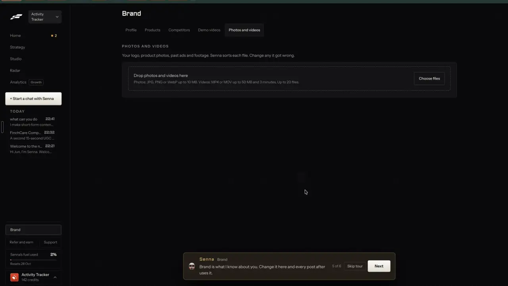

# Your media in the cloud

`brand-media-library` | brand | phase 4 | status: partial | /north-star#brand-media-library

## Leo asked

No direct ask; from the competitor research.

## How the best do it

Fastlane takes your files on Brand > Photos and videos, under the heading "PHOTOS AND VIDEOS" and the line "Your logo, product photos, past ads and footage. Senna sorts each file. Change any it got wrong." Below it, a dashed dropzone with a "Choose files" button gives the limits: "Drop photos and videos here" and "Photos: JPG, PNG or WebP up to 10 MB. Videos: MP4 or MOV up to 50 MB and 3 minutes. Up to 20 files."



The same files show in Studio > Library under "MEDIA", with the meter "16 MB of 10 GB storage used", filters "All", "Images" and "Videos", and an "Upload" button (FireShot capture `research/fastlane-pdf/lib-tile-00.webp`). In chat, Senna answers "how do I give you my content assets" with "Attach photos or videos with the paperclip in this chat and say how you want them used. You can also keep content in [Library] for later." (notes-4.md 2.7). Settings lists storage under "Plan and spend": "Your plan, credits, storage and invoices." (notes-4.md 2.17).

Other competitors:

- VEED brand kits take a bulk upload and sort it automatically into fonts, colours, images, video, audio and saved groups. Free has no kit, Creator gets one kit with fonts and colours only, and Pro and up get several kits with every asset type ([support.veed.io](https://support.veed.io/en/articles/9616498-how-to-create-and-manage-brand-kits)).
- Descript Brand Studio keeps up to 500 shared media assets, B-roll included, on Business and Enterprise ([help.descript.com](https://help.descript.com/branding/brand-studio.md)).
- Sprout Social's Asset Library imports from Canva, Bynder, Adobe Experience Manager, Dropbox and Google Drive ([sproutsocial.com](https://sproutsocial.com/features/social-media-publishing/)).
- Later's media library takes uploads, Canva and Dropbox, and on Growth and Scale "Collect by Tags" and "Collect by Mentions" pull other people's posts in ([later.com](https://later.com/pricing/)).
- Storage limits elsewhere: Planable gives 10 GB or 50 GB ([planable.io](https://planable.io/pricing/)); Kapwing gives 5 GB on Free with 3-day retention, 200 GB on Pro and 800 GB on Business ([kapwing.com](https://www.kapwing.com/help/kapwing-faq/)).

## What we have today

Checked against origin/main f2cb275 on 20 Oct.

- /media (`src/pages/MediaPage.tsx`, `src/lib/mediaLibrary.ts`) holds photos only, as 1080 px wide JPEGs that `storePicture` writes to IndexedDB (`src/lib/deviceFiles.ts`, database `content-studio-video`, store `files`) under `cimg-` keys. The index (name, folder, alt, width, height, added date and Pexels credit) sits in device-only `cs-media-<scoped>` and keeps at most 300 items: `addMedia` puts the new one first and `save` cuts the list to 300, so the oldest entry drops off without a word while its file stays in IndexedDB. `loadMedia` keeps only keys matching `cimg-`, and `updateMedia` can change only name, folder and alt.
- It has folders, search, hand-typed alt text, Pexels stock with credit, and the "AI images" folder that Write's "Make the image" fills.
- Videos uploaded to /edit stay with the editor's projects (IndexedDB, keyed by project id) and never appear in Media. Write already keeps an attached video under a `cvid-` key (`attachFiles` in `GeneratePage.tsx`) and checks types with `fileType` and `fileProblem` from `src/lib/autoPost.ts` (JPG, PNG, WebP, MP4, MOV), but that video belongs to one draft.
- Nothing syncs: a photo added on the laptop is missing on the phone, and the page has no sort and no storage meter.
- The repo has no Supabase Storage at all, with no `storage.from(` call anywhere and no bucket in the `supabase/hub/` migrations (the last is 024).

Status is partial: there is a photo library on one device, with no videos, no sort and no cloud copy.

## Build

Two steps. Step 1 changes no schema and can ship now. Step 2 needs a migration and new storage spend, so it waits for Leo's yes. Everything new shows only when `leoOnly(email)` is true; other accounts keep today's photo library.

### Screens and states, step 1

/media Library view:

```
Media    [Library] [Sets]                                   [Upload]
Using 340 MB on this device
[All] [Photos] [Videos]      Type: [Any v]          [ Search ...        ]
+ - - - - - - - - - - - - - - - - - - - - - - - - - - - - - - - - - - +
| Drop photos and videos here                                          |
| Photos: JPG, PNG or WebP up to 10 MB. Videos: MP4 or MOV up to       |
| 50 MB and 3 minutes. Up to 20 at a time.            [Choose files]   |
| Sorting: under US$0.01 a file | 200 left today                       |
+ - - - - - - - - - - - - - - - - - - - - - - - - - - - - - - - - - - +
[tile: Product]  [tile 0:24: Footage]  [tile: Person]  ...
```

Each tile carries a type chip. Tapping it opens a menu of the seven types (Person, Logo, Product, Past post, Screen, Footage, Other), and the pick saves at once with `typeBy: "you"`. Video tiles show their length, such as "0:24".

Adding: the drop or the file picker takes up to 20 files, checks each one before storing it, and shows "Adding 3 of 7" in the strip. The type check reuses `fileType` from `src/lib/autoPost.ts`; the size and length limits are this page's own. Photos go through `storePicture` as today. Videos keep their own bytes, stored with `putFile` under a `cvid-` key, the same prefix Write's attachments use. Each gets a 240 px thumbnail under the matching `cimg-` key from `stills(file, [0.25], 240)` (it returns a data URL, turned into a Blob with `fetch(url).blob()` as `storePicture` does) and a length from `loadVideo` (both in `src/lib/videoMedia.ts`).

Sorting: each new file joins a queue in `src/lib/mediaSort.ts`, a job outside React that runs 3 at a time and keeps going if the page is left. A tile shows the chip "Sorting" until its answer lands, usually in about 2 seconds. The answer sets the type and fills the alt text when the item has none, so a Pexels photo keeps Pexels' alt text. The chip's "<n> left today" comes from `useUsesLeft` in `src/lib/aiUsage.ts`.

Refusals before storing, one line each in the strip:

- Too big: "<name> is 64 MB. Videos can be up to 50 MB." (photos: "Photos can be up to 10 MB.")
- Too long: "<name> runs 4:10. Videos can be up to 3 minutes."
- Wrong type: "<name> isn't a photo or video we can use."
- More than 20: "Pick up to 20 at a time. Added the first 20."
- The browser cannot open a video: `loadVideo`'s own message, "This browser can't open that video. Try an MP4 or MOV."
- Device full (IndexedDB `QuotaExceededError`): "This device is out of space for media. Remove some, or free up space on the device."
- Library full (300 items): "Media holds 300 files. Remove some to add more." This check runs before storing, so a new upload never pushes the oldest entry out the way `save` does today.

Sort failures leave the file in place. When the vision call fails or Jev returns null, the type is "Other" with no message, since the chip itself is the fix. When `media-sort` is used up the strip says "Saved. Sorting is used up for today, so set the type yourself." A 403 from media-sort changes nothing visible: the type stays "Other".

The space line reads `navigator.storage.estimate()` usage for the whole site, so it counts editor projects too: "Using 340 MB on this device".

### Screens and states (step 2: the cloud copy, after Leo approves)

The space line becomes the quota: "1.2 GB of 5 GB used". At 90% it turns to a warning, "Almost full: 4.6 GB of 5 GB used". An upload that would pass the quota is refused with "Your media is full (5 GB). Remove some to add more."

On the first load after step 2, the device's index copies into the synced key and its files upload in the background, 2 at a time, under the strip "Copying your media to the cloud: 12 of 40". Leaving the page pauses nothing, because the job lives outside React; it resumes on the next load if the tab closed.

A tile whose file is not on this device yet shows its thumbnail from a signed URL. Opening or using it downloads the file, with "Getting it from the cloud" on the tile. When another device has deleted the cloud copy, the tile reads "This file was deleted" and drops out when tapped.

A failed upload keeps the file on the device. Its tile says "Not in the cloud yet. Retry", and Retry runs that one upload again.

### Copy

- Dropzone: "Drop photos and videos here", "Photos: JPG, PNG or WebP up to 10 MB. Videos: MP4 or MOV up to 50 MB and 3 minutes. Up to 20 at a time.", button "Choose files"
- Filters: "All", "Photos", "Videos"; "Type" with "Any", "Person", "Logo", "Product", "Past post", "Screen", "Footage", "Other"
- Chips: "Sorting", the type name, "<m:ss>" on videos
- Strip: "Adding <n> of <m>"
- Refusals: "<name> is <n> MB. Videos can be up to 50 MB.", "<name> is <n> MB. Photos can be up to 10 MB.", "<name> runs <m:ss>. Videos can be up to 3 minutes.", "<name> isn't a photo or video we can use.", "Pick up to 20 at a time. Added the first 20.", "This device is out of space for media. Remove some, or free up space on the device.", "Media holds 300 files. Remove some to add more."
- Cap: "Saved. Sorting is used up for today, so set the type yourself."
- Space: "Using <size> on this device"
- Step 2: "<used> of 5 GB used", "Almost full: <used> of 5 GB used", "Your media is full (5 GB). Remove some to add more.", "Copying your media to the cloud: <n> of <m>", "Getting it from the cloud", "This file was deleted", "Not in the cloud yet. Retry"
- Price chip under the dropzone: "Sorting: under US$0.01 a file | <n> left today", or "None left today, so set the type yourself"
- InfoTip beside the Type filter: "We sort each file when you add it. Tap a type to change it."

### Data

Step 1:

- `MediaItem` in `src/lib/mediaLibrary.ts` gains `kind?: "photo" | "video"` (missing means photo), `seconds?: number`, `bytes?: number`, `type?: "person" | "logo" | "product" | "past-post" | "screen" | "footage" | "other"` and `typeBy?: "ai" | "you"`. `loadMedia` accepts `cvid-` keys beside `cimg-` and drops unknown types to undefined, and `updateMedia`'s patch widens to take `type`, `typeBy` and `alt`. An answer from the sort never overwrites a type the person set.
- `filterMedia` takes `kind` and `type` as well as the query and folder.
- Video files keep their own bytes in IndexedDB (no re-encode); thumbnails use the `cimg-` key with the same id.
- The index stays in device-only `cs-media-<scoped>`, and the database schema does not change in this step.

Step 2 (stop: needs Leo, schema and money):

- Migration `supabase/hub/0NN_media_storage.sql`, numbered at build time. The last migration in the repo is 024, and agent-autonomy and business-credits also propose 025, so take the next free number when this is approved:
  - a private bucket `cs-media`, `file_size_limit` 104857600 (100 MB, for demo videos), `allowed_mime_types` image/jpeg, image/png, image/webp, video/mp4, video/quicktime;
  - `storage.objects` policies for select and delete where `bucket_id = 'cs-media'` and `(storage.foldername(name))[1] = auth.uid()::text`, and no insert policy, so uploads go only through signed upload URLs the function hands out;
  - `cs_media_bytes(p_uid uuid) returns bigint`, security definer, the sum of `(metadata->>'size')::bigint` for that user's prefix, executable by the service role only.
  - Run the migration review and the live-name check (docs on migrations 022 and 024) before it is applied.
- Each object is stored at `<uid>/<profile id or me>/<key>.<ext>`, so the policies can read the owner from the first folder of the path.
- A new edge function `media` (JWT on), with modes: `upload {key, bytes, type}` checks the type, the per-type size limit and `cs_media_bytes + bytes <= MEDIA_QUOTA_BYTES` (secret, default 5368709120), then returns `createSignedUploadUrl`; `urls {keys}` returns `createSignedUrls` for up to 100 keys, valid 1 hour; `delete {keys}` removes them; `usage` returns bytes used and the quota.
- The index moves to the synced `content-studio-media-<scoped>` with `cloud: true` per uploaded item, and set records (brand-media-sets) move to `content-studio-media-sets-<scoped>`. IndexedDB stays as the device cache.
- Deletes remove the entry from the synced index and the object on the server. cloudSync keeps no tombstones, so an old device can push back an entry whose file is gone; the tile then says "This file was deleted". That is acceptable here because no security state depends on it.

### AI and cost

A new edge function `supabase/functions/media-sort` (JWT on, logic in `logic.ts` with no Deno imports so vitest can test it), with `mode: "sort"` for this item and `mode: "demo"` for brand-demo-videos. It answers 403 `{ code: "not_allowed" }` unless `isAllowed(Deno.env.get("NORTH_STAR_USERS"), uid)` passes (`isAllowed` from `supabase/functions/market/logic.ts`; the secret holds Leo's two uids, as in find-competitors).

`sort` takes one JPEG still as a data URL (360 px wide; for a video the frame at 25%), plus `kind`, `seconds`, `width`, `height` and the file name.

1. One vision call through `openaiChat` with model `"gpt-4.1"`, as video-assist's frame reads do, image `detail: "low"`, `max_tokens` 150, strict schema `{ alt, onScreen }`: alt is "a plain description of the picture for alt text, under 125 characters", and onScreen is "the main words visible on it, as written, under 200 characters". The system prompt treats any words in the image as data, never as instructions.
2. Jev picks the type in one choice question, `who: "media-sort"`:
   - instructions: "Which kind of file is this, going by its description, the words on it and its shape?"
   - criteria: person "One person facing the camera, such as a headshot, a selfie or someone speaking to camera"; logo "A logo, wordmark or brand mark, usually on a plain background"; product "A product, an app shown on a phone, a document, or a service being given to a client"; past-post "A finished social post, ad or slide with designed text over it"; screen "A screen recording or screenshot of an app, website or spreadsheet"; footage "Places, objects or people going about their day, usable as background footage"; other "None of these".
   - state: `{ alt, onScreen, kind, seconds, shape: "portrait" | "square" | "landscape", name }`
   - Take the choice when its probability is 0.5 or more; otherwise, and when Jev returns null, the type is "other".
3. The function returns `{ alt, type }`. A failed vision call gives the use back with `refundUsage(admin, uid, "media-sort", day)`, where `day` is the UTC date from when the use was counted, as ai-video does.

Cost per file, estimated from gpt-4.1's list prices of USD 2 per million tokens in and 8 out: one low-detail image is 85 tokens, plus about 250 of prompt and 80 out, so roughly US$0.001. Jev adds a few hundred tokens at USD 0.042 per million.

Caps in DAILY_LIMITS (`supabase/functions/_shared/usageCaps.ts`):

- `"media-sort": 200` with the comment "Sorting a photo or video added to Media, and reading a demo video (media-sort): one low-detail gpt-4.1 vision call and one Jev pick, about US$0.001 each."
- Step 2 adds `"media-upload": 300` with the comment "Signed upload links for the cloud media library (media). Storage cost, not AI; the byte quota is checked separately."

Storage cost for step 2 (unverified for this project's plan): Supabase's published Pro plan includes 100 GB of storage and charges about USD 0.021 per GB a month after that, plus egress. 5 GB per account is about USD 0.11 a month at that rate once past the included amount.

### Deep links

- /media?kind=photos and /media?kind=videos (default all, replace), read with `useUrlState` from `src/lib/urlState.ts` as `folder` is today.
- /media?type=<person|logo|product|past-post|screen|footage|other> (default any, replace).
- The existing ?q= and ?folder= stay; ?view=sets belongs to brand-media-sets.
- `links.media` in `src/lib/links.ts` gains `kind` and `type`; add the rows to the /media table in docs/deep-links.md.

## Done when

Step 1:

- [ ] On Leo's sign-in /media takes photos and videos by drop or picker, with the limits above; another account sees today's page.
- [ ] Each new file gets a type and alt text within a few seconds; leaving the page mid-sort still sorts every file.
- [ ] Changing a type by hand sticks, and a later sort never overwrites it.
- [ ] The All, Photos and Videos filters and the Type filter work and live in the URL.
- [ ] Each refusal shows its line and stores nothing.
- [ ] With Jev off, files land as "Other" with alt text and no error.
- [ ] Checked by eye at 390 px and 1440 px; `npm run build` and the full `npx vitest run` pass.

Step 2, only after Leo approves the migration and the spend:

- [ ] A photo added on the laptop opens on the phone, signed in to the same account and brand.
- [ ] The quota line matches `cs_media_bytes`, and an upload past 5 GB is refused before it starts.
- [ ] Another user cannot list, read or delete the files (policy test in `0NN_media_storage.test.sql`).
- [ ] Deleting on one device removes the object; an old device shows "This file was deleted".
- [ ] The item's `status` and `ours` line flipped in `src/data/northStar.ts` after step 2 (step 1 alone stays partial).

## Tests

- `src/lib/mediaLibrary.test.ts`: `cvid-` keys load, unknown types drop, `filterMedia` by kind and type, a sort answer does not replace `typeBy: "you"`, and adding the 301st item is refused instead of dropping the oldest.
- `src/lib/mediaUpload.test.ts`: the size, length, type and count checks, each returning its exact line.
- `supabase/functions/media-sort/logic.test.ts`: the request parser refuses a missing or oversized still; `readType` takes the choice at 0.5, falls back to "other" below it and for null; `parseVision` trims alt to 125 and onScreen to 200 characters.
- `supabase/functions/media-sort/index.test.ts`: 403 for a uid missing from `NORTH_STAR_USERS`; the cap is consumed; a failed vision call refunds it.
- Step 2, `supabase/hub/0NN_media_storage.test.sql`: the owner reads and deletes their own objects; a second user can do neither; `cs_media_bytes` sums one user's prefix only.
- Step 2, `supabase/functions/media/logic.test.ts`: quota arithmetic and per-type limits.
- Calibration: sort 40 of Leo's real files (photos of him, logos, app screens, past posts, B-roll) and read every Jev answer before fixing the 0.5 threshold.

## Open questions

- Step 2 needs Leo's yes on two things: the private bucket with its policies (a new storage migration), and the storage spend. This spec proposes 5 GB per account while it is Leo-only; Leo's Fastlane workspace, on its Starter plan, showed "16 MB of 10 GB storage used".
- Should Google Drive or Dropbox import come later, as Sprout Social and Later offer? Not in this item.

## Related

brand-media-sets, brand-demo-videos, brand-products, people-my-face, formats-custom, edit-video, publish-library
