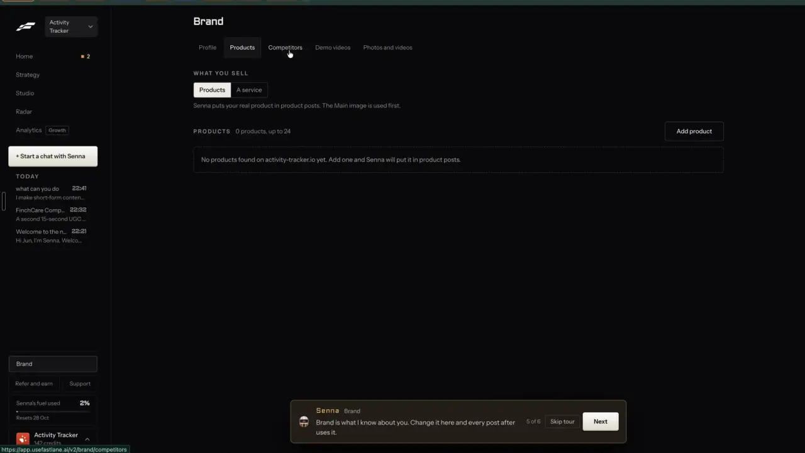
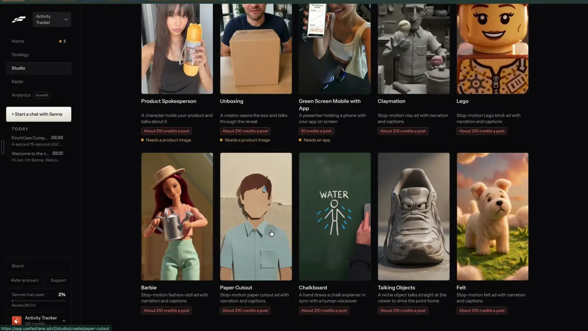

# Products and offers

`brand-products` | brand | phase 4 | status: partial | /north-star#brand-products

## Leo asked

No direct ask; from the competitor research.

## How the best do it

Fastlane keeps them on Brand > Products, where a segmented toggle under "WHAT YOU SELL" switches between "Products" and "A service" above the helper line "Senna puts your real product in product posts. The Main image is used first." The list header reads "PRODUCTS  0 products, up to 24" with an "Add product" button beside it. On Leo's ActivityTracker workspace the website scan came back empty, so the dashed box said "No products found on activity-tracker.io yet. Add one and Senna will put it in product posts."



Formats that need a product say so on their card with "Needs a product image": "Product Spokesperson" ("A character holds your product and talks about it", about 210 credits a post) and "Unboxing" ("A creator opens the box and talks through the reveal", about 210 credits a post), per notes-1.md F10. Planning reads the list as well; the campaign row in Settings > Activity says "Mostly templated: a business with no product listed to show yet." (notes-4.md 2.16).



Other competitors:

- Gethookd brand profiles hold brand images, product details and creative guidelines, one per client or product line, and products saved there are used automatically in Clone and script generation; its limits are unverified ([gethookd.ai](https://www.gethookd.ai/ai-ad-generator)).
- Hedra "Elements" saves characters, products and visual references ("Characters - Products - Brand") so later generations stay consistent ([hedra.com](https://www.hedra.com/studio)).
- Predis.ai links a Shopify, WooCommerce, Wix or Squarespace store, or takes an uploaded product, and makes posts and product videos from the product details ([predis.ai](https://predis.ai/ai-social-media-manager/)).
- Creatify URL to Video reads a product page's features, benefits and selling points before making avatar videos in several variations ([creatify.ai](https://creatify.ai/features/url-to-video)).
- TopView.ai Product Avatar takes a product photo or link, pairs it with an avatar and makes the product-holding shot ([topview.ai](https://www.topview.ai/ai-avatar/product-avatar)).

## What we have today

Checked against origin/main f2cb275 on 20 Oct.

- Brand kit Offers at /brand#offers (`src/pages/BrandPage.tsx`, section id `offers`) holds up to 5 `{ name, url }` pairs in `CarouselBrand.offers` (`MAX_OFFERS` 5, `MAX_OFFER_NAME` 60, `MAX_OFFER_URL` 300) under `content-studio-carousel-brand-<scoped>`. Its InfoTip reads "Posts link only to these. Any other link gets flagged."
- `src/lib/brandRules.ts` turns them into links only. `brandRulesLine` tells Write (`GeneratePage.tsx`), Batch and the video captions (`PlatformCaptions.tsx`) "use one of these links exactly as written and never any other link", `checkLimits` flags any other link, and /links (`TrackedLinksPage.tsx`) offers them for tracking. An offer has no picture, no description and no audience, and no writer or remix is asked to post about one.
- AI template clips at /edit?panel=ai&kind=template: five of the eight templates have a product photo slot (`ugc-creator-review`, `product-commercial-shotlist`, `timeline-shot-script`, `food-asmr`, `pov-continuous-take` in `supabase/functions/ai-video/templates.ts`). The photo is a `File` picked from disk on every visit and held in component state (`src/components/AiVideo.tsx`), and a clip takes one photo, person or product, never both. The typed "Your product" field carries over between templates within one visit.
- brand-dna reads the home page only and returns no products.

Status is partial: five offer links exist, while products with pictures, a website scan and use in remixes do not.

## Build

Ship it after the multi-page read in brand-from-website, since the scan reuses its page pick. Gate everything new with `leoOnly(email)` in the browser and, in brand-dna, with `isAllowed(Deno.env.get("NORTH_STAR_USERS"), uid)` from `supabase/functions/market/logic.ts`, the same server check find-competitors uses.

### Screens and states

A new section "Products and services" sits on /brand right after Offers (id `products`).

```
Products and services            [Find them on my website]  About US$0.03 | 10 left today
What you sell   [Products] [A service]
3 of 24
[pic] Retirement plan review   For people in their 50s ...          [Edit]
      One line from the page   [Names an insurer product]
      [Write a post about it]  [Use in a video]          Use in posts [on]
[Add one]
```

The toggle starts on Jev's pick from the scan, or on "A service" before any scan, since most advisers sell advice. It changes the words only ("Product name" or "Service name" in the editor, "products" or "services" in counts).

Empty before any scan: "Nothing here yet. Find them on your website, or add one." The main button is "Find them on my website" when the brand kit has a `website` (brand-from-website), else "Add one" with an inline address field.

Scanning runs outside React in `src/lib/productScan.ts`, so leaving the page keeps it going. Steps tick over as on /brands/new: "Opening the site", "Finding product and service pages", "Reading <n> pages", "Listing what you sell", "Checking each one". The answer waits in `cs-products-scan-<scoped>` until it is reviewed.

Review, at /brand?products=review#products, starts with "Found 7 on acme.sg. Untick any that aren't yours." Each row has its picture (fetched one at a time through brand-dna `mode: "image"`), the name, the one line and any chips. Rows Jev rates 0.6 or more start ticked; the rest sit under "Maybe not yours", unticked. A row that matches an existing item by page link or by name (case-insensitive) shows "Already added" and is skipped, and the main button counts only the rows that will be added, as in "Add 6". If the ticked rows would take the list past 24, the button is disabled and the line reads "Only 2 more fit. Untick some, or remove one first."

Done: toast "6 added. Remixes will use them."

Nothing found: "No products or services found on acme.sg. Add one and remixes will use it."

The editor opens at /brand?product=<id>#products, or ?product=new for a blank one, as a dialog with these fields:

- Name, 60 characters ("Product name" or "Service name")
- What it is, 200 characters
- Who it's for, 120 characters
- Price (optional), 40 characters, kept exactly as the page or person wrote it
- Page link, 300 characters, http or https only, checked with `offerUrl` from brandRules.ts
- Pictures, up to 4, with "Add from Media", "Upload", "Make first" and "Remove"

"Save" is the main button. "Delete" is quiet and shows the toast "Removed <name>." with "Undo".

When a picture cannot be fetched the tile reads "Couldn't fetch that picture. Upload one instead." At 24 items "Add one" is disabled with "24 is the most a brand can keep. Remove one to add another." A 403 from brand-dna shows "This isn't on for your account yet.", and a 429 shows the `usageRefusal` copy with the 8am reset.

When Jev is unavailable every found row arrives unticked under "Check each one: we couldn't sort these." No named-product chip shows in that case; Write's own compliance chips still run on the post.

Named insurer products get a warning chip, "Names an insurer product", with the InfoTip "Posts describe it in general terms, like 'a whole life plan'." The item keeps a `generic` description written by the LLM, and every brief built from the item uses `generic` in place of the name. This warns by default; switching it to block is brand-rules' job.

This item ships four places that use products:

1. "Write a post about it" opens `links.generate({ ctx: productBrief(p) })`.
2. "Use in a video" opens /edit?panel=ai&kind=template&template=product-commercial-shotlist&product=<id>. AiVideo reads `?product=`, loads the item's first picture from IndexedDB with `getFile`, wraps it as a `File` (the photo slot holds a `File`), puts it in the product slot and fills the template's `product` field with the item's name, or with `generic` when `namedProduct` is set. Every one of the five templates with a product slot also gets a row "From your products" with up to 6 thumbnails above its file picker. Picking a product clears a person photo, since a clip takes one photo. The clip still costs what it costs today: its "Costs <credits>" line above "Make the clip", about US$0.82 to US$3.70 a clip, cap `ai-clip` 2 a day.
3. `src/lib/products.ts` exports `productBrief(p)` and `mainProduct(list)` (the first item with "Use in posts" on). remix-your-brand calls them; this item leaves the remix builders alone.
4. The media picker gets a "Products" folder, because product pictures are saved into Media (see Data).

### Copy

- Section title: "Products and services"
- Toggle: "Products", "A service"
- Count: "<n> of 24"
- Buttons: "Find them on my website", "Add one", "Edit", "Write a post about it", "Use in a video", "Save", "Delete", "Add <n>", "Add from Media", "Upload", "Make first", "Remove", "Undo"
- Toggle on each row: "Use in posts"
- Price chip: "About US$0.03 | <n> left today", or "None left today"
- Steps: "Opening the site", "Finding product and service pages", "Reading <n> pages", "Listing what you sell", "Checking each one"
- Review head: "Found <n> on <host>. Untick any that aren't yours."
- Groups: "Maybe not yours", "Check each one: we couldn't sort these."
- Row states: "Already added", "Couldn't fetch that picture. Upload one instead.", "Not on this device"
- Limits: "Only <n> more fit. Untick some, or remove one first.", "24 is the most a brand can keep. Remove one to add another."
- Empty: "Nothing here yet. Find them on your website, or add one."
- Nothing found: "No products or services found on <host>. Add one and remixes will use it."
- Chip: "Names an insurer product"; its InfoTip: "Posts describe it in general terms, like 'a whole life plan'."
- Section InfoTip: "Remixes put your real offer in posts. The first picture is used first."
- Toasts: "<n> added. Remixes will use them.", "Removed <name>."
- Editor labels: "Product name" or "Service name", "What it is", "Who it's for", "Price (optional)", "Page link", "Pictures"
- AiVideo row: "From your products"
- Refused: "This isn't on for your account yet."

### Data

The list is a synced key, `content-studio-products-<scoped>`, read and written by `src/lib/products.ts` with load, save and sanitize functions shaped like the brand kit's in `src/lib/carousel.ts`:

```
{
  kind: "products" | "service",
  site?: string,          // origin scanned
  readAt?: string,        // ISO
  items: [{
    id, name, what, forWho, price?, url?,
    pictures: string[],   // cimg- keys in IndexedDB, at most 4, first one is used first
    sources: string[],    // http(s) picture URLs from the site, at most 4
    generic?: string,     // general description, no brand or insurer names
    namedProduct?: boolean,
    use: boolean,         // "Use in posts"
    from: "website" | "you",
    addedAt
  }]
}
```

`MAX_PRODUCTS` is 24. The sanitizer trims every length, keeps only `cimg-` keys and http or https URLs, and drops items with no name.

Pictures are stored with `storePicture` (1080 px wide JPEG, `cimg-` keys in IndexedDB) and added to the media library index with folder "Products", so they appear in Media and in the carousel picker. On another device the card fetches `sources[i]` again through brand-dna `mode: "image"` and stores it there. An uploaded picture with no source shows a grey tile with Media's existing line "Not on this device" until brand-media-library step 2 puts files in the cloud. Since everything here is a synced key or IndexedDB, the database schema stays as it is.

### AI and cost

brand-dna gains two modes. Both answer 403 `{ code: "not_allowed" }` for a uid missing from `NORTH_STAR_USERS`.

`{ mode: "products", url }` reads the home page plus the 4 pages Jev picks in the deep read (brand-from-website). `readSite` collects, per page, the `og:image` and up to 8 `` tags that have alt text (absolute URLs, no SVG), and the names, descriptions and image URLs of any schema.org Product or Service entries in `application/ld+json` blocks. Those go to the LLM as plain lines, "Listed item: <name> | <image>". One `openaiChat` call (OPENAI_MODEL, strict JSON schema, max 2,000 tokens out) lists up to 24 items with name, what (one sentence in the page's words), forWho, price (only when the page states it), url (one of the pages read), picture (one of that page's listed picture URLs) and generic (the general kind of product or service with no brand or insurer names). `parseProducts` drops any url or picture that was not in the input, so the model cannot invent a link.

Jev then answers in one call (`who: "brand-dna products"`, `timeoutMs: 15_000`). A call carries one state, so the state is the brand, `{ brand: <name>, oneLiner, items: [names] }`, and each item rides inside its own questions' instructions, as `pickQuestions` in `supabase/functions/video-assist/montage.ts` does with beats. Two noul questions per item and one choice:

- `offer_<i>`: instructions `{ item: { name, what, url }, question: "Is \`item\` something the business sells or offers to its clients, such as a product, plan, package or service, rather than a blog post, a person, an event or a page about the company?" }`. Ticked at 0.6 or more.
- `named_<i>`: instructions `{ item: { name, what }, question: "Does \`item\` name a specific insurance or investment product from an insurer or fund house, such as a branded plan name, rather than a general kind of cover or advice?" }`. Chip at 0.5 or more.
- `kind` (choice): "Does this business mainly sell products or a service?" with criteria products: "Things a buyer receives or installs: goods, apps, subscriptions, courses" and service: "Work done for the client: advice, planning, reviews, done-for-you jobs".

`{ mode: "image", url }` fetches one picture through `fetchCapped` with the same public-address guards, at most 2 MB, PNG, JPEG or WebP checked by its first bytes, and returns a data URL that the browser hands to `storePicture`.

Caps to add to DAILY_LIMITS in `supabase/functions/_shared/usageCaps.ts`:

- `"brand-products": 10` with the comment "A products and services scan (brand-dna products): up to 5 pages read, one LLM call and one Jev call."
- `"brand-image": 100` with the comment "Pictures fetched from a brand's own site for its products (brand-dna image). No paid provider; capped because it fetches a public URL on request."

The `products` mode consumes `brand-products` only and `image` consumes `brand-image` only; neither touches `brand-dna`. The chip's "<n> left today" comes from `useUsesLeft` in `src/lib/aiUsage.ts`.

A failed LLM call refunds `brand-products` with `refundUsage(admin, uid, "brand-products", day)`, where `day` is the UTC date taken when the use was counted, as ai-video does. A scan is estimated at roughly 2 to 4 US cents: one OPENAI_MODEL call of up to about 8,000 tokens in and 2,000 out (the gpt-6-luna price is not in the repo, hence the range) plus up to 49 Jev questions for under 0.1 US cent, while picture fetches cost only bandwidth.

### Deep links

- /brand#products opens the section.
- /brand?product=<id>#products opens the editor; ?product=new opens a blank one. Use `useUrlItem("product")` from `src/lib/urlState.ts` (as AiVideo does for `?template=`): opening pushes a history entry, so Back closes the dialog.
- /brand?products=review#products opens this device's waiting scan.
- /edit?panel=ai&kind=template&template=<id>&product=<id> preselects the product photo. Add `product?: string` to `links.edit`.
- Add `"products"` to `BrandSection` in `src/lib/links.ts`, and the rows to the /brand and /edit tables in docs/deep-links.md.

## Done when

- [ ] On Leo's sign-in /brand shows Products and services after Offers; another account sees neither the section nor a working `products` or `image` mode (403).
- [ ] A scan of a real SG adviser site lists its services with pictures where the site has them, and every url and picture in the answer came from the pages read.
- [ ] Unticked rows are not added; re-scanning skips items already in the list; the 24 limit holds in the review, the editor and Add one.
- [ ] A product named after an insurer plan shows the chip, and `productBrief` for it contains `generic` and not the plan name.
- [ ] "Write a post about it" opens Write with the brief, and "Use in a video" opens the product template with the first picture already in the product slot.
- [ ] A product added on one device shows its website picture on a second device after one fetch.
- [ ] Jev switched off leaves every found row unticked with no error; a 429 shows the 8am copy.
- [ ] Checked by eye at 390 px and 1440 px; `npm run build` and the full `npx vitest run` pass; the item flipped in `src/data/northStar.ts`.

## Tests

- `src/lib/products.test.ts`: the sanitizer caps items at 24 and pictures at 4, keeps only `cimg-` keys and http or https URLs, and trims lengths. `productBrief` uses `generic` when `namedProduct` is true and leaves price out when empty. `mainProduct` returns the first item with `use` on. `mergeScan` matches by url or name and keeps the person's edits.
- `supabase/functions/brand-dna/logic.test.ts`: per-page picture candidates (og:image plus alt-text images, absolute, no SVG); JSON-LD Product and Service lines; `parseProducts` drops items with no name and any url or picture not in the input; `pickOffers` ticks at 0.6 and returns everything unticked for null answers; `namedProduct` stays undefined when Jev is null.
- `supabase/functions/brand-dna/index.test.ts`: `products` and `image` answer 403 for a uid missing from `NORTH_STAR_USERS`; `image` refuses a private host and a body that is not PNG, JPEG or WebP; each mode consumes its cap; a failed LLM call refunds `brand-products`.
- `src/components/AiVideo` (or the URL reader it uses): `?product=<id>` puts that item's first picture in the product slot as a `File`, fills the `product` field with the name (or `generic` for a named product), and clears a person photo.
- Calibration before the thresholds are final: scan Leo's three brand sites and 5 SG adviser sites, read every `isOffer` and `namedProduct` answer beside what a person would say, and set both thresholds from that run.

## Open questions

- Should the brand kit's 5 Offers merge into this list, with each product's page link becoming an allowed link in posts? Today the offers are the only links Write, Batch and video captions may use, so a merge changes what every post may link to. This spec keeps both lists. Leo decides.
- A named insurer product warns by default. Should it be off for posts by default instead? Leo, or a team leader through brand-rules.
- formats-presenter's Spokesperson picks a brand-kit offer and saves its picture to the Media folder "Offers". Whichever of the two ships second makes that picker list products too and offers each "Offers" picture as a product to add, so one list feeds both.

## Related

brand-from-website, remix-your-brand, formats-presenter, formats-talking-head, formats-static-ad, brand-media-library, brand-rules, trust-compliance-check
