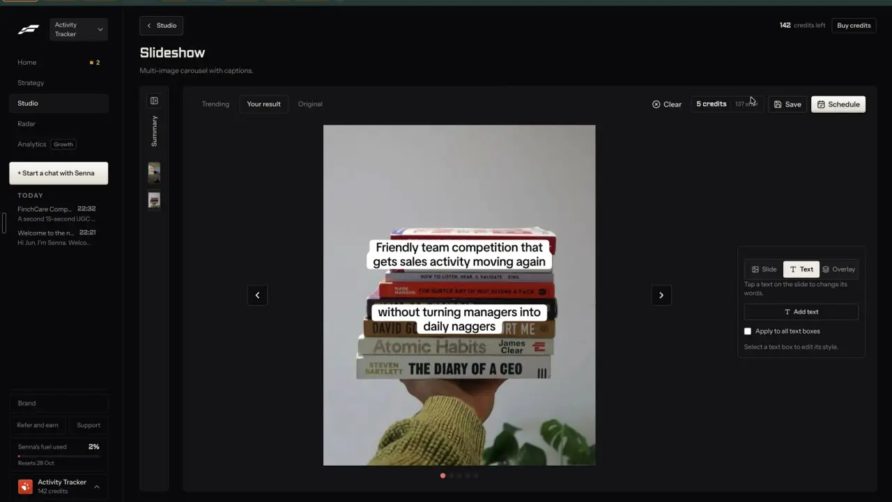
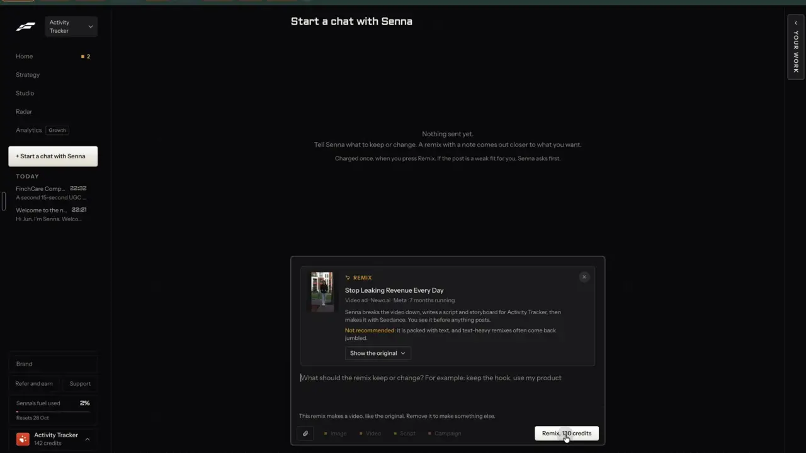

# The price on every button

`business-cost-preview` | business | phase 1 | status: partial | /north-star#business-cost-preview

## Leo asked

19 Oct 2026: "the idea is that one can remix any content format and the ai will regenerate"

The north-star page files this item under that ask: a remix into any format has to show what it costs before it runs.

## How the best do it

Fastlane puts a price on every tile and every button that spends, and says so in its own copy: "Tap one to start it in the box. Each make shows its price before anything runs." under the Home tiles, and "He shows the price before anything is made." under the Studio headline (0:04, 1:20).


- Format tiles carry a chip in one of four shapes: "5 credits a post", "About 210 credits a post" (a 15-second estimate), "15 credits a second" and "From 2 credits". Remix buttons carry their own: "12 credits" for a static ad, "130 credits" for a video ad, "390 credits" for a trending video, "Remix this | 5 credits" for a template trend.
- A video create page holds the price in a sticky footer. Before the options load it reads "Pick your options to see the price" / "142 credits now" with "Generate video" greyed. Once the length is picked it reads "210 credits" / "142 credits now, 68 credits short" in orange, with "Buy credits" beside a disabled "Generate video" (1:31).


- A template format says when the charge lands: "Charged when you save or schedule" / "5 credits" / "142 credits now, 137 after this one" over "Generate slideshow" (2:37). Generating left the balance at 142.


- In the editor the chip sits between "Clear" and "Save": "5 credits | 137 after" (1:53).



- A remix sent to the agent puts the price inside the button, "Remix, 130 credits", over the line "Charged once, when you press Remix. If the post is a weak fit for you, Senna asks first." (4:15).



- In a campaign's review queue the Make button reads "Make | 5 credits", and on posts the balance cannot cover it turns into "Not enough credits / Add 68" (0:58). The campaign header sizes the top-up to the gap: "You are short 803 credits" and "Cover all posts | 803 credits ->" (0:38).

Other competitors:

- Revid.ai shows an estimated cost in the editor before every render and refunds failed renders ([pricing](https://revid.ai/pricing), [create flow](https://www.revid.ai/llm/how-to-create-a-video-with-revid-ai.md)). Its API prices a payload for free without a key (`POST /api/public/v3/calculate-credits`) ([credit costs](https://www.revid.ai/llm/revid-ai-credit-costs.md)).
- Blotato prints the cost above "Regenerate" and charges only when the run succeeds ([AI video credits](https://help.blotato.com/web-app-features/videos/ai-video-credits.md)).
- Creatify shows the cost before you confirm, and manual edits cost nothing ([pricing](https://creatify.ai/pricing)).
- Vamos opens a chat for free and prints what each answer cost under the reply, from a fraction of a credit to tens of credits for a research report ([plans and credits](https://intercom.help/getvamos/en/articles/13004516-plans-credits-and-prices)).
- Captions lists the credit cost per model, 1 to 6 for an image and 1 to 100 for a video, so people can pick cheap or premium ([AI usage](https://www.captions.ai/help/docs/ai-usage)).
- Kapwing does not document a price before a run; it refunds failed runs on its own and keeps a set of tools free of credits, which is the "Failed" state below ([credits](https://www.kapwing.com/help/how-do-kapwing-credits-work/)).

## What we have today

- No user balance. Paid calls are capped per user per day in `supabase/functions/_shared/usageCaps.ts` (`DAILY_LIMITS`, counted by `cs_consume_ai_usage` on `cs_ai_usage`, reset 08:00 Singapore). The refusal is 429 `daily_limit`: "You've used all N for today. It resets at 8am Singapore time."
- Uses left today show beside AI buttons in 12 files through `useUsesLeft` in `src/lib/aiUsage.ts` (tested in `aiUsage.test.ts`). Each caller draws its own span with the same classes: `src/components/AiVideo.tsx` (its own `Left`, for ai-clip, ai-video, ai-image, ai-voice, ai-video-script, montage-beats), `AutoBroll.tsx` (broll-picks, ai-broll), `ClipFinder.tsx` (video-clips, already "{passes} uses, {left} left"), `ColdOpenControl.tsx` (cold-open), `HookOptions.tsx` (vibe-edit), `LongCaptions.tsx` (video-transcribe), `MotionControls.tsx` and `StylePresets.tsx` (motion-picks), `PlatformCaptions.tsx` (video-captions), `ReelStyleCopy.tsx` (reel-style, motion-picks), `src/pages/CloneReelPage.tsx` (reel-clone, reel-concepts) and `src/pages/VideoEditPage.tsx` (its own `Left`, for video-watch, vibe-edit, video-publish, video-translate, ai-voice, ai-music, video-transcribe, video-cutaways).
- A money price shows in one component: the AI video maker writes "Costs {n} Higgsfield credits (about US${x})." on the template clip, avatar ("Costs 44 Higgsfield credits (about US$2.75)." for 15 s) and explainer tabs, from `cost()` in `AiVideo.tsx`, using `avatarCredits`, `clipCredits`, `explainerCredits`, `creditsUsd` and `CREDIT_USD` (0.0625) from `supabase/functions/ai-video/logic.ts`.
- Paid buttons with neither a price nor uses left: "Make the image" and "Fix it" in Write (`src/lib/aiImage.ts`), the carousel's "Tighten with AI" (`carousel`), Idea Dump, One long piece, Storyboard, the Engage tools, Add a brand (`brand-dna`), Following's check (`track-accounts`), Your market's check, YouTube clips, Mentions and feeds. Write's own generation (`generate-social-content`) is hosted on the academy project and has no cap in this repo.
- So the status is partial: prices in money exist for AI video only, uses left exist on about a dozen buttons, and nothing is shared.

## Build

One price table, one chip, used by every button that starts a paid call. Credits do not exist, so the chip prices in US$ (the provider's cost) and shows the daily cap the way Fastlane shows a balance. When `business-credits` ships, the same chip reads credits and the call sites do not change.

Gate: the price half of the chip shows for `leoOnly(email)`. Everyone else keeps today's uses-left text, word for word.

### Screens and states

The chip sits in the same row as its button, to the right on wide screens and under it at 390 px.

```
[ Make the video ]   About US$2.75 | 1 left after this
```

- Ready: price, a divider, then what is left after this run.
- Price only: usage not read yet, or unreadable (`readUsage` returned null). The server still decides.
- Last one: "About US$2.75 | Last one today".
- None left: the button is disabled, the chip reads "None left today" in the destructive colour, and the line under the button reads "Back at 8am Singapore time."
- Several uses in one run (ClipFinder's passes): "About US$0.06 | 3 uses, 7 left after this". When the run needs more uses than are left, the button is disabled with "This needs 3 uses and 2 are left today."
- Options change the price (clip length and quality, avatar length, music length): the chip updates within the same render. With options not picked yet it reads "Pick your options to see the price".
- Running: the button reads "Making..." and the chip hides.
- Failed: the existing error toast with the function's own message; functions that refund (`refundUsage`) give the use back, and the chip reads usage again when `busy` turns false.
- Refused by the server after the client thought one was left: the toast shows the 429 message and the chip reads usage again.
- Caps on `NO_PRICE` show uses left only, no price: the Jev-only calls (post-score, writing-judge, fact-check, cold-open, motion-picks, montage-pick, music-mood, week-pick, engage-picks, assistant-act), the free or relay calls (stock-search on Pexels, reel-video relaying a reel's file), the across-everyone counters (every `-global` key), social reads and writes (social-connect, social-read, social-automation-write, social-schedule, social-presign) and team-comment.
- Free work (drawing a carousel, cutting a video on the device, Pexels searches already cached): no chip.

### Copy

- Price: "About US$2.75", "From US$0.82", "Up to US$5.50", "Under US$0.01"
- After: "{n} left after this", "Last one today", "None left today", "{k} uses, {n} left after this"
- Reasons: "Back at 8am Singapore time.", "This needs {k} uses and {n} are left today."
- Before options: "Pick your options to see the price"
- Non-Leo text stays as today: "{n} left today", "None left today" (`AiVideo.tsx` lowercases it to "none left today"; keep each caller's casing).

Money format: two decimals, "US$" prefix, no space. Under US$0.01 shows "Under US$0.01".

### Data

- New `supabase/functions/_shared/prices.ts`, pure, no Deno or npm imports, so the browser and the functions read one table (the `usageCaps.ts` pattern; `business-credits` charges from it later). It imports the cost helpers from `../ai-video/logic.ts`. `src/lib/prices.ts` re-exports it and adds `chipText`:

```ts
export type PriceKind = "about" | "from" | "upTo";
export interface Price { usd: number; kind: PriceKind }
export interface PriceOpts { seconds?: number; quality?: ClipQuality; slices?: number[]; scenes?: number; minutes?: number }
/** Every paid cap, priced from the cost constants in the functions, never a typed number in a component. */
export const PRICES: Partial<Record<UsageFeature, Price | ((o: PriceOpts) => Price)>>;
/** Caps that never show a price: Jev-only calls, free or relay calls, across-everyone counters, social reads and writes, team comments. */
export const NO_PRICE: UsageFeature[];
export function priceOf(feature: UsageFeature, o?: PriceOpts): Price | null;
export function priceText(p: Price): string;
export function chipText(a: { price: Price | null; left: number | null; uses?: number; leo: boolean }): { text: string; out: boolean };
```

- Prices to start with, each with its source in a comment beside it:

| Cap | Price | Source |
|---|---|---|
| ai-video (avatar) | `avatarCredits(slices) * CREDIT_USD`, about US$2.75 for 15 s, up to US$5.50 | ai-video/logic.ts |
| ai-video (explainer) | `explainerCredits(scenes) * CREDIT_USD` plus one voiceover | ai-video/logic.ts |
| ai-clip | `clipCredits(seconds, quality) * CREDIT_USD`, from US$0.82 to US$3.70 | ai-video/logic.ts |
| ai-image | 0.006, shown "Under US$0.01" | ai-image/index.ts |
| ai-broll | about US$0.13 | ai-image/broll.ts |
| ai-music | US$0.15 a minute, up to US$0.30 | usageCaps.ts comment |
| video-watch | about US$0.07 for a 40 s reel | usageCaps.ts, video-assist/watch.ts |
| video-transcribe | US$0.006 a minute of audio (Whisper list price) | unverified, measure |
| repurpose-long | about US$0.04 | usageCaps.ts |
| engage-replies, engage-dms, engage-comments, engage-connect | up to US$0.02 | engage-assist/index.ts |
| video-captions, video-clips | about US$0.01, about US$0.02 a pass | usageCaps.ts, video-assist/logic.ts |
| yt-captions | 0.006, shown "Under US$0.01" | youtube-captions/index.ts |
| market-check | about US$0.02 plus the news | market/index.ts |
| ai-image-fix, ai-voice, reel-clone, reel-concepts, reel-visuals, reel-style, track-accounts, mentions, feeds, idea-dump, storyboard, carousel, brand-dna, profile-score, ai-video-script, vibe-edit, video-translate, video-cutaways, video-publish, broll-picks, montage-beats, market-suggest | "about" with a first estimate | unverified: log the provider's reported cost on Leo's first five runs and set the number |

- Write's generation is uncapped and lives on the academy project. Its button shows "About US$0.01" for Leo only, with no uses part (unverified, measure).
- New `src/components/PriceChip.tsx`: props `{ feature: UsageFeature; opts?: PriceOpts; left: number | null; uses?: number }`. It renders `chipText` and nothing else.
- New `src/lib/useLeoOnly.ts`: reads the email once with `supabase.auth.getSession()` (the NorthStarPage pattern) and returns `leoOnly(email)`, false until read.
- Call sites: replace `Left` in `AiVideo.tsx` and the inline spans in the files listed under "What we have today" with `PriceChip`. Add a chip to the buttons that have none, listed there too. New format makers from the `formats-*` items use `PriceChip` in their footers.
- No storage, no table, no schema change.

### AI and cost

- No AI call, no Jev question: a price is arithmetic.
- No new cap. The chip only reads `cs_ai_usage` through `readUsage`.
- Cost per run: nothing.

### Deep links

None. The chip lives on pages that already own their URLs.

## Done when

- [ ] Every button that starts a call counted in `DAILY_LIMITS` shows a `PriceChip`, or is on `NO_PRICE` and shows uses left only.
- [ ] Leo sees "About US$2.75 | 1 left after this" on a 15-second avatar video with 2 of 2 left, and the number moves as the script length changes.
- [ ] With 0 left the button is disabled, and the reason is under it.
- [ ] A demo sign-in sees exactly today's uses-left text on every button that had it, and no new chip anywhere.
- [ ] No price in a component is a typed number; each comes from `priceOf`.
- [ ] Checked by eye at 390 px and 1440 px on /edit (AI panel), /generate and /clone; `npm run build` and the full `npx vitest run` pass.
- [ ] `src/data/northStar.ts` item `business-cost-preview` flipped with its `ours` line, in the same commit.

## Tests

- `supabase/functions/_shared/prices.test.ts` and `src/lib/prices.test.ts`:
  - Every key of `DAILY_LIMITS` is in `PRICES` or in `NO_PRICE`, never both and never neither. This is the guard that makes the next paid cap declare a price.
  - `priceOf("ai-video", { slices: [7.5, 7.5] })` equals `avatarCredits([7.5, 7.5]) * CREDIT_USD` (2.75).
  - `priceOf("ai-clip", { seconds: 8, quality: "720p" })` equals `clipCredits(8, "720p") * CREDIT_USD`.
  - `priceText` gives "About US$2.75", "From US$0.82", "Up to US$5.50" and "Under US$0.01".
  - `chipText`: left 2 gives "1 left after this"; left 1 gives "Last one today"; left 0 gives "None left today" with `out: true`; uses 3 and left 2 gives `out: true`; `leo: false` gives "2 left today" with no price; left null gives the price only.

## Open questions

- Leo: should the price half turn on for everyone now? It costs nothing and tells advisers what a video costs before they press. The README keeps it on his sign-ins until he says "on for everyone".
- Leo: US$ or SGD on the chip. US$ matches the providers' invoices; SGD is what an adviser pays in. This spec uses US$ until plans exist, and the switch is one function.
- When credits ship, Fastlane's "charged when you save or schedule" rule for template formats is `business-credits`' call. This chip only shows the price.

## Related

business-credits, business-plans, agent-budget, agent-approvals, agent-activity, formats-gallery, formats-slideshow, formats-talking-head, remix-any-format, remix-everywhere, plan-review-queue, plan-campaign-page, learn-pace
