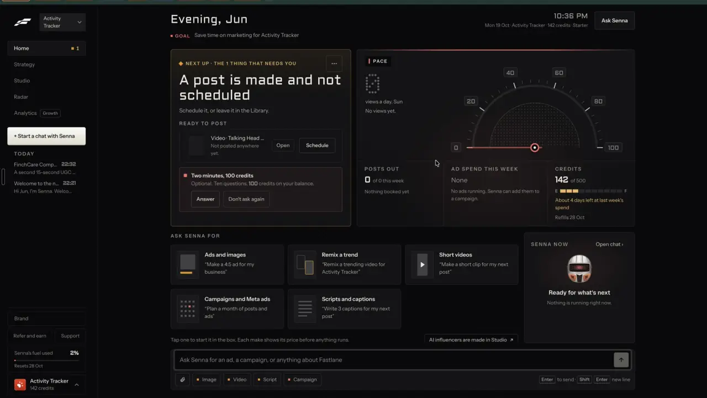
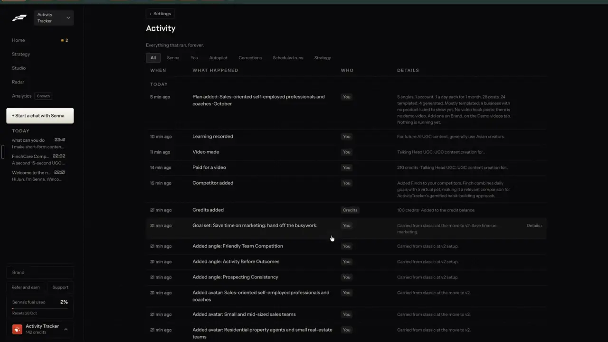
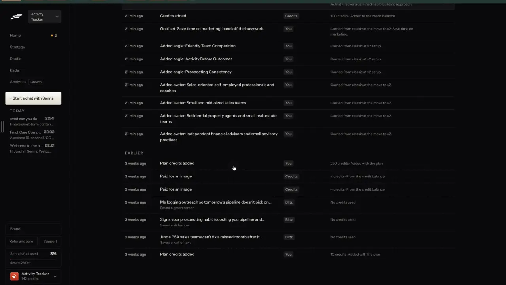

# One credit balance

`business-credits` | business | phase 8 | status: missing | /north-star#business-credits

## Leo asked

No direct ask; from the competitor research.

## How the best do it

Fastlane meters making in credits and shows the balance in five places. Three are on Home (0:04): the header line "Mon 19 Oct | Activity Tracker | 142 credits | Starter", the sidebar account card "Activity Tracker / 142 credits", and the Home cell "CREDITS 142 of 500" over a fuel bar from E to F with "About 4 days left at last week's spend" and "Refills 28 Oct". The other two are a campaign's "YOUR CREDITS" panel (0:38) and the review queue's "CREDITS LEFT 142" (0:40). A separate bar, "Senna's fuel used 2%" with "Resets 28 Oct", meters the chat agent apart from credits (what it counts is not shown).



- Every charge and every top-up is a row in Settings > Activity, so the balance can be checked by hand (5:42 and 5:43). Today's rows read "Paid for a video" / "210 credits | Talking Head UGC: UGC content creation for..." and "Credits added" / "100 credits | Added to the credit balance." (its WHO pill reads "Credits"). Scrolled down, the EARLIER rows read "Plan credits added" / "250 credits | Added with the plan", "Paid for an image" / "4 credits | From the credit balance" twice, three saved posts with "No credits used", and "Plan credits added" / "10 credits | Added with the plan". The rows add up: 10 + 250 - 4 - 4 + 100 = 352, then 352 - 210 = 142.





- When the charge lands: a template slideshow is free to generate and "Charged when you save or schedule" (2:37). A generated video is charged when its card is approved, "210 credits charged. Usually renders in 4 to 10 min, then it lands in the Library." (4:26).
- When the balance is short, the agent refuses and offers a smaller job: "A second 15-second UGC video did not get drafted because it needs 210 credits and you have 142." / "A 10-second version is 140 credits, or you can buy credits in [Plan and spend]." (4:23).


- Public prices disagree with each other. The homepage lists Starter USD 20 a month for 500 credits, Growth USD 55 for 2,000, Pro USD 139 for 10,000 and Enterprise USD 699 for 50,000, and prices a static at 5 credits and a video at 60. The /pricing page lists Free USD 0 (10 credits), Starter USD 29 (250), Growth USD 49 (500) and Pro USD 149 (2,000) ([home](https://usefastlane.ai), [pricing](https://usefastlane.ai/pricing), both from the remix-ugc research). Leo's ledger matches /pricing (plan credits of 10, then 250) while his Home reads "of 500". In the app, Talking Head UGC was 210 credits for 15 s and 140 for 10 s.

Other competitors:

- Captions: one pool for every AI feature, spent whether or not you export; rollover capped at 3x the monthly allowance; downgrading forfeits the excess and cancelling forfeits the balance at period end. Free 60 to 200 one-time, Max 500, Frontier 1,400 a month ([AI usage](https://www.captions.ai/help/docs/ai-usage), [subscriptions](https://captions.ai/help/docs/subscriptions.md)).
- Kapwing: one pool; failed runs are refunded automatically, unwanted results are not; a set of tools is free. Pro 1,000 a month, Business 4,000, a Business top-up is 500 credits for US$50 ([credits](https://www.kapwing.com/help/how-do-kapwing-credits-work/)).
- Blotato: writing is unlimited and credits pay only for images and video; the cost shows above "Regenerate" and is charged only on success; packs are US$6 for 1,000 and roll over ([billing](https://help.blotato.com/settings/billing-and-credits.md), [AI video credits](https://help.blotato.com/web-app-features/videos/ai-video-credits.md)).
- Quso.ai (formerly Vidyo.ai): editing, publishing and downloading are free; failed processing is refunded; add-on credits are US$0.15 each and never expire ([how credits work](https://helpdesk.quso.ai/help/how-credits-work.md)).
- Later: one pool for all AI, Starter 5, Growth 50, Scale 100, reset on the 1st at 00:00 UTC ([pricing](https://later.com/pricing/)).
- CapCut: 1 credit is US$0.01; subscription credits are spent first, then promo credits, then bought ones ([credit types](https://www.capcut.com/help/credit-types)).
- Sandcastles: bought "boost" credits never expire and are spent after plan credits ([credits](https://help.sandcastles.ai/credits-v3)).
- Descript: a Usage tab shows what each run cost and sells one-time top-ups ([usage](https://help.descript.com/billing-payments-plans/track-and-understand-your-media-minutes-and-ai-credits.md)).

## What we have today

- No balance, no ledger, no top-up. Every signed-in user gets the same daily caps (`DAILY_LIMITS` in `supabase/functions/_shared/usageCaps.ts`), counted atomically by `cs_consume_ai_usage` in `cs_ai_usage` (`supabase/hub/009_ai_usage.sql`, a conditional update that returns null at the limit, service role only). Global caps on `GLOBAL_COUNTER_USER` guard the prepaid Higgsfield and ElevenLabs pools.
- `refundUsage` gives a use back in three functions only: `ai-video` (avatar videos and template clips, through `refundFailed` and a signed refund ticket in `ai-video/logic.ts`), `text-voice` music (`giveMusicBack`) and `market`. A failed picture (`ai-image`), voiceover or dub (`text-voice`) or watch (`video-assist`) keeps the use spent.
- "Higgsfield credits" in `src/components/AiVideo.tsx` are the provider's, shown for information in three lines (template clip, avatar, explainer) by `cost()`; nothing is deducted from the user.
- Specs already written lean on this item: `business-cost-preview` builds the price table (`supabase/functions/_shared/prices.ts`) and the chip; `agent-activity` shows past AI use with a cost column; `learn-pace` shows "AI runs this week" on Home until credits exist.

## Build

Nothing from this item ships before Leo answers `decide-credits` on /north-star. The page's recommendation is to keep daily caps while the north star is on his accounts only. This spec is the build for the day he says yes. It needs a schema change and touches money, so both stop for Leo first.

Rules, chosen to keep one balance and no buckets:

1. One balance per account (bare uid, shared by all of a person's brands, like the caps).
2. Writing is free: posts, captions, scripts, hooks and every Jev check (Blotato's rule). Caps stay on them as abuse guards.
3. Credits pay for media a provider makes (AI video, template clips, images, image fixes, AI B-roll, voiceovers, dubs, music) and for "Watch it like a viewer".
4. The charge lands when the server accepts the job, and a failed job gives it back (Kapwing refunds failed runs; Blotato charges only on success). That includes the functions that keep a use spent today: a failed picture, voiceover, dub or watch gives its credits back even though the daily use stays counted. Daily caps stay on top.
7. Gate: the browser shows credits only when `leoOnly(email)` is true, and the server charges only uids in the `CREDITS_ON` secret. Everyone else keeps today's caps and sees nothing new.
5. At each refill the plan allowance is added; a balance above 3x the allowance is trimmed with an "expire" row (Captions' cap).
6. Price in credits: `max(1, ceil(usd * 3 / 0.04))`, then rounded up to a multiple of 5 above 50. That is three times the provider cost at a retail 4 US cents a credit, which lands near Fastlane's prices: a 15 s talking head is 210 (US$2.75 cost), 30 s is 415, a 4 s 480p clip 65, an 8 s 720p clip 280, a B-roll clip 10, a 2-minute track 23, a watch 6, a picture 1. The markup and the credit's price are Leo's.

### Screens and states

- Account card in `src/pages/StudioLayout.tsx`. Rail 1 is 72 px of icons, so the card goes in rail 2's footer block, above "Sign out" and the email: "{balance} credits" on one line, linking to `/billing#credits`. On phones it goes in the More sheet's footer row, left of the email. Loading: a grey bar the width of the text. Unreadable: the line hides.
- Home: `learn-pace` owns the Home cell and switches it to `creditSummary()` from this item: "CREDITS", "{balance} of {allowance}", a 10-segment bar, "About {d} days left at last week's spend" (balance divided by last 7 days' spend per day; hidden with no spend), "Refills {d MMM}".
- Credits section on `/billing` (the page shell is `business-plans`'): balance, refill date, filter "All | Spent | Added", and the ledger newest first, 50 rows with "Show more".

```
When        What happened          Credits   Details
5 min ago   Paid for a video       -210      Talking head: Three questions before...
5 min ago   Refunded               +210      The video failed. Nothing was charged.
3 Oct       Plan credits added     +500      Added with the plan
```

- Price chip: when credits are on, `PriceChip` reads "210 credits | 352 now, 142 after" and the uses-left part moves to a line under the button.
- Short: the button is disabled, the chip reads "Not enough credits" and the line reads "Needs 210, you have 142." with the link "Add 68 credits" (opens `/billing?pack=68#credits`; `business-plans` sizes the top-up).
- Refused by the server (402 `credits_short`): the toast shows the server's message, and the chip reads the balance again.
- Over the daily cap: unchanged, the cap refusal from today.
- Making: the balance in the rail drops as soon as the server accepts the job, before it finishes.
- Failed: the refund row lands with the failure, and the toast says "The video failed. Your 210 credits are back."

### Copy

- Rail: "{n} credits"
- Home: "CREDITS", "{n} of {allowance}", "About {d} days left at last week's spend", "Refills {d MMM}"
- Section: "Credits", "Refills {d MMM}", "All", "Spent", "Added", "Show more"
- Ledger reasons: "Plan credits added", "Credits added", "Paid for a video", "Paid for a clip", "Paid for a picture", "Paid for a voiceover", "Paid for music", "Paid for a watch", "Refunded", "Expired at refill", "Given by Leo"
- Details: "Added with the plan", "Added to the credit balance.", "The {thing} failed. Nothing was charged.", "Above 3x your monthly credits."
- Chip: "{price} credits | {balance} now, {after} after", "Not enough credits", "Needs {price}, you have {balance}.", "Add {gap} credits"
- Server 402: "This needs {price} credits and you have {balance}."
- Toast: "The {thing} failed. Your {price} credits are back."

### Data

Schema change, stop for Leo, then an independent review of the migration before it is applied. Check the live database first that no `cs_credit_*` names exist.

- Migration `supabase/hub/025_credits.sql` (the next free number today; recheck at build time):
  - `cs_credit_accounts (user_id uuid primary key references auth.users on delete cascade, balance integer not null default 0 check (balance >= 0), allowance integer not null default 0, refills_on date, updated_at timestamptz not null default now())`. The balance is kept on the row so a spend is one conditional update; the ledger is the record that explains it.
  - `cs_credit_ledger (id bigserial primary key, user_id uuid not null references auth.users on delete cascade, delta integer not null, reason text not null check (reason in ('plan','pack','grant','survey','referral','spend','refund','expire')), feature text, ref text, note text, created_at timestamptz not null default now())`, with a unique index on `(user_id, reason, ref)` where `ref is not null`, so a spend, a refund or a Stripe event lands once.
  - RLS: `select` own rows on both tables for `authenticated`; no insert, update or delete policies.
  - `cs_spend_credits(p_user uuid, p_amount int, p_feature text, p_ref text) returns integer`: inserts the account row if it is missing (`on conflict do nothing`), then `update ... set balance = balance - p_amount where user_id = p_user and balance >= p_amount returning balance` (the `cs_consume_ai_usage` pattern). No row updated returns -1 and writes nothing; otherwise it inserts the `spend` row in the same transaction and returns the new balance. `security definer`, revoked from public, anon and authenticated, granted to `service_role`.
  - `cs_add_credits(p_user uuid, p_amount int, p_reason text, p_ref text, p_note text) returns integer`: the same shape for `plan`, `pack`, `grant`, `survey` and `referral`; a repeat `p_ref` adds nothing (the unique index) and returns the current balance. Service role only.
  - `cs_refund_credits(p_user uuid, p_ref text) returns integer`: adds back that ref's spend once, as a `refund` row with the same ref. Service role only.
  - `cs_my_credit_balance() returns integer`: `security invoker`, reads the caller's own row (0 with no row).
  - Before plans exist, Leo's balance comes from `grant` rows: `select cs_add_credits('<uid>', 500, 'grant', 'grant:2026-10', 'Given by Leo');` run in the SQL editor, noted in the migration header.
- Server: new `supabase/functions/_shared/credits.ts` with `creditsOn(uid)` (secret `CREDITS_ON`: unset is off, a uid list, or `*`), `creditsFor(feature, opts)` from the shared price table, `spendCredits(admin, uid, feature, credits, ref)` and `refundCredits(admin, uid, ref)`. No Deno or npm imports, so vitest can test it.
- Callers, after `consumeUsage` passes and before the provider is called: `ai-video` (avatar, template, explainer pictures, presenter picture), `ai-image` (start, fix, broll), `text-voice` (speech, dub, music), `video-assist` watch. `ref` is the provider job id where the job is async (ai-video, ai-image), else a new uuid made before the call. The existing refund paths (`refundFailed` in ai-video, `giveMusicBack` in text-voice) also call `refundCredits` with that ref; ai-image, speech, dub and watch get a new `refundCredits` call where the provider call fails, without giving the daily use back.
- A 402 `credits_short` answer carries `{ price, balance }` so the browser can write the short line without another read.
- Browser: new `src/lib/credits.ts` with `readCredits()` (the RPC plus the account row), `readLedger({ before, kind })`, `creditSummary(ledger, account, now)` and `daysLeft(balance, weekSpend)`.
- No `content-studio-` keys: money lives in the tables only.

### AI and cost

- No AI call and no Jev question: a balance is a sum.
- No new cap. The caps stay as they are, under the credits.
- Cost per run: one extra RPC per paid call.

### Deep links

- `/billing#credits` opens the section (`useScrollToHash`).
- `/billing?credits=spent` and `?credits=added` filter the ledger (replace; default all).
- `/billing?pack=<n>#credits` preselects the smallest pack that covers `n` (owned by `business-plans`).
- Add `links.billing({ credits, pack })` to `src/lib/links.ts` and the rows to `docs/deep-links.md`.

## Done when

- [ ] Leo has answered `decide-credits`, approved the migration, and set the markup and the credit's price.
- [ ] With `CREDITS_ON` set to Leo's uid, a 15 s avatar video shows "210 credits", takes 210 from his balance when the job starts, and a forced failure puts 210 back once.
- [ ] Two calls at the same moment with 250 credits for two 210-credit videos: one runs, one gets 402.
- [ ] A forced failure of "Make the image" puts its 1 credit back, and the picture's daily use stays spent.
- [ ] A demo sign-in sees no credits anywhere and is charged nothing.
- [ ] The ledger rows add up to the balance shown in the rail, on Home and on /billing.
- [ ] Checked by eye at 390 px and 1440 px; `npm run build` and the full `npx vitest run` pass; the SQL tests pass.
- [ ] `src/data/northStar.ts` item `business-credits` flipped with its `ours` line, in the same commit.

## Tests

- `supabase/hub/025_credits.test.sql` (the style of `012_preview_links.test.sql`): spend refuses when short and leaves no row; spend on a user with no account row creates it and refuses; a repeated spend ref charges once; a refund lands once per ref; after a mixed run the ledger's sum equals `balance`; a user reads only their own rows and cannot insert; `cs_spend_credits`, `cs_add_credits` and `cs_refund_credits` are not callable by `authenticated`.
- `supabase/hub/025.concurrency.sh` (the `012-015.concurrency.sh` pattern): 20 parallel spends never take the balance below 0.
- `supabase/functions/_shared/credits.test.ts` with a fake RPC client: `creditsOn` for unset, a list and `*`; `spendCredits` maps -1 to `{ ok: false, short: true }`; an RPC error fails closed.
- `src/lib/credits.test.ts`: `creditSummary` on the Fastlane ledger (10, 250, -4, -4, 100, -210) gives 142; `daysLeft(142, 210 over 7 days)` gives 4; no spend hides the line.
- `supabase/functions/_shared/prices.test.ts`: `creditsFor` gives 210 for a 15 s avatar, 415 for 30 s, 65 and 280 for the clip examples, 1 for a picture.

## Open questions

- Leo: credits at all (`decide-credits`), and when. The page recommends caps until a paying adviser is close.
- Leo: the credit's retail price (4 US cents here) and the markup (3x), or SGD-denominated credits.
- Leo: writing free (this spec, Blotato) or a small charge per post. Free keeps the ledger to media only.
- Leo: Fastlane's "charged when you save or schedule" for template formats. With writing free it does not arise.
- Leo: the rollover cap (3x here, Captions) or no rollover with packs that never expire (Sandcastles).
- Whether a paying user's daily caps rise. This spec keeps them as they are.

## Related

business-cost-preview, business-plans, business-referrals, business-onboarding, agent-budget, agent-activity, agent-approvals, learn-pace, plan-campaign-page, plan-review-queue, trust-workspaces
