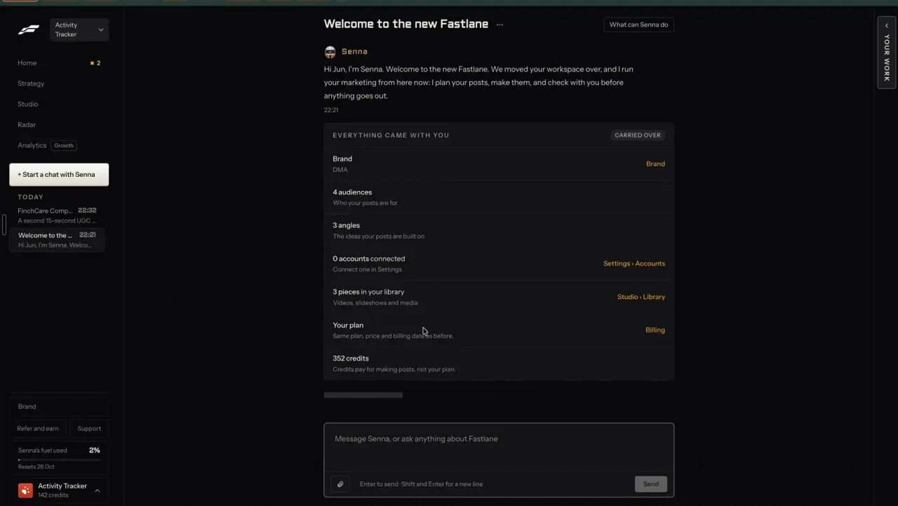
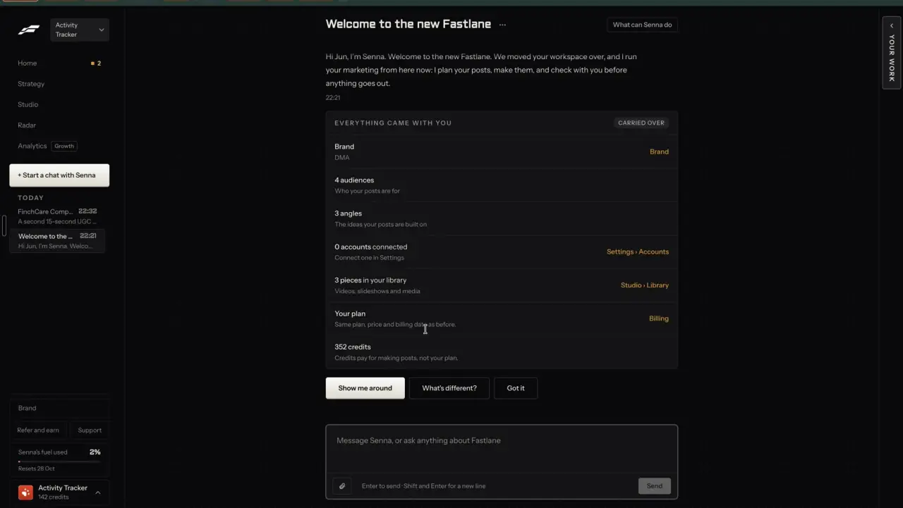

# A first week that pays off

`business-onboarding` | business | phase 8 | status: partial | /north-star#business-onboarding

## Leo asked

8 Oct 2026: "an all in one tool for my social media management, and for each person too"

For each person to use it, a new adviser has to get from sign-up to a first week of posts without Leo walking them through it.

## How the best do it

On Leo's account Fastlane shows what is already set up, pays credits for a short survey, and starts Strategy on "Plan your first campaign" (0:00).

- The Home "Next up" card holds an offer box with a red square, "Two minutes, 100 credits" / "Optional. Ten questions, 100 credits on your balance." and the buttons "Answer" and "Don't ask again" (0:04). Leo did not open it, so the ten questions are unverified.


- The first chat thread, "Welcome to the new Fastlane", opens with "Hi Jun, I'm Senna. Welcome to the new Fastlane. We moved your workspace over, and I run your marketing from here now: I plan your posts, make them, and check with you before anything goes out." (4:40). Leo's workspace was moved from Fastlane's older version, so this is a migration card; what a brand-new sign-up sees is not in the recording. Under it, a card titled "EVERYTHING CAME WITH YOU" with the badge "CARRIED OVER" lists one row per thing the workspace has. Four rows carry a link to where the thing lives; audiences, angles and credits have none:
  - "Brand" / "DMA" / link "Brand"
  - "4 audiences" / "Who your posts are for" (no link)
  - "3 angles" / "The ideas your posts are built on" (no link)
  - "0 accounts connected" / "Connect one in Settings" / link "Settings > Accounts"
  - "3 pieces in your library" / "Videos, slideshows and media" / link "Studio > Library"
  - "Your plan" / "Same plan, price and billing date as before." / link "Billing"
  - "352 credits" / "Credits pay for making posts, not your plan." (no link)



- Three buttons sit under the card: "Show me around" (main), "What's different?" and "Got it" (4:41). They stay after the tour, so the card can be reused. "Show me around" starts a six-step tour that moves through the real pages (`agent-tour`).



- The first campaign explains its own gaps. Its Activity row reads "24 templated, 4 generated. Mostly templated: a business with no product listed to show yet. No video hook posts: there is no demo video. Add one on Brand, on the Demo videos tab." (5:42).

Other competitors:

- SocialBee's optional Copilot onboarding asks whether you are a person or a company, then 8 questions, and returns suggested networks, content categories, a posting plan and generated posts ([Copilot](https://help.socialbee.com/article/359-social-media-copilot)).
- Blaze asks for your website first and builds a starting brand kit from it ([getting started](https://help.blaze.ai/en/articles/9535151-getting-started-with-blaze)).
- SageContent, for advisers, starts with a questionnaire on expertise, audience, positioning and style, and filters every idea through it ([site](https://www.sagecontent.ai/)).
- MakeUGC starts in three steps: "Start from anything", "Describe the ad", "Generate, edit & launch" ([site](https://www.makeugc.ai/)).
- Taplio gives 7 days of Pro, a 30-day money-back promise, and live group demos ([pricing](https://taplio.com/pricing)). Kleo bundles fast-start videos and weekly live coaching ([pricing](https://wf.kleo.so/pricing)). Levitate gives every account a Success Specialist for onboarding ([features](https://www.levitate.ai/features)).

## What we have today

- `/welcome` (`src/pages/WelcomePage.tsx`, in the nav as Home > "Getting started" for everyone): the heading "Welcome, {name}" with a waving-hand emoji after it (the name is the email's local part when it reads like a name), three steps headed "Step {n} | {title}" with a middle dot ("Set your voice" to `/voice`, "Write your first post" to `/generate`, "Plan your week" to `/plan`), the button "Start with my first post" and a skip link that puts an em dash between "Skip" and "take me to my dashboard". The emoji, the middle dot and the em dash all break the ASCII copy rules.
- First run: `src/pages/HomePage.tsx` sends a person to `/welcome` when they have no drafts, no usable voice profile and no `content-studio-onboarded-<uid>` flag (`src/lib/onboarding.ts`, set by `markOnboarded` on any click). The flag starts with `content-studio-`, so `cloudSync` carries it to other devices. `onboarding.ts` has no test.
- Home's "Get set up" card lists five items ("Set your voice", "Set up your brand kit", "Write your first post", "Schedule a post", "Check your content in Coach") with "{done} / 5 done" until all are ticked.
- Elsewhere: the diagnosis quiz (`/coach?view=quiz`, `src/lib/diagnosis.ts`, about 14 scored questions and one profiling question) picks a first action; `/brands/new` fills a brand from its website; `/tutorial` is a written studio tour.
- Positioning (`src/lib/positioning.ts`, per brand through `scoped`) is what Write and `/plan` read. `loadPositioning` fills missing fields from `EMPTY_POSITIONING` (audience "general", platform "linkedin", cadence 3), so a saved positioning always has an audience, a platform and a cadence even when the person never chose them. `/plan?view=setup` is the form that edits it.
- Missing: a view of what is set up with a link to each gap, questions that fill those gaps, a reward for answering, and a first week planned from the answers.

## Build

No money and no schema. Leo's sign-ins get the new `/welcome`; everyone else keeps the current page until he turns it on. The credit reward waits for `business-credits`.

### Screens and states

`/welcome`, rebuilt in `src/pages/WelcomePage.tsx` for `leoOnly(email)`:

```
Welcome, Jun
WHAT YOU HAVE
  Brand              MoneyBees
  Who you serve      Working adults                            Change
  Your voice         Not set yet                               Set it
  Brand kit          Photo and sign-off                        Brand kit
  Competitors        2 accounts followed                       Following
  Posts              4 drafts, 1 scheduled                     My posts
  Media              12 files                                  Media
[ Two minutes, a better first week | Answer | Don't ask again ]
[ Plan my first week ]   Show me around   Go to Home
```

- Rows come from the stores already on the device, read on mount: the active brand's name (`loadProfiles`, `activeProfileId`), `loadPositioning`, `loadVoiceProfile` with `isVoiceProfileUsable`, `loadBrand` from `src/lib/carousel.ts` (ready when it has a photo or a sign-off, the rule Home's checklist uses), `loadFollowing`, `getDraftStats` (drafts and scheduled), `loadMedia`. A row with nothing yet shows "Not set yet" and its link reads "Set it".
- Links: Brand has none when set (there is no brand page; the profile switcher changes brands). Who you serve "Change" opens `/plan?view=setup`; Your voice `/voice`; Brand kit `/brand`; Competitors `/following`; Posts `/drafts`; Media `/media`.
- "Accounts connected" shows only when `socialConnectShown()`, from `socialStatus(profileId)`, with "Connect one" to `/accounts`. While it loads, the row shows a grey bar; if it fails, the row hides.
- "Your plan" shows only once `business-plans` step 1 has shipped: "Preview" / "Free while Content Studio is invite-only." / "Plan and spend".
- Loading: the heading renders at once and the rows show as grey bars until the stores are read (one tick; they are synchronous).
- "Plan my first week" is the one main button. "Show me around" opens `agent-tour` once it ships and `/tutorial` before then. "Go to Home" marks the person onboarded and opens `/home`.

The offer, on `/welcome` and as its own small card on Home above "Get set up" (Leo only; "Get set up" hides once its five items are done, so the offer cannot live inside it), until the questions are answered or dismissed:

- "Two minutes, a better first week" / "Optional. Up to 6 questions. Your answers set up your first week of posts." / "Answer" / "Don't ask again".
- "Don't ask again" hides it on every device (synced) and shows "Hidden. The questions are still on /welcome." with "Undo".

The questions, one per screen at `/welcome?survey=1`:

- Only questions the stores cannot already answer are asked. Because a saved positioning always has an audience, a platform and a cadence (the defaults), those three are asked only when `loadPositioning` returns null for the brand. "asks" is asked when `topics` is empty, and "goal" when plan-goal has not saved one. So a person with a saved positioning and topics sees 2 or 3.
- Header "{i} of {n}" with a bar, "Back", "Skip this one", and "Next" as the main button ("Finish" on the last).
- Each answer is saved the moment it is picked, so closing the tab resumes at the same question.
- Done: "Your first week is ready to plan" with the answers in one short list (each with "Change") and the main button "Plan my first week".

| id | Question | Answers | Saved to |
|---|---|---|---|
| audience | "Who do you most want to reach?" | "Young adults starting out", "Working adults", "Parents", "Close to retirement", "A mix of people" | `positioning.audience` |
| asks | "What do clients ask you about most?" | free text, up to 200 characters, placeholder "For example: how much insurance is enough for a young family" | `positioning.topics` (added, not replaced) |
| platform | "Where do you post most?" | "LinkedIn", "Instagram", "Facebook", "TikTok" | `positioning.platform` |
| cadence | "How many posts a week can you check and approve?" | "3 a week", "4 a week", "5 a week", "7 a week" (`CADENCE_OPTIONS`) | `positioning.cadence` |
| camera | "Are you happy to be on camera?" | "Yes, I'll film myself", "Yes, as an AI video of me", "No, keep me off camera" | onboarding answers |
| goal | "What should posting do for you?" | plan-goal's five chips, word for word: "Get more enquiries from people I can help", "Grow an audience that knows what I do", "Keep in touch with clients so they refer me", "Find people to join my team", "Post every week without it taking my evenings" | `positioning.goal` and `goalKind` (clients, audience, trust, recruit, time) once plan-goal ships, else onboarding answers, copied over when it ships |

No language question: nothing in the app reads a language answer yet. Add one when `edit-translate` or Write can use it.

"Plan my first week":

- When `plan-campaign` has shipped: opens `/campaigns/new?audience=<key>&step=review` (an audience key from `brand-audiences`; without one, `/campaigns/new` at its first step) with one week at the chosen cadence and formats from the camera answer: Text post and Carousel always; "Short video script" for "Yes, I'll film myself"; "AI video" for "Yes, as an AI video of me" only when a face is saved (`people-my-face`).
- Before then: opens `/plan`, which builds a plan from the positioning the answers just filled.
- Either way the onboarding record gets `firstWeekAt`, and Home's "Get set up" card gains a ticked "Plan your first week".

States: no brand profile yet (brand-new account) shows one row, "Brand" / "Not set yet" / "Add from your website" to `/brands/new`, above the rest; storage blocked (private window) shows the page with every row "Not set yet" and the questions still work for the session.

### Copy

- Heading: "Welcome, {name}" or "Welcome" (no emoji)
- Card: "WHAT YOU HAVE"; rows "Brand", "Who you serve", "Your voice", "Brand kit", "Competitors", "Posts", "Media", "Accounts connected", "Your plan"
- Values: "Not set yet", "Ready", "Photo and sign-off", "{n} accounts followed", "{d} drafts, {s} scheduled", "{n} files", "{n} connected"
- Links: "Change", "Set it", "Brand kit", "Following", "My posts", "Media", "Connect one", "Plan and spend", "Add from your website"
- Buttons: "Plan my first week", "Show me around", "Go to Home"
- Offer: "Two minutes, a better first week", "Optional. Up to 6 questions. Your answers set up your first week of posts.", "Answer", "Don't ask again", "Hidden. The questions are still on /welcome.", "Undo"
- Questions: the table above, plus "{i} of {n}", "Back", "Skip this one", "Next", "Finish"
- Done: "Your first week is ready to plan", "Change", "Plan my first week"
- After `business-credits` ships, the offer reads "Two minutes, 100 credits" / "Optional. Up to 6 questions, 100 credits on your balance." (amount Leo's).

### Data

- New synced key `content-studio-onboarding-${scoped(userId)}` (per brand, since the answers describe one brand):

```ts
interface Onboarding {
  v: 1;
  answers: Partial<Record<"audience" | "asks" | "platform" | "cadence" | "camera" | "goal", string>>;
  answeredAt?: string;   // the last question answered or skipped
  dismissedAt?: string;  // "Don't ask again"
  firstWeekAt?: string;  // "Plan my first week" pressed
}
```

- Answers that map to positioning are written through `savePositioning` in `src/lib/positioning.ts`, starting from `EMPTY_POSITIONING` when the brand has none, so Write and Plan see them at once.
- `src/lib/onboarding.ts` grows `loadOnboarding`, `saveAnswer`, `dismissOffer`, `inventory(stores)` (rows with value and link) and `openQuestions(positioning, onboarding)`. The `content-studio-onboarded-<uid>` flag stays as it is.
- No table, no schema change.

### AI and cost

- No AI call and no Jev question: every answer is the person's own choice, mapped by a table.
- No new cap. "Plan my first week" costs what `plan-campaign` costs (about US$0.07 for 12 posts by that spec's estimate); `/plan` costs nothing.
- Step 2, after `business-credits`: finishing the questions calls a `grant` that writes one `survey` ledger row with ref `survey:<uid>`, so it pays once per account.

### Deep links

- `/welcome` (the card).
- `/welcome?survey=1` opens the questions (push); `&q=<id>` is the current question (replace), so a link can resume at "camera".
- `/welcome?survey=done` shows the done screen (replace).
- Add `links.welcome({ survey, q })` to `src/lib/links.ts` and a `/welcome` row to `docs/deep-links.md`.

## Done when

- [ ] Leo's /welcome shows every row with the right value for his active brand, and each link opens the page it names.
- [ ] Switching brand (`?profile=<id>`) changes the rows and the questions asked.
- [ ] With a saved positioning that has topics, only camera and goal are asked (goal too is skipped once plan-goal has saved one); answering audience on a fresh brand writes `positioning.audience`.
- [ ] Closing the tab on question 3 and opening `/welcome?survey=1` resumes at question 3.
- [ ] "Don't ask again" hides the offer on another device after sync, and Undo brings it back.
- [ ] "Plan my first week" opens `/plan` today, and `/campaigns/new` with the answers once `plan-campaign` ships.
- [ ] A demo sign-in sees today's /welcome unchanged.
- [ ] No emoji and no em dash on the page.
- [ ] Checked by eye at 390 px and 1440 px; `npm run build` and the full `npx vitest run` pass.
- [ ] `src/data/northStar.ts` item `business-onboarding` flipped with its `ours` line, in the same commit.

## Tests

- New `src/lib/onboarding.test.ts`:
  - `inventory` on an empty account gives every row "Not set yet" with its "Set it" link, and on a set-up account gives the counts.
  - `openQuestions` asks audience, platform and cadence when the positioning is null and skips them when one is saved (even with the default values), asks "asks" only with empty topics, and skips anything already answered or skipped.
  - `saveAnswer("audience", "Working adults")` writes `working-adult` to the positioning and keeps the other fields.
  - `saveAnswer("asks", text)` adds to `topics` without duplicates and trims to 200 characters.
  - `firstWeekFormats("Yes, as an AI video of me", false)` leaves AI video out when no face is saved.
- The same new file also covers `isOnboarded` and `markOnboarded`, which have no test today.

## Open questions

- Leo: the reward once credits exist (Fastlane gives 100 credits for 10 questions).
- Leo: should the questions replace the diagnosis quiz's profiling question, or both stay?
- Leo: "Show me around" or "Plan my first week" as the main button. This spec picks the first week, since that is the payoff.
- When to turn the new /welcome on for everyone.

## Related

brand-from-website, brand-audiences, plan-goal, plan-campaign, plan-review-queue, agent-tour, agent-home, people-my-face, business-credits, business-plans, business-referrals
