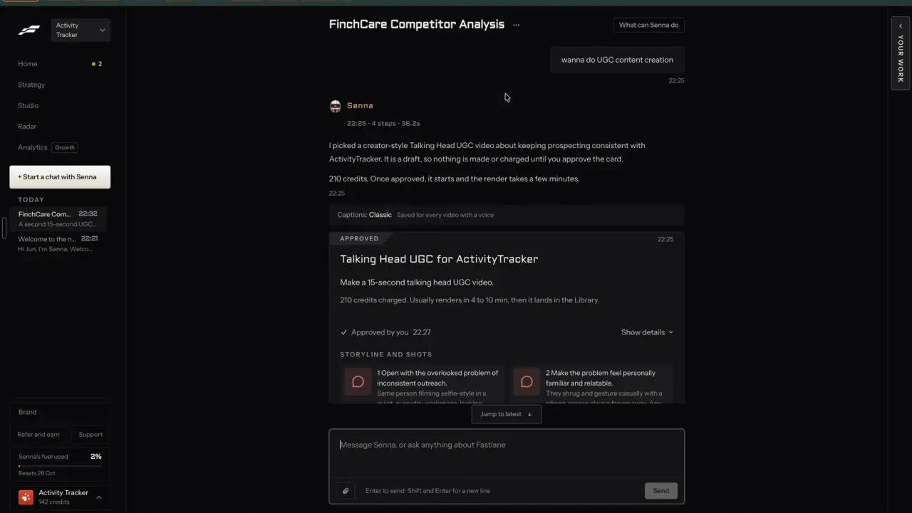
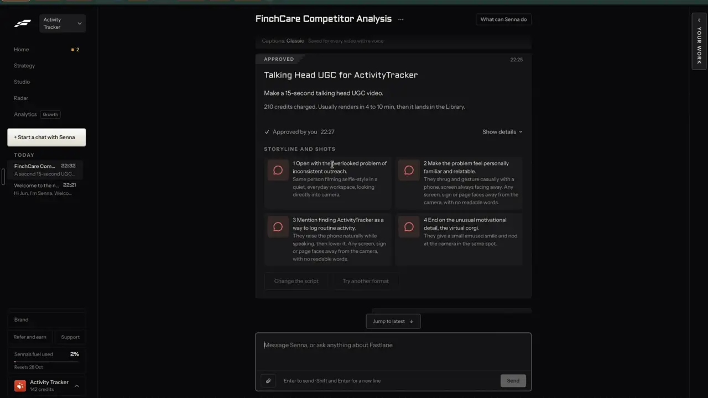

# Edit by asking

`edit-by-chat` | edit | phase 6 | status: partial | /north-star#edit-by-chat

## Leo asked

19 Oct 2026: "the idea is that one can remix any content format and the ai will regenerate"

Regenerating is half of it; the other half is saying "shorter", "end on a question" or "bigger captions" and getting that change on the thing already made. No direct ask for chat editing; the rest is from the competitor research.

## How the best do it

Fastlane runs everything through its agent, Senna, and every change goes through a card:

1. Senna explains the card and its price first: "It is a draft, so nothing is made or charged until you approve the card." / "210 credits. Once approved, it starts and the render takes a few minutes." (notes-4 2.3).



2. A video card shows "STORYLINE AND SHOTS" with four beats and two buttons under them, "Change the script" and "Try another format". After approval both are greyed with a not-allowed cursor (t272). The pending state, where they would work, is not in the recording (unverified).



3. After an approved change, a receipt says what happened and how to take it back: "Learning recorded" / "For future AI UGC content, generally use Asian creators." / "To undo: Say undo in chat to remove it." (notes-4 2.4).
4. Short of credits, Senna refuses before drafting and offers a cheaper option: "A second 15-second UGC video did not get drafted because it needs 210 credits and you have 142." / "A 10-second version is 140 credits, or you can buy credits in Plan and spend." (notes-4 2.6).


Editors that change a made thing by chat:

- The Captions app, which includes Mirage, has "Chat to edit": click timeline items to point at them (Shift for several), mark moments with "Add annotations", then ask, for example "Add chill background music" or "Generate b-roll about X and add it to the first shot"; follow-ups like "make it softer" work, and you can keep editing while chat runs. It costs 2 credits a message plus 1 per action plus any generation, on Max and up ([help](https://captions.ai/help/docs/timeline/chat-to-edit.md), [usage](https://www.captions.ai/help/docs/ai-usage)).
- OpusClip's Agent Opus: select a range, describe the change, preview, then apply, with version history and "Reimagine" for a new version in another style. Each edit is quoted before approval, failed generations release the reserved credits, and each video gets one free retry ([FAQ](https://help.opus.pro/agent-opus/article/ao-faq.md), [credits](https://help.opus.pro/agent-opus/article/ao-faq-credits-faq.md)).
- Kapwing's Kai takes commands for filters, borders, layer position and order, audio fades, background removal and timed text at the top, middle or bottom; fine timing and text styling still go to the editor ([release notes](https://www.kapwing.com/help/kapwing-release-notes-may-2026/)).
- Taplio's "AI Edit": "Improve this post", "Rewrite the hook", "Fix grammar and spelling" or your own instruction, with "History" to restore earlier versions ([help](https://intercom.help/taplio/en/articles/17233357-using-taplio-s-ai-for-content-inspiration)).
- Typefully's writing assistant flags weak hooks "instead of blindly following instructions" and keeps rules you set once, such as banned punctuation ([changelog](https://typefully.com/changelog/writing-assistant-133)).
- Agorapulse offers "Shorter", "Longer", "Rephrase", "Translate in..." and seven tones, then "Send to Composer", "Copy" or "Retry" ([help](https://support.agorapulse.com/en/articles/8769298-how-to-use-the-ai-writing-assistant)); Buffer's assistant rephrases, shortens, expands and changes tone on every plan for free ([buffer.com](https://buffer.com/ai-assistant)).

## What we have today

Editing by asking exists in three separate places:

- Video: "Vibe edit" in `/edit` (`runVibe` in `src/pages/VideoEditPage.tsx` around line 1078; video-assist mode `vibe`, `buildVibeMessages` in `supabase/functions/video-assist/logic.ts`, gpt-4.1, cap `vibe-edit` 100). Plain words become a patch to the edit's settings (`VIBE_KEYS`: caption style, position, size, colours, hook, pauses, trims, frame, name tag and more) with a one-sentence reply, kept in a short log, with Undo through the editor's history. It can also match up to 3 frames of a reference video (`MAX_FRAMES`), and its prompt tells it to say plainly what it could not do (music, B-roll, stickers, transitions). The client call is `vibeEdit` in `src/lib/videoProjects.ts`, which returns `{ patch, reply }`.
- Write: `/generate?draft=<id>&ask=<words>` rewrites a post and offers "Use this" and "Discard", then Undo (`rewriteFields` in `src/pages/GeneratePage.tsx`).
- The assistant dock (`src/components/feedback/AssistantDock.tsx`, a copy of the feedback-board repo's client, mounted by `src/components/feedback/AssistantMount.tsx`): before answering, `proposeAct` in `src/lib/assistantActs.ts` skips text that is mostly not English, then sends the message and the adviser's post titles to `assistant-act`, where Jev picks one act (`move`, `write`, `week`, four `engage_*`, `none`; `ACT_MIN` 0.6, `PICK_MIN` 0.5, cap `assistant-act` 30). The host returns a `DockAct`: either `{ say, go? }`, an answer with link chips, or `{ ask, yes, run }`, a confirm card whose `run()` returns `{ done, open?, go?, undo? }`. The dock draws the card with the `yes` label and its own "Cancel", which answers "Nothing changed.", and shows Undo after a run. `write` opens Write with `?ask=`; nothing posts. Any error inside `proposeAct` returns null, so the chat answers in words.

Missing: the carousel has only one fixed instruction ("Tighten with AI"), the slideshow and the words-over-video editor have none, and the dock cannot change the thing open on screen, so the status is partial.

## Build

Grow the dock through its host hook, never a second agent. `AssistantDock.tsx` is a shared component copied from the feedback-board repo, so it stays untouched: everything below lives in `assistantActs.ts`, `assistant-act`, `AssistantMount.tsx`, a small registry and the editor pages. The existing `DockAct` shape already carries all of it, as shown under step 3.

Order: build after edit-carousel, which adds `carousel-copy` mode `ask` and the `edit-ask` cap. The slideshow part waits for edit-slideshow.

### 1. The page tells the dock what is open

New `src/lib/editTarget.ts`, a module-level registry:

```
export interface EditTarget {
  kind: "carousel" | "slideshow" | "video";
  title: string;
  slides?: string[];            // first 80 characters of each slide, for carousel and slideshow
  onScreen?: number;            // the slide shown or picked, 1-based
  propose(ask: string, slide: number | null): Promise<Proposal>;   // calls the writer, changes nothing
}
export interface Proposal { reply: string; preview: string; flags: string[]; apply(): { done: string; undo: () => void } }
export function registerEditTarget(t: EditTarget): () => void;
export function currentEditTarget(): EditTarget | null;
```

- `CarouselPage.tsx` registers while a carousel is open. `propose` calls `carousel-copy` mode `ask` (built in edit-carousel) with `index` when a slide is named; `apply` goes through the page's `change()` and undo stack.
- `SlideshowPage.tsx` (edit-slideshow) registers the same way, sending each slide's box texts as `texts`.
- `VideoEditPage.tsx` registers while a project is open. `propose` calls the existing `vibeEdit` (from `src/lib/videoProjects.ts`) and keeps the `{ patch, reply }`; `apply` runs `applyPatch` and `change()`, so the editor's own Undo works. An empty patch with a reply means the writer could not do it. The vibe box keeps working as it does today.
- Write is not registered: posts keep the existing `write` act.

### 2. Jev learns one more act

In `supabase/functions/assistant-act/logic.ts`:

- `ActBody` gains `open?: { kind; title; slides?: string[]; onScreen?: number }`, cleaned like the post titles (at most 10 slides of 80 characters).
- `ACTS` gains `"edit"`. Its criterion is only offered when `open` is present: "Change the {kind} that is open on screen right now, \"{title}\": its words, length, tone, captions, look, or the order of its slides."
- When `open.slides` exists, one more question:
  - id `slide`, type `choice`, instructions: "The adviser has a {kind} open with {n} slides, and slide {onScreen} is the one on screen. Which slide does the message mean? Pick all when it means the whole {kind} or names no slide."
  - criteria: `s1` to `sN` as "Slide {i}: \"{first 80 characters}\"", plus `all`: "The whole {kind}, or no slide is named."
- Thresholds: the act at `ACT_MIN` 0.6, the slide at `PICK_MIN` 0.5 (below it the change covers every slide). Both are the existing proposals; set them after 30 messages typed on Leo's account and reading every pick.
- Server gate: in `assistant-act/index.ts`, `open` is dropped unless `isAllowed(Deno.env.get("NORTH_STAR_USERS"), uid)` passes (`isAllowed` from `supabase/functions/market/logic.ts`, the secret holding Leo's two uids). Adding an option to the act question changes Jev's routing for every message, so no one else may get it.

### 3. The card shows the change before it lands

In `src/lib/assistantActs.ts`, `proposeAct` sends `open` from `currentEditTarget()`. For an `edit` pick, it calls `target.propose(message, slide)` while the dock shows its "thinking..." line, then returns a card. The paid writer runs before the tap, so the card can show the result; nothing changes until "Use this".

The card is the dock's existing confirm card, `{ ask, yes: "Use this", run }`: `ask` holds the lines below joined by new lines (the dock keeps line breaks), and the dock adds its own "Cancel". `run()` first checks that `currentEditTarget()` is still the same target, then calls `proposal.apply()` and returns its `{ done, undo }`. A writer that could not do it returns `{ say, go }` instead, and a writer that failed returns `{ say: "That change didn't go through. Nothing changed." }`; neither may fall into today's catch that returns null.

```
Change slide 3 of "5 CPF myths"?
Made it shorter and ended on a question.
"Topping up your CPF before 31 Dec? Here is what counts..."
Check: "guaranteed" is flagged.
[Use this]  [Cancel]
```

After "Use this" the dock says `Done. Slide 3 changed. Undo here or on the page.` and offers its Undo, which calls the page's undo.

### 4. Words in the address

`ask=<words>` on an open item runs the same proposal on the page itself, for links from jobs and other pages: the carousel and slideshow show it as the in-page suggestion with "Use this" and "Keep mine" (edit-carousel's suggestion area); the video editor fills the vibe box and runs it, as Write does with its own `ask`. The param is read once and removed (replace).

### Screens and states

- Nothing open, or not Leo: no `edit` act; the dock behaves as today.
- Working: the dock's busy state while Jev and the writer run, usually 3 to 8 seconds.
- Proposal ready: the card above. The page under it is unchanged.
- Cancel: the dock's own "Nothing changed." (`cancelCard`).
- The item was closed before the tap: "That carousel is no longer open. Open it and ask again." Nothing is applied and no Undo shows.
- The writer could not do it (a video change outside `VIBE_KEYS`, seen as an empty patch): a plain answer with the writer's own reply, for example "I can't add music by asking yet. Add it in the Cuts tab.", and a chip to `links.edit({ p, tab: "cuts" })`, where the music controls sit.
- Over a cap: the server's words, for example "You've used all 60 for today. It resets at 8am Singapore time." (`edit-ask`) or the `vibe-edit` and `assistant-act` limits.
- Writer failed: "That change didn't go through. Nothing changed." The `edit-ask` use is refunded.
- Jev null, unsure, or the message mostly not in English: no act; the dock answers in words, as today.
- Compliance: `scanCompliance` on the proposed text; any flag shows on the card as "Check: \"{match}\" is flagged." It warns by default; trust-compliance-check later lets a team leader switch a rule to block or review.

### Copy

- Dock intro for Leo (`intro` prop in `src/components/feedback/AssistantMount.tsx`, chosen with `leoOnly(user?.email)`; everyone else keeps today's intro word for word): "Ask how anything works or reach the team. It can also change the carousel, slideshow or video you have open, move a post, rewrite one in Write, show last week's numbers or paste text into Reply drafts. Nothing changes until you tap to confirm."
- Card: "Change slide {n} of \"{title}\"?" or "Change \"{title}\"?", then the writer's reply, then the preview in quotes (160 characters at most), then flags, with the buttons "Use this" and "Cancel".
- Done: "Done. Slide {n} changed. Undo here or on the page." / "Done. \"{title}\" changed. Undo here or on the page."
- "Nothing changed.", "That {kind} is no longer open. Open it and ask again.", "That change didn't go through. Nothing changed."

### Data

- Nothing new is stored. The registry and proposals live in memory; undo is each page's history.
- No table and no schema change.

### AI and cost

- Per edit: one `assistant-act` Jev request (cap `assistant-act` 30, well under US$0.001), then one writer call: `carousel-copy` mode `ask` for a carousel or slideshow (about US$0.002, cap `edit-ask` 60, added by edit-carousel) or video-assist `vibe` for a video (gpt-4.1, a few US cents at most with a long transcript, cap `vibe-edit` 100). Estimates from list prices; unverified against the bill.
- Jev decides which act and which slide; the LLM writes the new words and the reply. No new cap beyond `edit-ask`.
- Compare: the Captions app charges 2 credits a message plus 1 per action; OpusClip quotes each edit before approval.

### Deep links

| URL | Does |
|---|---|
| `/carousel?carousel=<id>&ask=<words>` | Proposes that change on the open carousel, shown in the page |
| `/slideshow?s=<id>&ask=<words>` | The same on a slideshow |
| `/edit?p=<id>&ask=<words>` | Fills the vibe box with the words and runs it |

`ask` is at most 300 characters (Write's `MAX_ASK`), read once and removed. Add `ask` to `links.carousel`, `links.slideshow` and `links.edit` in `src/lib/links.ts`, and rows to `docs/deep-links.md`.

### Gate

The `edit` act, the registry's effect and the `ask` params work only when `leoOnly(email)`; the client sends no `open` for anyone else and the server drops it too.

## Done when

- [ ] On Leo's account, with a carousel open, "make slide 3 shorter" proposes a shorter slide 3 only, "Use this" applies it and Undo in the dock and on the page each take it back.
- [ ] "End on a question" with no slide named changes the whole carousel.
- [ ] With a video open, "bigger yellow captions at the top" proposes and applies a settings change, and "add music" answers in words with the Cuts tab link.
- [ ] With nothing open, the dock behaves exactly as today.
- [ ] Jev mocked to null and a failing writer both leave the page unchanged with the right lines.
- [ ] Another account never sees an `edit` card.
- [ ] `npm run build` and the full `npx vitest run` pass; `src/data/northStar.ts` item flipped with its `ours` line in the same commit.

## Tests

- `supabase/functions/assistant-act/logic.test.ts`: the `edit` criterion and the `slide` question appear only with `open`; the exact wording; `actPick` returns `edit` at 0.6 and above and a slide at 0.5 and above, else `null`; `actBody` cleans `open` and cuts it to 10 slides.
- `src/lib/editTarget.test.ts`: register, replace and unregister; `currentEditTarget` is null after the page's unregister runs.
- `src/lib/assistantActs.test.ts`: an `edit` pick with a fake target gives a card whose `yes` is "Use this", whose `run` calls `apply` and whose undo calls the page undo; a target gone at tap time gives the "no longer open" line with no undo; a proposal with a flagged word lists it; an empty video patch gives `{ say, go }`; a throwing writer gives the "didn't go through" answer, not null.
- `supabase/functions/assistant-act/logic.test.ts`: the gate is a pure step in `logic.ts` (`actBody(raw, allowed)` drops `open` when `allowed` is false; `index.ts` passes the `isAllowed` result), so a body with `open` from a caller not on the list asks no `edit` criterion and no `slide` question.
- `src/lib/links.test.ts`: `ask` on the three builders.

## Open questions

- Paying before the tap: the writer runs before "Use this" so the card can show the change, which spends a capped call even when the adviser cancels. OpusClip quotes first and charges on approval. With caps only this is fine; once credits exist (business-credits) Leo decides whether a proposal is free.
- Pointing at a part on screen (the Captions app's timeline selection) is limited here to "the slide on screen". Pointing at a video moment by tapping the timeline could come later.
- Typefully pushes back on weak hooks. Whether the assistant should say "this hook is weaker than the one you had" (a Jev judgment, see edit-score) is Leo's call.
- Hard stops checked: no schema change, no new npm package, no new paid provider (OpenAI and Jev are already wired in) and no auth change; the shared `AssistantDock.tsx` is not edited.

## Related

edit-carousel, edit-slideshow, edit-video, edit-captions, edit-text-video, edit-score, agent-chat, agent-approvals, agent-memory, brand-voice-memory, business-credits
