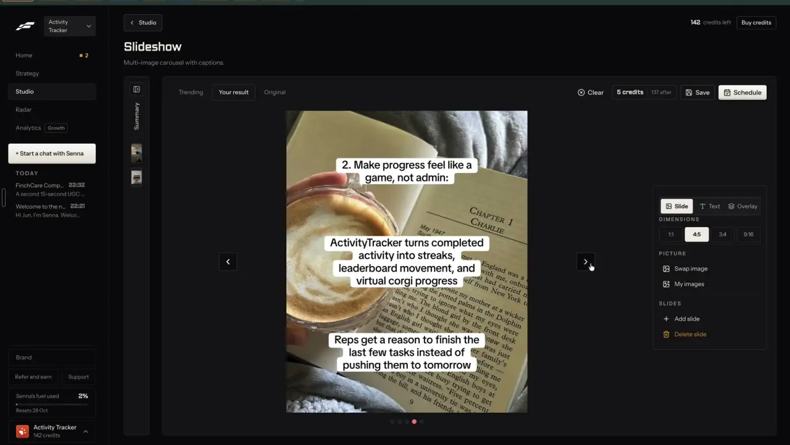
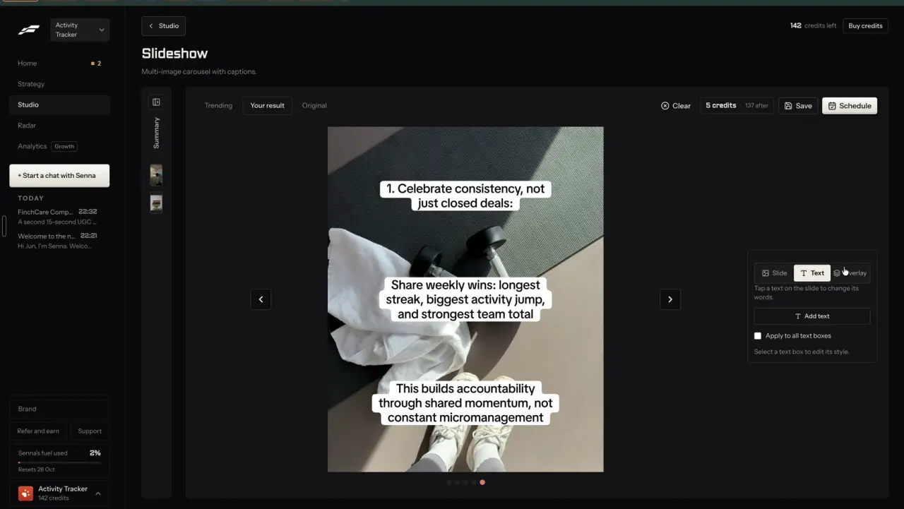

# Design editor for images and covers

`edit-design-canvas` | edit | phase 3 | status: partial | /north-star#edit-design-canvas

## Leo asked

No direct ask; from the competitor research.

It serves the north star Leo set on 19 Oct 2026: "the idea is that one can remix any content format and the ai will regenerate". A remixed static ad or carousel slide usually comes back nearly right, and the canvas is where the adviser nudges a line or erases a stray cup before approving it.

## How the best do it

Fastlane edits text boxes on the slide itself. In its Slideshow editor (Studio > Slideshow, "Your result" tab) the right panel has three tabs, "Slide", "Text" and "Overlay". "Slide" holds "DIMENSIONS" (1:1, 4:5 default, 3:4, 9:16), "PICTURE" ("Swap image", "My images") and "SLIDES" ("Add slide", "Delete slide").



With nothing selected, the Text tab says "Tap a text on the slide to change its words." with "Add text", "Apply to all text boxes" and "Select a text box to edit its style." Tapping a box draws 8 handles and a round "x" to delete it, and the tab shows "Words" ("Or double-click the text on the slide."), "Font" ("TikTok Sans"), "Weight" ("Medium"), "Size" ("16px"), "Color" ("#000000"), "Stroke" ("3px"), "Stroke color" ("#FFFFFF") and "Background" ("White", "None", "Snapchat").




Saving is "Save" or "Schedule", which renders each slide first ("Preparing slides 3/5", with "Cancel preparation"). The slideshow costs 5 credits, "Charged when you save or schedule" (notes-2 F9 to F13). There are no layers, no free sizes and no AI picture fixes in what Leo recorded.

The design tools go further:

- Ocoya Design Studio: drag-and-drop canvas with layers (opacity, corners, borders, filters, order), over a million templates, photos, videos and tracks, AI "Erase", "Extend" and "Replace", export at 1:1, 4:5, 9:16 and 16:9 from one design or a custom size up to 2000 px, straight into a scheduled post, and designs saved as team templates. [ocoya.com/features/design](https://www.ocoya.com/features/design)
- PostNitro: 100+ editable 4:5 templates, your own saved templates (1, 5 or 15 by plan), and a freeform canvas with "Any canvas size" (4:5, 1:1, 9:16, 16:9). Nitro Chat beside the canvas edits slides, wording, layouts and colours on request. [postnitro.ai](https://postnitro.ai/), [pricing](https://postnitro.ai/pricing)
- 1of10's thumbnail editor: Magic Eraser, Magic Edit, face swap, text and font controls, 4K upscale; 4 credits a thumbnail. [1of10.com](https://1of10.com)
- ContentStudio's AI image tools include "Remove Background" and "Upscale", 25 to 125 AI image credits a month. [ai-studio](https://contentstudio.io/ai-studio)
- FMG Suite, an adviser tool, lets advisers customise social designs with Canva and pull Unsplash photos inside the builder, on all tiers. Hootsuite puts Canva and Adobe Express templates inside its composer. [FMG pricing](https://fmgsuite.com/pricing/), [Hootsuite](https://www.hootsuite.com/platform/publishing)

## What we have today

Partial. Every designed picture comes from a fixed layout; nothing can be moved, layered or resized.

- Carousel maker, `/carousel` (`src/pages/CarouselPage.tsx`): slides drawn as SVG in the browser by `layoutSlide` and `renderSvg` (`src/lib/carouselLayout.ts`) and saved as PNG by `svgToPng` (`src/lib/carouselRender.ts`). One size, 1080x1350, 96 px side margins (`PAD_X`). Choices: brand colour presets or a hex, three font pairs (`SLIDE_FONTS`: Classic is a serif title over a sans body, Modern is sans and sans, Editorial is serif and serif; system stacks `SERIF_STACK` and `SANS_STACK` only, titles at weight 600 and bodies at 400), three papers, left or centre, text scale 0.8 to 1.25, headshot or logo, a picture per slide from Media, with saved carousels synced as `content-studio-carousels-${scoped(userId)}` (latest 20). `sanitizeSaved` in `src/lib/carousel.ts` rebuilds each slide as `id`, `title`, `body`, `image`, `recap` and drops any other field. The page already uses `?tab=` (drafts, paste, topic, saved) and `?carousel=`.
- Media (`/media`, `src/lib/mediaLibrary.ts`): photos on this device (IndexedDB), folders, alt text; free stock photos from Pexels (`src/components/StockSearch.tsx`, `stock-media`, cap `stock-search` 100).
- AI pictures: "Make the image" in Write (Higgsfield Soul v2, about US$0.006, cap `ai-image` 5) and "Fix it" (Qwen Image 3 edit, `alibaba/qwen-image-3/edit` at 2k, caps `ai-image-fix` 5 and `ai-image-fix-global` 40). Fix only works on a picture this adviser made with Higgsfield, since the server reads its link from Higgsfield. `buildFixBody` in `supabase/functions/ai-image/logic.ts` always asks for `aspect_ratio: "3:4"`, its `KEEP_RULE` is a private constant, and a failed fix job is never refunded (ai-image has no `refundUsage`; ai-video's `REFUNDS` covers only `ai-video` and `ai-clip`).
- On-device person cut-out already exists for video: MediaPipe `selfie_segmenter` loaded by `personFinder` in `src/lib/faceVision.ts` (`@mediapipe/tasks-vision` 1.1.0, about 7 ms a frame, model and wasm fetched from Google's and jsdelivr's CDNs on first use). `personFinder` is private and only feeds the video backdrop through `paintEffects`.
- No PDF reader is installed (`package.json` has no pdf.js), so the app cannot open a PDF page as a picture today.
- Specified, not built: `formats-static-ad` adds `/image` with four fixed layouts in four sizes; `formats-prompt-media` adds an `ai-video` mode `still-edit` that runs Qwen Image 3 edit on the adviser's own uploaded photo.
- Missing: moving and resizing text and pictures, layers, free sizes, saved design templates, background removal for stills, erase and replace on any picture, Canva import.

## Build

"Edit freely": one canvas editor that opens on top of a carousel slide or an `/image` design and turns its fixed layout into boxes you can move. Build after `formats-static-ad` if possible; until `/image` exists it opens from `/carousel` only.

One engine for the whole app. `edit-slideshow` specifies a canvas editor for photo slideshows: `TextBox` in `src/lib/slideshow.ts`, drawing in `src/lib/slideshowDraw.ts` (canvas 2D, after `ensureCaptionFonts()` from `src/lib/videoMedia.ts`), and pick, drag, resize and delete in `src/components/slideshow/SlideCanvas.tsx`. This item reuses those three and adds pictures, shapes, layers and free sizes. If `edit-slideshow` has not shipped, build those files as that spec describes first, then extend them here.

### The model

New pure file `src/lib/canvasDoc.ts`. Positions and sizes are shares of the frame (0 to 1), and `x`, `y` are the centre of a node, as `TextBox` already uses, so changing the canvas size never breaks a layout.

```
CanvasDoc  { id, width, height, background: string, nodes: CanvasNode[], updatedAt }
CanvasNode =
  | TextBox & { kind: "text", align: "left" | "center", weight?: 400 | 600, hidden? }   // TextBox from src/lib/slideshow.ts
  | { id, kind: "picture", x, y, w, h, mediaKey, shape: "rect" | "rounded" | "circle", hidden? }
  | { id, kind: "shape", x, y, w, h, fill, radius, opacity, hidden? }
```

- `TextBox.font` gains two values, `"georgia"` and `"system"`, the carousel's own stacks (`SERIF_STACK`, `SANS_STACK` in `src/lib/carouselLayout.ts`), labelled "Georgia" and "System" in the Font picker. They are not named Classic or Modern, because those are the carousel's font pairs, each of which mixes both stacks. `weight` is set only on these two fonts, copied from the carousel's 600 titles and 400 bodies, and has no control, so a carousel slide converts without its type changing. The three caption fonts (Heavy, Clean, Serif) stay and carry their own weight.
- `sanitizeDoc(raw)` in the same file cleans a stored doc the way `sanitizeSaved` cleans a carousel: known kinds and fonts only, shares clamped to 0 to 1, colours as hex, at most 40 nodes and 400 characters a text node, `mediaKey` only as a device key, never a `data:` URL.
- `layoutToDoc(layout: SlideLayout)`: turns the SVG nodes the carousel layout already draws into canvas nodes. Text lines that share a font, colour and steady line spacing merge into one text node; images become picture nodes; rects become shapes.
- `drawDoc(ctx, doc, size, pictures)` in `src/lib/slideshowDraw.ts`: draws the nodes in order (node order is the layer order), text through the same `layoutBoxes` the slideshow uses. Export is `canvas.toBlob` at the doc size.
- Docs hold `mediaKey` references only, never data URLs, so a synced doc stays a few KB.

### The editor

New component `src/components/DesignCanvas.tsx`, full screen over the page it opens from.

```
< Back   Cover slide                        [Undo] [Redo]    [Save]  [Download]
+---------------------------+   Text | Picture | Layers | Canvas
|  [Your hospital bill,  ]  |   Words  [ Your hospital bill, split in two ]
|  [split in two       x ]  |   Font [Classic v]  Size [96px]  Colour [#1E3A8A]
|        (photo)            |   Outline [0px]  Background [White|None|Dark bar]
|  @leotan  (logo)          |   Align [Left|Centre]   [Add text]
+---------------------------+
```

- Canvas: `SlideCanvas` scaled to fit, extended from text boxes to every node kind. Tap or click selects a node and shows 8 handles and a delete "x". Drag moves, corner handles resize (pictures keep their ratio unless Shift is held), arrow keys nudge 1% (5% with Shift), Delete removes. Guides snap to the centre lines and to the 96 px side margins.
- Text tab: the slideshow's controls ("Words", "Font", "Size", "Colour", "Outline", "Outline colour", "Background" with "White", "None", "Dark bar"), with "Georgia" and "System" added to Font, the brand colour first in Colour, plus "Align" and "Add text". There is no weight control, as in `edit-slideshow`. With nothing selected the tab shows `edit-slideshow`'s line "Tap the words on a slide to change them." and the "Add text" button.
- Picture tab: "Swap from Media", "Stock photo" (`StockSearch`), "Import a Canva design" (part 3), "Shape" ("Square", "Rounded", "Circle"), and the AI fixes (part 2).
- Layers tab: every node top to bottom, with "Move up", "Move down", "Hide" and "Delete", and its name (the first words of a text, or the picture's Media name).
- Canvas tab: size chips "Feed 4:5" 1080x1350, "Square" 1080x1080, "Story 9:16" 1080x1920, "Link 1.91:1" 1200x628, and "Custom" (width and height, 320 to 2000 px); "Background" colour. Changing size scales node positions to the new frame and keeps text sizes.
- Undo and Redo keep the last 20 docs in memory, as `edit-slideshow` does; Ctrl or Cmd+Z and Shift+Ctrl or Cmd+Z.
- At 390 px the tabs become a bottom sheet under the canvas, and handles are 44 px touch targets.
- Drawing with canvas 2D (rather than the carousel's SVG) is what lets the caption web fonts load, which an SVG drawn into a canvas cannot do.

### 1. Where it opens and what it saves

- `/carousel`: each slide gets "Edit freely". Its first edit stores the doc on the saved carousel's slide as `free`, and from then on that slide draws from the doc instead of `layoutSlide`. `sanitizeSaved` must keep `free` through `sanitizeDoc`, or the edit is gone on the next load. The slide shows the tag "Edited freely" and the action "Reset to layout", which asks "Drop your changes to this slide?" before removing `free`. Post it for me's `carouselPngs` draws a slide with `free` from the doc.
- `/image` (from `formats-static-ad`): "Edit freely" on any design, plus a "Blank canvas" layout chip that starts an empty doc at the chosen size with the brand colour.
- "Save as template" (on `/image` designs): asks for a name and keeps the doc with its words, as `content-studio-designs-${scoped(userId)}`, latest 20. Templates appear on `/image` as chips under "Your templates", and opening one copies it.
- "Download" exports PNG at the doc size. "Use in a post" saves the PNG to Media and attaches it to a new or chosen draft in Write. Post it for me takes it from there.

### 2. AI fixes on a picture

| Button | What runs | Cost | Caps |
| --- | --- | --- | --- |
| "Cut out the person" | On the device: a new export `cutOutPerson(image)` in `src/lib/faceVision.ts` runs the private `personFinder` on the picture and returns `{ png, coverage }`; the browser writes the PNG with transparency to Media folder "Cut-outs" | Free | none |
| "Remove background" | `still-edit` with the fixed prompt "Remove the background and place the main subject on plain white. Keep the subject exactly as it is." | Qwen Image 3 at 2k, price unverified | `ai-image-fix` 5, `ai-image-fix-global` 40 |
| "Erase something" | A box "What should go?" then `still-edit` with "Remove {words} and fill the space so it matches the surroundings." | same | same |
| "Change something" | A box "What should change?" then `still-edit` with the adviser's words | same | same |
| "Make it sharper" | `still-edit` with "Keep the picture exactly as it is, only sharper and cleaner." at 2k | same | same |

- "Cut out the person" first measures the mask. Under 5% of the picture covered: "No person found in this picture. Try Remove background." This is a measurement, not a judgment, so it needs no Jev.
- Every `still-edit` prompt gets the existing keep rule (`KEEP_RULE` in `supabase/functions/ai-image/logic.ts`, exported for this; ai-video already imports from that file) plus "Keep every face exactly as it is."
- `still-edit` is the mode `formats-prompt-media` adds to `supabase/functions/ai-video`: `{ jpeg, prompt, own: true }`, uploaded with the `upload` helper `ai-video` already has, refused without `own: true`. If that item has not shipped, add the mode here exactly as it describes. That includes mapping `ai-image-fix` in `REFUNDS`, which is what gives a failed edit back. The canvas sends `own: true` only for pictures in the adviser's Media (their uploads, their AI pictures, Pexels photos, whose licence allows changes; unverified here).
- Shape: `buildFixBody` hard-codes 3:4. `still-edit` sends `aspect_ratio` as the nearest of 1:1, 3:4, 9:16 and 16:9 to the source picture (the shapes `formats-prompt-media` sends Soul; only 3:4 is proven on Qwen Image 3 edit in this repo, so read the model's schema first and fall back to 3:4). The canvas fits the result into the node's box by cover, centred, so a near-ratio result never stretches.
- The fixed picture is saved to Media beside the original as "{name} (fixed)" and swapped into the node; the original stays, and Undo swaps it back.

### 3. Canva import

"Import a Canva design" takes a PNG or JPG exported from Canva and adds it to Media folder "Canva" and to the canvas as a picture node, or as the background when the canvas is empty. A PDF is refused with "Download it from Canva as a PNG." since reading a PDF needs a new dependency (open question). The InfoTip says "In Canva, use Share, then Download, then PNG." There is no Canva account link (open question).

### Screens and states

- Empty: a blank canvas shows the brand colour and the line "Add text or a picture to start." with "Add text" and "Swap from Media".
- Loading: opening a design draws within 400 ms; pictures load from the device and show a grey box until ready.
- Picture on another device: the node shows "This picture is on another device." in its box, and Download is disabled until it is swapped.
- Working (AI fix): the node dims with "Removing the background..." (or "Erasing...", "Changing it...", "Sharpening...") while everything else stays editable. Like `src/lib/aiImage.ts`, the job lives in a module-level runner and keeps going if the adviser leaves the page.
- Done: the new picture swaps in and a toast says "Fixed. The original is still in Media." with "Undo".
- Failed: "Couldn't change the picture right now. Try again in a minute." The picture stays as it was and the use is refunded.
- Refused: the server's 403 shows as "This isn't on for your account yet."
- Over the cap: "You've used all 5 picture fixes for today. They reset at 8am Singapore time." The global cap: the existing "Today's picture fixes for the whole studio are used up. Try again after 8am Singapore time."
- Text over a picture: when a text node's colour has under 4.5:1 contrast with the shape or background under it (`contrastRatio`), the Text tab shows "Hard to read on this background." with "Add a white background" (text over a photo is left alone, since a photo has no single colour to measure).
- Compliance: words in text nodes run through `scanCompliance` and show the warn chip in the Text tab; they never block.
- Leaving with unsaved changes: "Save your changes?" with "Save", "Leave without saving" and "Keep editing". Every change is also kept on the device as `cs-canvas-work-${scoped(userId)}` until saved, so a closed tab loses nothing.

### Copy

| Where | String |
| --- | --- |
| Entry | "Edit freely", "Blank canvas", "Edited freely", "Reset to layout", "Drop your changes to this slide?" |
| Header | "Back", "Undo", "Redo", "Save", "Download", "Use in a post", "Save as template" |
| Tabs | "Text", "Picture", "Layers", "Canvas" |
| Text tab | `edit-slideshow`'s Text tab strings (empty line "Tap the words on a slide to change them."), plus font names "Georgia" and "System", "Align", "Left", "Centre" |
| Picture tab | "Swap from Media", "Stock photo", "Import a Canva design", "Shape", "Square", "Rounded", "Circle" |
| AI fixes | "Cut out the person", "Remove background", "Erase something", "What should go?", "Change something", "What should change?", "Make it sharper" |
| Layers | "Move up", "Move down", "Hide", "Show", "Delete" |
| Canvas tab | "Feed 4:5", "Square", "Story 9:16", "Link 1.91:1", "Custom", "Width", "Height", "Background" |
| States | "Add text or a picture to start.", "This picture is on another device.", "Removing the background...", "Erasing...", "Changing it...", "Sharpening...", "Fixed. The original is still in Media.", "No person found in this picture. Try Remove background.", "Couldn't change the picture right now. Try again in a minute.", "Hard to read on this background.", "Add a white background", "Save your changes?", "Leave without saving", "Keep editing" |
| Templates | "Your templates", "Name this template" |
| InfoTip (Canva) | "In Canva, use Share, then Download, then PNG." |
| PDF refused | "Download it from Canva as a PNG." |

### Data

- `free?: CanvasDoc` on a saved carousel's slide (`content-studio-carousels-`) and on a saved `/image` design (`content-studio-images-`), both synced.
- Templates: `content-studio-designs-${scoped(userId)}`, synced, latest 20.
- Unsaved work: `cs-canvas-work-${scoped(userId)}`, device only, one doc.
- Pictures stay in the device media library, referenced by `mediaKey`; `brand-media-library` moves them to the cloud later.
- No table, no schema change.

### AI and cost

- Drawing, moving, export, cut-out and Canva import run in the browser and cost nothing.
- `still-edit`: Qwen Image 3 edit at 2k through Higgsfield (prepaid). The price per edit is not in the code; read Higgsfield's free `POST /estimate` for `alibaba/qwen-image-3/edit` before shipping and write it beside `FIX_MODEL`. Show it on the buttons as a price chip ("About US${x}").
- Caps: the existing `ai-image-fix` 5 a day per adviser and `ai-image-fix-global` 40 across everyone, refunded on a failed job through ai-video's refund ticket once `REFUNDS` maps `ai-image-fix` to `ai-image-fix-global`. No new cap. Price chip: `ai-image-fix` in `PRICES` (`supabase/functions/_shared/prices.ts`) with the estimate above.
- Jev: no new question. Text-node words get the `trust-compliance-check` question when that item ships.

### Gate

- "Edit freely", "Blank canvas" and the editor show only when `leoOnly(email)`; a typed `edit=free` does nothing for anyone else. A carousel slide with `free`, opened by anyone else on the same brand, still draws from the doc, read-only.
- `still-edit` answers 403 unless `isAllowed(Deno.env.get("NORTH_STAR_USERS"), uid)`, as `formats-prompt-media` specifies.

### Deep links

| URL | Opens |
|---|---|
| `/carousel?carousel=<id>&slide=3&edit=free` | That saved carousel's slide 3 in the editor. Push (Back closes it). |
| `/image?image=<id>&edit=free` | That saved design in the editor. Push. |
| `/image?layout=blank&size=1x1` | A blank canvas at that size. Replace. |
| `...&panel=layers` | The editor on a tab: `text` (default, left out), `picture`, `layers`, `canvas`. Replace. |
| `...&box=<nodeId>` | With that node picked. Replace. |

The editor tab is `panel` and the picked node is `box`, the names `edit-slideshow` uses, because `/carousel` already uses `tab` for its own tabs (drafts, paste, topic, saved). Add `slide`, `edit`, `panel` and `box` to `links.carousel`, and `edit`, `panel` and `box` to the `image` builder, in `src/lib/links.ts`, with rows in `docs/deep-links.md`. An unknown node id leaves nothing picked.

## Done when

- [ ] A carousel cover opened with "Edit freely" looks the same as before the first change, then lets Leo move the title, resize the headshot and add a text box.
- [ ] A slide edited freely keeps its edits after a reload and on another device (pictures aside), and "Reset to layout" brings back the fixed layout.
- [ ] The same design exports at all four preset sizes and at a custom 1200x1500, with pixel sizes checked.
- [ ] "Cut out the person" on Leo's headshot gives a PNG with a transparent background, with no call to any Content Studio function (the network shows only the model files from the CDN on first use).
- [ ] "Remove background" on a 4:5 photo comes back filling the node's box with no stretching, and a failed edit gives the use back.
- [ ] "Erase something" on an uploaded photo removes the named object, the original stays in Media, and Undo swaps it back.
- [ ] A Canva PNG imports as a picture node, and a PDF is refused with the PNG line.
- [ ] Undo and Redo work for moves, text edits and deletes; closing the tab mid-edit and reopening offers the unsaved work.
- [ ] Non-Leo accounts see no "Edit freely".
- [ ] `npm run build` and the full `npx vitest run` pass; checked by eye at 390 px and 1440 px; `src/data/northStar.ts` flipped in the same commit.

## Tests

- `src/lib/canvasDoc.test.ts`: `layoutToDoc` on each slide role gives one text node per text block with the carousel's font stack and weight, keeps each block's top-left within 2 px of the SVG layout and each picture's box exactly; layer order follows node order; hidden nodes are skipped by a pure `drawList(doc)`; a resize to another size keeps shares and text sizes; `sanitizeDoc` drops a `data:` URL, an unknown font or kind, and clamps shares.
- `src/lib/carousel.test.ts`: `sanitizeSaved` keeps a well-formed `free` doc on a slide and drops a broken one.
- `nearestRatio(w, h)` (pure, in ai-video logic): 1080x1350 gives 3:4, 1080x1920 gives 9:16, 1200x628 gives 16:9.
- Text wrap: a text node wraps to its `w` and ends in "..." when it runs past the canvas.
- Contrast: a white text node on the default paper is flagged, black is not.
- Mask coverage: `maskCoverage(mask)` under 0.05 returns the "no person" path (pure, with a fake mask).
- `supabase/functions/ai-video/logic.test.ts`: `still-edit` refuses a call without `own: true`, appends the keep rule and the face rule to every prompt, and `REFUNDS` maps `ai-image-fix` to `ai-image-fix-global`.
- `src/lib/links.test.ts`: `slide`, `edit`, `panel` and `box` on `links.carousel` and `links.image`, defaults left out, and `tab` on `links.carousel` unchanged.

## Open questions

- Canva's Connect API would let advisers pick designs from their Canva account. It needs a Canva developer app and OAuth, which is an auth change and a new integration, so it waits for Leo. Until then it is a file import.
- Importing a Canva PDF (a whole carousel in one file) needs a PDF reader such as pdf.js, a new npm dependency. Leo decides; until then PNG and JPG only.
- Fastlane's "TikTok Sans" would load the way the caption fonts do, if its licence allows bundling it (unverified). Adding a sixth font is a small asset, worth it only if Leo wants that exact TikTok look.
- "Make it sharper" runs an edit model, not a real upscaler, and Higgsfield's catalogue as listed to us shows no upscaler. Read the first ten results by eye; if faces drift, drop the button.
- If `edit-slideshow` changes its `TextBox` shape or drawing files before it ships, this spec follows it; the two must stay one engine.
- Templates for whole carousels need one per slide role; for now templates cover single designs only.

## Related

formats-static-ad, formats-prompt-media, formats-carousel-designs, edit-carousel, edit-slideshow, brand-kit, brand-media-library, brand-media-sets, remix-any-format, remix-your-brand, trust-compliance-check, publish-schedule
