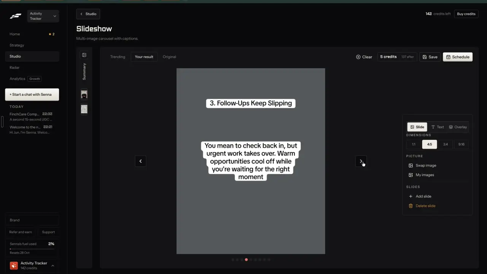
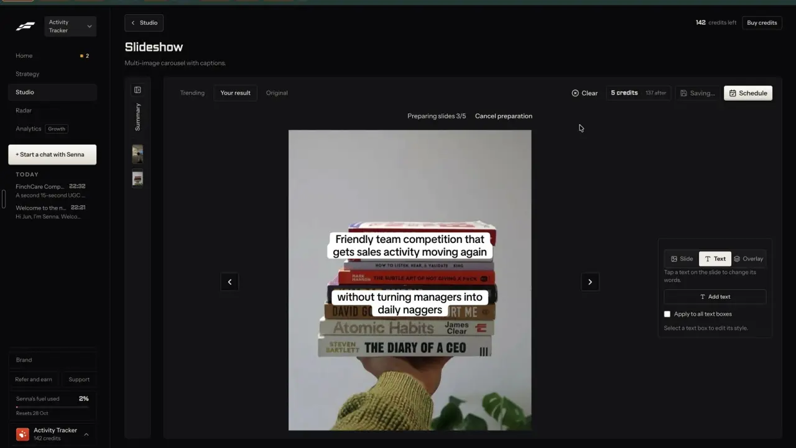

# Slideshow editor

`edit-slideshow` | edit | phase 1 | status: missing | /north-star#edit-slideshow

## Leo asked

19 Oct 2026: "the idea is that one can remix any content format and the ai will regenerate"

A remixed slideshow only helps if the adviser can fix a word, swap a picture or change the size before it goes out. No direct ask for the editor itself; the rest is from the competitor research.

## How the best do it

Fastlane. Every slideshow, whether remixed from a trending one or started blank, opens in the same result editor at `/v2/studio/create/slideshow` (notes-2 F11, notes-3 F1).

1. Layout: a narrow "Summary" rail on the left, tabs "Trending" | "Your result" | "Original" over the canvas, and on the right "Clear", a price chip "5 credits | 137 after", "Save" and "Schedule" (primary). One slide shows at a time at 4:5, with round prev and next buttons beside it and dots under it.
2. The canvas: photo full bleed, text in white rounded "sticker" boxes with black bold words, two or three boxes a slide (title, body, tagline). While a photo loads the slide is grey with the words already placed.
3. Right panel, "Slide" tab: "DIMENSIONS" `1:1`, `4:5` (default), `3:4`, `9:16`; "PICTURE" "Swap image" and "My images"; "SLIDES" "+ Add slide" and "Delete slide" in orange.



4. "Text" tab with nothing picked: "Tap a text on the slide to change its words.", "Add text", a checkbox "Apply to all text boxes", "Select a text box to edit its style."


5. "Text" tab with a box picked: the box gets 8 handles and a round "x" on the canvas. The panel shows "Words" (a textarea) with "Or double-click the text on the slide.", "Font" `TikTok Sans`, "Weight" slider at `Medium`, "Size" `16px`, "Color" `#000000`, "Stroke" `3px`, "Stroke color" `#FFFFFF`, and "Background" `White` | `None` | `Snapchat`.


6. "Overlay" tab: never opened in the recording, so what it holds is unverified.
7. Price: "Charged when you save or schedule", 5 credits a slideshow; making one is free (balance stayed at 142 after a generation). Pressing "Schedule" turns "Save" into "Saving..." and shows "Preparing slides 0/5" then "Preparing slides 3/5" with "Cancel preparation" above the slide (each slide drawn to an image, about 2 seconds for 5), then the schedule modal (notes-2 F13).



8. Leaving the Wall of Text result, which uses the same editor shell, with "< Studio" asked nothing (notes-3 F6); the recording does not show whether the draft was kept. Clicking the Slideshow tile again reopened the last unsaved 5-slide result (notes-2 F11, 1:41).

Others:

- ReelFarm styles each text item with colour, size (its guide uses 10 px headings and 8 px supporting lines), alignment, a "flush" position and about 80% width, and sets an overlay opacity on the picture (30% in its guide), slide count (default 5) and ratio 9:16 or 4:5, custom or as the original ([ReelFarm guide](https://reel.farm/guides/automate-tiktok-slideshows-with-ai), [changes](https://reel.farm/changes)).
- Genviral regenerates one slide at a time (`regenerate-slide`), saves a slideshow as a reusable template, feeds slides from image packs, and has every slide checked by eye before it posts ([genviral-skill](https://github.com/fdarkaou/genviral-skill)).
- PostNitro has a freeform drag-and-drop canvas at "Any canvas size" (4:5, 1:1, 9:16, 16:9), saves a design as a template, and exports PNG per slide, a PDF and MP4 ([postnitro.ai](https://postnitro.ai/), [pricing](https://postnitro.ai/pricing)).
- Blotato ships two slideshow templates in its list, "Image Slideshow with Text Overlays" and "Image Slideshow with Prominent Text", next to quote cards and tutorial carousels ([help.blotato.com](https://help.blotato.com/llms.txt)).

## What we have today

There is no photo slideshow. The nearest pieces:

- Carousel maker `/carousel` (`src/pages/CarouselPage.tsx`, `src/lib/carousel.ts`, `src/lib/carouselLayout.ts`, `src/lib/carouselRender.ts`): designed text cards drawn as SVG (`layoutSlide`, `renderSvg`, `svgToPng`) at 1080x1350 only, brand colour on the cover and CTA, a picture above the text on point slides ("Add a picture", "From media"), one look for the whole carousel (Font: Classic, Modern or Editorial; Background: Light, Dark or Brand tint; Text: Left or Centre; Size: Smaller, Usual or Larger), add, move up or down and delete slides (2 to 10, `MIN_SLIDES` and `MAX_SLIDES`), per-slide compliance flags (`scanCompliance`), "Tighten with AI" (`carousel-copy`, gpt-4.1, cap `carousel` 30), PNG and PDF download, saved carousels in `content-studio-carousels-${scoped(userId)}` (latest 20, `sanitizeSaved`). It has no free text boxes, no full-bleed photo, no per-box style and no size but 4:5.
- Text measuring for a canvas: `createCanvasMeasure()` in `src/lib/carouselRender.ts` and the greedy `wrapText` in `src/lib/carouselLayout.ts`.
- Pictures: `storePicture`, `addMedia`, `loadMedia` in `src/lib/mediaLibrary.ts` and `getFile` in `src/lib/deviceFiles.ts` (device only, `cimg-` keys); Pexels photos through `searchStock` in `src/lib/stockMedia.ts` (edge fn `stock-media`, cap `stock-search` 100, cached searches free).
- Fonts that draw on a canvas: `ensureCaptionFonts()` in `src/lib/videoMedia.ts` loads Archivo Black, DM Sans and Fraunces; `FONTS` in `src/lib/videoEdit.ts` names them Heavy, Clean and Serif.
- Post it for me already turns a saved carousel into PNGs for a draft (`carouselPngs` in `src/components/PostItForMe.tsx`, which draws the draft's own carousel the way `/carousel` does) and takes up to 10 pictures (`MAX_PICTURES` in `supabase/functions/social/posts.ts`). It shows only when `socialConnectShown()` is true; the server allows the users in the `SOCIAL_CONNECT_USERS` secret.
- The AI explainer (`/edit?panel=ai&kind=explainer`) joins pictures and a voiceover into an MP4. It is a video, with no slide editing.

## Build

One new page, `/slideshow`, that is the editor. formats-slideshow adds the maker (blank, from a topic, remix a trending one) to the same page's start card; until then the start card offers a blank slideshow and one made from an existing post, so the editor is usable on its own.

Files:

- `src/lib/slideshow.ts`: types and pure functions (new, add, delete, move, duplicate slide; add, change, delete text box; apply style to all boxes; sanitize; load and save; `fromPost(text)` using `splitDraftIntoSlides`).
- `src/lib/slideshowDraw.ts`: canvas drawing used by both the on-screen canvas and export: `layoutBoxes(slide, size, measure)` (pure, tested) and `drawSlide(ctx, slide, size, pictures)`; `slideshowPngs(show)` for export and Post it for me.
- `src/pages/SlideshowPage.tsx`: start card, header actions, canvas, inspector.
- `src/components/slideshow/SlideCanvas.tsx`: pointer handling (pick, drag, resize, delete, double-click to type).
- `src/components/slideshow/SlideInspector.tsx`: the Slide, Text and Overlay tabs.
- Edits: `src/App.tsx` (lazy route), `src/lib/nav.ts` (write section page `{ to: "/slideshow", label: "Slideshow", owners: LEO_EMAILS }`), `src/lib/nav.test.ts` (add the path to `routes`), `src/lib/links.ts` (`slideshow` builder), `src/lib/jumpTo.ts` (keywords "slideshow", "photo carousel", "tiktok photos"), `src/components/PostItForMe.tsx` (use `slideshowPngs` when the draft has a slideshow), `docs/deep-links.md`.

### Screens and states

Start card (no slideshow open):

```
Slideshow
Start from   [A blank slideshow] [One of my posts]
             (pick a post)  [Make the slides]
Your slideshows   [thumb] 5 CPF myths   edited 2h ago   ...
```

- "One of my posts" lists drafts with text (`draftsWithText`), splits the text with `splitDraftIntoSlides` and puts a title box and a body box on each slide with no picture. formats-slideshow later adds "Remix a trending one".
- Saved slideshows list newest first; each opens the editor.

Editor (1440 px):

```
[< Slideshows]  5 CPF myths            Saved just now   [Download] [Save to My posts] [Schedule]
 tabs: [Your slideshow] [Original]
 |  <   +------------------+   >   |  [Slide] [Text] [Overlay]
 |      |  photo, boxes    |       |  Size  1:1 [4:5] 3:4 9:16
 |      +------------------+       |  Picture  Swap picture  My pictures
 |        o o o * o o              |  Slides   + Add slide  Duplicate  Delete slide
 [1][2][3][4][5][6]  thumbnails with move left and right
```

At 390 px the inspector sits under the canvas as three tabs, the canvas is full width, and handles have a 44 px touch area.

- Original tab: shown only when the slideshow has a `source` (remix-source-trail); remix-compare owns what it shows.
- Loading a picture: grey slide, small spinner, words already placed.
- Picture not on this device: grey slide and "This picture is on the device you added it from." with "Swap picture".
- Text box picked: 8 handles and a round delete button on the canvas. Side handles change the width, corners change the size, dragging moves it, with a centre guide line that snaps within 12 px. Double-click (double-tap on phones) types in place.
- Keys: Delete or Backspace removes the picked box (when not typing), arrows nudge 1% (Shift 5%), Cmd or Ctrl+Z undo, Shift+Cmd or Ctrl+Z redo, Escape lets go.
- Too many words: when a box block runs past the frame, an amber line "Too many words for this slide. Cut some or make the text smaller." The slide still draws, clipped.
- Compliance: `scanCompliance` on each slide's words, shown as chips under "Words". They warn by default; when trust-compliance-check ships, a team leader's block or review setting applies here too.
- Swap picture searching: the button reads "Finding a picture..."; nothing found: "No picture found for these words. Pick one from My pictures."
- Over the stock cap: the server's words, "You've used all 100 for today. It resets at 8am Singapore time."
- Delete slide at 2 slides: disabled, with the reason "A slideshow needs at least 2 slides." Add slide at 10: disabled, "10 slides is the most Post it for me can send."
- Delete slide and delete box act at once; the toast that follows has Undo.
- Preparing (Download, Save to My posts, Schedule): "Preparing slides 3 of 9" with "Cancel". Failed: "Couldn't make the pictures. Try again, or try another browser." with "Try again".
- Saved to My posts: toast "Saved to My posts" with "Open My posts". Schedule opens Post it for me on that draft with the slides attached. Without Social accounts (`socialConnectShown()` false) the Schedule button is hidden and Download is the main button.
- Leaving the page: nothing is lost, since every change saves (800 ms after the last one). The header says "Saved just now".

Left out on purpose: a weight slider (the three fonts carry their own weight), dragging or zooming the photo inside the frame (it is cropped to the centre), and more than 10 slides.

### Copy

- Page title "Slideshow", nav label "Slideshow"
- Start: "Start from", "A blank slideshow", "One of my posts", "Pick one of your posts", "Make the slides", "Your slideshows"
- Tabs: "Your slideshow", "Original"
- Header: "Saved just now", "Download", "Save to My posts", "Schedule", back link "Slideshows"
- Inspector tabs: "Slide", "Text", "Overlay"
- Slide tab: "Size" with "1:1", "4:5", "3:4", "9:16"; "Picture" with "Swap picture", "My pictures", "Upload a picture"; "Slides" with "Add slide", "Duplicate", "Delete slide"
- Text tab, nothing picked: "Tap the words on a slide to change them.", "Add text", "Apply to all text boxes", "Pick a text box to change its style."
- Text tab, box picked: "Words", "Or double-tap the words on the slide.", "Font" with "Heavy", "Clean", "Serif"; "Size" with the value as "52px"; "Colour"; "Outline" with "3px"; "Outline colour"; "Background" with "White", "None", "Dark bar"
- Overlay tab: "Darken the picture" with the value as "30%"; "Your mark" with "Off", "Handle", "Logo"
- Messages as listed under the states above, plus toasts "Slide deleted", "Text box deleted" (each with "Undo") and "Slideshow downloaded".

### Data

```
interface TextBox { id: string; text: string; x: number; y: number; w: number;   // centre and width as shares of the frame
  font: "heavy" | "clean" | "serif"; size: number; color: string; stroke: number; strokeColor: string;
  bg: "white" | "none" | "bar" }
interface ShowSlide { id: string; image?: string; boxes: TextBox[] }            // image: a cimg- device key; at most 6 boxes
interface Slideshow { id: string; title: string; size: "1x1" | "4x5" | "3x4" | "9x16";
  overlay: { darken: number; mark: "off" | "handle" | "logo" };
  slides: ShowSlide[]; draftId?: string; updatedAt: string }                    // 2 to 10 slides
```

- Synced per brand: `content-studio-slideshows-${scoped(userId)}`, the latest 20, sanitized on read the way `sanitizeSaved` in `src/lib/carousel.ts` does (unknown values dropped, numbers clamped, at most 400 characters a box).
- Pictures stay on the device that added them, as carousel pictures do (`storePicture`); a Pexels pick is downloaded with `downloadStock` and stored the same way, its photographer credit kept in the media item.
- The last text style used, as a device hint: `cs-slideshow-style`.
- Undo history: in memory, 20 steps.
- Save to My posts writes a draft with `format: "carousel"` (to every network a slideshow is a photo carousel) and the slide words joined as the caption; the slideshow keeps that `draftId` so Post it for me finds it. All of this rides on synced keys, with no table or schema change.

### AI and cost

- The editor makes no paid call. Drawing and export run in the browser on a canvas at 1080 px wide (1080, 1350, 1440 or 1920 high), after `ensureCaptionFonts()`.
- "Swap picture": the next photo from the media set the slideshow drew from once brand-media-sets ships; until then a Pexels search with the slide's first box as the query, through `searchStock("photo", words, page, orientation)` with the first 6 words of that box and `orientation` "portrait" for 4:5, 3:4 and 9:16 or "square" for 1:1 (cap `stock-search` 100, free, cached searches free). Each press takes the next result; Pexels' own order is used, so no Jev call.
- Rewriting the words is edit-by-chat; this item adds no writer.
- No new caps. Cost per slideshow: 0, against Fastlane's 5 credits a save.

### Deep links

| URL | Opens |
|---|---|
| `/slideshow` | The start card |
| `/slideshow?s=<id>` | That slideshow in the editor (push) |
| `/slideshow?s=<id>&slide=4` | On slide 4 (1-based; 1 is left out). Replace. |
| `/slideshow?s=<id>&panel=text` | With the Text tab open (`slide` is the default and left out). Replace. |
| `/slideshow?s=<id>&box=<boxId>` | With that text box picked. Replace. |
| `/slideshow?s=<id>&view=original` | The Original tab |

Unknown ids fall back silently to the start card or slide 1. Add `slideshow: (o: { s?: string; slide?: number; panel?: "text" | "overlay"; box?: string; view?: "original" })` to `src/lib/links.ts` and a row to the Create pages table in `docs/deep-links.md`. Give the editor a CopyLinkButton.

### Gate

The nav entry has `owners: LEO_EMAILS`, and the page renders `NotFoundPage` unless `leoOnly(email)` (email from `supabase.auth.getSession()`), because a typed URL skips the nav. Post it for me stays behind its own `SOCIAL_CONNECT_USERS` gate.

## Done when

- [ ] On Leo's account a blank slideshow and one made from a post each open in the editor, at 390 px and 1440 px, checked by eye.
- [ ] Every control in the Slide, Text and Overlay tabs changes the canvas within 400 ms.
- [ ] A box can be picked, typed into, moved, resized and deleted on a phone and with a mouse; Undo and Redo walk back 20 steps.
- [ ] "Apply to all text boxes" restyles every box on every slide and leaves the words alone.
- [ ] All four sizes download as PNGs at 1080 wide with no text outside the frame unless the overflow line shows.
- [ ] Save to My posts makes a draft, and Post it for me on that draft attaches the slides (dry run, never a live post).
- [ ] Reload mid-edit, and the slideshow comes back as it was.
- [ ] Another account gets the 404 page at `/slideshow` and sees no nav entry.
- [ ] `npm run build` and the full `npx vitest run` pass; `src/data/northStar.ts` item flipped with its `ours` line in the same commit.

## Tests

- `src/lib/slideshow.test.ts`: sanitize drops boxes with bad fonts or colours, clamps x, y, w and size, keeps only `cimg-` keys, cuts lists to 10 slides and 6 boxes; add, delete, duplicate and move keep ids unique and respect 2 and 10; apply-to-all changes style keys and never text; `fromPost` on a 5-point post gives a cover, points and a CTA.
- `src/lib/slideshowDraw.test.ts` with a fixed-width fake measure: `layoutBoxes` wraps at the box width, line height 1.25, sets `overflow` when the block passes the frame, and gives the same result at every size for a box placed by shares.
- `src/lib/links.test.ts`: the `slideshow` builder leaves defaults out.
- `src/lib/nav.test.ts` and `src/lib/navRoutes.test.ts` stay green with the owner-gated page.

## Open questions

- Charging: Fastlane charges 5 credits on save. Ours is free while caps are the only limit; business-credits decides later. Leo.
- TikTok photo mode: whether Zernio posts several pictures to TikTok as a photo post with a sound is unverified; publish-tiktok checks it. Until then Schedule offers the networks Post it for me already supports for pictures.
- Moving the photo inside the frame (Fastlane does not show it either). Add only if Leo finds centre crops cut off faces.
- Hard stops checked: no schema change, no new npm package (the canvas, pointer events and the existing fonts cover it), no new paid provider and no auth change.

## Related

formats-slideshow, edit-carousel, edit-by-chat, brand-media-sets, brand-media-library, remix-compare, remix-source-trail, publish-schedule, publish-tiktok, edit-design-canvas, business-credits
