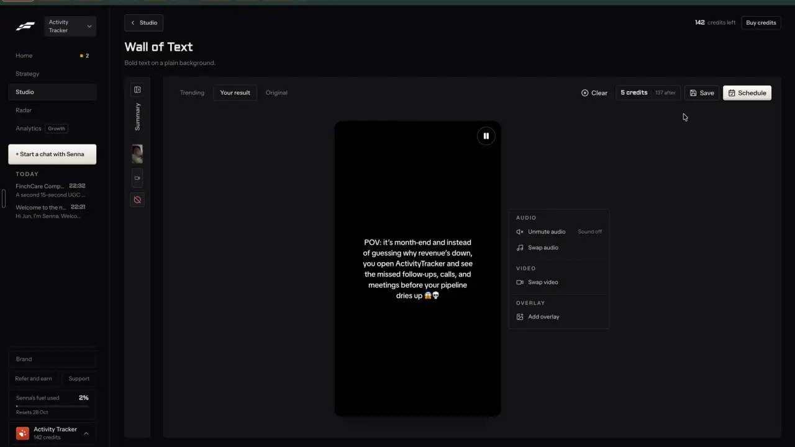
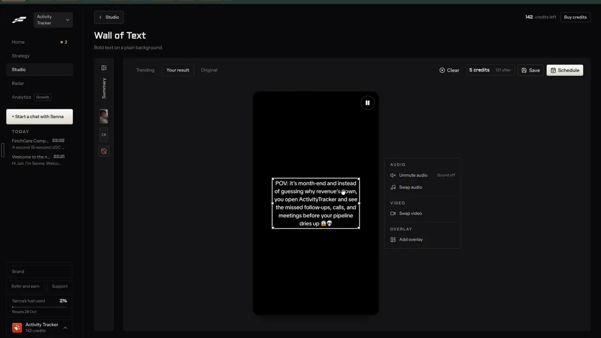
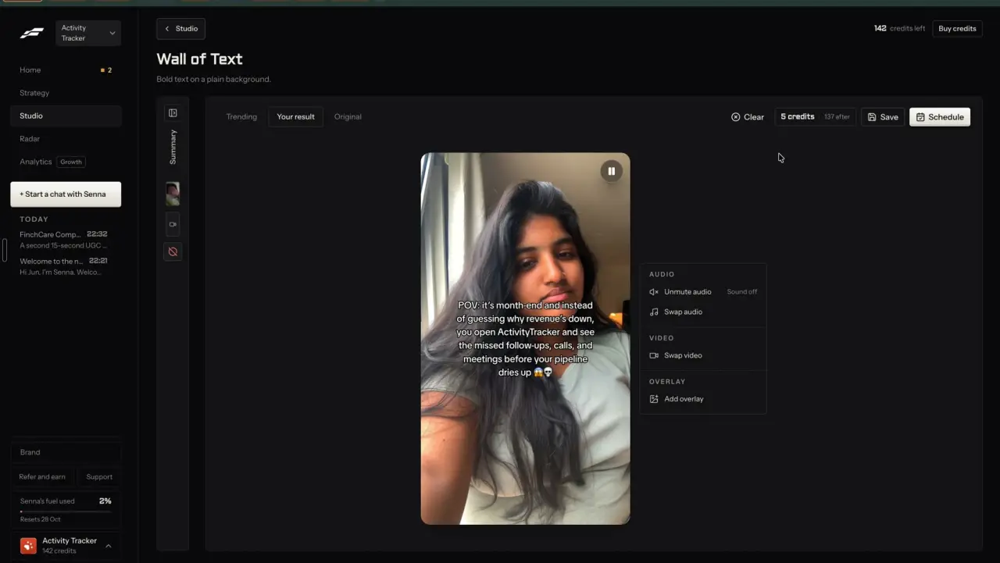

# Text-over-video editor

`edit-text-video` | edit | phase 1 | status: live (Leo's sign-ins, 20 Oct 2026) | /north-star#edit-text-video

## Leo asked

19 Oct 2026: "the idea is that one can remix any content format and the ai will regenerate"

The wall of text is the cheapest video remix: the words change, the clip and sound stay. No direct ask for the editor itself; the rest is from the competitor research.

## How the best do it

Fastlane's "Wall of Text" (`/v2/studio/create/wall-of-text`, subtitle "Bold text on a plain background.") opens from "Remix this | 5 credits" on a template trend and starts generating by itself; the result showed about 3 seconds later (notes-3 F6).

1. The result view uses the slideshow editor's shell: tabs "Trending" | "Your result" | "Original", then "Clear", "5 credits | 137 after", "Save", "Schedule".
2. The canvas is a 9:16 video with rounded corners, playing muted, with a pause button in the corner. The words sit in the middle as white bold centred text with a dark shadow and no box, and the original's emoji style is kept.



3. Clicking the words gives a box with corner and side handles, so the block can be moved and resized.



4. The panel beside the video has three groups: "AUDIO" with "Unmute audio" (state "Sound off") and "Swap audio"; "VIDEO" with "Swap video"; "OVERLAY" with "Add overlay". What each opens was not shown.
5. The background is the trending post's own footage, a stranger's selfie video in this case, and only the words are rewritten for the brand.



6. The setup footer says "Charged when you save or schedule" over "5 credits" and "142 credits now, 137 after this one"; the result toolbar carries the chip "5 credits | 137 after". The balance stayed at 142 for the whole visit, and leaving with "< Studio" on the unsaved result asked nothing (t212 to t213).

Others put a headline over a clip and style it once:

- OpusClip's "Auto headline" writes a one-line overlay at the start of a clip, styled once in the brand template: font, size, weight (default 700), colour, word background colour, corner radius, box width, centred ([help](https://help.opus.pro/docs/article/auto-headline.md), [brand template](https://help.opus.pro/docs/article/how-to-add-a-brand-template.md)).
- Quso.ai (formerly Vidyo.ai) adds a 4 to 7 word "AI headline" over the first 5 seconds, bold black text in a white rounded box near the top. The toggle at import is remembered, and a reworded headline survives template or ratio changes ([help](https://helpdesk.quso.ai/help/editor/ai-headline.md)).
- Submagic's hook title takes 1 to 100 characters, a template, a position from the top (0 to 80) and a size ([guide](https://care.submagic.co/en/article/how-to-use-submagic-step-by-step-guide-pafx7o/), [API](https://docs.submagic.co/api-reference/create-project.md)).
- Arcads prices "Text Overlay" at 0 credits in its hook-variation flow ([help](https://help.arcads.ai/en/articles/17595001-hook-variations)).

## What we have today

The video editor `/edit` (`src/pages/VideoEditPage.tsx`, `src/lib/videoEdit.ts`, `src/lib/videoMedia.ts`) can already put words on any video, in pieces:

- "Hook on screen": `settings.hook`, at most 90 characters, for 0 to 10 seconds (`hookSeconds`).
- Stickers ("Stickers and charts" tab): `settings.overlays` of kind `text`, one line each on a rounded pill in the sticker's colour, shrunk to fit 86% of the width (`drawOverlay` in `videoMedia.ts`), at most 60 characters (`sanitizeOverlays`), 20 per video (`MAX_OVERLAYS`), each with a start and end time (`newOverlay` gives 3 s). Arrow, circle and underline stickers sit beside it.
- Sound: "Original sound" in the Cuts tab (`settings.volume`, 0 to 1), background music from the adviser's own file (`settings.music`, ducked under speech), voiceover. "Music for me" (Eleven Music) is built but hidden while `AI_MUSIC` is false in `src/lib/aiMusic.ts`.
- Undo: the editor keeps a history of `EditSettings` only (`history` in the `Editor` component, about line 455). Project fields such as `fileId` are outside it.
- Logo from the brand kit (`settings.logo`), stock video search for B-roll (`StockSearch` kind `video`, Pexels, cap `stock-search` 100).
- formats-custom (spec written, not built) places its written lines as text stickers on the adviser's own clip.

So the status is partial: what is missing is a multi-line block of words that stays for the whole video, a quick way to swap the clip under an edit, and a short panel for a video with no speech in place of the seven tabs.

## Build

Grow the existing editor. A "words on video" project is an ordinary video project with `settings.wall: true`: captions off, the words in one block overlay, and a short panel in place of the tabs.

Footage rule: the clip under the words is the adviser's own video, a Pexels stock clip or a generated clip (formats-text-over-clip). It is never the trending post's footage. Fastlane reuses a stranger's face; that is left out here (other people's faces and copying are out of scope for the north star).

### 1. A block overlay

In `src/lib/videoEdit.ts`:

- `OverlayKind` gains `"block"`. `Overlay` gains optional `w` (width share, 0.5 to 0.95, default 0.84), `font?: FontId` and `box?: "none" | "white" | "bar"` (default `"none"`).
- `sanitizeOverlays` keeps `block`, allows 400 characters of text for it (60 stays the limit for `text`) and clamps `w`.
- `newOverlay` gains an optional fourth argument, the edit's length; `newOverlay("block", 0, "#FFFFFF", length)` runs from 0 to the end of the edit (the other kinds keep 3 s).
- New pure `wrapBlock(text, widthPx, sizePx, measure)` returns lines; `readSeconds(text)` = words / 3.5, rounded up.

In `src/lib/videoMedia.ts`, `drawOverlay` draws `block`: wrapped lines centred at `x, y`, line height 1.3, size `52 * size` px at 1080 wide. `none`: white text with the dark shadow the stickers already use plus a 3 px dark outline; `white`: each line on a white rounded box with dark text (the slideshow's sticker look); `bar`: a band of rgba(0,0,0,0.55) behind the block with white text, with emoji drawn as ordinary text in all three.

### 2. Swap the video

New `swapSource(userId, projectId, file)` in `src/lib/videoProjects.ts`: stores the file with `putFile` under the key `${projectId}-s${n}` (n counts up), sets `fileId`, `duration`, `size` and `thumb`, clears `words`, keeps `settings`, and clamps `trimEnd` and each overlay's `to` to the new length. The editor already reloads when `fileKey(project)` changes (the `fk` effect), so the new clip plays without a remount.

- `isClip` in `videoProjects.ts` counts any project whose `fileId` differs from its `id` as a clip (the 40-clip pool, not the 12 uploads). Change it to also treat a `fileId` starting with `${id}-s` as an upload, so a swapped video is not pruned as a clip.
- The old file stays on the device, the pattern music tracks and voiceover takes already follow (comments near lines 798 and 860 of `VideoEditPage.tsx`), so Undo can bring it back.
- Undo: the settings history cannot hold `fileId`, so the swap shows its own toast "Video swapped" with "Undo", which writes the previous `fileId`, `duration`, `size`, `thumb`, `words` and `settings` back.
- If captions are on, the existing transcribe runs again.

### 3. The short panel

When `settings.wall` is true, the right column of the editor shows this instead of the tab bar (the vibe edit box stays above it):

```
WORDS     [ textarea, the block's words ]   47 words, about 14 s to read
          Font  [Heavy] [Clean] [Serif]   Size ---o---   Colour [ ]
          Background  [None] [White] [Dark bar]
SOUND     [Sound off | Sound on]   Swap sound   Music level ---o---
VIDEO     Swap video:  [Upload]  [Stock clip]
ON TOP    Add  [Text sticker] [Arrow] [Circle] [Underline] [Your logo]
          [All editing tools]
```

- Words edits the block's `text`. Clicking the block on the preview picks it (the existing `overlayHit`), so it drags like a sticker; a side handle sets `w`, a corner sets `size`.
- "Sound off | Sound on" sets `volume` to 0 or 1. "Swap sound" picks an audio file into `settings.music` (the existing music path) and turns the filmed sound off.
- "Swap video": Upload picks a file; "Stock clip" opens the existing `StockSearch` for video, downloads the pick with `downloadStock`, then `swapSource`.
- "Add" reuses `newOverlay` for the four sticker kinds and toggles `settings.logo`.
- "All editing tools" shows the usual seven tabs (`view=all`).

### 4. A way in

A start-screen panel "Words over a video" (`START_PANELS` gains `"wall"`): pick a clip (Upload or Stock clip), paste the words, "Make it". It creates the project with `wall: true`, `captions: false`, `volume: 0`, one centred block, aspect 9:16, and opens it. formats-wall-of-text later fills the words with AI from a trend and calls the same creator.

### Screens and states

- Empty panel: "Make it" disabled with "Add a clip and your words first."
- Saving the clip: the existing "Saving it on this device..." busy line.
- Stock search: the existing StockSearch states; over the cap, the server's words "You've used all 100 for today. It resets at 8am Singapore time."
- A clip that will not open: "That video couldn't be opened. Try an MP4 or MOV." The panel keeps the words.
- Swapping: "Swapping the video..." over the preview, then the new clip plays muted with the same words and a toast "Video swapped" with "Undo", which puts the old clip back.
- Reading time: under Words, "47 words, about 14 s to read". When reading time is longer than the edit, an amber line: "People need about 14 s to read this. The video is 9 s. Cut words or use a longer clip."
- Too tall: when the block covers more than 70% of the frame height, an amber line "Too many words for the frame. Cut some or make the text smaller."
- Compliance: `scanCompliance` chips under Words. They warn by default; trust-compliance-check later lets a team leader switch a rule to block or review.
- Done: Export works as today (captions off), and Save to My posts saves the words as the caption.

### Copy

- Start panel: title "Words over a video", "Pick a clip", "Upload", "Stock clip", "Your words", placeholder "POV: it's year-end and you finally check what your CPF is doing", button "Make it", helper "Add a clip and your words first."
- Panel groups: "Words", "Sound", "Video", "On top"
- "Font", "Heavy", "Clean", "Serif", "Size", "Colour", "Background", "None", "White", "Dark bar"
- "{n} words, about {s} s to read"
- "Sound off", "Sound on", "Swap sound", "Music level"
- "Swap video", "Upload", "Stock clip", "Swapping the video...", toast "Video swapped" with "Undo"
- "Add", "Text sticker", "Arrow", "Circle", "Underline", "Your logo"
- "All editing tools", "Fewer tools"
- Errors and warnings as listed under the states.
- InfoTip beside "Video": "Use your own clip, a stock clip or a made one, never someone else's."

### Data

- `EditSettings` gains `wall?: boolean`; `Overlay` gains `w`, `font`, `box` as above. Both live in the project inside `content-studio-videoprojects-${scoped(userId)}` (synced metadata, files on the device).
- `applyPatch` and `LOOK_KEYS` leave `wall` out, so a saved look or skill never turns a talking-head video into a wall.
- `LOOK_KEYS` does hold `captions`, so a skill tapped on a wall project (`change(withLook(settings, sk.look))`, about line 1097) would switch captions back on. `withLook` keeps `captions: false` whenever `s.wall` is true.
- Nothing here needs a table or a schema change.

### AI and cost

- None paid. Reading time is arithmetic; wrapping is `measureText`.
- Stock clips through `stock-media` (Pexels, free, cap `stock-search` 100).
- Writing the words with AI is formats-wall-of-text; changing them by asking is edit-by-chat. No Jev question here, since nothing is decided.
- Cost per video: 0, against Fastlane's 5 credits a save.

### Deep links

| URL | Opens |
|---|---|
| `/edit?panel=wall` | The "Words over a video" start panel (push; Back closes it) |
| `/edit?p=<id>` | A wall project with the short panel |
| `/edit?p=<id>&view=all` | The same project with all seven tabs (replace) |

Add `"wall"` to `panel` and `view?: "all"` to `links.edit` in `src/lib/links.ts`, and rows to the Create pages table in `docs/deep-links.md`.

### Gate

`panel=wall` is in the allowed list, and the short panel shows, only when `leoOnly(email)`. For anyone else the param falls back to the plain start screen and a wall project (which only Leo can make) would open with the usual tabs.

## Done when

- [ ] On Leo's account, "Words over a video" with an uploaded clip and with a stock clip each opens a muted 9:16 project with the words centred, at 390 px and 1440 px, checked by eye.
- [ ] The block wraps, moves, resizes and restyles; all three backgrounds draw the same in preview and export.
- [ ] Swap video keeps the words, sound choice and stickers; Undo brings the old clip back.
- [ ] Swap sound plays the picked file with the filmed sound off; Export carries it.
- [ ] Reading-time and too-tall warnings show at the right moments.
- [ ] A saved skill applied to a wall project does not switch captions back on.
- [ ] Another account sees no panel and no change to `/edit`.
- [ ] `npm run build` and the full `npx vitest run` pass; `src/data/northStar.ts` item flipped with its `ours` line in the same commit.

## Tests

- `src/lib/videoEdit.test.ts`: `sanitizeOverlays` keeps a `block` with 400 characters and cuts a `text` at 60, clamps `w`, drops an unknown `box`; `newOverlay("block")` spans the edit; `wrapBlock` with a fixed-width fake measure breaks at the width and never splits a word under the width; `readSeconds` on 47 words gives 14; `lookOf` never contains `wall`.
- `src/lib/videoEdit.test.ts`: `withLook` on a wall project with a look holding `captions: true` keeps captions off.
- `src/lib/videoProjects.test.ts`: `swapSource` keeps settings, clears words, clamps `trimEnd` and overlay ends to a shorter clip, and sets a new `fileId` of the form `${id}-s1`; a project with that `fileId` is not counted as a clip, while one whose `fileId` is another project's id still is.
- `src/lib/links.test.ts`: `links.edit({ panel: ["wall"], view: "all" })`.

## Open questions

- Footage: Fastlane keeps the trending post's video and only rewrites the words. This spec never uses someone else's footage, which matches "other people's faces" being left out. If Leo wants the trend's footage, that needs his call on rights. Leo.
- Trending sounds: Swap sound takes the adviser's own file only. Licensed trending audio would be a new provider. Leo.
- Words that appear line by line in time with the clip (a common wall-of-text look) are not built; the block shows the whole time, as in Fastlane.
- Hard stops checked: no schema change, no new npm package, no new paid provider and no auth change.

## New evidence (20 Oct 2026)

Wall of text results to edit against: [review notes](../videos/fastlane-2026-10-20-review/notes.md) section 2.3.

## Related

formats-wall-of-text, formats-text-over-clip, formats-custom, edit-video, edit-slideshow, edit-captions, edit-by-chat, remix-compare, brand-media-library, people-face-swap
