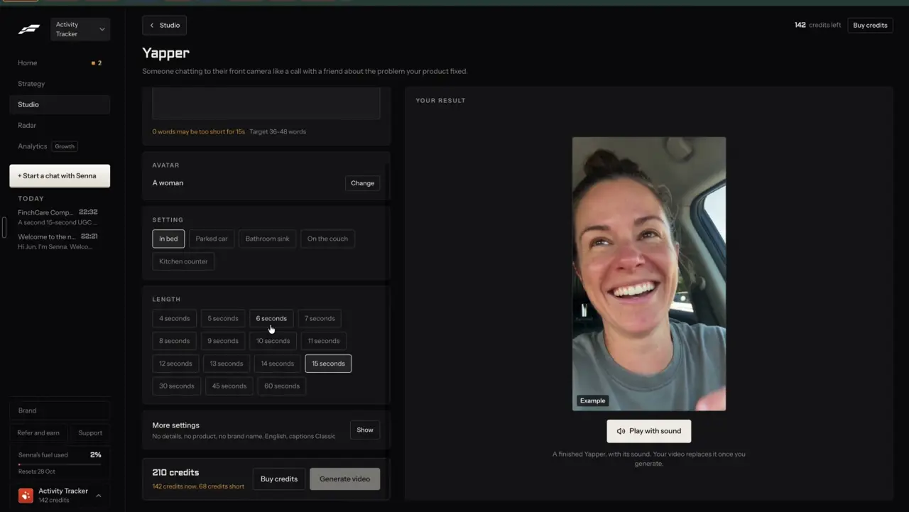

# Posts in Chinese, Malay or Tamil

`edit-translate` | edit | phase 4 | status: partial | /north-star#edit-translate

## Leo asked

15 Oct 2026: "embed it within the tool so it depends on the person's market/website"

An adviser whose clients read Chinese, Malay or Tamil should get posts in that language without asking each time. The brand's market and its website set the default. Spoken dubbing is a separate item, `people-dub-lipsync`.

## How the best do it

Fastlane keeps one language per workspace: Settings has a "Language" tile, "The language your posts are written in.", under "SENNA" beside "Post choices" and "Post labels".


Each make shows it too. On a format page such as Yapper, the collapsed "More settings" card sums up the hidden choices as "No details, no product, no brand name, English, captions Classic", with "Show".



The recording opens neither the Language tile nor "Show", so whether a single make can switch language, and which languages Fastlane offers, are unverified.

Others:

- Vizard transcribes 36 to 40 languages, including Malay, Tamil, Mandarin (Simplified and Traditional) and Cantonese, and translates subtitles into 128 languages, on paid plans (unverified for Free). It covers all four of Singapore's main language groups. [help](https://help.vizard.ai/en/articles/8767561-what-languages-are-supported), [API](https://docs.vizard.ai/docs/supported-languages.md)
- CapCut: "Captions" > "Auto captions" > "Generate", then "Translate", pick a language, "Translate"; 27+ languages. [video translator](https://www.capcut.com/tools/video-translator)
- Kapwing translates a transcript into another subtitle language for 2 credits a minute. [help](https://www.kapwing.com/help/add-captions/)
- For post text: Agorapulse's composer has "Translate in..." beside "Shorter" and "Rephrase" [help](https://support.agorapulse.com/en/articles/8769298-how-to-use-the-ai-writing-assistant); Publer's AI Assist translates [blog](https://publer.com/blog/introducing-publer-ai-assist/); Predis.ai takes input in one language and outputs ads in another, 19+ languages [features](https://predis.ai/features/); Ocoya writes copy from a one-line idea and translates it into 37 languages [ocoya.com](https://www.ocoya.com/).
- aiCarousels has a language selector with 11 European languages and no Chinese, Malay or Tamil. [aicarousels.com](https://www.aicarousels.com/)
- Levitate, an adviser tool, translates content into 10 languages on all plans. [features](https://www.levitate.ai/features)

None of them keeps the translation tied to its original, so none can tell the adviser when the English changed after translating, and this spec adds that link.

## What we have today

Partial. Videos get Chinese, Malay and Tamil subtitles and dubs; posts and carousels get nothing.

- Video editor `/edit` (`src/pages/VideoEditPage.tsx`, the "Second language" row, about line 1940): "Off" and three chips labelled in their own scripts (Chinese, Malay and Tamil written as `\u` escapes in the code). `video-assist` mode `translate` (`supabase/functions/video-assist/logic.ts`, `TRANSLATE_LANGS` zh Simplified Chinese, ms Malay, ta Tamil) translates caption lines one for one with gpt-4.1 (`VIBE_MODEL`), keeping numbers and Singapore terms (CPF, MediShield, HDB) "as locals write them". `parseTranslateRequest` cuts every line to 300 characters and keeps at most 400 lines, and `parseTranslateReply` cuts each answer to 300 characters, which suits subtitles and would silently cut a post's long paragraph. Cap `video-translate` 30, never refunded: a failed call or an incomplete reply keeps the use. Subtitles draw with CJK and Tamil font stacks (`src/lib/videoMedia.ts`, about line 714). "Dub it" speaks the translation (`DUB_LANGS` in `supabase/functions/text-voice/logic.ts`, ElevenLabs).
- Write (`/generate`) has no language choice and every post comes out in English. `generate-social-content` (academy-hosted, not deployed from this repo) asks for "plain English" and has a Singlish option; there is no language field. The checks read English: `scanCompliance` is English regex, `post-score` refuses text that is under 80% Latin letters ("The score reads English posts only.").
- Carousels (`/carousel`): `wrapText` in `src/lib/carouselLayout.ts` splits on spaces, so a Chinese paragraph is one long "word" that `breakWord` cuts at any character, and a line can start with a comma. Saved carousels hold 20 per brand, ids "d:<draft id>" or "p:<time>", and `sanitizeSaved` drops any field it does not know.
- Drafts: `loadDrafts` in `src/lib/draftHistory.ts` casts what is stored and checks no fields; `upsertDraft` puts the saved post first and keeps 50 (`MAX_DRAFTS`).
- Write reads its pre-fill params (`format`, `platform`, `cta` and the rest) once on load and strips them from the address (GeneratePage, about line 1085).
- Brand kit and "Add a brand from its website" (`brand-dna`, `readSite` in `supabase/functions/brand-dna/logic.ts`) store no language, and `readSite` does not read the page's `lang`.
- Missing: a default language per brand, a per-make choice, translating a post, carousel or caption, and a link between a translation and its original.

## Build

English stays the source. Every post is written and checked in English, then translated into a linked version. This keeps the MAS checks, the score and Jev (which reads English best) working on the words that matter, and it works with the academy-hosted writer as it is.

### 1. The brand's language

- Brand kit gets a section "Post language", anchor `#language`, with chips "English", "Chinese", "Malay", "Tamil" (`postLang?: "zh" | "ms" | "ta"` on `CarouselBrand` in `src/lib/carousel.ts`; missing means English). The labels are the English names `DUB_LANGS` in `supabase/functions/text-voice/logic.ts` already uses, not `/edit`'s own-script chips.
- Helper line under it: "Posts are written in English and checked, then a version in this language is made beside it."
- Add a brand from its website: `readSite` reads `<html lang>`. When it starts with `zh`, `ms` or `ta`, the confirm card pre-fills Post language with that language and says "Your website is in Chinese, so posts will be too. Change it in Brand kit." Anything else leaves English. This reads a fact from the page, so it needs no Jev.

### 2. Per make

- Write's Format step gets a "Language" row: "English", "Chinese", "Malay", "Tamil", preset to the brand's language. A link can preset it with `lang`, read once and stripped like `format` (add `lang` to the strip list at about line 1085); after that the pick is brief state, as format is.
- When the pick is not English, Write writes the English post as today, then makes the version straight after (part 3) and shows both as tabs above the editor: "English" and the language name. The English tab carries the checks; the version tab carries the line "Checks run on the English version."

### 3. Translate any post

- Under a finished post in Write, and in the My posts row menu: "Make it in" with "Chinese", "Malay", "Tamil".
- It creates a new draft: `lang`, `translationOf: { id, key, at }` (the source's id, `textKey(platform, text)` of the source when translated, and the time), the same platform, format, labels and attachments, status draft, and Write opens it straight away.
- The source shows "Versions:" with a chip per language that opens it. The version shows "Chinese version of: {source hook}" linking back.
- Stale: when the source text's `textKey` no longer matches `translationOf.key`, the version shows "The English changed after this was made." with "Translate again", which replaces the version's text (Undo keeps the old one).
- Post it for me and Copy work on a version as on any draft. A version's sign-off and disclosure lines stay in English unless the adviser edits them, since they are the adviser's own fixed words.

### 4. Carousels

- `/carousel` gets "Make it in" with the three languages under the slides. The slide titles and bodies go through the same translation as lines, and the result is saved as a new carousel with id "v:<time>", `lang` and `translationOf` (the source carousel's id). `sanitizeSaved` must keep both fields or the link is lost on the next load. Carousels hold 20 per brand, so when the list is full the same "drops your oldest" question below asks first, worded for carousels.
- `wrapText` learns to break Chinese text between any two characters, and never to start a line with Chinese closing punctuation (U+FF0C, U+3002, U+FF01, U+FF1F, U+3001, U+FF1A, U+FF1B, U+300D, U+FF09). Latin words inside Chinese text still break at spaces.
- `SANS_STACK` and `SERIF_STACK` gain the CJK and Tamil names `videoMedia.ts` already uses ("PingFang SC", "Noto Sans SC", "Microsoft YaHei", "Tamil Sangam MN", "Noto Sans Tamil", "Latha"), so slides draw and measure with a real font on Mac, Android and Windows.

### 5. Video captions

The subtitles stay as they are in `/edit`. The post caption a video writes is saved to My posts as a short-video draft, so "Make it in" in part 3 covers it.

### Checks on a version

- The translation call also returns an English back-translation of the version (`back`).
- Jev compares the source with `back` (question below). A low answer shows "Check this version: it may say something the English doesn't." on the version, with "Show the English meaning", which reveals `back` line by line beside the version.
- `scanCompliance(back)` runs too, and a flag shows on the version as "In English this says "{match}"." with the rule's message.
- Both warn and never block, unless a team leader set the rule to block (`trust-compliance-check`).
- Platform counters: for Chinese the counter shows characters only ("{n} characters"), since word counts mean nothing without spaces.

### Screens and states

```
Write   [English] [Chinese]                      Versions: Chinese
Chinese version of: "Most people pay for their hospital stay twice."
(the Chinese post, editable)
Checks run on the English version.
[Copy] [Post it for me]   [Show the English meaning]
```

- Empty: no "Versions" line until one is made.
- Translating: the "Make it in" chip shows the orb and "Translating..." within 400 ms; the button row stays usable. The call runs in a module-level runner, so leaving the page keeps it going, and the version appears in My posts when done.
- Done: Write opens the version with a toast "Chinese version saved." and "Open the English".
- Jev warns: the line above, with "Show the English meaning".
- Jev null: no warning line; the compliance flags on `back` still show.
- Stale: "The English changed after this was made." with "Translate again".
- Failed: "Couldn't translate it right now. Try again in a minute." Nothing is saved and the use is refunded.
- Incomplete reply (wrong line count): "The translation came back incomplete. Try again." (today's video string), use refunded.
- Over the cap: the 429 line from `usageRefusal`, "You've used all 30 for today. It resets at 8am Singapore time."
- Refused: "This isn't on for your account yet."
- My posts full: drafts are capped at 50 per brand (`MAX_DRAFTS`), and a save drops the post saved longest ago. Before saving a version when the list is full: "My posts holds 50 posts. Saving this drops your oldest one." with "Save anyway" and "Cancel". For carousels: "Your carousels hold 20. Saving this drops your oldest one."

### Copy

| Where | String |
| --- | --- |
| Brand kit | "Post language", "English", "Chinese", "Malay", "Tamil", "Posts are written in English and checked, then a version in this language is made beside it." |
| Website card | "Your website is in {language}, so posts will be too. Change it in Brand kit." |
| Write | "Language", "Make it in", "Translating...", "Versions:", "{language} version of: {hook}", "Checks run on the English version." |
| Done | "{language} version saved.", "Open the English" |
| Stale | "The English changed after this was made.", "Translate again" |
| Checks | "Check this version: it may say something the English doesn't.", "Show the English meaning", "In English this says "{match}"." |
| Counter | "{n} characters" |
| Errors | "Couldn't translate it right now. Try again in a minute.", "The translation came back incomplete. Try again.", "This post is too long to translate in one go.", "This isn't on for your account yet." |
| Full | "My posts holds 50 posts. Saving this drops your oldest one.", "Your carousels hold 20. Saving this drops your oldest one.", "Save anyway", "Cancel" |

### Data

- `CarouselBrand.postLang` in the brand kit (`content-studio-carousel-brand-`), synced, per brand.
- `DraftEntry` (`src/lib/draftHistory.ts`) gains `lang?: "zh" | "ms" | "ta"` and `translationOf?: { id: string; key: string; at: string }`, plus `back?: string[]` (the English meaning, one per line, for the check). `loadDrafts` checks no fields, so pure readers in `src/lib/translate.ts` do: `langOf(entry)` returns a known language or null (null means English), and `sourceOf(entry)` returns `translationOf` only when its three fields are strings.
- Saved carousels (`content-studio-carousels-`) gain the same `lang` and `translationOf`, kept by `sanitizeSaved` (known languages only).
- Each version is its own draft, so it counts toward `MAX_DRAFTS` (50) like any other post, and nothing here needs a table or a schema change.

### AI and cost

- Reuse `video-assist` mode `translate` with a new field `kind: "post" | "captions"` (missing means captions, so `/edit` is unchanged) and `back: true`. For `kind: "post"` the system prompt is:
  "Translate a social media post by a Singapore financial adviser into {language}. Keep every line break, number, dollar amount and call to action exactly. Keep CPF, MediShield, HDB and other Singapore terms as locals write them. Write it the way a Singaporean adviser would post it, plain and warm, with no em dashes. Add nothing: no new claims, promises, figures or product names. Then translate your version back into English, line by line. Return JSON only: {"lines": [...], "back": [...]}, one entry per input line in the same order."
- The post is sent as its lines (split on line breaks, empty lines kept as empty entries), so `parseTranslateReply` checks the count for both arrays.
- Lengths for `kind: "post"`: up to 60 lines, each up to 1,500 characters, 5,000 in all (Write's longest post), refused with "This post is too long to translate in one go." when over. The 300-character cut stays for captions only, on the request and on the reply, so a long paragraph is never cut short.
- Refunds: for `kind: "post"`, a failed OpenAI call or an incomplete reply gives the use back with `refundUsage` (caption translation keeps today's behaviour).
- Model: `VIBE_MODEL` (gpt-4.1), as the caption translation uses today. A 200-word post with its back-translation is about 600 tokens in and 1,000 out, about 1 US cent (unverified; log the first 20). Captions send `max_tokens: 4000`; a long post in Tamil plus its English meaning can pass that, so `kind: "post"` sends 12,000.
- New cap `"post-translate": 30` in `DAILY_LIMITS`, refunded on failure. Captions keep `video-translate`. Price chip: `post-translate` in `PRICES` (`supabase/functions/_shared/prices.ts`) as "About US$0.01" until the first 20 are logged.
- Jev, after the call, one `noul` in `video-assist` with state `{ source, back }`: "Does `back` say the same thing as `source`: the same facts, numbers and asks, with nothing added, such as a promise, a guarantee or a product name?" Criteria: true "Same meaning, facts, numbers and asks, only worded differently." false "A fact, number or ask is changed or missing, or something is added." Proposed threshold: warn under 0.6. Run the first 30 translations in shadow (store the answer, show nothing), read every pair, then set the number.
- When Jev returns null there is no warning line and `scanCompliance(back)` still runs. Leo's rule says Jev reads English best, which is why it reads the back-translation and never the Chinese, Malay or Tamil itself.

### Gate

- The Post language section, the Language row, "Make it in" and versions show only when `leoOnly(email)`.
- `video-assist` refuses `kind: "post"` with 403 unless `isAllowed(Deno.env.get("NORTH_STAR_USERS"), uid)` (from `supabase/functions/market/logic.ts`), or whichever server gate helper the first north-star item shipped.

### Deep links

| URL | Opens |
|---|---|
| `/generate?lang=zh` | Write with the language preset for this make (`zh`, `ms`, `ta`; English is the default and is left out). Read once, then stripped like the other pre-fill params. |
| `/generate?draft=<versionId>` | A version, like any draft. |
| `/carousel?carousel=<versionId>` | A carousel version. |
| `/brand#language` | The Post language section. |

Add `lang` to `links.generate`, `"language"` to `BrandSection` in `src/lib/links.ts`, and rows to `docs/deep-links.md`.

## Done when

- [ ] With Post language set to Chinese, a new post in Write ends with an English draft and a linked Chinese version, both in My posts.
- [ ] "Make it in Malay" on an older post makes a version that links back, and changing the English shows the stale line on the version.
- [ ] A Chinese carousel version draws with no line starting with Chinese punctuation, checked by eye at 1080x1350.
- [ ] A translation that drops a number gets the Jev warning once shadow mode ends, and the English meaning shows beside it.
- [ ] A site with `<html lang="zh-SG">` pre-fills Chinese on the confirm card.
- [ ] `/edit` subtitles and dubs work exactly as before.
- [ ] Non-Leo accounts see today's Write, Brand kit and carousel maker.
- [ ] `npm run build` and the full `npx vitest run` pass; checked by eye at 390 px and 1440 px; `src/data/northStar.ts` flipped in the same commit.

## Tests

- `supabase/functions/video-assist/logic.test.ts`: `parseTranslateRequest` keeps captions as the default with the 300-character cut, accepts `kind: "post"` with a 1,200-character line uncut and refuses over 5,000 characters in all; the post prompt is built for each language; `parseTranslateReply` with `back` refuses a reply whose `lines` or `back` count differs and does not cut a long post line.
- `src/lib/carouselLayout.test.ts`: `wrapText` breaks a Chinese paragraph within the width, never starts a line with the listed punctuation, and still breaks English at spaces.
- `src/lib/translate.test.ts`: `langOf` returns a known language and null for an unknown one or none; `sourceOf` returns null for a malformed `translationOf`; older drafts read as English.
- `src/lib/carousel.test.ts`: `sanitizeSaved` keeps `lang` and `translationOf` and drops an unknown `lang`.
- A pure `isStale(version, source)` in `src/lib/translate.ts` (new): true when the source's `textKey` differs from `translationOf.key`, false when the source is gone (the version then stands alone).
- `supabase/functions/brand-dna/logic.test.ts`: `readSite` returns `lang: "zh"` for `<html lang="zh-SG">`, null for `en` and for no attribute.
- `src/lib/platformCounters.test.ts`: a Chinese post's readout counts characters.
- `src/lib/links.test.ts`: `links.generate({ lang: "zh" })` and `links.brand({ section: "language" })`.

## Open questions

- Writing natively in Chinese would read better than a translation, but the writer is the academy-hosted `generate-social-content`, which this repo cannot change. Leo decides whether the academy function should take a language.
- Should a version replace the English as the post that goes out, so a brand posts one language only? This spec keeps both as drafts and lets the adviser schedule either. Leo decides.
- Traditional Chinese and Cantonese are left out; Singapore reads Simplified Chinese. Leo decides if any client needs them.
- Versions eat into the 50-post limit of My posts. If brands translate everything, the limit needs raising, which changes how much each brand syncs.

## Related

people-dub-lipsync, edit-captions, edit-text-post, edit-score, brand-kit, brand-from-website, trust-compliance-check, publish-per-network, remix-your-brand
