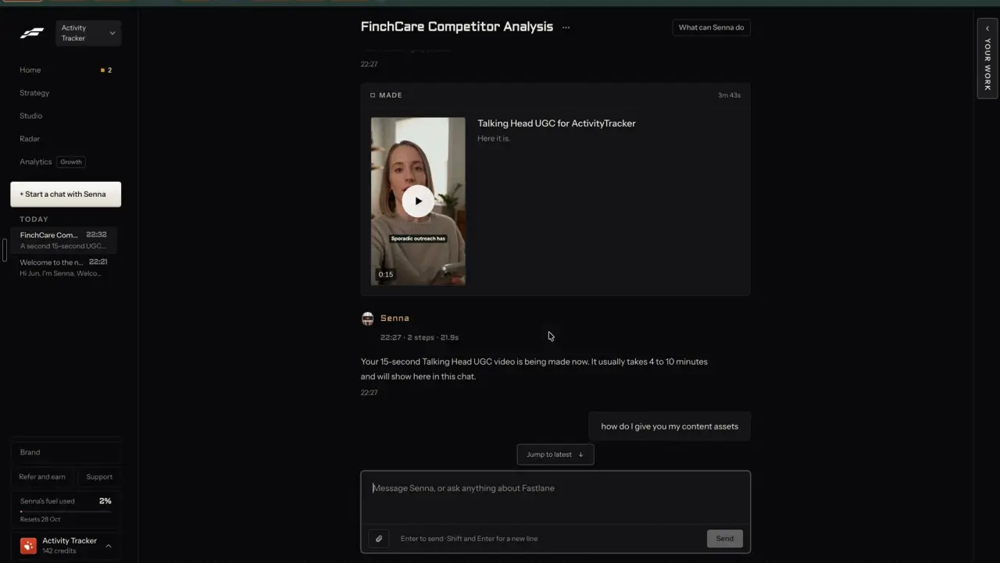

# Video editor

`edit-video` | edit | phase 3 | status: partial | /north-star#edit-video

## Leo asked

19 Oct 2026: "the idea is that one can remix any content format and the ai will regenerate"

For video, the regenerated result is a script or a shot list until something turns it into footage. This item makes the editor open straight from that script. No direct ask beyond the quote; the rest is from the competitor research.

## How the best do it

Fastlane has no timeline editor in Leo's recording; its videos are made from a plan and land finished in the Library:

1. In chat, Senna proposes a card before anything renders. Its message says "It is a draft, so nothing is made or charged until you approve the card." / "210 credits. Once approved, it starts and the render takes a few minutes." The card reads "Talking Head UGC for ActivityTracker", "Make a 15-second talking head UGC video.", "210 credits charged. Usually renders in 4 to 10 min, then it lands in the Library.", with a row "Captions: Classic  Saved for every video with a voice" above it (notes-4 2.3).


2. The card holds "STORYLINE AND SHOTS", four numbered beats each with a direction, and two buttons, "Change the script" and "Try another format". After approval both are greyed (t272). What they do before approval is not shown (unverified).


3. The made video shows in the thread as a "MADE 3m 43s" block with a 0:15 thumbnail, burned-in captions ("Sporadic outreach has") and "Here it is." (notes-4 2.5). No way to trim or recaption it appears in the recording.



The editors that take a script or a made video and keep going:

- InVideo takes raw footage "with or without a script". Its assistant picks the best takes, removes flubs, filler, silence and pauses, and flags script lines that were never shot; manual editing is free and agent work uses credits ([InVideo](https://invideo.io/news/introducing-invideo-editor/)).
- MakeUGC lets you edit captions, music, B-roll and trims after an AI video's render of about 2 minutes ([makeugc.ai](https://www.makeugc.ai/)).
- The Captions app, which includes Mirage, shows an edit plan before rendering: the prompt, "Recommended cuts" with "Restore original" and a per-cut "Revert", a style with "Edit intensity", and media to insert; 10 to 40 credits, sources of 3 minutes or less ([AI Edit](https://www.captions.ai/help/docs/project/ai-edit)).
- Vizard's AI Edit costs 0.5 credits a second, shows the estimate before submit and refunds failed runs ([help](https://help.vizard.ai/en/articles/16658532-what-is-ai-edit)).
- OpusClip's Speech Cleanup removes fillers from a checklist, pauses past a slider (default 0.5 s) and bad takes on Pro ([help](https://help.opus.pro/docs/article/speech-cleanup.md)); its brand template sets captions and layout once ([help](https://help.opus.pro/docs/article/how-to-add-a-brand-template.md)).
- Descript's "Edit for Clarity" has an intensity of Low, Medium or Heavy, and "Remove retakes" keeps one take of a line said several times ([clarity](https://help.descript.com/script-editing/edit-for-clarity.md), [retakes](https://www.descript.com/ai/remove-retakes)).
- Zebracat caps free edit rounds per video: 3, 3, 5 or unlimited by plan ([pricing](https://www.zebracat.ai/pricing)).

## What we have today

The editor at `/edit` (`src/pages/VideoEditPage.tsx`, 2,641 lines; `src/lib/videoEdit.ts`, `src/lib/videoMedia.ts`) is the deepest part of the app and is live for everyone. Measured against the competitors above:

| Competitor feature | Ours | Where |
|---|---|---|
| Cut fillers, pauses, retakes | live | Cuts tab: `removeFillers`, `maxPause`, `pauseFast`, `removeRetakes` |
| Cut by deleting words | live | Words tab, `mode=cut` |
| Captions, styles, second language | live | Captions tab (edit-captions) |
| Reframe, follow the face, two speakers, screen and face | live | Hook and frame, Face and background tabs |
| Stock and AI B-roll | live; the AI clip runs while the `AI_BROLL_ENABLED` secret is "1" (on since 10 Oct 2026) | B-roll tab, caps `broll-picks` 20, `ai-broll` 3, `ai-broll-global` 20 |
| Denoise, voice polish, loudness | live | Cuts tab |
| One-tap looks, saved skills, change by asking | live | `src/lib/stylePresets.ts`, `src/lib/videoSkills.ts`, vibe edit (cap `vibe-edit` 100) |
| Clips from a long video | live | Find clips, cap `video-clips` 20 |
| Several sizes in one export, export checks | live | `src/lib/exportVersions.ts`, `src/lib/exportCheck.ts` |
| AI avatar, explainer, template clip, montage, opened in the editor | live | `src/components/AiVideo.tsx`, `/edit?panel=ai&kind=` |
| Eye contact fix | missing | people-dub-lipsync |
| Music made for you | hidden (`AI_MUSIC = false`) | `src/lib/aiMusic.ts` |

The gap is the hand-off. A remix ends as a script: Write's short-video draft (`splitScriptCaption` in `src/lib/scriptCaption.ts`, storyboard beats on `DraftEntry.storyboard`) or Clone a reel's version (`saveCloneDraft` in `src/lib/reelClone.ts`, called from `openInWrite` in `src/pages/CloneReelPage.tsx`; its draft text is `cloneDraftText`, the script, a `---` line and `CAPTION:`). Neither Write nor Clone links to `/edit` today, so nothing carries that script across. `links.edit` has `p, tab, mode, sticker, broll, guide, panel, kind, template` and no way to pre-fill the avatar script, explainer topic, montage theme or a template's line, so the adviser retypes it. Saving from the editor (`saveToPosts`, around line 1280) writes a new draft `video-${project.id}`, so the video and its remix end up as two unrelated posts, which is why the status is partial.

## Build

Three changes. Filming the script yourself with a teleprompter is formats-hooks-scripts ("Film it", `/generate?draft=<id>&view=prompter`), which hands its take to `/edit` the same way.

### 1. Open the AI panel from a post

`/edit?panel=ai&kind=<kind>&draft=<draftId>` pre-fills the panel from that draft, once, when it opens:

| kind | Field filled and its limit today | From |
|---|---|---|
| `avatar` | "What you say", 600 characters (`maxLength` in `AiVideo.tsx`), about 30 s (`MAX_AVATAR_SECONDS`) | the storyboard's `say` lines when `storyboard.script` still matches the draft's script, else the spoken script |
| `explainer` | Topic, 200 characters (`MAX_TOPIC` in `supabase/functions/ai-video/logic.ts`) | the hook, cut at a word under 200 |
| `montage` | Theme, 80 characters (`MAX_THEME` in `supabase/functions/video-assist/montage.ts`) | the hook, cut at a word under 80 |
| `template` | "What they say" (field key `line`, 200 characters, `MAX_FIELD`), only on the templates whose fields include it | the first spoken sentence |

- New `spokenScript(text)` in `src/lib/scriptCaption.ts`: `splitScriptCaption(text).script ?? text` with the `HOOK:`, `BODY:`, `CTA:` labels, markdown and stage directions in square brackets removed.
- New `fitScript(text, max)` in the same file: the longest run of whole sentences under `max` characters, plus how many sentences were left out.
- `AiVideo.tsx` reads `draft` with `useUrlState("draft", "")`, loads it with `loadDrafts(userId)`, fills the field and shows a strip at the top of the panel:

```
From your post: 3 CPF myths that cost you      [Open in Write] [Clear]
Cut to the first 4 sentences to fit 30 seconds. Change it before you make it.
```

- The made video's project keeps the draft: `VideoProject.draftId?: string`. The AI jobs run outside React and hand their file to `upload(file, extra)` through the join job (`VideoEditPage.tsx` about line 283), so `JoinExtra` in `src/lib/videoMedia.ts` (today `{ settings?, note? }`) gains `draftId?: string`. `AiVideo.tsx` passes the draft id into the make call (`makeAvatar`, `makeExplainer`, `makeTemplateClip`, `startMontage` in `src/lib/aiVideo.ts` and `src/lib/montage.ts`), each puts it in the join's `extra`, and `upload` writes it onto the new project. `startSlides` (the explainer's join) takes no `extra` today and gains the same optional argument. The avatar and template jobs can resume after a reload from `cs-ai-video-pending` (`pendingAvatar` in `aiVideo.ts`), so that stored record carries `draftId` too.

### 2. Ways in

- Write (`src/pages/GeneratePage.tsx`), on a saved short-video draft, next to the Storyboard block: a "Make the video" menu with "You speaking (AI)", "Explainer", "Stock montage" and "Film it" (the last one appears once formats-hooks-scripts ships), and each item links to `links.edit({ panel: ["ai"], kind, draft: id })`.
- Clone a reel (`src/pages/CloneReelPage.tsx`), on the version card beside "Open in Write": "Make the video" with the same menu. It calls `saveCloneDraft(userId, clone)` from `src/lib/reelClone.ts` first, as `openInWrite` does, then opens `/edit` with the returned `draftId`.

### 3. Save back to the same post

When the project has a `draftId`, "Save to My posts" becomes "Save to your post". It updates that draft instead of making `video-${project.id}`: every field kept (its source, schedule, labels, board stage), and only the caption half of `draft` replaced, so the text reads `${script}\n\n---\n\nCAPTION:\n${caption}` (the `cloneDraftText` shape) and `splitScriptCaption` still splits it. A new pure function, `withVideoCaption(entry, caption)` in `src/lib/scriptCaption.ts`, does that merge, and if the draft is gone the button falls back to today's behaviour with a toast.

### Screens and states

- Pre-filled: the strip above, the field filled, focus on the Make button. Nothing is made until the adviser presses it.
- Script cut to fit: the amber line "Cut to the first {n} sentences to fit 30 seconds. Change it before you make it."
- Draft not found (deleted, or another brand): "We couldn't find that post. Type the script instead." The param is removed (replace) and the panel opens empty.
- Draft with no words yet (a board idea): "That post has no script yet." with "Write it" linking to `/generate?draft=<id>`.
- A job already running: the existing AiVideo job view shows first; the pre-fill waits until the adviser starts a new one.
- Over the daily cap: the existing words from the server, e.g. "You've used all 2 for today. It resets at 8am Singapore time." (`ai-video`), and the Make button stays disabled with the uses-left line.
- Making, done, failed and refunded: as today in `AiVideo.tsx` (failed jobs refund the cap).
- Saved to your post: a toast "Saved to your post" whose "Open it" action opens `/generate?draft=<id>`.

### Copy

- Menu button "Make the video"; items "You speaking (AI)", "Explainer", "Stock montage", "Film it"
- Strip "From your post: {title}", buttons "Open in Write", "Clear"
- "Cut to the first {n} sentences to fit 30 seconds. Change it before you make it."
- "We couldn't find that post. Type the script instead."
- "That post has no script yet." with link "Write it"
- Button "Save to your post"; toast "Saved to your post", action "Open it"; fallback toast "That post is gone, so this saved as a new one."

### Data

- `VideoProject.draftId?: string` in `src/lib/videoProjects.ts`, synced inside `content-studio-videoprojects-${scoped(userId)}`. `loadProjects` has no sanitizer today (it parses the JSON as is), so the reader treats a non-string `draftId` as absent, and `getDraftById` returning null covers an id that no longer exists.
- The draft update goes through `upsertDraft` on the existing id (`content-studio-drafts-...`), so it syncs as today.
- No table and no schema change.

### AI and cost

- No new AI call and no new cap. The pre-fill is text handling.
- The makes cost what they cost today, under today's caps: AI avatar up to 88 Higgsfield credits, about US$5.50 (caps `ai-video` 2, `ai-video-global` 20, `ai-voice` 10); explainer script `ai-video-script` 10 plus Soul v2 pictures at about US$0.006 each; montage `montage-beats` 10 and `montage-pick` 20 with free Pexels clips; template clip US$0.82 to US$3.70 (`ai-clip` 2, `ai-clip-global` 8). All of it is Higgsfield, OpenAI and ElevenLabs, already wired in, so no new vendor. The cost line on the Make buttons ("Costs {n} Higgsfield credits (about US${x}).", `cost()` in `AiVideo.tsx`) stays as it is; business-cost-preview turns it into the shared price chip.
- No decision is made in this item, so no Jev question.

### Deep links

| URL | Opens |
|---|---|
| `/edit?panel=ai&kind=avatar&draft=<id>` | You speaking, script from that post |
| `/edit?panel=ai&kind=explainer&draft=<id>` | Explainer, topic from that post |
| `/edit?panel=ai&kind=montage&draft=<id>` | Montage, theme from that post |
| `/edit?panel=ai&kind=template&template=<tid>&draft=<id>` | That template, its line from that post |

`draft` stays in the address while the panel is open (a reload keeps the pre-fill) and is dropped when the panel closes or "Clear" is pressed (replace). Add `draft?: string` to `links.edit` in `src/lib/links.ts` and a row to the Create pages table in `docs/deep-links.md`.

### Gate

The "Make the video" menus in Write and Clone, the `draft` param and "Save to your post" work only when `leoOnly(email)`. For anyone else `draft` is ignored and the panel opens empty, as today.

## Done when

- [ ] From a Write short-video draft and from a Clone a reel version, each of the three menu kinds opens pre-filled on Leo's account, checked by eye at 390 px and 1440 px; the template link fills "What they say" on a template that has it.
- [ ] A script longer than 600 characters is cut at a sentence end with the amber line; the full script stays in the draft. The explainer topic and montage theme never pass 200 and 80 characters.
- [ ] Reloading the page while an avatar job is still running keeps the `draftId` on the project it makes.
- [ ] One AI avatar made from a remix opens in the editor with captions, and "Save to your post" updates the original draft, which still splits into script and caption in Write.
- [ ] A missing draft and an idea-only draft show their lines and never break the panel.
- [ ] Another account sees no menus and an empty panel with `draft` in the URL.
- [ ] `npm run build` and the full `npx vitest run` pass; `src/data/northStar.ts` item flipped with its `ours` line in the same commit.

## Tests

- `src/lib/scriptCaption.test.ts`: `spokenScript` strips the labels and keeps the spoken words, for each caption heading `CAPTION_HEADING` matches; `fitScript` never cuts mid-sentence and reports how many were left out; `withVideoCaption` round-trips through `splitScriptCaption` and keeps every other draft field.
- `src/lib/scriptCaption.test.ts`: a pre-fill helper per kind cuts at a word under 200 (explainer) and 80 (montage), and uses the storyboard's `say` lines only while `storyboard.script` matches the draft.
- `src/lib/videoProjects.test.ts`: `draftId` survives a save and load; a non-string value reads as none.
- `src/lib/links.test.ts`: `links.edit({ panel: ["ai"], kind: "avatar", draft: "d1" })`.

## Open questions

- InVideo flags script lines that were never shot. A Jev check of each script line against the transcript would do this for filmed takes; worth adding once formats-hooks-scripts ships the teleprompter, if Leo wants it.
- Fastlane shows the storyline before anything renders and lets you change it. Ours shows the script in the panel before Make, which serves the same purpose for one video; a plan card in chat is agent-approvals.
- Eye contact and fixing one spoken line belong to people-dub-lipsync, and an upscale or 4K export is not planned. Leo.
- Hard stops checked: no schema change, no new npm package, no new paid provider and no auth change.

## Related

formats-hooks-scripts, formats-talking-head, formats-faceless-video, formats-clips, formats-custom, edit-captions, edit-by-chat, edit-text-video, remix-source-trail, people-dub-lipsync, people-my-face, business-cost-preview
