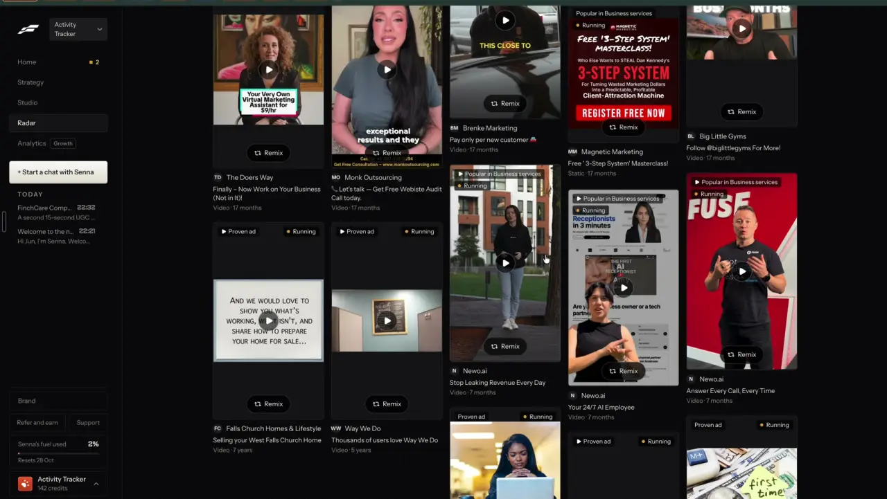

# Why this ad works

`find-ad-detail` | find | phase 2 | status: live (Leo's sign-ins, 20 Oct 2026) | /north-star#find-ad-detail

## Leo asked

19 Oct 2026: "find ways where one can key in their competitors and the app will scrape their ads and top performing social media posts"

This item is the page you land on after that scrape: one ad or post, how long it has run, why it is proven, and what Remix will do with it.

## How the best do it

Fastlane (Leo's recording, 4:00 to 4:10, notes-3.md F9). In Radar you click any ad card. A modal opens with a skeleton and a pill "Loading the post", then fills in about a second.




- Left: the ad's video in a player that starts on its own, the brand name over it, play, time (the notes read "0:01 / 0:56"), sound, full screen and a menu.
- Right, top: "Newo.ai - Meta ad", then the headline "Stop Leaking Revenue Every Day".
- Three big stats with a small caption under each: "7 months" / "running", "Video" / "video ad", "Longest" / "of their 6 ads".
- Then three rows of label and value: "Started" "4 Apr", "Placement" "Facebook and Instagram" and "Why it works" "Their longest running ad right now."
- A box "What Remix does": "Senna breaks the video down, writes a script and storyboard for Activity Tracker, then makes it with Seedance. You see it before anything posts." Under it, in orange: "Not recommended: it is packed with text, and text-heavy remixes often come back jumbled."
- Buttons: "Remix this" (primary) and "Open on Meta".
- The price shows only after Remix, in the chat composer: "Remix, 130 credits" for a video ad. Static ads remix for 12 credits (notes-3.md F13).

The "why it works" line is a fact from the numbers (run length, rank among the brand's ads). Fastlane writes no teardown here; the breakdown happens inside the remix.

Other competitors:

- Sandcastles opens a video detail with tabs Transcript, Idea Analysis (Topic, Idea Seed, Unique Angle, Common Belief to Challenge, Contrarian Reality, Supporting Evidence), Hook (Category, Formula, Spoken Hook, Analysis), Storytelling Format and Visual Layout, for 1 credit per video ([help](https://help.sandcastles.ai/video-detail)).
- Meta Ad Library cards carry the Library ID, Active or Inactive, the start date, platforms, and how many ads use the same creative. It shows no spend or reach for commercial ads outside the EU ([Jon Loomer](https://www.jonloomer.com/meta-ad-library/), [Buffer](https://buffer.com/resources/meta-ad-library/)).
- Gethookd gives each ad 1 to 5 stars from run length, creative reuse, brand activity and impressions, because spend is hidden. A review says the top tiers need 7 and 14 days of run time ([Gethookd](https://www.gethookd.ai/learn/how-to-spy-on-competitor-ads-4-best-tools-and-tips/), [review](https://dropshippingchampions.com/blog/gethookd-review)).
- PiPiAds charges 20 credits to open an ad's detail page against 1 credit for a search, and the page shows engagement, estimated spend, days running and landing page ([Copyfy review](https://www.copyfy.io/en/blog/pipiads-review), [pricing](https://affninja.com/pipiads-pricing/)).
- TikTok Creative Center plots a top ad second by second (CTR, CVR, clicks, conversions, retention) against the industry and marks "highlight frames" ([TikTok help](https://ads.tiktok.com/help/article/top-ads?lang=en), [Segwise](https://segwise.ai/blog/tiktok-top-ads-dashboard-guide)).
- Foreplay shows a Transcript tab on every saved video ad, with a marker for how long the ad stays on the problem before the product appears ([help](https://help.foreplay.co/articles/0985790-free-transcription)).
- Minea meters per-ad AI analysis at 10 a month on Starter and 50 on Premium; what it outputs is not public (unverified) ([pricing](https://www.minea.com/pricing)).

The pattern: the numbers that prove an ad first (run length, rank among the brand's ads, placements), a short read of how it is built, then one Remix button.

## What we have today

- Ads: `/swipe?tab=ads`, `src/components/AdsSwipe.tsx`, data `src/data/adsSwipe.json` (21 Singapore Meta ads from 7 advertisers, 3 each, fetched 2026-10-12), types and helpers in `src/lib/adsSwipe.ts` (`SwipeAd`, `daysRunning`, `searchAds`, `facetCounts`, `buildAdWriteUrl`).
- Each `AdCard` shows the picture, advertiser, industry, a "Running N days" chip, the Jev-picked hook family chip ("Problem hook"), format, headline, body with "Read the whole ad", then "Write a post like this" (to Write) and "Ad Library". The picture itself is a link out to the Ad Library entry. There is no detail view, no rank among the brand's ads, no placements line and no teardown.
- The ads tab keeps two things in the URL today: `q` (search) and `industry` (a chip). `setTab` in `SwipeFilePage.tsx` clears both on a tab switch.
- Video ads show a still picture only. Meta's media links expire, so the drop commits a 720 px picture to `public/ads/<adId>.jpg` and keeps no video.
- Posts: `src/components/PostDetailDrawer.tsx` is a working detail view for top posts (`/swipe?post=<key>`): embed, numbers, outperformance ("2.1x"), "Remix this for my business", "Open original", "Clone", "Save", then Hook, Topic, Content angle, Audience, Format, "Why it worked", "Psychological trigger", "Typical structure for this format", "How I'd adapt this for an FA", full caption, similar posts. Topic, angle and trigger come from keyword rules in `src/lib/postInsights.ts`; hook, why and adapt are written by the free Claude CLI at drop time (`scripts/gen-ideas.mjs`).
- The weekly ads drop: `~/.local/bin/ads-swipe-collect` (Leo's Mac, launchd com.leo.ads-swipe, Mondays 07:00) reads the Ad Library and asks Jev for the hook family, then `~/.local/bin/content-studio-drop.sh ads-swipe` runs `scripts/ads-swipe.mjs`, which rewrites `src/data/adsSwipe.json` from the snapshot each week.

So the post half is live and the ad half is missing. Status partial.

## Build

Scope: one ad detail drawer used everywhere an ad card shows (`/swipe?tab=ads` and `/competitors?view=ads`), plus a "What Remix does" box on the post drawer. The breakdown inside it is `remix-teardown`'s, not a second one. Leo-only behind `leoOnly(email)`.

### Screens and states

Files:

- `src/components/AdDetailDrawer.tsx` (new). Copy the shell of `PostDetailDrawer.tsx`: portal to body, z-[70], Escape and backdrop close, focus back to the opener, a full-screen sheet under 640 px and a centred modal (max-w-3xl, picture left, details right) above it.
- `src/lib/adDetail.ts` (new, pure): `toDetailAd`, `runLength`, `rankAmong`, `placementLabel`, `proofLine`.
- The ad cards open it with `useUrlItem("ad")`. That is `AdsSwipe.tsx` today; `AdLibrary.tsx` once `find-ad-library` ships (it replaces `AdsSwipe` for Leo); and the "Their ads" cards of `find-competitor-ads`. On Leo's sign-in the picture stops linking out to Meta and, with the headline, becomes one button that opens the drawer; each card keeps its own buttons. Other sign-ins keep today's cards, picture link included.
- `src/components/PostDetailDrawer.tsx`: the "What Remix does" box above "Hook / core idea", Leo-only.

`toDetailAd(ad)` turns a `SwipeAd` (the drop) or a `LibraryAd` (`find-ad-library`, which also covers competitor ads) into one shape: `{ id, advertiser, format, headline, body, start, end, active, platforms, image, video, libraryUrl, hookFamily, emotion, audience }`. The drawer reads only this shape, so it does not care where the ad came from.

Helpers in `src/lib/adDetail.ts`, with copy matching `find-competitor-ads`:

- `runLength(ad, now)`: `{ big: "45 days", small: "running" }`. Under 60 days it counts days; from 60 to 364 days it shows whole months, days divided by 30 and rounded down ("2 months" at 60, "10 months" for Thomson Medical's video from 23 Dec 2025); from 365 days whole years ("1 year", "2 years"). An ad that has stopped measures start to end and says `small: "ran"`. Null without a start date. The drop has no end date, so every drop ad reads "running".
- `rankAmong(ad, list)`: rank by days running among the ads in `list` with the same advertiser, where `list` is the list the drawer was opened from. Rank 1 of 2 or more gives `{ big: "Longest", small: "of their 3 ads" }`, rank 2 gives "2nd longest", rank 3 or lower gives "#3", and a single ad gives `{ big: "Only ad", small: "of theirs here" }`. Ads that started the same day share a rank, and a shared first place reads "Joint longest" (Singlife's 3 drop ads all started on 10 Sep).
- `placementLabel(platforms)`, case-insensitive because the drop says FACEBOOK and the scraper says facebook: Facebook, Instagram, Threads, WhatsApp, Messenger, Audience Network, joined as "Facebook, Instagram and Threads". Unknown values are dropped.
- `proofLine(ad, list, now)` returns the first line that holds:
  - running, rank 1 of 2 or more, 30+ days: "Their longest running ad right now."
  - running, 90+ days: "Running for 3+ months. Advertisers switch off ads that lose money."
  - running, 30+ days: "Running for a month or more."
  - running, under 14 days: "New. Too early to call it proven."
  - running, otherwise: "Running for 2 weeks or more."
  - stopped, 90+ days: "Ran for 3+ months before it stopped."
  - stopped, under 90 days: "Stopped after {n} days."
  These match `find-ad-library`'s "Proven ad" rule (running 30+ days, or ran 90+ days in total), so a stopped ad under 90 days never reads as proven. They are facts read off two numbers, so no Jev call.

Drawer layout (desktop, picture left):

```
[ picture or "No preview" ]   Singlife  Meta ad                      [copy link] [x]
[ Video ad. Play it on Meta ] Singlife CareShield
                              40 days      Image       Joint longest
                              running      image ad    of their 3 ads
                              Started      10 Sep
                              Placement    Facebook, Instagram and Threads
                              Hook         Problem hook
                              Proof        Running for a month or more.
                              Breakdown                     [See it v]   (remix-teardown)
                              What Remix does
                                Remix writes your own post ...
                              [ Remix this ]  [ Open on Meta ]
                              Full ad text (collapsed, "Read the whole ad")
```

On a phone the picture sits on top at most 45vh tall, and the two buttons stick to the bottom of the sheet.

States:

- Closed: no `ad` param.
- Open from a bundled or stored list: instant, so there is no loading state. If the id is not in the list yet (a deep link opened before a competitor check has finished), show the skeleton with the pill "Loading the ad" until the list has it, and close quietly after 10 seconds if it never arrives.
- Picture fails to load (Meta's links expire): a muted tile with an image icon and "No preview".
- Video ad: when `video` is set (competitor ads, until the link expires) it plays in a `<video controls>`; otherwise the still with a dark label "Video ad. Play it on Meta." linking to `libraryUrl`.
- Breakdown: the collapsed "Breakdown" row from `remix-teardown` for the key `ad:<id>`, with its own loading, failed and over-the-cap states. Until `remix-teardown` ships the row is left out, and nothing else changes.
- Unknown `ad` id in a list that has finished loading: close quietly, the same rule as `?post=` on this page.
- Not Leo: an `ad` param is ignored and removed with replace; the page renders as today.

### Copy

- Header: advertiser name, then muted "Meta ad".
- Title: `headline`, or the first line of `body` cut to 80 characters.
- Stat captions: "running" or "ran"; "image ad", "video ad", "carousel ad"; rank captions as in `rankAmong`.
- Row labels: "Started", "Placement", "Hook", "Proof". Started shows "10 Sep" in the current year, "10 Sep 2025" otherwise. Hook reads "<family> hook", the chip text the cards use; the row is left out when the ad has no family yet.
- Box heading: "What Remix does".
  - Image or carousel ad: "Remix writes your own post that opens the same kind of way, in your voice. It never copies their words, brand or claims. You check it before anything posts."
  - Video ad: "Remix writes your own short-video script that opens the same kind of way, in your voice. It never copies their words, brand or claims. You check it before anything posts."
  - These lines describe what `buildAdWriteUrl` sends today: the hook family and the opening lines as context, with a ban on the ad's wording, brand and claims. It sends no beats or shape, so the copy promises neither.
  - Top post (post drawer): "Remix writes your own version of this idea in your voice and the same format. It never copies their words."
  - When `remix-fit-check` ships, its one-line verdict goes under the box text in the warning colour and starts with "Weak fit:". Until then there is no fit line.
  - When `remix-any-format` makes media from ads, the box text comes from that item, which names the format it will make.
- Buttons: "Remix this" (primary, Wand2 icon) and "Open on Meta" (outline, ExternalLink icon, `libraryUrl`), plus a Copy link button labelled "Copy link to this ad". "Remix this" goes to `buildAdWriteUrl` today, and for a video ad the drawer adds `format=short-video` to that URL so Write makes a script (Write already reads `format`), while the cards' "Write a post like this" keeps today's URL; once `remix-everywhere` ships, "Remix this" opens the Remix sheet (`?remix=ad:<id>`) instead.
- No price chip yet, since Remix into Write costs the user nothing; once a remix from an ad costs anything, the button takes the chip from `business-cost-preview`.

### Data

Nothing new is stored. The drawer reads the drop (`src/data/adsSwipe.json`), the stores of `find-competitor-ads` and `find-ad-library`, and the teardown cache of `remix-teardown` (`content-studio-remix-teardowns-<uid>`). No table, no synced key, no schema change.

### AI and cost

- The drawer itself calls nothing: run length, rank, placement and proof are arithmetic on Ad Library fields.
- The Breakdown row costs what `remix-teardown` says (about 1 US cent of OpenAI plus a Jev call, cap `remix-teardown` 40 a day), and only when the user opens it or presses Remix.
- Hook family, emotion and audience labels come from the drop (Jev, in `ads-swipe-collect`) and from `find-ad-library`'s `label` mode (Jev). The drawer shows them; it never asks.

### Deep links

- `/swipe?tab=ads&ad=<adId>` opens the drawer over the ads tab. Push on open, so Back closes it. Example: `/swipe?tab=ads&ad=2095783381019179`.
- `/competitors?view=ads&ad=<adId>` does the same on the competitors page, once `find-competitors` adds that route (it does not exist yet).
- The tab's filters stay as they are under the open drawer: `q` and `industry` today, plus whatever `find-ad-library` adds (`scope`, `hook` and the rest).
- Add `ad?: string` to `links.swipe` (and to the `competitors` builder once it exists) in `src/lib/links.ts`, and a row to `docs/deep-links.md`: "ad | an ad's Library id; opens it, with Copy link | none | push".
- Switching tab clears `ad` along with the other params (add `ad: null` to `setTab` in `SwipeFilePage.tsx`).

## Done when

- [ ] On Leo's sign-in, clicking an ad's picture or headline on `/swipe?tab=ads` opens the drawer and the URL gains `&ad=<id>`; Back closes it.
- [ ] The drawer shows the three stats, Started, Placement, Hook, Proof, the "What Remix does" box and both buttons, with the copy above.
- [ ] Prudential Singapore's image ad from 16 Sep says "Longest" / "of their 3 ads" and its other two say "2nd longest" and "#3"; each of Singlife's 3 ads says "Joint longest".
- [ ] A drop video ad shows "Video ad. Play it on Meta." and that link opens the Ad Library entry; a competitor video ad with a live `video` link plays in the drawer.
- [ ] With `remix-teardown` live, the Breakdown row opens and shows the ad's hook, beats and why, built from the ad's copy.
- [ ] The same drawer opens from `/competitors?view=ads` once `find-competitor-ads` is live.
- [ ] On a non-Leo sign-in, `/swipe?tab=ads&ad=<id>` shows the ads tab with no drawer, and cards behave as today.
- [ ] The post drawer shows the "What Remix does" box on Leo's sign-in only.
- [ ] Checked by eye at 390 px and 1440 px: no horizontal scroll, and both buttons reachable without scrolling on a phone.
- [ ] `npm run build` and the full `npx vitest run` pass.
- [ ] `src/data/northStar.ts`: `find-ad-detail` flipped to live with its `ours` line, in the same commit as the last piece.

## Tests

- `src/lib/adDetail.test.ts` (new):
  - `runLength` gives "59 days", "2 months", "12 months", "1 year" and "2 years" at the boundaries (59, 60, 364, 365 and 730 days) and "ran" for a stopped ad.
  - `rankAmong` gives Longest, 2nd longest, #3 and Only ad on a fixture of 3 ads from one advertiser plus 1 from another, and Joint longest for 2 ads with the same start.
  - `placementLabel` maps both FACEBOOK and facebook, joins with "and", and drops unknown values.
  - `proofLine` returns each of its seven lines on a fixture built for it, and a stopped ad at 45 days never gets a "Running" line.
  - The drawer's Remix URL for a video ad carries `format=short-video`; for an image ad it equals `buildAdWriteUrl(ad)`.
  - `toDetailAd` maps a `SwipeAd` fixture and a `LibraryAd` fixture to the same shape.
- `src/lib/links.test.ts`: `links.swipe({ tab: "ads", ad: "123" })` gives `/swipe?tab=ads&ad=123`.
- `src/lib/nav.test.ts` and `src/lib/navRoutes.test.ts` stay green (no route or nav change).

## Open questions

- Video ads from the drop play only on Meta, and competitor video links expire within days. Keeping the video means a storage bucket and its cost, which is Leo's call and belongs with `find-competitor-ads`.
- Fastlane hides the remix price until the composer. This spec shows the price on the Remix button once a remix costs anything, because the page's money rule says paid buttons carry a price, and Leo can overrule that.
- Should the post drawer move to the same two-column layout on desktop? Left as is to keep the change small.

## Related

find-competitor-ads, find-ad-library, find-competitors, find-outlier-score, find-ai-tagging, remix-teardown, remix-fit-check, remix-everywhere, remix-any-format, business-cost-preview
