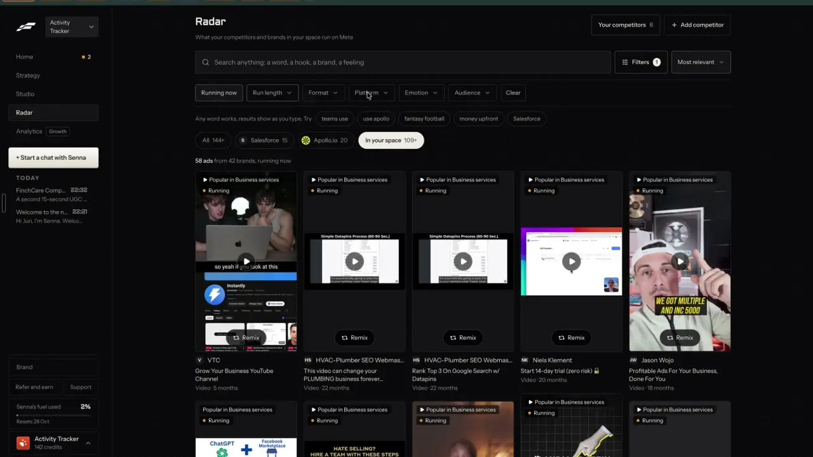

# An ad library for your space

`find-ad-library` | find | phase 2 | status: partial | /north-star#find-ad-library

## Leo asked

- 19 Oct 2026: "find ways where one can key in their competitors and the app will scrape their ads and top performing social media posts"
- 15 Oct 2026: "embed it within the tool so it depends on the person's market/website"

The library is where the scraped ads become searchable, and "In your space" is the part that depends on the person's market.

## How the best do it

Fastlane's Radar ("What your competitors and brands in your space run on Meta") has "Your competitors 6" and "+ Add competitor" at the top right. A search box reads "Search anything: a word, a hook, a brand, a feeling" with "Filters" and a sort "Most relevant". Under it: "Any word works, results show as you type. Try" and chips taken from ad copy ("teams use", "use apollo", "money upfront"). Scope pills "All 144+", "Salesforce 15", "Apollo.io 20" and "In your space 109+" grow while results stream in, and the count line reads "144+ ads from 85 brands".


"Filters" opens a row: "Running now", "Run length" ("Running for 7+ days", "Running for 30+ days", "Running for 90+ days"), "Format" ("Video", "Static"), "Platform", "Emotion", "Audience" (Platform and Emotion were not opened in the recording). With one active the button reads "Filters 1", a "Clear" chip appears, and the count changes to "58 ads from 42 brands, running now". "In your space" shows non-competitor brands in the inferred category, tagged "Popular in Business services". For Leo's ActivityTracker workspace that included insurance-career ads such as Capital Wealth Experts and Lead Elevate (notes-3.md F8; the In your space view is t225).



The Audience list is searchable ("Type to find") but its labels are raw AI output: "Both", "Male", "Male and female", "Woman", "Male 30-50", "Male 35-55", "25-54".


Cards carry a relevance tag ("Your competitor", "Popular in Business services" or "Proven ad"), a "Running" dot when live, a "Remix" pill on every creative, and a meta line such as "Video | 7 years" or "Static | Ran 5 years". "Show 40 more" appends cards in place.


Others:

- Foreplay Discovery: keyword search with typeahead; filters for format, platform, active status, niche, language, B2B or B2C and content style; sort "Newest" or "Longest Running". Sources: [search](https://help.foreplay.co/articles/5070053-search-discovery), [filters](https://help.foreplay.co/articles/6557654-filters-and-sorting), [discovery](https://www.foreplay.co/discovery).
- Foreplay's content style filter sorts image ads into 9 fixed styles ("Before and After", "Facts and Stats", "Testimonial - Review", "Us vs Them" and more). [Source](https://www.foreplay.co/post/introducing-content-style-filters).
- Atria filters by 31 normalized themes, 30 CTAs, run days, video length buckets, audience age and gender, and following-only. [Source](https://docs.tryatria.com/reference/search_library_ads.md).
- Predis.ai buckets ads by longevity ("90 days and up", "30 to 89 days", "under 30") and calls the longest-running live ads "Workhorses"; 4 credits per 100 live ads. [Source](https://predis.ai/ad-intelligence/).
- Minea filters Facebook ads by 15 reaction types, including love and anger. [Source](https://www.copyfy.io/en/blog/minea-review).
- Meta's own Ad Library search is free with no login; quotes force an exact phrase. [Source](https://www.jonloomer.com/meta-ad-library/).

## What we have today

- `/swipe?tab=ads` (`src/components/AdsSwipe.tsx`, `src/lib/adsSwipe.ts`) holds 21 Singapore Meta ads from 7 fixed advertisers, fetched 2026-10-12 on Leo's Mac. You can search across advertiser, industry, hook family, headline and body (`searchAds`) and narrow by industry chips (`facetCounts`); each card shows "Running N days", the hook family Jev picked from AdLauncher's seven, and "Write a post like this". The tab reads `q` and `industry` from the URL.
- On the ads tab, `searchAds` matches only when every word is found; `setTab` in `SwipeFilePage.tsx` clears `q`, `format`, `from`, `topic`, `angle`, `audience`, `sort`, `saved`, `post` and `industry` on a tab switch.
- The tab only appears while the drop has ads (`allowed: ADS.length ? ["news", "ads"] : ["news"]`). The page already calls `supabase.auth.getUser()` on load, and its answer carries the email `leoOnly` needs.
- The gate `leoOnly` (`src/lib/leoOnly.ts`) is in the north-star worktree and not on origin/main (checked at f2cb275, 2026-10-20).
- The status is partial because the library stops there: no scope per competitor, no "in your space" ads, no running, run length, format, platform, emotion or audience filters, no sort and no "Proven ad" badge.

## Build

For Leo's sign-ins, `/swipe?tab=ads` renders a new `src/components/AdLibrary.tsx` in place of `AdsSwipe`; everyone else keeps `AdsSwipe` unchanged. The library reads three stores: competitor ads (`find-competitor-ads`), in-your-space ads (new here) and the Singapore drop. This item adds two modes to the `competitors` edge function: `space` and `label`.

### Screens and states

```
Ads
[ Search anything: a word, a hook, a brand, a feeling ]  [Filters 2]  [Most relevant v]
Try a hook: Problem  Proof  Offer  Curiosity  Instruction
[ All 140 ] [ Singlife 22 ] [ Prudential Singapore 30 ] [ In your space 60 ] [ Singapore picks 21 ]
[Running now] [Run length v] [Format v] [Platform v] [Emotion v] [Audience v] [Clear]
58 ads from 42 brands, running now
+------------------+
|Your competitor  .Running|
|   creative       |
|    [Remix]       |
|SL Singlife       |
|headline, 2 lines |
|Video | 21 days   [Proven ad] [Problem]
Show 40 more
Your space: "term life", "hospitalisation plan", "retirement"   Checked 14 Oct  [Edit] [Check now] Up to US$0.53
```

Order under "Most relevant": with no search, proven ads first, then running, then newest; with a search, ads matching more of the words in the headline or body first, then matches in labels, then the advertiser name, ties by days running. "Longest running" sorts by days running. "Newest" by start date.

"Proven ad": running now for 30 days or more, or ran 90 days or more in total. Public data shows no spend, so run length is the proof, as Foreplay and Predis use it. Fastlane does not say how it picks its own "Proven ad" cards (notes-3.md, open question 9); the ones on t239 had run 5 to 7 years.

States:

- Nothing in any store: "No ads yet. Add competitors, or set your space's search words." with "Add competitors" (`/competitors?view=list`) and "Set search words".
- Your space not set up: the "In your space" pill is replaced by "Set your space" (opens the words editor, prefilled from Your market topics, Mentions keywords or F.A.D.S. topics, 3 at most).
- Space due: opening the tab checks it when the last check is 7 or more days old, as a module-level job in `src/lib/adLibrary.ts`. The pill shows "In your space ..." with a spinner and the line "Reading ads for "term life", about a minute..." (inside 400 ms).
- Space done: the pill gets its count; ads Jev did not judge (Jev down) carry the note "Not checked against your space".
- Labelling: unlabelled ads get labels in the background ("Sorting 40 ads by hook and feeling..."). Until then they show under "Any" only.
- Filters with no results: "No ads match these filters." above a "Clear" button.
- Failed Apify run: "Couldn't read Meta's ad library right now. Try again in a few minutes." The use is refunded and last week's ads stay on screen.
- Over the daily cap the server's message shows; over the global cap, "Ad checks are paused for today. They resume at 8am Singapore time."
- Refused (403): "Competitors is not switched on for this account."
- Picture expired: the card shows "No preview" until the next weekly check.

### Copy

- Search placeholder "Search anything: a word, a hook, a brand, a feeling"
- "Try a hook:" with the hook family chips present in the ads
- Pills "All {n}", "{competitor} {n}", "In your space {n}", "Singapore picks {n}", "Set your space"
- Filters button "Filters", "Filters {n}"; "Running now"; "Run length": "Any length", "Running 7+ days", "Running 30+ days", "Running 90+ days"; "Format": "Any format", "Image", "Video", "Carousel"; "Platform": "Any platform", "Facebook", "Instagram", "Messenger", "Threads"; "Emotion": "Any feeling", "Worry", "Hope", "Relief", "Pride", "Curiosity", "Urgency", "Trust", "Fun"; "Audience": "Anyone", "Fresh grads", "Young adults", "Parents", "Families", "High net worth", "Business owners", "Advisers and recruits", "General"; "Clear"
- Sort "Most relevant", "Longest running", "Newest"
- Count line "{n} ads from {b} brands", plus ", running now" when that filter is on
- Card tags "Your competitor", "In your space", "Singapore pick", "Proven ad", "Running"; meta "{Image|Video|Carousel} | {n} days" or "| Ran {n} days"
- Buttons "Remix", "Open on Meta", "Show 40 more"
- Space row "Your space:", "Checked {d Mon}", "Edit", "Check now", chip "Up to US$0.53"; editor title "Search words for your space", helper "Up to 3. We search Singapore's Meta ads for each.", "Save"
- Progress and errors as under states

"Remix" opens Write through `buildAdWriteUrl` until `remix-everywhere` ships; the brief carries structure only, never the ad's words, brand or claims.

### Data

- In-your-space ads: synced key `content-studio-space-ads-<scoped(userId)>`, per brand: `{ checkedAt, keywords: string[], ads: SpaceAd[] }`, 60 ads at most, where `SpaceAd` is `CompetitorAd` (from `find-competitor-ads`) plus `advertiser`, `pageId` and `fit: number | null` (Jev's probability, null when not judged).
- Labels: synced key `content-studio-ad-labels-<userId>` (account-wide, bare uid, since a label describes the ad and not the brand): `Record<adId, { hook: string | null; emotion: string | null; audience: string | null }>`, 2,000 newest kept. The drop's own `hookFamily` wins over a label.
- `buildLibrary()` in `src/lib/adLibrary.ts` joins the three stores and the labels into one `LibraryAd[]` (scope, advertiser, format, text, media, start, end, active, days, proven, labels, `libraryUrl`, remix link). An ad found in two stores is kept once, as a competitor ad.
- All of this fits in synced keys, so there is no schema change.

### AI and cost

Mode `space` of `supabase/functions/competitors/index.ts`, body `{ mode: "space", brand: { name, sells, serves }, keywords, excludePageIds }`:

1. Gate, then `consumeUsage` on `space-ads` (user) and `space-ads-global` (`GLOBAL_COUNTER_USER`).
2. For each keyword (3 at most), the Apify actor `apify~facebook-ads-scraper` with `startUrls` `https://www.facebook.com/ads/library/?active_status=active&ad_type=all&country=SG&q=<keyword>&search_type=keyword_unordered&media_type=all` and `resultsLimit: 30`. The three runs go in parallel (`Promise.allSettled` over `apifyItems`, exported by `find-competitor-ads`), because `apifyItems` waits up to 90 s per run and three in a row would pass the edge function's roughly 150 s. A keyword whose run fails is skipped; the mode fails only when all three do.
3. `shapeAds` (from `find-competitor-ads`), then drop pages in `excludePageIds` (tracked competitors) and duplicates.
4. Jev question `space` (noul) per ad, 6 at a time, state `{ brand, sells, serves, country: "Singapore", ad: { advertiser, headline, body } }` (body cut to 400 characters):
   - instructions: "Is this ad from a business that sells to the same people as `brand`, or sells something those people would weigh against what `brand` sells?"
   - Keep 0.6 and up, best first, 60 at most. Proposed threshold; Leo labels 40 ads from the first run and the cut is set from the disagreements.
   - Jev null: return the ads with `fit: null` rather than drop them, since the Apify spend has happened.
5. All three runs failing, or any throw before results: `refundUsage` on both counters with the UTC `day` read before the call. A spent global counter answers 429 `{ code: "global_limit" }` with the "Ad checks are paused" copy, as in `find-competitor-ads`.

Cost: 90 ads at most at the Free-plan rate of US$5.80 per 1,000 (US$3.40 on Business; [actor page](https://apify.com/apify/facebook-ads-scraper), read 2026-10-20) is US$0.522, plus about 90 Jev questions (under US$0.001), once a week per brand. The chip reads "Up to US$0.53". Caps to add: `space-ads` 2 a day per user, `space-ads-global` 10 a day (US$5.22 a day at most).

Mode `label`, body `{ mode: "label", ads: [{ id, headline, body }] }`, 60 ads at most. One Jev call per ad with three choice questions on one state `{ headline, primary_text }`:

- `hook`: "Which kind of hook does this ad OPEN with, judging by its first lines?" Criteria: the seven AdLauncher families, copied word for word from `HOOK_FAMILIES` in `~/.local/bin/ads-swipe-collect` into `competitors/logic.ts` (Problem, Desire, Curiosity, Proof, Audience, Offer, Instruction), so the drop and the scraped ads use one list.
- `emotion`: "Which feeling does this ad most try to stir in the reader?" Criteria: Worry "concern about a risk, a loss or a gap"; Hope "a better future within reach"; Relief "a burden taken off"; Pride "status, achievement or being smart"; Curiosity "wanting to know the answer"; Urgency "act now before it is gone"; Trust "safety, credibility, being looked after"; Fun "humour or delight".
- `audience`: "Who is this ad mainly speaking to?" Criteria: the `/swipe` audience slugs (fresh-grads, young-adults, parents, families, hnw, business-owners, advisors-recruitment) plus general "anyone, no clear group".
- A label is kept when its pick has probability 0.5 or more, else null.

Cost: about 400 tokens an ad, 60 ads about 24,000 tokens, under US$0.002. Cap `ad-labels`: 10 runs a day per user.

### Deep links

On `/swipe?tab=ads` (all replace the history entry; defaults left out):

- `scope=<competitorId>|space|sg` (default all)
- `q=`, `hook=<family>`, `running=only`, `run=7|30|90`, `format=image|video|carousel`, `platform=facebook|instagram|messenger|threads`, `emotion=<slug>`, `audience=<slug>`, `sort=longest|newest` (default relevant)
- `industry=` keeps working under `scope=sg`
- Add `scope`, `hook`, `running`, `run`, `platform` and `emotion` to the params `setTab` clears. `format`, `audience` and `sort` are already cleared; inside `AdLibrary` read them with their own `allowed` lists (`image|video|carousel`, the ad audience slugs, `longest|newest`), separate from the posts tab's values.
- For Leo, `tab=ads` is allowed even when the drop is empty, as long as another store has ads.
- Extend `links.swipe` in `src/lib/links.ts`; add the rows to `docs/deep-links.md`; the "{n} ads | {running} running >" link on `/competitors` points at `/swipe?tab=ads` with the competitor scope.

## Done when

- [ ] Leo sees the new library on `/swipe?tab=ads`; any other account sees today's `AdsSwipe`, unchanged.
- [ ] Scope pills list each competitor with ads, "In your space" and "Singapore picks", with counts that match the cards.
- [ ] Every filter, the sort and the search land in the URL and survive a reload; "Clear" resets the filters only.
- [ ] "Proven ad" shows on ads running 30+ days or that ran 90+ days, and nowhere else.
- [ ] Setting 3 search words fills "In your space" with up to 60 Singapore ads, none from a tracked competitor.
- [ ] New ads get hook, feeling and audience labels in the background; unlabelled ads appear only under "Any".
- [ ] A failed space run refunds both counters and keeps last week's ads.
- [ ] `space-ads`, `space-ads-global` and `ad-labels` are in `usageCaps.ts`.
- [ ] Checked at 390 px and 1440 px; build and full vitest pass; the north-star item flipped.

## Tests

- `src/lib/adLibrary.test.ts`: `buildLibrary` joins three stores, keeps one copy of an ad found twice (competitor wins), applies labels and lets the drop's hook family win; the proven rule at 29, 30 and 90 days; each filter alone and combined; the three sorts; search word counting; counts per scope.
- `competitors/logic.test.ts`: the keyword search URL is encoded (a keyword with spaces and "&"); `excludePageIds` drops tracked pages; label picks under 0.5 become null; `HOOK_FAMILIES` keys match the seven in the drop.
- `competitors/index.test.ts`: `space` returns the other keywords' ads when one run fails and refunds both counters only when all three fail, returns `fit: null` ads when Jev is down, and is refused with 403 for a non-Leo uid; `ad-labels` counted once a run.
- `src/pages/SwipeFilePage` behaviour for a non-Leo email still renders `AdsSwipe` (a render test, or a unit test of the branch helper).

## Open questions

- Fastlane's "In your space" comes from an inferred category. This spec uses up to 3 search words the user can edit, prefilled from their market. Leo may prefer an automatic category.
- TikTok, LinkedIn and Google ads in the same library need their own scrapers (see `find-competitor-ads`). Leo decides which.
- Emotion and audience lists are new. Leo or an adviser should read 50 labelled ads before the filters are trusted.
- Saved searches (Meta, BigSpy) and a shuffle button (Foreplay) are left out until someone asks.
- "Most relevant" with a search orders by how many search words each ad contains, like today's `searchAds`, so it is free and updates as you type. Letting Jev rerank the top 40 for the search would follow the decisions rule more closely but adds a call per search; decide after Leo has used the word-count order.

## Related

find-competitor-ads, find-competitors, find-ad-detail, find-niche-feed, find-ai-tagging, find-save-anywhere, remix-everywhere, remix-fit-check, business-cost-preview
