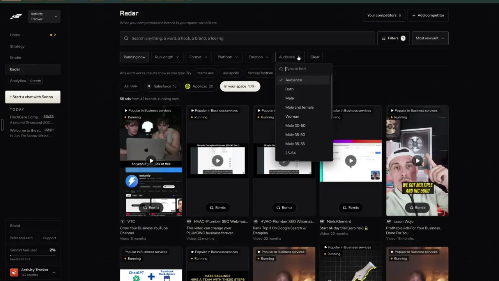

# Every saved post broken down

`find-ai-tagging` | find | phase 2 | status: partial | /north-star#find-ai-tagging

## Leo asked

No direct ask; from the competitor research.

## How the best do it

Fastlane tags the ads it collects, and Radar's filter row has "Running now", "Run length", "Format", "Platform", "Emotion" and "Audience" (notes-3.md F8, 3:47 to 3:52). The Audience list is searchable ("Type to find") and its values look like raw AI labels that were never merged: "Both", "Male", "Male and female", "Woman", "Male 30-50", "Male 35-50", "Male 35-55", "25-54". Leo did not open Emotion or Platform, so their values are unknown. A filter built on free-text tags gets messy fast, which is why every tag here comes from a fixed list.



The ad detail also carries a per-ad fit warning computed before any spend ("Not recommended: it is packed with text...", see `find-ad-detail`).

Others:

- Foreplay analyses every saved ad on save, with no button. The Ad Details drawer has "AI Analysis" with three sections, Emotional Analysis, Creative Targeting and Persona, and "See More" opens similar ads ([help](https://help.foreplay.co/articles/3042222-ai-analysis)). Every saved video ad is also transcribed for free; "Copy Transcript" copies it with timestamps, and a marker shows how long the ad stays on the problem before the product appears ([help](https://help.foreplay.co/articles/0985790-free-transcription)). A Competitor Hooks tab lists every tracked brand's hooks, lets you pin them and exports them as CSV ([help](https://help.foreplay.co/articles/2800395-competitor-hooks)). Image ads are sorted into 9 messaging styles such as "Before and After", "Facts and Stats", "Testimonial - Review" and "Us vs Them" ([post](https://www.foreplay.co/post/introducing-content-style-filters)).
- Sandcastles analyses a video for 1 credit, refunded if it fails within 3 hours. Cards move through "Queued for analysis", a progress bar ("may take a few minutes"), a green "Analyzed", or "Failed to analyze" with the reason, and "Out of credits". "Bulk Analyze" queues up to 100 on Pro ([help](https://help.sandcastles.ai/videos-deep-analyze), [credits](https://help.sandcastles.ai/credits-v3)).
- Virlo gives each hook a `usage_count`, how many posts use the same words, where 1 means original ([docs](https://dev.virlo.ai/docs/hooks)).
- OpusClip's search indexes transcript, topics, speakers, mood and key moments, filterable by People, Topics, Mood and Duration ([help](https://help.opus.pro/docs/article/opussearch.md)).
- Metered elsewhere: BigSpy reads the copy out of video ads at 100 a month on Starter and 1,000 on Growth ([pricing](https://bigspy.com/pricing)); Minea transcribes at 10 a month on Starter and 50 on Premium ([pricing](https://www.minea.com/pricing)); FastMoss extracts scripts at 10 or 20 videos a day by plan ([pricing](https://www.fastmoss.com/pricing)); Atria's transcripts are slow and use credits ([Atria docs](https://docs.tryatria.com/llms.txt)).

The pattern: transcript plus a few fixed tags written on save, shown on the card, filterable, and one tap from the remix.

## What we have today

- Top posts carry labels, but keyword rules decide them. `enrich(post, averages)` in `src/lib/postInsights.ts` picks topic (8 values) and angle (8) with regular expressions over the post's idea hook and caption (topic falls back to the creator's niche tags), and a psychological trigger the same way. Audience (7 values) is not read from the post at all: `deriveAudiences` maps the creator's audience and niche tags from `src/data/advisors.json`, so every post by one creator gets the same audience. `/swipe` filters by topic, angle and audience. Leo's standing rule says decisions like these go to Jev, so these are the part to replace.
- Top posts also carry an idea breakdown, `idea.hook`, `idea.why` and `idea.adapt`, written once per post by the free Claude CLI at drop time (`scripts/gen-ideas.mjs`).
- Ads carry a hook family that Jev picked at drop time (`ads-swipe-collect`, AdLauncher's seven families).
- Clone a reel (`/clone`, `supabase/functions/clone-reel`) reads a pasted Instagram or TikTok post's caption and transcript through Apify, caches them in `cs_reel_sources`, and writes a breakdown (hook, beats, payoff, CTA, why it worked) on request, for `reel-clone` 20 a day.
- Nothing tags a post when it is saved, nothing tags a Following post or a pasted link, and no page filters by hook or emotion. The transcript is never shown outside a clone.

Status partial: drop-time labels from keyword rules plus an on-request breakdown in Clone.

## Build

Scope: when a post is saved (`find-save-anywhere`), break it down without a button press: transcript, hook formula, angle, topic, feeling, audience, format and beats. Show the tags on the card, filter by them on `/saved`, and remix from a tag. Then put the same Jev tags on the weekly top posts, side by side with today's keyword rules first. All of it shows on Leo's sign-ins only (`leoOnly(email)`).

Build after `remix-teardown` and `find-save-anywhere`. The breakdown is `remix-teardown`'s `Teardown` (hook line and pattern, Jev's hook formula, beats, payoff, ask, why it worked), made by the `teardown` mode of `supabase/functions/remix`. This item adds four Jev tags to that same call and runs it on save, so there is one breakdown in the app, not two.

### Screens and states

Files:

- `supabase/functions/remix/logic.ts` and `index.ts` (from `remix-teardown`): the `teardown` mode accepts `tags: true`, adds four questions to its one Jev call, and returns `tags` with the teardown.
- `src/lib/postTags.ts` (new): the tag lists and labels, `tagsFromTeardown`, and the chain that asks for a teardown once a saved item's read is done.
- `src/lib/boards.ts` (from `find-save-anywhere`): store the tags on the item and start the chain.
- `src/pages/SavedPage.tsx`: tag chips on cards, the Breakdown block in the item drawer, tag filters.
- `scripts/tag-top-posts.mjs` (new): the same Jev tags for `src/data/topPosts.json` at drop time, run by `scripts/refresh-top-posts.mjs` after `gen-ideas.mjs`, the way it already chains `build-top-posts.mjs`, `fetch-covers.mjs` and `gen-ideas.mjs`.
- `src/lib/postInsights.ts`: `enrich(post, averages, { useTags })`, a third argument defaulting to false, prefers `post.tags` when it is true.
- `src/pages/SwipeFilePage.tsx`: builds the enriched list both ways at load (about 140 posts) and uses the Jev one when `leoOnly(email)`.
- `supabase/functions/_shared/usageCaps.ts`: one cap.

Card (on `/saved`): up to three chips under the caption, hook name first, then angle and feeling, for example "Myth bust", "Contrarian", "Worry", with unsure tags left off.

Item drawer, "Breakdown" block (the `remix-teardown` rows plus the tags):

```
Breakdown
Hook        Myth bust  "Everyone says clear your home loan early..."
Angle       Contrarian
Topic       CPF
Feeling     Worry
For         Young adults
Format      Reel, 42 s
How it is built
  1. Opens on a common belief, said to camera
  2. Shows one number that breaks it
  3. Explains why in two steps
  4. Ends asking viewers to comment their age
Transcript  312 words   [Copy transcript]   (collapsed, tap to open)
[ Remix with this hook ]
```

States:

- Waiting for the read: nothing extra; the card already shows "Reading the post".
- Breaking it down: chip "Breaking it down". The chain runs as a job outside React, so leaving the page does not stop it, and the result is written to the store when it lands. It starts in the same job as the read and sends the caption and transcript it just got as text (`basedOn: "transcript"`, the way `remix-teardown` takes a `link:` source), so the `remix` function never reads the post a second time. That matters for Instagram reels, which `clone-reel` scrapes and charges on every read. An in-app item (top post, ad, trend, format) sends its own text with no read.
- Done: the chips and the Breakdown block.
- Some tags unsure: those rows are left out of the block and the card; the rest show.
- Nothing to read (a link-only item with no note): in the Breakdown block, "Nothing to read on this link. Add a note, then tap Break it down." with the button "Break it down".
- Failed: chip "Couldn't break it down" and "Try again". The item and its read stay.
- Over the daily cap: chip "Breakdowns used up today. Try again after 8am." The item stays saved and can be broken down later from the drawer.
- Not English: tagged by the fallback (AI and cost), with a quiet line "Tagged without Jev" in the block so a reader knows why a tag may be off.
- No speech: for a picture post, or a video where nobody talks, the Transcript row reads "No speech in this post."

### Copy

- Card chip while running: "Breaking it down".
- Block heading "Breakdown". Row labels "Hook", "Angle", "Topic", "Feeling", "For", "Format", "How it is built", "Transcript".
- Hook row: the formula's `name` from `src/lib/hookFormulas.ts`, then the post's opening line in quotes, cut to 100 characters, or the opening line alone when there is no formula because Jev was unsure or answered "none".
- The Format row reads one of "Reel, 42 s", "Carousel, 8 slides", "Picture", "Video, 3 min", "Text" or "Link".
- The Transcript row shows "{n} words" with a "Copy transcript" button and a "Show transcript" / "Hide transcript" toggle when the transcript is in this device's cache. When it is not (another device, or evicted), the row shows "{n} words" and a "Load transcript" button with the hint "Uses 1 of today's reads", since loading it is a `clone-reel` read on the `reel-style` cap.
- Buttons: "Remix with this hook", and in the drawer menu "Break it down again". "Break it down" and "Break it down again" each carry the price chip "~US$0.01" (the page's rule for paid buttons), and switch to the chip from `business-cost-preview` once that item ships. The automatic breakdown on save has no button, so no chip.
- Filter labels on `/saved`: "Hook", "Angle", "Topic", "Feeling", "For", "Format", each a select with "All" first and counts.
- Feeling values, the same eight `find-ad-library` uses for ads: "Worry", "Hope", "Relief", "Pride", "Curiosity", "Urgency", "Trust", "Fun".
- Audience values: the seven slugs of the `/swipe` audience filter (fresh-grads, young-adults, parents, families, hnw, business-owners, advisors-recruitment) plus `general`, shown with the labels `find-ad-library` uses: "Fresh grads", "Young adults", "Parents", "Families", "High net worth", "Business owners", "Advisers and recruits", "General". The "All" option of the filter is the only one that means everyone. `/swipe` itself still shows the older labels from `AUDIENCES` in `postInsights.ts` ("Fresh Grads", "HNW", "Advisors / Recruitment"); leave those alone here.

### Data

On each saved item in `content-studio-boards-${scoped(userId)}`, copied from the teardown so it survives the teardown cache (which keeps only 40):

```
"tags": {
  "formula": "myth-bust", "angle": "Contrarian", "topic": "CPF", "emotion": "worry", "audience": "young-adults",
  "p": { "formula": 0.71, "angle": 0.64, "topic": 0.88, "emotion": 0.52, "audience": 0.58 },
  "format": "reel", "seconds": 42, "slides": null,
  "opening": "Everyone says clear your home loan early",
  "beats": ["Opens on a common belief, said to camera", "..."],
  "words": 312, "by": "jev" | "llm", "at": "2026-10-20T03:14:00Z"
},
"tagState": "pending" | "done" | "failed" | "capped" | "none"
```

- A tag under 0.5 is stored with its `p` and treated as unsure everywhere, the same cut `remix-teardown` uses for the formula and `find-ad-library` uses for labels.
- The transcript is not stored in the synced key. The drawer reads it from the device cache `cs-transcripts-<scope>` that `find-save-anywhere` fills when a read lands. Without it, "Load transcript" calls `clone-reel` with `style: true` again: free only for a TikTok or Instagram picture post read in the last 24 hours, and one `reel-style` use otherwise (an Instagram reel always scrapes).
- Top posts: `scripts/tag-top-posts.mjs` writes `tags: { formula, angle, topic, emotion, audience, p }` onto each post in `src/data/topPosts.json`, skipping posts that already have them. `buildTopPosts` in `scripts/build-top-posts.mjs` carries them over by `shortCode`, the way it keeps `idea` and `cover`. `refresh-top-posts.mjs` calls it after `gen-ideas.mjs` (the Sunday 21:00 `com.leo.top-posts-refresh` run), and `~/.local/bin/content-studio-drop.sh` loads `TYPESAFE_API_KEY` for the `top-posts` case too (today only `sg-feeds` and `industry-news` get it). Without the key the script writes nothing and the keyword rules stay.
- None of this needs a table or a schema change.

### AI and cost

The `teardown` mode with `tags: true`:

1. Charged to a new cap instead of `remix-teardown`'s, so saving does not eat the remix allowance. New `DAILY_LIMITS` entry `"post-tags": 60`, comment "A saved post broken down on save (remix teardown with tags): one OpenAI call and one Jev call." Refunded with `refundUsage` when the call fails.
2. The teardown's Jev call (jev-1.13.0) gains four `choice` questions on the same state:
   - `angle`: "What is this post's main angle?" Criteria: the 8 `ANGLES` from `postInsights.ts`, each with a one-line meaning.
   - `topic`: "What money topic is this post mainly about?" Criteria: the 8 `TOPICS` plus "Other".
   - `emotion`: "Which feeling does this post most try to stir in the viewer?" Criteria: word for word the eight from `find-ad-library`'s `label` mode (Worry "concern about a risk, a loss or a gap"; Hope "a better future within reach"; Relief "a burden taken off"; Pride "status, achievement or being smart"; Curiosity "wanting to know the answer"; Urgency "act now before it is gone"; Trust "safety, credibility, being looked after"; Fun "humour or delight"). Keep the list in one exported constant both items import.
   - `audience`: "Who is this post mainly speaking to?" Criteria: the `/swipe` audience slugs plus general "anyone, no clear group", as `find-ad-library` asks for ads.
   Keep each pick at 0.5 or more (proposed). Without a Jev answer the tags come back empty and the beats still show.
3. Non-English text (more than 30% of letters outside ASCII, which catches Chinese and Tamil; Malay in Latin script stays with Jev): the teardown's OpenAI call also picks the formula and the four tags from the same lists, and the result carries `by: "llm"`. This is the fallback Leo's Jev rule asks for.
4. Format, length and slide count come from the read (`is_video`, `duration_sec`) or the in-app source, never from a model.

Cost per saved post: the teardown's own estimate, about 1 US cent of OpenAI (unverified), plus the Jev call with four more questions, a fraction of a cent. The read before it is `find-save-anywhere`'s cost.

Top posts at drop time: `scripts/tag-top-posts.mjs` on Leo's Mac asks the four tag questions and the formula question per post (importing `supabase/functions/_shared/jev.ts` the way `scripts/sg-feeds.mjs` does). No OpenAI; the posts already have `idea` from the Claude CLI. About 140 posts the first week and only new ones after, well under 1 US cent a week.

Switching top posts from keyword rules to Jev (Leo's rule for live decisions):

1. `node scripts/tag-top-posts.mjs --compare` prints, per post, the keyword-rule topic and angle beside Jev's with its probability, and a count of disagreements.
2. Read every disagreement and note which side was right. Set the 0.5 cut from that read.
3. Only then does `SwipeFilePage` use Jev's tags, and only for `leoOnly(email)`. Everyone else keeps the keyword rules until Leo says "on for everyone". The keyword rules stay as the fallback for a post without tags.

### Deep links

- `/saved?hook=myth-bust`, `?angle=contrarian`, `?topic=cpf`, `?emotion=worry`, `?audience=parents`, `?format=reel` filter the Saved page (slugs; defaults left out). Replace. They combine with `board`, `platform` and `q`.
- `/saved?item=<id>#breakdown` opens an item and scrolls to its Breakdown (`useScrollToHash`).
- "Remix with this hook" goes to `remixUrlFor(item)` from `find-save-anywhere` with `formula=<id>` added; Write already reads `formula` (`docs/deep-links.md`, "Still read").
- Add the filter params to `links.saved` and to the `/saved` rows in `docs/deep-links.md`.

## Done when

- [ ] Saving a TikTok on Leo's sign-in ends, without another tap, with chips on its card and a Breakdown with beats and a transcript within about two minutes.
- [ ] A saved web link with a note gets a breakdown from the note after "Break it down".
- [ ] `/saved?hook=myth-bust` shows only items tagged Myth bust, and the filter survives a reload.
- [ ] "Remix with this hook" opens Write with that formula picked.
- [ ] The 61st breakdown in a day shows the cap chip and spends nothing, and the `remix-teardown` allowance is untouched by saves.
- [ ] A Chinese-language caption is tagged by the fallback and shows "Tagged without Jev".
- [ ] `--compare` was run on the real top posts, the disagreements were read, and the cut was set from them before `useTags` was turned on for Leo.
- [ ] Another sign-in sees the same Top posts labels as before.
- [ ] Checked by eye at 390 px and 1440 px; `npm run build` and the full `npx vitest run` pass; `find-ai-tagging` flipped in `src/data/northStar.ts`.

## Tests

- `supabase/functions/remix/logic.test.ts`: with `tags: true` the Jev ask has the formula question plus four tag questions with the right option ids; without it, only the formula question; picks under 0.5 come out unsure; an unknown option is dropped; the non-English check sends Chinese and Tamil text to the fallback and keeps English and Malay with Jev; `tags: true` charges `post-tags`, not `remix-teardown`.
- `src/lib/postTags.test.ts`:
  - every formula id, angle, topic, feeling and audience has a label;
  - `tagsFromTeardown` copies the fields and keeps unsure ones out of the chips;
  - the chain waits for `read` to turn `done`, then sends the caption and transcript as text with `basedOn: "transcript"` and no post URL, so the `remix` function cannot start a second scrape;
  - filtering by a tag leaves out the items where Jev was unsure of it.
- `src/lib/postInsights.test.ts` (existing): `enrich` with `useTags: true` uses `post.tags` and falls back to the keyword rules for a post without them; with `useTags: false` nothing changes.
- `scripts/tag-top-posts.test.mjs` (new): it skips posts that already have tags, and `--compare` counts disagreements on a fixture.
- `scripts/build-top-posts.test.mjs` (existing): `tags` carry over by `shortCode` from the previous file, as `idea` and `cover` do.
- `supabase/functions/_shared/usageCaps.test.ts`: `post-tags` is 60.

## Open questions

- Hook originality, as Virlo counts it, needs every saved post's opening line compared across users, which means a shared table, so it is Leo's call.
- Visual style (talking head, wall of text, green screen) needs the video, and Jev reads text only. Gemini already watches an exported file in the video editor at about USD 0.07 for a 40 s reel ("Watch it like a viewer", the watch mode of `supabase/functions/video-assist`, cap `video-watch` 30 a day). Leo decides whether that is worth it per saved post.
- Should breaking down on save stay automatic once advisers pay per use? Sandcastles makes it a 1-credit opt-in per video; Foreplay does it free on save. Automatic suits the Leo-only phase.

## Related

find-save-anywhere, find-ad-detail, find-outlier-score, find-niche-feed, remix-teardown, remix-patterns, learn-format-winners, edit-snippets
