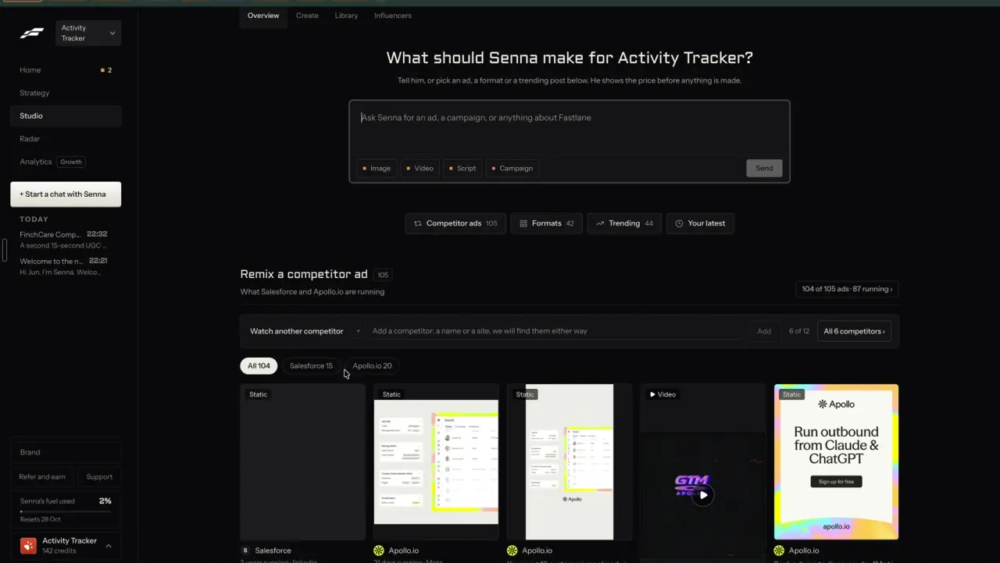
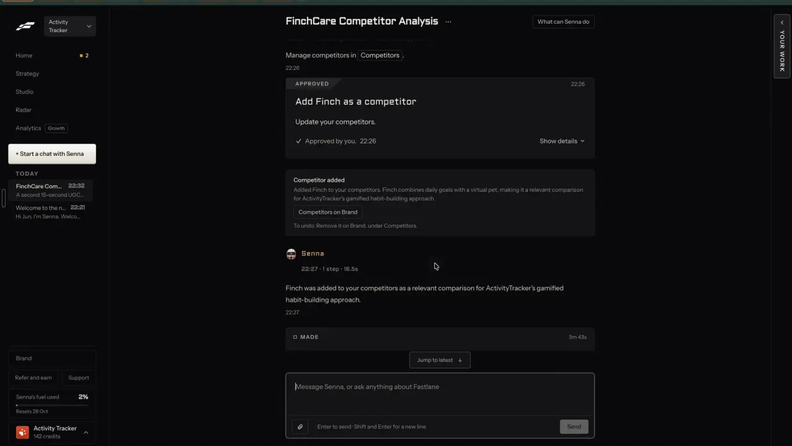

# Key in your competitors

`find-competitors` | find | phase 2 | status: live (Leo's sign-ins, 20 Oct 2026) | /north-star#find-competitors

## Leo asked

- 19 Oct 2026: "find ways where one can key in their competitors and the app will scrape their ads and top performing social media posts"
- 15 Oct 2026: "embed it within the tool so it depends on the person's market/website"

This item is the first half of the 19 Oct ask: the list of competitors. Their ads (`find-competitor-ads`) and their posts (`find-competitor-posts`) read from it.

## How the best do it

Fastlane puts a watch bar at the top of Studio's competitor section. Label "Watch another competitor", a "+" box, the input placeholder "Add a competitor: a name or a site, we will find them either way", an "Add" button that stays grey until you type, the counter "6 of 12" (6 watched, cap 12) and a button "All 6 competitors >". The account was on the Starter plan; whether 12 changes by plan is not shown.



Brand > Competitors lists each one with a logo (2-letter initials until it loads), the name, the domain and one line on why a buyer would compare them with you, written relative to your product, as in "Wise Agent / wiseagent.com / Small real-estate teams may weigh Wise Agent against ActivityTracker because it is a contract-free real-estate CRM priced at $49 per month with ...". The card header reads "Competitors 6" with a "+ Add" button, and the list ends in "Show 1 more".


You can also add one in chat. Leo typed "my competitors are finchcare app, and finchcare app"; Senna answered with an approval card "Add Finch as a competitor / Update your competitors", added it once (it removed the repeat), and left a receipt: "Competitor added / Added Finch to your competitors. Finch combines daily goals with a virtual pet, making it a relevant comparison for ActivityTracker's gamified habit-building approach. / Competitors on Brand / To undo: Remove it on Brand, under Competitors."



Others:

- Foreplay Spyder adds a brand three ways: search its index, paste the brand's Facebook Ad Library URL under "Add Manually", or "Track Brand in Spyder" from a brand avatar. Workflow plan 15 brands, Agency 50. Sources: [help](https://help.foreplay.co/articles/1041267-track-competitor-with-spyder), [pricing](https://www.foreplay.co/pricing).
- Atria follows by brand id, advertiser id or Ad Library URL. Over quota it keeps the newest follows and locks the oldest (still listed, flagged locked). Core 50, Plus 100, Business 200. Sources: [API](https://docs.tryatria.com/reference/follow_inspo_brand.md), [pricing](https://www.tryatria.com/pricing).
- Motion: when a brand is missing, "Add a missing brand" and paste its Facebook page or Ad Library link. [Source](https://help.motionapp.com/en/articles/12589123-getting-started-with-inspo-in-motion).
- MagicBrief warns that history starts the day you add a brand, so the first day only shows ads live that day. [Source](https://support.magicbrief.com/articles/9441630012-brand-tracking).
- Planable's listening add-on suggests competitors and caps them at 3 per workspace. [Source](https://planable.io/pricing/).

## What we have today

Checked against origin/main 08537d1 and again at f2cb275 (2026-10-20; nothing here changed).

- `/following` (`src/pages/FollowingPage.tsx`, `src/lib/following.ts`, edge fn `track-accounts`): up to 5 public Instagram or TikTok accounts per brand (`MAX_FOLLOWED = 5`), stored in the synced key `content-studio-following-<scoped(userId)>`. The file's header calls them "competitors or creators", but it is a list of handles, not of businesses: no name, website, logo, Facebook page or reason. Cap `track-accounts` 10 a day.
- `/plan` has "Reference competitors" (`src/components/CompetitorReference.tsx`, `src/pages/PlanPage.tsx`): pick up to 3 from the 66 hand-picked creators in `src/data/advisors.json`, or paste any Instagram handle or profile link (`parseInstagramInput`, `customInstagramRef`) with an optional note on what you like about them. Write (`/generate`) has the same picker for one reference. The creator's style notes go into the prompt ("Match the ANGLE and structure of ..."); nothing is scraped and nothing is kept as a list.
- `/market` (`src/lib/market.ts`, Leo only through the `MARKET_USERS` secret) stores your own name and site, not competitors'. Its header says competitors live in Following. Each check asks ChatGPT the brand's questions through DataForSEO, and every answer keeps `named`: "Advisers, firms and brands the answer recommends" (`GeoRead.named` in `supabase/functions/market/logic.ts`), stored in `MarketState.checks[].geo[]`. These are real rivals the buyer is shown, already paid for, and nothing reads them as competitors yet.
- `brand-dna` reads one website safely (public host check, redirects re-checked, body capped) and finds the name, logo and Instagram, Facebook, LinkedIn and TikTok handles in the markup (`readSite` in `supabase/functions/brand-dna/logic.ts`; no YouTube). The guarded fetch (`publicHost`, `fetchCapped`) lives in `brand-dna/index.ts` and is not exported. `publicHost` uses `privateIp` from `brand-dna/logic.ts`, and `fetchCapped` uses `safeFeedUrl` from `supabase/functions/feed-ideas/logic.ts`. Its `logoOf` downloads the logo as a data URL of up to 250 KB, which is right for one brand kit and too big for 12 rows in a synced key. `brand-dna` has its own cap (10 a day) and gives no use back on failure.
- No competitor list, no suggestions, no "why they compare you" line. Status partial because Following covers handle tracking and Plan covers style references only.
- The gate `leoOnly` (`src/lib/leoOnly.ts`, `LEO_EMAILS`) and the `/north-star` page sit in the north-star worktree and are not on origin/main (checked at f2cb275 on 2026-10-20), so build on them once they land.

## Build

A new Leo-only page `/competitors` under Discover. This item builds the page shell, the add bar and the "Who you watch" view. `find-competitor-ads` and `find-competitor-posts` add the other two views to the same page.

### Screens and states

Page shell (all views):

```
Competitors
[+] Add a competitor: a name, a website or a social link      [Add]   6 of 12
[ Their ads 104 ] [ Their posts 212 ] [ Who you watch 6 ]
```

Who you watch (`?view=list`):

```
Who you watch                                   6 of 12
SL  Singlife         singlife.com    Advisers here get compared with ...   v
JT  Josh Tan         @joshconsultancy  Parents weigh his free videos ...    v
...
Suggested for you                    [Suggest competitors]  Up to US$0.02
PR  Prudential Singapore  prudential.com.sg  Why ...     [Add] [Not them]
```

Expanding a row (chevron, or `?edit=<id>`) shows editable fields: Name, Website, Facebook page or Ad Library link, Instagram, TikTok, LinkedIn, YouTube, Why buyers compare you, Ads shown in (Singapore / Anywhere), with "Save" and "Remove" under them.

States:

- Empty: no competitors yet. The view defaults to `list` and shows the empty line and the "Suggest competitors" button as the main action.
- Adding: the row appears at once with a spinner and "Finding them..." (feedback inside 400 ms). The read runs as a module-level job in `src/lib/competitors.ts`, so leaving the page keeps it going.
- Done: logo (or initials), name, site or handle, the why line. Rows added by typing have no why line yet (no AI call is made for them); the why cell shows the link "Add why" that opens the editor, while suggested rows carry the AI's line.
- Needs a pick: a name matched more than one result. The row shows up to 3 choices and "None of these".
- Not found: the row opens in edit mode under "We couldn't find their website or pages. Add a link."
- Duplicate: toast "You already watch Singlife.", matched by site host, Facebook page id or any handle.
- At the cap: the Add button is disabled and the helper reads "12 of 12. Remove one to add another."
- Over the daily cap (429 `daily_limit`): a toast shows the server's message and the row stays open in edit mode, so a pasted link still works because links need no server call.
- Refused (403 `not_allowed`): "Competitors is not switched on for this account."
- Failed (5xx or timeout): "Couldn't read their site. Try again in a few minutes." with "Try again".
- Suggesting: the button reads "Suggesting..." and is disabled. Done: up to 6 cards. Nothing kept: "No clear competitors found. Add one you know."
- Removed: toast "Stopped watching Singlife" with "Undo".

Gate: nav entry with `owners: LEO_EMAILS`, and the page returns `<NotFoundPage />` when `!leoOnly(email)` (copy the `getSession` pattern in `src/pages/NorthStarPage.tsx`). The edge function also checks the caller.

### Copy

- Nav label and h1: "Competitors"
- Add bar placeholder: "Add a competitor: a name, a website or a social link"
- Add button: "Add". When the typed text parses as a bare name (the only add that pays a provider), a chip "Under US$0.01" shows beside it. A site calls the server too, but only uses the free daily cap, so it has no chip; links and handles make no server call.
- Counter: "6 of 12"
- View tabs: "Their ads", "Their posts", "Who you watch"
- Empty: "Nobody yet. Add a competitor above, or let us suggest some from your brand."
- Suggest button: "Suggest competitors", busy "Suggesting...", price chip "Up to US$0.02"
- Suggestion buttons: "Add", "Not them"
- Row states: "Finding them...", "Which one?", "None of these", "We couldn't find their website or pages. Add a link.", "Add why"
- Edit labels: "Name", "Website", "Facebook page or Ad Library link", "Instagram", "TikTok", "LinkedIn", "YouTube", "Why buyers compare you", "Ads shown in", "Singapore", "Anywhere", "Save", "Remove"
- Toasts: "You already watch {name}.", "Stopped watching {name}", "Undo", "Competitors is not switched on for this account."
- InfoTip beside "Who you watch": "Up to 12 per brand. Each brand keeps its own list."

### Data

Synced key `content-studio-competitors-<scoped(userId)>`, one per brand, written whole (like Following, so a removal stays removed without a tombstone):

```ts
// src/lib/competitors.ts
export const MAX_COMPETITORS = 12;
export interface Competitor {
  id: string;                 // slug(name) + "-" + 4 random chars, never reused
  name: string;               // 80 chars max
  site: string | null;        // host only, "singlife.com"
  logo: string | null;        // first of readSite's `logos` (an https link, not logoOf's data URL); initials when it fails to load
  why: string;                // 200 chars max, typed or written by the AI
  fbPageId: string | null;    // from an Ad Library link (view_all_page_id)
  handles: { facebook?: string; instagram?: string; tiktok?: string; linkedin?: string; youtube?: string };
  adsCountry: "SG" | "ALL";   // default "SG"
  source: "typed" | "suggested" | "website";
  addedAt: string;
}
export interface CompetitorsState { list: Competitor[]; dismissed: string[] } // dismissed: lowercased names, 200 max
export function addCompetitor(userId: string, c: Omit<Competitor, "id" | "addedAt">): { ok: true; c: Competitor } | { ok: false; reason: "duplicate" | "cap" };
```

This item owns the list's shape. `brand-from-website` also adds competitors (ticked in its website review), and its spec already writes through `addCompetitor()` with `name`, `site`, `why` and `source: "website"`, so there is one shape and one cap. Whichever item ships first creates `src/lib/competitors.ts`. Everything lives in the synced key, so there is no new table and no schema change.

### AI and cost

New edge function `supabase/functions/competitors/` (`index.ts`, `logic.ts`, `logic.test.ts`), JWT on. It checks `isAllowed(Deno.env.get("NORTH_STAR_USERS"), uid)` (reuse `isAllowed` from `supabase/functions/market/logic.ts`) before any paid call and answers 403 `{ code: "not_allowed" }`. Secret `NORTH_STAR_USERS` = Leo's two uids (40f07a18-b087-4c95-ba1f-d5444222968a, 13b28b1d-2ecb-40be-b3a9-aefc90366f9b). Other items add modes to this function.

Move `publicHost` and `fetchCapped` from `brand-dna/index.ts` to a new `supabase/functions/_shared/safeFetch.ts` and import them from both functions. Move `privateIp` with them (re-export it from `brand-dna/logic.ts` so its tests keep their import), and import `safeFeedUrl` from `../feed-ideas/logic.ts` as brand-dna does today. The move keeps every guard; `brand-dna` tests stay green. The deployed brand-dna keeps its bundled copy until it is next deployed, so nothing live changes until then; redeploy it in the same change.

Mode `read`, body `{ mode: "read", input }`:

1. `parseInput(input)` in `competitors/logic.ts` (pure, also imported by the app): an Ad Library URL with `view_all_page_id` gives `fbPageId`; facebook.com, instagram.com, tiktok.com, linkedin.com/company, youtube.com/@ links and `@handle` give a handle; a string with a dot and no spaces is a site; anything else is a name. The app handles links and handles itself with no server call.
2. Site: safe fetch of the home page, then `readSite` for name, logo and handles. Free apart from the cap.
3. Name: one DataForSEO Google organic search (`serp/google/organic/live/regular`, `location_code` 2702, depth 10; secrets `DATAFORSEO_LOGIN` and `DATAFORSEO_PASSWORD` already set for `market`), about US$0.002 (unverified). Market's `dfs` POST helper is private to `market/index.ts`; move it to `supabase/functions/_shared/dataforseo.ts` in the same change as the `pool` move below. Jev picks the official result from the top 5, then step 2 runs on it.

Jev question `site` (choice), state `{ name, country: "Singapore", results: [{ key, title, url, snippet }] }`:

- instructions: "Which search result is the official website or main social page of the business or person called `name`?"
- criteria: one entry per result key (its title and url), plus `none`: "None of these is clearly theirs."
- Accept when the pick is not `none` and its probability is 0.6 or more. Between 0.4 and 0.6, show the top 3 as "Which one?". Below that, or Jev returns null, show "Not found".

Cap `competitor-read`: 20 a day per user, consumed only for a bare name or a site. When DataForSEO or the site read fails, give the use back with `refundUsage(admin, uid, "competitor-read", day)`, where `day` is the UTC day read before the call (`utcDay` in `market/logic.ts`), as `market` does.

Mode `suggest`, body `{ mode: "suggest", brand: { name, site, sells, serves, topics }, candidates, exclude }`. Market's own `suggest` action (`SUGGEST_FORMAT`, `suggestMessages`, `parseSuggest` in `market/logic.ts`: the LLM writes candidates, Jev keeps the ones that fit) is the pattern to copy:

1. The app builds up to 80 candidates from what we already know is real: the names in Your market's last 3 checks (`loadMarket(userId).checks[].geo[].named`, this brand's own ChatGPT answers, listed first), the 66 creators in `src/data/advisors.json` (name, handle, platform, company, why_follow) and the 7 advertisers in `src/data/adsSwipe.json`. `brand` is read from three stores the app already has: brand kit, F.A.D.S. and Your market.
2. The LLM (`openaiChat`, `OPENAI_MODEL`, JSON schema) proposes up to 8 more `{ name, site }` from the brand's own words. Each site must answer a safe fetch with a 200, so an invented domain is dropped.
3. Jev scores every candidate, 10 at a time as `market` does. Its `pool` helper is private to `market/index.ts`; move it to `supabase/functions/_shared/pool.ts` and import it in both functions (market's tests stay green). Keep 0.6 and up, best first, 6 at most, minus anything in `exclude` (current list and `dismissed`).
4. One more LLM call writes the why line for the kept ones: JSON `[{ key, why }]`, 160 characters max, about the buyer and the shared need, no figures, no promises.
5. Jev null: refund the use and return `{ suggestions: [], note: "Suggestions are unavailable right now. Add one you know." }`.

Jev question `compare` (noul), state `{ brand, sells, serves, country: "Singapore", candidate: { name, about } }`:

- instructions: "Would someone deciding whether to buy from `brand` also look at `candidate` as another option for the same need?"
- Threshold 0.6, proposed. Before turning it on, run it on Leo's three brands with 20 hand-labelled candidates each and set the cut from the disagreements.

Cost per suggest run: two LLM calls (about US$0.01, unverified for the current `OPENAI_MODEL`), up to 88 Jev questions (well under US$0.001), up to 8 site reads (free). Cap `competitor-suggest`: 5 a day per user.

Add both caps to `DAILY_LIMITS` in `supabase/functions/_shared/usageCaps.ts` with a one-line comment each, like the others.

### Deep links

- `/competitors`: default view is `ads` when the brand has a competitor, `list` when it has none.
- `/competitors?view=list`: Who you watch.
- `/competitors?view=list&edit=<competitorId>`: opens that row's editor (push; Back closes it).
- Add a `competitors` builder to `src/lib/links.ts`, rows for `/competitors` to `docs/deep-links.md`, and a CopyLinkButton on an open editor. `?profile=<id>` keeps working.

## Done when

- [ ] `/competitors` is in Discover for Leo's two sign-ins only, and a typed URL on any other account shows the 404 page.
- [ ] Pasting an Ad Library link, a Facebook, Instagram, TikTok, LinkedIn or YouTube link, or `@handle` adds a row with no edge call (checked in the network tab).
- [ ] Typing `singlife.com` adds Singlife with its logo and the handles found on its home page.
- [ ] Typing a bare name either adds the right business, asks "Which one?", or says "Not found"; it never adds a made-up site.
- [ ] The 13th add is blocked with "12 of 12. Remove one to add another."
- [ ] Remove, then Undo, restores the row; remove and reload keeps it removed on a second device.
- [ ] "Suggest competitors" returns up to 6 cards with why lines; "Not them" hides a card for good on that brand.
- [ ] Each brand has its own list (switch brands, the list changes).
- [ ] A non-Leo uid calling the function gets 403 and spends nothing.
- [ ] `competitor-read` and `competitor-suggest` are in `usageCaps.ts`; a 429 shows the server's message.
- [ ] `brand-dna` and `market` are redeployed after the `safeFetch.ts`, `pool.ts` and `dataforseo.ts` moves, `market` still answers its free `{ action: "status" }` probe, and one "Add a brand from its website" read works on Leo's sign-in. Do not run a paid market check to test the move.
- [ ] `docs/deep-links.md`, `src/lib/links.ts`, `src/lib/nav.ts`, `src/lib/jumpTo.ts` (keywords "competitors rivals") updated.
- [ ] Checked by eye at 390 px and 1440 px; `npm run build` and `npx vitest run` pass.
- [x] `src/data/northStar.ts` item flipped with its `ours` line.

## Tests

- `supabase/functions/competitors/logic.test.ts`: `parseInput` for each link shape above, `https://www.singlife.com/en/`, `singlife.com`, `Singlife`, empty input and `javascript:` (null). Proves the app and server agree on what costs a call.
- Same file: the `site` pick rule (0.6 accept, 0.4 to 0.6 ask, below or null not found), and the suggest filter (threshold, exclude list, top 6, Jev null gives an empty list).
- `supabase/functions/competitors/index.test.ts`: a uid outside `NORTH_STAR_USERS` gets 403 and `consumeUsage` is never called.
- `src/lib/competitors.test.ts`: add, duplicate by host or handle, cap 12, remove and undo, dismissed, and the key is `content-studio-competitors-` + `scoped(userId)`.
- Same file: the suggest candidates put Your market's `named` brands first, drop names already on the list or in `dismissed`, dedupe by lowercased name and stop at 80.
- `brand-dna` tests still pass after the `safeFetch.ts` move, and `market` tests after the `pool.ts` and `dataforseo.ts` moves.
- `src/lib/nav.test.ts` and `src/lib/navRoutes.test.ts`: the new route, and the More sheet for someone@example.com unchanged.

## Open questions

- Cap: 12 per brand copies Fastlane. Leo decides whether advisers get fewer when this opens to everyone.
- Over the cap, block (built here) or lock the oldest like Atria? Leo.
- Should Plan's "Reference competitors" read this list instead of the hand-picked creators? Decide when `plan-content-plan` is built.
- Adding a competitor from the in-app assistant with a confirm card, as Fastlane does in chat, belongs to `agent-chat`: a new action in `supabase/functions/assistant-act` and `src/components/feedback/AssistantDock.tsx` that calls `addCompetitor()`.
- The DataForSEO price per name lookup is unverified; check the first invoice line.
- `brand-from-website` now reuses this item's `suggest` mode behind the same button and dropped its own Google search. Adding Google results for the brand's main search words as more candidates would cost one DataForSEO call a run; left out until the first runs show the candidates are too thin.
- Which server gate: this spec and most others use the `NORTH_STAR_USERS` uid secret with `isAllowed` (the `MARKET_USERS` pattern); `remix-everywhere` proposes `REMIX_USERS` and some specs an email list in `_shared/leoOnly.ts`. The first to ship picks one and the rest follow it. This spec picks `NORTH_STAR_USERS`.

## Related

find-competitor-ads, find-competitor-posts, find-ad-library, find-creators, brand-from-website, learn-benchmark, agent-chat, agent-approvals
