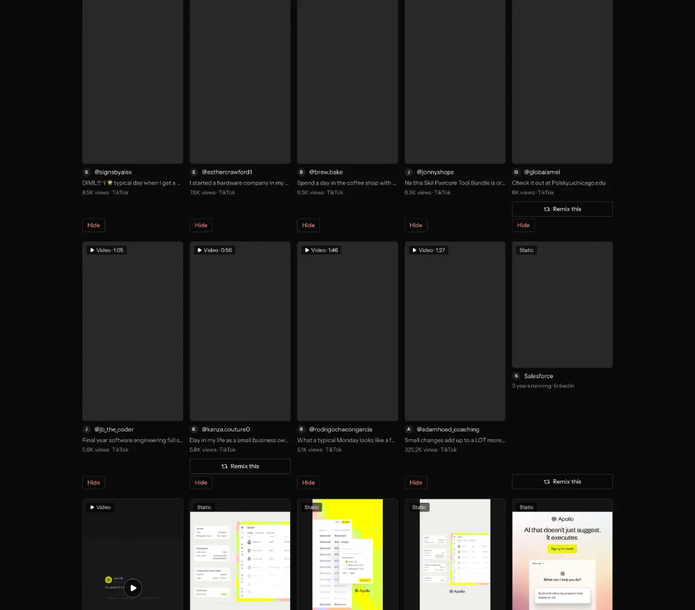

# Creators to learn from

`find-creators` | find | phase 2 | status: partial | /north-star#find-creators

## Leo asked

No direct ask; from the competitor research.

His 19 Oct 2026 ask about keying in competitors is specced in find-competitors and find-competitor-posts. This item shares their Follow plumbing (`track-accounts`), but creators you learn from are not competitors, so the quote is not used here.

## How the best do it

Fastlane shows no creator pages in the recording. Its Studio feed "Remix trending posts" ("Top organic posts in your niche this week", 44 posts) names no creator at all: each card has a duration, "TikTok", a cut caption, views, likes and, on some, "Remix" at "390 credits".


Its Library's inspiration cards (Leo's FireShot capture, not the video) name the creator only as a handle line. In the capture below a card reads "@adamhoad_coaching", a cut caption, "325.2K views . TikTok", with "Remix this" on some cards and a red "Hide" on each organic post card; the ad cards ("Salesforce", "3 years running . linkedin") carry "Remix this" only. Nothing opens a creator to show what works for them. The Studio tab "Influencers" is about AI influencers ("AI influencers are made in Studio"), which is the item people-presenters.



The only account list Fastlane keeps is competitors, capped at 12 a workspace ("6 of 12" beside "Watch another competitor", t080), which find-competitors covers.

Other competitors:

| Competitor | What they do | Numbers | Source |
| --- | --- | --- | --- |
| Vamos | Creator search in two modes, Topic (accounts in a subject) and Account (@handle, name or profile link), then "Follow". An empty search shows suggestions grouped by topic with "Follow all"; "Similar creators" finds lookalikes. Each creator page shows followers, typical views, posting frequency, best video length and hit rate, with a sort from "Most recent" to "Outlier score". A scan takes "a minute or two per creator". | 20 Free, 70 Pro, 150 Business creators per workspace | [watchlists](https://intercom.help/getvamos/en/articles/13004806-watchlists-track-creators-and-competitors), [plans](https://intercom.help/getvamos/en/articles/13004516-plans-credits-and-prices) |
| Eden (2026 entrant) | Study a creator: their top posts, the hooks and formats they reuse, sorts "Top liked" and "Top outlier". | Tracked creators: 10 Starter, 40 Pro, 100 Max | [site](https://eden.so/), [pricing](https://eden.so/pricing) |
| ViralBrain (2026 entrant) | "Discover Heroes" finds top LinkedIn creators in your niche and reads their structure and tone. | Free 3 heroes; Pro 10 heroes; 10 posts per hero free, 20 paid | [site](https://www.viralbrain.ai/), [pricing](https://www.viralbrain.ai/pricing) |
| Sandcastles | Channels page in four modes: Suggested ("More like this"), Describe (free text plus Platform and Account size from Nano to Mega), Search (Exact or Approximate matches) and Add URL (paste many links, "Parse", "Add all"). | New channels per month: Pro 100, Visionary 150, Titan 250; Starter cannot add | [channels](https://help.sandcastles.ai/channels-4-modes), [plans](https://help.sandcastles.ai/plans) |
| Foreplay | Discovery > Experts tab lists respected ad professionals; you open one and save ads from their own swipe file. Experts apply by form. | No stated plan limit | [help](https://help.foreplay.co/articles/5574859-foreplay-experts) |
| EasyGen | Creator search that shows which of a creator's posts did best and why, then adapts the approach in your voice. | not published | [site](https://www.easygen.io/) |
| Trendpop | Finds fast-growing creators in a niche from creator-level engagement, for TikTok. | Starter $250/mo in 2022; on request in 2026 | [argil](https://argil.ai/blog/viral-finder) |
| TikTok Creative Center | Trending creators filtered by audience region and follower count, with their top videos. Only Creator Marketplace members above set thresholds are listed. | Free with a TikTok for Business login; signed out shows a short preview | [metricool guide](https://metricool.com/tiktok-creative-center/), [moda](https://moda.app/blog/tiktok-creative-center) |

The moves that fit advisers are Vamos's one-tap follow from a suggestion, its small creator stats (typical views, best format, hit rate) and Eden's list of the hooks a creator reuses. Sandcastles' describe-your-niche search needs a search index we do not have; that belongs to find-viral-search.

## What we have today

Checked against 08537d1, then re-checked on origin/main f2cb275 on 20 Oct 2026.

- `/profiles` (`src/pages/ProfilesPage.tsx` rendering `src/components/AdvisorProfiles.tsx`) lists 66 hand-picked Singapore finance creators from `src/data/advisors.json`: 48 on Instagram, 7 on YouTube, 5 on TikTok, 4 on LinkedIn and 2 on Facebook. Each has a company, audience tags (mostly the Plan audiences: working-adult 50, young-adult 41, parent 14, pre-retiree 14, plus a few others), niche (8 parent groups in `src/lib/nicheGroups.ts`), a "why follow" line and style notes, and the entries were last checked on 2026-04-29 (34 creators), 2026-06-05 (1) and 2026-07-01 (31). Filters are `q`, `company`, `platform`, `audience`, `niche` and `saved`. The list is split into three tier sections, "Financial advisors", "Finance creators & media" and "Firms & institutions", in data order inside each, with no sort control.
- `/profiles/:id` (`src/pages/ProfileDetailPage.tsx`) shows the creator with one main button, "Open profile" (the gradient button linking to `platform_url`), and their top posts as `TopPostCard` with "Remix this" and, on videos, "Clone this reel". `getTopPostsForAdvisor` matches by handle, so the 47 handles in `src/data/topPosts.json` give top posts to 51 creator pages (a creator listed on two platforms under one handle shows the same posts on both). The file holds 136 posts, 2 to 5 of each creator's best, so any stats from it describe a creator's hits, not their average. It is refreshed weekly by `scripts/refresh-top-posts.mjs` (launchd `com.leo.top-posts-refresh`, Sundays 21:00, Apify about US$0.75 a run).
- The analysis of what works for a creator already exists, but only on `/analytics` in Creator lookup (`src/components/CreatorLookup.tsx`): `analyzeCreator` in `src/lib/creatorAnalysis.ts` returns average likes and comments, format stats, plain-words insights and the best post with "Remix their best post in Write". Its live fallback for any public Instagram handle, `analyze-ig-creator`, is deployed on the shared academy project, not from this repo (copy in `supabase/snapshots/functions/analyze-ig-creator/index.ts`). It has no entry in `usageCaps.ts`, but the function itself refuses more than 10 uncached lookups per user an hour.
- `/following` (`src/pages/FollowingPage.tsx`, `src/lib/following.ts`, edge fn `track-accounts`, cap `track-accounts` 10) follows up to 5 public Instagram or TikTok accounts per brand (`MAX_FOLLOWED`), keeps 12 posts a check (`POSTS_PER_CHECK`, asking Apify for 15), and offers Remix per post. `followStats(a)` already computes followers, 30-day growth, posts a week and the best post. The add logic (`normalizeHandle`, duplicate check, the 5 cap, `saveFollowing`, then `runCheck`) lives inside the page's `add` handler, so no other page can follow anyone.
- A fit sort already exists for posts: `/swipe`'s "Best for you" uses `personalTargetFromPositioning` and `personalMatch` in `src/lib/postInsights.ts`, a keyword match of the Plan audience and topics. It is shown only when the brand has a Plan positioning. Nothing scores creators.

So the gaps are a Follow button where you meet a creator, "what works for them" on the creator page, a sort by fit to your brand, and a short list of similar creators.

## Build

Everything new sits behind `leoOnly(email)` from `src/lib/leoOnly.ts`; other accounts see today's pages unchanged.

### Screens and states

On `/profiles`, each card for an Instagram or TikTok creator (53 of the 66) gets a "Follow" button. Cards for YouTube, LinkedIn and Facebook creators get no button, so the list does not carry 13 dead buttons; the reason shows on their creator page instead. A new sort control offers "Best for you" when the brand has a Plan positioning (the rule `/swipe` uses: `personalTargetFromPositioning` returns a target). With `sort=for-you` the list drops the three tier sections and shows one ranked list. Cards Jev rates at 0.6 or above carry a "Good fit for you" chip.

```
/profiles?sort=for-you
Sort: [Best for you v]          (Sorting by fit...)
+-------------------------------------------+
| Sean Tan                 Good fit for you  |
| @seantalkssg . Instagram . Young adults    |
| <why follow line>                          |
| [Follow]                                   |
+-------------------------------------------+
```

On `/profiles/:id`, "Follow" becomes the header's main button for Instagram and TikTok creators, and "Open profile" drops to the outline style beside it, so the page keeps one main button. For other platforms "Open profile" stays the main button and a disabled "Follow" sits beside it with its reason underneath. Below the header come three new blocks.

```
<creator name>                               [Follow]
What works for them (i)                    #works
 Average likes <n> . Average comments <n> . Best format <format> . Posts read <n>
 Angles they use most: <angle> (<n>), <angle> (<n>)
 How their posts are built: <structure>, <structure>
 - <insight lines from analyzeCreator>
 [Remix their best post]
From your last check   (only when you follow them)
 Followers <n> . +<n> in 30 days . <n> posts a week   Open in Following
More creators in Investing                  See all
 4 cards
Top posts (existing)
```

"What works for them" renders `analyzeCreator(entry)` through a new `src/components/CreatorInsights.tsx`, which is the result card moved out of `CreatorLookup.tsx` so both pages share it. The angle and structure counts come from `enrich(post, advisor)` in `src/lib/postInsights.ts` (its `angle` and `structure` fields), which `/swipe` already runs on each top post. "Remix their best post" is today's `buildRemixUrl` link. Once `remix-everywhere` has shipped, it is wrapped as `<RemixButton source={...}>{link}</RemixButton>` (that component's props are `source` and `children`) with the best post's existing `top:<advisorId>-<shortCode>` key, so this item adds no new source kind.

"From your last check" reads `followStats(a)` from `src/lib/following.ts` for the followed account with the same platform and handle.

"More creators in <group>" uses the group of the creator's first niche (`nicheGroup` in `src/lib/nicheGroups.ts`) and shows up to 4 other creators in that group, ordered by fit when a fit result is cached and by data order otherwise, with "See all" linking to `/profiles?niche=<group slug>`.

| Where | State | What shows |
| --- | --- | --- |
| Follow | Idle | "Follow" |
| Follow | Not Instagram or TikTok | On the creator page only: button disabled with the reason under it, "Following reads Instagram and TikTok accounts only." List cards show no button |
| Follow | Added | Button turns to "Following" within 400 ms; toast "Following @handle. Their newest posts load in a minute." with action "Open Following" |
| Follow | Already followed | Button reads "Following" and links to `/following` |
| Follow | Five already followed | Following's existing toast, "You can follow up to 5 accounts" with "Remove one first.", plus the action "Open Following"; nothing is added |
| Follow | Over the `track-accounts` cap | The account is added and its check fails with the standard refusal; the line under the button reads "Their posts load after 8am, when today's checks reset." |
| Follow | Check failed (private or missing account) | The line under the button shows the `checkFailure` message, the same text Following shows |
| Best for you | Sorting | "Sorting by fit..." beside the control, list in data order meanwhile |
| Best for you | Done | Sorted by fit, chips on 0.6 and above |
| Best for you | Jev null, over the `creator-fit` cap, or failed | Creators whose `audience` tags include the brand's Plan audience come first, data order inside each half, no chips (a Plan audience of `general` leaves data order); over the cap adds "Sorted by audience until 8am." and a failure adds "Try again" |
| What works for them | No posts read for this creator | "No posts read for this creator yet." plus Follow when it applies |

### Copy

| Where | Text |
| --- | --- |
| Card and header button | "Follow", "Following" |
| Disabled reason | "Following reads Instagram and TikTok accounts only." |
| Sort option | "Best for you" |
| Fit chip | "Good fit for you" |
| Section heading | "What works for them" |
| Section InfoTip | "From their top posts we keep, not every post they made." |
| Stat labels | "Average likes", "Average comments", "Best format", "Posts read" |
| Label lines | "Angles they use most", "How their posts are built" |
| Remix button | "Remix their best post" |
| Followed block | "From your last check", link "Open in Following" |
| Similar block | "More creators in <group>", link "See all" |
| Toasts and state lines | as written in the states table |

### Data

- Following keeps its synced key `content-studio-following-<scoped(userId)>` and its cap `MAX_FOLLOWED = 5`. Move the add logic out of `FollowingPage.tsx` into `followAccount(userId, platform, handle)` in `src/lib/following.ts`, returning `"added" | "already" | "full" | "invalid"`, and call it from Following, the creator cards and the creator page. It keeps today's steps in order: `normalizeHandle` from `supabase/functions/_shared/socialAudit.ts`, `sameAccount`, the cap, `saveFollowing`, then the existing `runCheck`, which runs outside React, so leaving the page does not lose the first check. Each caller keeps its own toast text.
- The fit result lives in a device cache, `cs-creator-fit-<scoped(userId)>`, as `{ at, inputHash, fit: Record<creatorId, number> }`. It is reused for 7 days, or until the hash of the brand's audience and topics changes.
- A new `src/lib/creatorFit.ts` holds `sortByFit(entries, fit)` and the fallback `sortByAudience(entries, planAudience)`, which puts creators whose `advisors.json` audience tags include the one Plan audience first and runs whenever Jev has no answer. None of this touches the database schema.

### AI and cost

- Add a mode `creator-fit` to `supabase/functions/writing-judge` (rules in its `logic.ts`). The request is `{ mode: "creator-fit", serves, topics, creators: { id, name, why, niche, audience }[] }` with at most 70 creators, and the response is `{ fit: Record<string, number> | null }`. `serves` and `topics` come from the Plan positioning (`audienceDetail`, `topics`). The mode consumes its own `creator-fit` cap, not `writing-judge`.
- The mode answers 403 `{ code: "not_allowed" }` unless `isAllowed(Deno.env.get("NORTH_STAR_USERS"), uid)` passes. `isAllowed` already lives in `supabase/functions/market/logic.ts`, and the secret holds Leo's two user ids. The check uses the user id because an email proves nothing on this Supabase project (`docs/team-roles.md`).
- Each creator gets one `askJev` call (6 at a time with a copy of the local `pool` helper in `supabase/functions/market/index.ts`, `JEV_TIMEOUT_MS` 5 s, pinned `jev-1.13.0`) with the state `{ serves, topics, creator: name, why, niche, audience }` and one noul question:
  - `fit`: "Would a financial adviser who serves `serves` and posts about `topics` pick up ideas they can use from how `creator` posts, given they are followed for `why`?"
- The chip shows at `fit >= 0.6`. Treat that as a starting point: on the first run for each of Leo's brands, read all 66 scores against his own sense of who fits and move the line before the gate comes off.
- A run is 66 calls of about 250 input tokens, about 16,500 tokens or under US$0.001.
- Add `"creator-fit": 5` to `DAILY_LIMITS` in `supabase/functions/_shared/usageCaps.ts`, commented "Best for you on Creators (writing-judge creator-fit): Jev only, under US$0.001 a run."
- Follow costs one `track-accounts` check (Apify, 15 results asked for, 12 kept) under the existing cap of 10 a day. The cost per check is not written down anywhere in the repo (unverified), so read it from the Apify run log before anyone raises the cap. Because Follow starts a paid check, it carries a price chip, "<n> of 10 checks left today", from `useUsesLeft` in `src/lib/aiUsage.ts` with feature `track-accounts`; the US$ figure joins the chip once the Apify cost per check is read. The fit sort costs under US$0.001 a run, so it gets no chip.

### Deep links

- `/profiles?sort=for-you` uses a new `sort` param. It replaces history, the default is today's tier sections and is left out of links, and `for-you` is only allowed behind the gate and when the brand has a Plan positioning. Add `sort` to `links.profiles` in `src/lib/links.ts` and a row to `docs/deep-links.md`.
- `/profiles/:id#works` scrolls to "What works for them" once it is drawn (`useScrollToHash`).
- Following needs no new param. The existing filters `?niche=`, `?platform=` and `?audience=` keep working.

## Done when

- [ ] On Leo's sign-ins, a card for an Instagram creator shows "Follow", and tapping it adds the account to `/following`, where its first check runs.
- [ ] A YouTube or LinkedIn creator's page shows the disabled Follow with its reason, and its card on `/profiles` shows no Follow.
- [ ] With five accounts followed, Follow adds nothing and shows "You can follow up to 5 accounts".
- [ ] On an Instagram creator's page, Follow is the only gradient button and "Open profile" is outlined.
- [ ] `/profiles/:id` for a creator with top posts shows "What works for them" with the same numbers Creator lookup shows on `/analytics` for that handle.
- [ ] `/profiles?sort=for-you` sorts by Jev fit and shows chips; with `TYPESAFE_API_KEY` unset it sorts by audience with no chips and no error.
- [ ] The 6th fit run in a day falls back to the audience sort with the 8am line.
- [ ] "More creators in <group>" shows up to 4 others from the same group, and "See all" opens the filtered list.
- [ ] Another account sees `/profiles` and `/profiles/:id` exactly as today, and a uid missing from `NORTH_STAR_USERS` gets 403 from `creator-fit` even when it calls the function directly.
- [ ] Checked by eye at 390 px and 1440 px, with Follow at least 44 px tall on a phone.
- [ ] `npm run build` and `npx vitest run` pass, `docs/deep-links.md` is updated, and the item in `northStar.ts` is flipped with its `ours` line.

## Tests

- In `src/lib/following.test.ts`, check that `followAccount` returns `added`, `already`, `full` and `invalid` for the four cases, never stores more than 5 accounts, and stores nothing on `full` or `invalid`.
- In `supabase/functions/writing-judge/logic.test.ts`, check that the `creator-fit` request is capped at 70 creators, that the Jev state carries the audience, topics and the creator's `why`, and that the gate refuses a uid missing from `NORTH_STAR_USERS`.
- In `src/lib/creatorFit.test.ts`, check that `sortByFit` orders by score with data order breaking ties, that the fallback orders by shared audience tags, and that the cache is ignored when the positioning hash changes. Each case must fail when its rule is removed.
- A render test of `ProfileDetailPage` proves that a LinkedIn creator gets the disabled Follow with its reason, that an Instagram creator gets Follow as the main button with "Open profile" outlined, that a creator with top posts renders `CreatorInsights`, and that a non-Leo email sees none of the new blocks.
- On `AdvisorProfiles`, check that a YouTube card has no Follow and an Instagram card has one, on a Leo email only.
- `CreatorLookup` still renders the same result after the card moves into `CreatorInsights`; its existing tests stay green.

## Open questions

- Following holds competitors and creators in one list of 5, while find-competitors plans a keyed-in competitor list (Fastlane allows 12, "6 of 12" at t080). Should creators you learn from share that cap or get their own list? Leo decides.
- Raising the follow cap toward Vamos's 20 or Eden's 10 adds Apify cost per check. That is a money call for Leo.
- Apify refused every daily trend scout run from 12 to 19 Oct 2026 (402 on the 12th, then 403 "Monthly usage hard limit exceeded"; `gh run list --workflow trend-scout.yml`), and the last good run was 11 Oct. Whether `track-accounts` (Supabase secret `APIFY_API_KEY`) bills the same Apify account as the scout's `APIFY_TOKEN` repo secret is unverified. If it does, a Follow's first check fails until the limit resets, and raising the limit is Leo's money call.
- `NORTH_STAR_USERS` is a new Supabase secret if no earlier north-star item has set it. The builder confirms Leo's two user ids with him before setting it.
- The hand-picked list was last checked in April, June and July 2026. Who adds new creators, and how often, is Leo's call; searching for new creators by topic belongs to find-viral-search.
- LinkedIn creators (ViralBrain's "heroes") cannot be followed, because no LinkedIn scraper is wired in. No change is proposed.

## Related

find-competitors, find-competitor-posts, find-outlier-score, find-viral-search, find-niche-feed, remix-everywhere, remix-patterns, learn-benchmark
