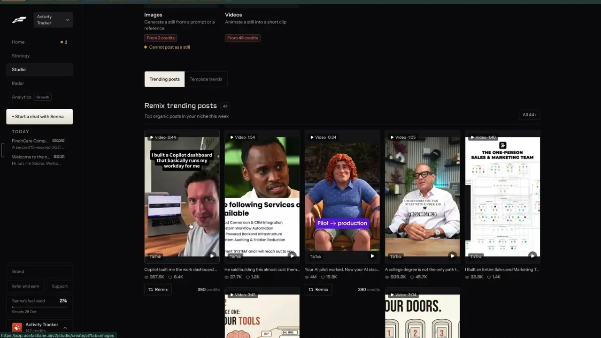
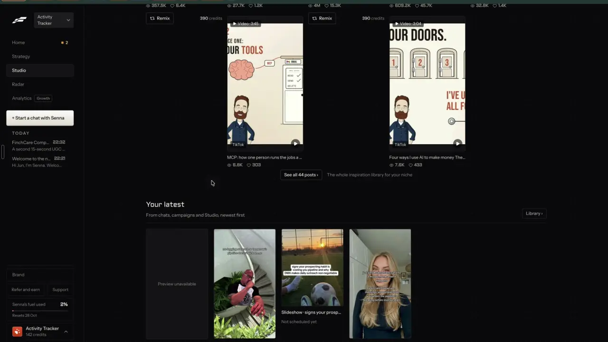
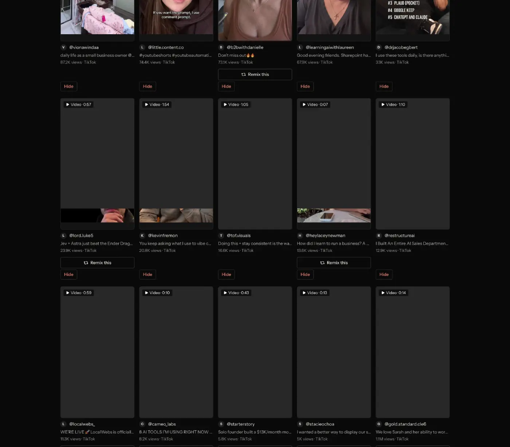

# Top posts in your niche

`find-niche-feed` | find | phase 2 | status: partial | /north-star#find-niche-feed

## Leo asked

- 15 Oct 2026: "embed it within the tool so it depends on the person's market/website"
- 19 Oct 2026: "the idea is that one can remix any content format and the ai will regenerate"

The feed is where a user finds the proven post to remix, and what it shows depends on the brand's market.

## How the best do it

Fastlane's Studio has a tab "Trending posts" with the section "Remix trending posts", a count chip "44", the sub line "Top organic posts in your niche this week" and "All 44 >". Cards show "Video | 0:44", the platform ("TikTok"), a caption line, views and likes ("357.5K", "6.4K"), and some of them (not all, for no reason shown) carry "Remix" at "390 credits". The footer reads "See all 44 posts >" and "The whole inspiration library for your niche".





Studio > Library > Inspiration is the full feed: "24 of these match what you sell, shown first. Top posts in Vertical / SMB business software, ops & CRM lately. And the ads your competitors run now." A toggle "All / Organic / Ads", a search "Search posts and ads, like hydration before 5pm", and cards with the handle, caption, "357.5K views | TikTok", "Remix this" on some cards and a red "Hide" on every card.




Others:

- Taplio's "For You" tab gives 5 new high-performing LinkedIn posts a day matched to your AI settings. Each card has "Why is this viral?", "Save" and "Remix". "Adjust AI" edits the matching fields "You write in", "You work in", "You are a", "You want to reach", "You post about". [Source](https://intercom.help/taplio/en/articles/17173501-finding-post-inspiration-with-taplio).
- Hearsay Social (Yext) has a Post Library with a "Recommended for Your Audience" filter, and each card shows networks, engagements and release date. [Source](https://info.yext.com/rs/906-IBA-353/images/Hearsay_Social_Datasheet_2022.pdf).
- Motion's Inspo has "For you" and "Following" feeds and an Organic feed of trending TikTok content. [Source](https://help.motionapp.com/en/articles/12589123-getting-started-with-inspo-in-motion).
- Exolyt's Industry Insights pick an industry and surface its most viral videos, gainers and losers. [Source](https://exolyt.com/features/industry-insights).
- Tweet Hunter suggests "Picked-for-you tweet inspiration" daily from your own account. [Source](https://tweethunter.io/).

## What we have today

- `/swipe?tab=posts` (`src/pages/SwipeFilePage.tsx`, `src/lib/topPosts.ts`, `src/lib/postInsights.ts`): about 140 top Instagram posts from 47 Singapore finance creators (`src/data/topPosts.json`), refreshed weekly on Leo's Mac. Filters by format, from, topic, angle, audience and saved; sorts include "for-you", which is offered only when the brand has a Playbook (`personalTargetFromPositioning`). Each card has "Remix this" (`buildRemixUrl`) and, for reels, "Clone this reel".
- `/trends`: 10 daily trend kits (`src/data/trends.json`) with "Remix in Write" (`buildTrendRemixUrl`).
- `/swipe?tab=ads`: 21 Singapore Meta ads with "Write a post like this".
- `/following` and `/market` hold posts from accounts the user follows; Market asks Jev whether each is worth acting on.
- `/swipe` tabs today are "Top posts", "Industry news" and "Ads" (the last only while the drop has ads), from `useUrlState("tab", ...)` in `SwipeFilePage.tsx`. `setTab` clears a fixed list of params on every switch (`q`, `format`, `from`, `topic`, `angle`, `audience`, `sort`, `saved`, `post`, `industry`).
- `SwipeFilePage` already calls `supabase.auth.getUser()` on load for the user id, and that answer carries the email `leoOnly` needs.
- The gate `leoOnly` (`src/lib/leoOnly.ts`) is in the north-star worktree and not on origin/main (checked at f2cb275, 2026-10-20).
- Missing, which is why the status is partial: one feed of organic posts and ads together, matching to what this brand sells (an ActivityTracker brand sees the same finance posts as an adviser), "matches shown first", Hide, and daily picks.

## Build

A Leo-only tab "For you" on `/swipe` (`?tab=foryou`) pools every source the app already has and asks Jev which items fit this brand, so those come first; this item adds no new scraping.

### Screens and states

```
Top posts | For you | Industry news | Ads              (For you: Leo only)

Today's 5 for MoneyBees                      [card][card][card][card][card]

For you
31 of these match what MoneyBees sells, shown first.
[ All ] [ Organic ] [ Ads ]     [ Search posts and ads, like CPF top-ups ]
+--------+ +--------+ +--------+
|Video 0:44| |Image ad| ...
|Your competitor . @joshconsultancy
|caption, two lines
|88k views | Instagram    [3.2x their usual]
|[Remix this]   [Hide]
---- Other top posts lately ----
...
Updated 19 Oct.   Show hidden (4)
```

Sources pooled by `buildFeed()` in `src/lib/nicheFeed.ts`, each item tagged with where it came from:

| Source | Kind | Card chip | Remix link |
| --- | --- | --- | --- |
| `src/data/topPosts.json` | organic | "SG creator" | `buildRemixUrl` |
| `src/data/trends.json` | organic | "Trend" | `buildTrendRemixUrl` |
| Following (`content-studio-following-`) | organic | "Following" | `remixUrl` |
| Competitor posts (`find-competitor-posts`) | organic | "Your competitor" | `remixUrl` |
| Competitor ads (`find-competitor-ads`) | ad | "Your competitor" | `buildAdWriteUrl` |
| In-your-space ads (`find-ad-library`) | ad | "In your space" | `buildAdWriteUrl` |
| `src/data/adsSwipe.json` | ad | "Singapore pick" | `buildAdWriteUrl` |

Scraped ads have no industry or hook family, so their Remix needs the `buildAdWriteUrl` change `find-competitor-ads` makes (null `industry` and `hookFamily` allowed). Sources that do not exist yet (competitor posts and ads, in-your-space ads) are simply empty until their items ship.

Order: matched items first (Jev score 0.6 or more), then "Other top posts lately". Inside each group organic posts sort by `rankOf` from `find-outlier-score` and ads by days running, running ads first. Under "All" the two lists interleave, 4 organic posts to each ad. Every card has "Remix this", unlike Fastlane, where only some do.

Today's 5: the top 5 matched items not hidden and not picked in the last 7 days, at most 2 ads and at most 2 from one account. Picked once per Singapore day and kept for that day.

States:

- Loading: cards render at once in outlier order from local data, with a pill "Matching 40 new posts to MoneyBees..." while Jev runs (a module-level job in `src/lib/nicheFeed.ts`). When it finishes, the list re-sorts once and the header count appears.
- Done: header count, picks strip, two groups.
- Nothing matched: "Nothing here matches MoneyBees yet." with links "Add competitors" (`/competitors?view=list`) and "Follow accounts" (`/following`), and the whole feed below under "Other top posts lately".
- No brand facts (no offers in the brand kit, no F.A.D.S. positioning, no Your market audience): banner "Add what you sell in Brand kit to match posts to you." with a link to `/brand`; the feed shows unmatched, by outlier.
- Jev unavailable (null), over the daily cap or refused: banner "Matching is off right now. Showing everything by outlier score." Scores already cached still apply.
- Hidden: the card leaves at once with toast "Hidden for MoneyBees." and "Undo", and "Show hidden ({n})" at the bottom lists hidden cards with "Unhide" on each.
- Search with no results: "No posts or ads match "{q}"." above a "Clear search" button.

### Copy

- Tab label "For you"
- Picks heading "Today's 5 for {brand}", where {brand} is `activeProfile(userId).name` from `src/lib/profiles.ts`
- Header "For you", line "{n} of these match what {brand} sells, shown first."
- Toggle "All", "Organic", "Ads"; search placeholder "Search posts and ads, like CPF top-ups"
- Divider "Other top posts lately"
- Chips "SG creator", "Trend", "Following", "Your competitor", "In your space", "Singapore pick"
- Buttons "Remix this", "Hide", "Unhide", "Show hidden ({n})", "Clear search"
- Pill "Matching {n} new posts to {brand}..."
- Banners as under states; footer "Updated {d Mon}." (the newest source date)

### Data

Synced key `content-studio-niche-<scoped(userId)>`, one per brand:

```ts
// src/lib/nicheFeed.ts
export interface NicheState {
  brandSig: string;                 // hash of the brand facts sent to Jev; a change clears scores
  scores: Record<string, number>;   // item id -> Jev probability, 2,000 newest kept
  hidden: string[];                 // item ids, 500 max
  picks: { day: string; ids: string[] };
  picked: Record<string, string>;   // item id -> day it was picked, 500 max, for the 7-day rotation
}
```

Item ids are prefixed by source (`tp:`, `tr:`, `fo:`, `cp:`, `ca:`, `sa:`, `sg:`) so they never collide. Hiding is a per-brand preference, not a security state. No schema change.

### AI and cost

Mode `match` of `supabase/functions/competitors/index.ts` (the function `find-competitors` creates, gated by `NORTH_STAR_USERS`), body `{ mode: "match", brand: { name, sells, serves }, items: [{ id, from, kind, text }] }`, 80 items at most, text cut to 400 characters. The app sends only items without a cached score.

Jev question `match` (noul), one call per item, 10 at a time through the `pool` helper (`find-competitors` moves it from `market/index.ts` to `_shared/pool.ts`), state `{ brand, sells, serves, country: "Singapore", post: { from, kind, text } }`:

- instructions: "Is this post about something the people `brand` serves care about, close enough to what `brand` sells that its idea could be remade for them?"
- Threshold 0.6, proposed. Before relying on it, Leo hand-labels 30 items for each of his three brands and the cut is set from the disagreements.
- Null answers are not cached, so they are asked again next time.
- Jev reads English best. A caption in Chinese, Malay or Tamil that comes back null stays in "Other top posts lately".

`brand.sells` joins the brand kit's offer names (`loadBrand(userId)?.offers`, `src/lib/carousel.ts`, names and links only) with the F.A.D.S. one-liner and edge (`loadPositioning(userId)`, `src/lib/positioning.ts`). `brand.serves` is positioning's `audienceDetail`, else its `audience`, else Your market's `audience` (`loadMarket(userId)`, `src/lib/market.ts`). All three keys are per brand through `scoped()`. `brandSig` hashes exactly these two strings.

Cost: about 250 input tokens a question, so 80 questions is about 20,000 tokens, under US$0.001 at Jev's US$0.042 per million. Cap `niche-match`: 5 runs a day per user, added to `DAILY_LIMITS`.

### Deep links

- `/swipe?tab=foryou`: this tab. For non-Leo accounts `foryou` is not in `allowed`, so the URL falls back to the posts tab.
- `&kind=organic|ads` (replace), `&q=` (replace), `&hidden=only` (replace).
- Add `kind` and `hidden` to the params `setTab` clears, so a tab switch still starts clean.
- Take the email from the `getUser()` call the page already makes (no second auth call), and show the page skeleton until it answers, so a `tab=foryou` link on Leo's sign-in does not flash Top posts first.
- Extend `links.swipe` in `src/lib/links.ts` with `tab: "foryou"`, `kind` and `hidden`; add the rows to `docs/deep-links.md`.

## Done when

- [ ] `/swipe?tab=foryou` shows on Leo's sign-ins only and falls back to Top posts for anyone else.
- [ ] The feed pools all seven sources; each card shows its chip and a working "Remix this".
- [ ] For MoneyBees most finance posts match; for an ActivityTracker brand few do, and they are shown first.
- [ ] "Today's 5" stays the same all day and does not repeat an item within 7 days.
- [ ] Hide, Undo and Unhide work and stay per brand across devices.
- [ ] Changing the brand kit offers clears the cached scores and re-matches.
- [ ] Jev down: the feed still renders, by outlier score, with the banner.
- [ ] `niche-match` is in `usageCaps.ts`.
- [ ] Checked at 390 px and 1440 px; build and full vitest pass; the north-star item flipped.

## Tests

- `src/lib/nicheFeed.test.ts`: `buildFeed` maps each source to an item with a unique prefixed id and the right remix link; matched before unmatched; the 4-to-1 interleave; hidden items left out; `kind` filter; search across caption, handle and advertiser.
- Same file: picks are stable for a day, skip items picked in the last 7 days, hold at most 2 ads and 2 per account; `brandSig` change clears `scores`.
- `competitors/logic.test.ts`: the `match` request is trimmed to 80 items and 400 characters; null answers are left out of the returned scores.
- `competitors/index.test.ts`: `niche-match` is consumed once per run, and a Jev outage returns an empty score map with 200.

## Open questions

- Sourcing niche posts per brand (for brands outside Singapore finance) needs a weekly Apify hashtag or keyword scrape per brand, like `scripts/trend-scout.mjs` but on the server. That is new spend per brand; Leo decides.
- Taplio explains "Why is this viral?" on each card. That belongs to `find-ai-tagging` and `find-ad-detail`.
- Should "For you" become the default `/swipe` tab for Leo? This spec keeps Top posts as the default so existing links do not change.

## Related

find-outlier-score, find-competitor-posts, find-competitor-ads, find-ad-library, find-trending-formats, find-ai-tagging, find-alerts-digest, remix-everywhere, brand-from-website
