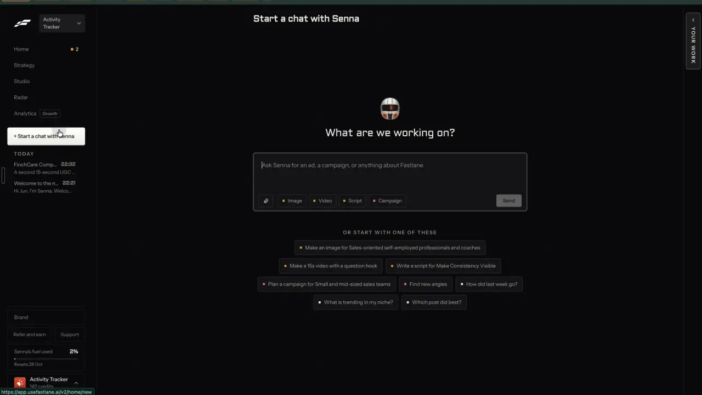

# Topics and hashtags people search for

`find-search-topics` | find | phase 2 | status: live (Leo's sign-ins, 21 Oct 2026) | /north-star#find-search-topics

## Leo asked

15 Oct 2026: "embed it within the tool so it depends on the person's market/website"

He said it about Your market. It applies here because the search topics start from each brand's own topics, so two brands see different lists.

## How the best do it

Fastlane does not show search demand or hashtag data in the recording. The nearest thing is a starter chip in a new Senna chat, "What is trending in my niche?", which was never pressed, so what it answers is unknown.



Other competitors:

| Competitor | What they do | Numbers | Source |
| --- | --- | --- | --- |
| TikTok Creator Search Insights (native) | Lists the topics people search for on TikTok, sorted by category or "For You" (topics near the creator's own content). Each topic has a popularity score, and a "Recommended Topic" label marks high-potential terms. A content gap filter shows topics searched often but featured in few videos. | Select regions; searches by followers needs 1,000+ followers per a third-party guide (unverified) | [newsroom](https://newsroom.tiktok.com/creator-search-insights), [metricool guide](https://metricool.com/tiktok-creator-insights/) |
| TikTok Creative Center | Trends > Hashtags ranked by number of posts and interest over time, with search and filters for industry and time frame. "See Analytics" opens the trendline, related videos, audience, regional popularity and related hashtags. | Free; signed out shows the top 3 only | [help](https://ads.tiktok.com/help/article/how-to-use-trends?lang=en), [metricool guide](https://metricool.com/tiktok-creative-center/), [moda](https://moda.app/blog/tiktok-creative-center) |
| Exolyt | Hashtag analytics show videos, total views, engagement rate and historical growth per tag, plus related hashtags with an overlap rate and today's hot hashtags by industry. Trends show daily topics by country with Uptrends and Downtrends. | Tracked hashtags: Basic 1, Essentials 50, Advanced 300; data refresh 1x, 2x or 6x a day; Essentials SGD 385/mo | [hashtags](https://exolyt.com/features/hashtags), [trends](https://exolyt.com/features/trends), [pricing](https://exolyt.com/pricing) |
| Virlo | Niche Analyzer compares engagement, growth and competition across niches, with hashtag rankings across 500K+ tags (a schema claim, unverified). The API gives a hashtag's performance as a time series. | Repeat lookups free within 6 hours | [features](https://virlo.ai/features), [changelog](https://dev.virlo.ai/changelog) |
| Metricool | Hashtag tracker for a tag's reach and posts on Instagram, and on X on paid plans. | $25 per day per tracker | [pricing](https://metricool.com/pricing/) |
| Instagram Inspiration hub (native) | Reels Trends in the Professional Dashboard has Audio and Hashtags tabs. Third-party guides describe the audio list as the top 50 sounds of the past three days with rank movement. | US only, mobile app, professional accounts, per Metricool | [izea](https://izea.com/resources/reels-trends-feature/), [metricool](https://metricool.com/how-to-find-current-instagram-reels-trends) |

TikTok's content gap filter, demand minus supply, suits advisers best, because a finance question that many people search and few people answer on video is an easy first post. Exolyt's overlap rate is the cheapest way to show related tags.

## What we have today

Checked against 08537d1, then re-checked on origin/main f2cb275 and the GitHub Actions log on 20 Oct 2026. Nothing measures search demand or keeps hashtag numbers over time.

- `/trends` (`src/pages/TrendsPage.tsx`, `src/lib/trends.ts`, data `src/data/trends.json`) shows trend kits made by `scripts/trend-scout.mjs`, which GitHub Actions runs every morning at 01:37 UTC (`.github/workflows/trend-scout.yml`, Apify about US$1 a run, kits written through `ANTHROPIC_API_KEY`). The scout asks the `clockworks~tiktok-scraper` actor for 15 videos per hashtag for 5 fixed hashtags (fintok, moneytok, personalfinance, financialliteracy, budgeting), so a run reads about 75 TikToks from around the world. It also reads 5 recent reels each from up to 40 hand-picked Singapore creators plus 6 global accounts and ranks everything. `normalizeTiktokItem` keeps caption, likes, comments, shares, views and date, and drops each video's own hashtags. Its header comment says Instagram hashtag feeds return only brand-new, low-engagement posts, which is why it skips them.
- The scout is not running. The last drop on main is dated 2026-10-11, the last good run. Every scheduled run from 12 to 19 Oct 2026 failed in under a minute: Apify answered 402 on the 12th and 403 "Monthly usage hard limit exceeded" from the 13th (`gh run list --workflow trend-scout.yml`). So the kits on `/trends` are 9 days old, and the hashtag half of this item depends on that run.
- The page also shows this month's most-viewed Singapore finance videos on YouTube (`src/components/YouTubeTrends.tsx`, `src/data/youtubeTrends.json` from `scripts/sg-feeds.mjs`). Its params are `platform`, `type` and `trend`.
- Nearby sources are the real forum questions (in Write only), Mentions (Google News) and Your market's ChatGPT answers, which `find-news-questions` covers.
- DataForSEO is already wired, with `DATAFORSEO_LOGIN` and `DATAFORSEO_PASSWORD` used by `mentions`, `youtube-captions` and `market`. The `market` function has a `dfs(path, task, auth, timeoutMs)` helper and the Singapore location code `2702`.

## Build

Two new views on `/trends`, "Searches" and "Hashtags", beside today's trend kits. Everything sits behind `leoOnly(email)` from `src/lib/leoOnly.ts`, and other accounts see `/trends` as it is today.

### Screens and states

```
/trends?view=search
[Trend kits] [Searches] [Hashtags]
What people in Singapore search for (i)
Your topics: CPF, retirement, hospital bills   Edit
[All] [Rising] [Few videos]
 cpf life payout             1,300 searches a month   Up 40% in 3 months   ~~sparkline~~   Few videos  [Make a post]
 medishield life premium       880 searches a month   Steady               ~~sparkline~~               [Make a post]
 ...
Checked Mon 20 Oct. Next check from Mon 27 Oct.
```

The numbers in the wireframe are examples of the layout.

Searches view states:

| State | What shows |
| --- | --- |
| No topics yet | "Add up to 5 topics you post about." with a chip input prefilled from the Your market topics or else the Plan positioning topics, and the button "Check searches" with the price chip "Under US$0.10 . <n> left today" (`useUsesLeft` from `src/lib/aiUsage.ts`, feature `search-topics`) |
| Checking | Within 400 ms, "Reading searches for <n> topics. This takes about 30 seconds." The job runs outside React, so leaving the page keeps it going |
| Done | Rows sorted by searches a month, with "Checked <day>. Next check from <day>." under the list |
| Checked this week | "Check searches" is disabled, with the reason "Checked this week. Next check from <day>." |
| Over the daily cap | The standard refusal, "You've used all 2 for today. It resets at 8am Singapore time." |
| Failed | "Couldn't read searches just now. Nothing was used up. Try again." with a "Try again" button, after all three counters are refunded |
| Jev returned null | Every keyword with 10 or more searches is shown, with the line "Not filtered for fit this time." |
| Not switched on (the 404 `market` already sends when the uid is not in `MARKET_USERS`, or 403 from the north-star gate) | "Searches aren't switched on yet." |
| Filter matches nothing | "No rising topics this week." or "No gaps this week." with a link "See all" |

Opening a row (`?topic=<slug>`) shows a drawer with a larger 12-month chart, the 3 newest YouTube results found for it (title and link), the related keywords from the same seed and "Make a post".

```
/trends?view=hashtags
Finance hashtags on TikTok (i)
 #moneytok   41 videos in today's read   Median 18K views   Up 25% this week   ~~sparkline~~
             Often with: #budgeting 40%  #savingmoney 22%                    [Make a post]
```

The hashtag view reads a static file and makes no calls. It shows "No hashtag data yet." before the first scout run writes the file, and "Last read <day>." under the heading when the newest day in the file is more than 2 days old, so a stopped scout is visible. Its numbers come from the scout's own read of about 75 videos chosen by 5 fixed tags, so they show which tags travel with those 5 and how those videos did, not how big a tag is on TikTok. The InfoTip says so.

"Make a post" is a plain Write link today, `searchWriteUrl` or `hashtagWriteUrl` below. Once remix-everywhere and remix-source-trail have shipped (neither `RemixButton` nor `src/lib/remixSource.ts` exists yet), the link is wrapped as `<RemixButton source={resolveSource(key, userId)}>{link}</RemixButton>`, that component's API (props `source` and `children`), and a null source renders the link alone. This item adds two kinds to `RemixSourceKind` and `resolveSource`, both with format `text`: `search:<slug>`, resolved from the stored searches key, and `hashtag:<tag>`, resolved from `src/data/hashtagStats.json`.

### Copy

| Where | Text |
| --- | --- |
| View tabs | "Trend kits", "Searches", "Hashtags" |
| Searches heading | "What people in Singapore search for" |
| Searches InfoTip | "Monthly Google searches in Singapore, read once a week." |
| Topics line | "Your topics:" and the link "Edit" |
| Filter chips | "All", "Rising", "Few videos" |
| Row text | "<n> searches a month" |
| Change chips | "Up <n>% in 3 months", "Down <n>% in 3 months", "Steady", "New" |
| Gap badge | "Few videos" |
| Gap badge tooltip | "Few YouTube videos on this from the last 90 days." |
| Hashtags heading | "Finance hashtags on TikTok" |
| Hashtags InfoTip | "From about 75 finance TikToks we read each morning, worldwide." |
| Price chip on "Check searches" | "Under US$0.10 . <n> left today" (the US$ figure is replaced by the measured one) |
| Hashtag row text | "<n> videos in today's read", "Median <n> views", "Up <n>% this week", "Often with:" |
| Button on every row | "Make a post" |
| State lines | as in the states table |

### Data

- A synced key per brand, `content-studio-searches-<scoped(userId)>`, holds `{ seeds: string[], checks: { checkedAt, topics: SearchTopic[] }[] }` with the last 8 checks. `SearchTopic` is `{ keyword, slug, seed, volume, series: number[12], change: number | null, trend: "rising" | "falling" | "steady" | "new", recentVideos: number | null, gap: boolean, videos: { title, url }[] }`. On load each check is rebuilt field by field and a bad one is dropped, as `cleanDigest` does in `src/lib/market.ts`.
- `src/data/hashtagStats.json` is a static file written by the scout: `{ updated, tags: { [tag]: { history: { day, videos, medianViews }[], related: { tag, overlap }[], finance: boolean } } }`, with history kept for 90 days.
- A new `src/lib/searchTopics.ts` holds the load and save helpers, the filters, `searchWriteUrl` and `hashtagWriteUrl`, and the job runner modelled on `runMarketCheck`, none of which needs a schema change.

### AI and cost

Searches run as a new action `searches` on `supabase/functions/market`, which dispatches on `body.action` (`status`, `suggest`, `check` today). That function already has the DataForSEO helper, the Singapore code, the Jev helpers, the weekly-per-brand counter pattern (`takeSlots`) and the `MARKET_USERS` gate, which today means Leo only. The new action also checks `isAllowed(Deno.env.get("NORTH_STAR_USERS"), uid)` and answers 403 `{ code: "not_allowed" }` without it, so opening Your market to more people later does not open this.

1. The request is `{ action: "searches", profile, seeds, serves, sells }`, with at most 5 seeds trimmed and deduplicated. `serves` and `sells` come from the Your market set-up or else the Plan positioning (`audienceDetail`, `oneLiner`).
2. Limits follow `market-check`: one check a week per brand through a `search-topics:<profile>` usage row read over 7 days, plus the new caps below.
3. For each seed it calls `dataforseo_labs/google/related_keywords/live` with `location_code: 2702`, `language_code: "en"`, depth 1 and limit 30, and reads each keyword's `search_volume` and `monthly_searches`.
4. Jev judges each keyword (6 at a time with the function's own `pool` helper in `market/index.ts`, pinned `jev-1.13.0`) with the state `{ serves, sells, country: "Singapore", keyword }` and two noul questions:
   - `keep`: "Would someone `serves` in `country` search `keyword` when they need what `sells` offers, or with a question the brand could answer in a general post?" Keep 0.6 and above.
   - `safe`: "Can a financial adviser in Singapore post about `keyword` without naming an insurer's product, promising a return or giving personal advice?" Keep 0.6 and above.
   Both lines are starting points, so log every keyword with its scores on the first three checks, read the 20 nearest each line, and move them before the gate comes off. When Jev returns null, keep every keyword with at least 10 searches a month.
5. It keeps the top 30 by volume and calls `serp/youtube/organic/live/advanced` (location 2702, English, depth 20) for the 10 highest to count how many of the results were published in the last 90 days. Which field carries the publish date is unverified; the builder saves one live response as a fixture under `supabase/functions/market/fixtures/` and reads it before writing the count.
6. The figures are arithmetic on measured numbers, so no Jev is needed for them. `change` is the sum of the last 3 months against the 3 before, as a percent, and null with the label "New" when the earlier sum is 0. `trend` is rising at +20% or more, falling at -20% or less, and steady otherwise. `gap` is true when volume is 100 or more and fewer than 3 of YouTube's top 20 results are from the last 90 days.
7. If DataForSEO fails before any result comes back, it refunds the brand row, `search-topics` and `search-topics-global`, the way `paidPartsFailed` works today.

Caps to add to `DAILY_LIMITS` in `supabase/functions/_shared/usageCaps.ts`:

- `"search-topics": 2`, commented "Searches on Trends (market searches): up to 5 related-keyword reads and 10 YouTube result pages, under US$0.10 a check (confirm on the DataForSEO price page)."
- `"search-topics-global": 10`, on `GLOBAL_COUNTER_USER`, so the shared DataForSEO balance cannot be drained.

The DataForSEO prices are unverified. At list prices it is roughly US$0.01 per Labs task plus about US$0.0001 per keyword returned, and about US$0.002 per YouTube results page, so a full check stays under US$0.10. The builder confirms on https://dataforseo.com/pricing before the first live run and writes the measured figure into the cap comment. Jev adds about 150 keywords at 200 tokens, roughly 30,000 tokens or US$0.001.

Hashtags come from `scripts/trend-scout.mjs` at no extra scrape cost, because it already reads the videos. This half waits until the scout runs again (see What we have today); the Searches half does not depend on it.

- `normalizeTiktokItem` keeps a new `tags` field: the actor item's `hashtags[].name`, or the `#words` in its `text` when that field is missing. The actor's field name is unverified; the builder saves one raw item as a fixture in `scripts/` before coding against it.
- For every hashtag on 5 or more of the day's TikTok videos, it records the video count, the median views and the related tags with their overlap rate (the share of this tag's videos that also carry the other tag, top 5), then appends the day to `src/data/hashtagStats.json`. Instagram reels are left out, as today.
- Jev asks each new tag once, and the answer is stored in `finance`: "Is `hashtag` about personal money, saving, investing, insurance, retirement or work and careers?" A tag is shown at 0.6 and above. CI needs a `TYPESAFE_API_KEY` repo secret for this. Without it, the scout drops a fixed list of generic tags (fyp, foryou, foryoupage, viral, trending, tiktok) and keeps the rest.
- The scout's rule stays the same: a failed run writes nothing.

The link builders in `src/lib/searchTopics.ts`, both built with `links.generate` from `src/lib/links.ts`:

- `searchWriteUrl(t)` returns `/generate?pillar=topic&detail=<keyword>&idea=real-question&ctx=...` with ctx: `People in Singapore search "<keyword>" about <volume> times a month (<change line>). Write a post that answers what they want to know, in general terms. No product names, no promised returns, and no numbers other than the ones given here.`
- `hashtagWriteUrl(tag)` returns `/generate?pillar=topic&detail=<tag>&platform=tiktok&format=short-video&ctx=...` naming the tag and its top related tags, with the same MAS rules.

### Deep links

- `/trends?view=search` and `/trends?view=hashtags` use a new `view` param that replaces history. The default `kits` is left out of links, and the param is allowed only behind the gate.
- `/trends?view=search&show=rising` and `&show=gap` filter the list and replace history.
- `/trends?view=search&topic=<slug>` and `/trends?view=hashtags&tag=<tag>` open the drawer and push history, with a Copy link button.
- Add `view`, `show`, `topic` and `tag` to `links.trends` in `src/lib/links.ts` and to the `/trends` rows in `docs/deep-links.md`.

## Done when

- [ ] On Leo's sign-ins, `/trends` shows the three view tabs, and another account sees today's page with no tabs.
- [ ] A first check with 3 seeds returns topics with volumes, 12-month sparklines, change chips and at least one gap or a clean "No gaps this week." line.
- [ ] A second check in the same week is refused with the "Checked this week" reason, and the 3rd check in a day across brands hits the cap line.
- [ ] A DataForSEO failure refunds all three counters, which the test proves and `cs_ai_usage` confirms after a forced failure.
- [ ] "Few videos" shows only when volume is 100 or more and fewer than 3 recent videos are in YouTube's top 20.
- [ ] A uid missing from `NORTH_STAR_USERS` gets 403 from the `searches` action even when it calls the function directly.
- [ ] Once the scout runs again, it writes `src/data/hashtagStats.json`, the Hashtags view shows median views over time and related tags with overlap, and generic tags such as fyp do not appear.
- [ ] "Make a post" on a search row opens Write with `idea=real-question` and the MAS rules in ctx.
- [ ] The measured cost of one check is written in the cap comment.
- [ ] Checked by eye at 390 px and 1440 px; on a phone each row stacks and the sparkline keeps its width.
- [ ] `npm run build` and `npx vitest run` pass, `docs/deep-links.md` is updated, and the item in `northStar.ts` is flipped with its `ours` line.

## Tests

- `supabase/functions/market/logic.test.ts` checks the searches request (at most 5 seeds, trimmed, deduplicated), the `NORTH_STAR_USERS` gate, the shaping of a related-keywords fixture, `change` with a zero base giving "New", the 20% trend lines, the gap rule at its edges (99 against 100 searches, 2 against 3 videos), the 90-day count from a YouTube fixture, and the keep rule when Jev returns null. Each case fails when its rule is removed.
- `scripts/trend-scout.test.mjs` checks that `normalizeTiktokItem` reads `tags` from the saved raw item and from `#words` in `text` when the field is missing, hashtag stats from fixture videos (counts, median, overlap rate), the history trimmed to 90 days, the generic-tag fallback when Jev is unavailable, and that a failed run still writes nothing.
- `src/lib/searchTopics.test.ts` checks that a malformed stored check is dropped on load, and that both write links carry their ctx rules.
- A `TrendsPage` render test proves the view tabs are hidden for a non-Leo email and that `?view=search` falls back to the kits for that account.
- `supabase/functions/_shared/usageCaps.test.ts` still passes with the two new caps.

## Open questions

- TikTok's own search insights have no public API, so the demand numbers here are Google searches in Singapore and the supply numbers are YouTube's. Leo decides whether that is close enough to "what people search".
- The trend scout's Apify account hit its monthly hard limit, so no trend kits have landed since 2026-10-11 (402 on 12 Oct, 403 every day from 13 to 19 Oct). Raising that limit or waiting for the reset is a money call for Leo, and the Hashtags view stays empty until then.
- The Hashtags view can only describe the 75 videos the 5 fixed tags pull in. If Leo wants real tag sizes, the read has to widen, which is the larger-read question below.
- A larger hashtag read, such as TikTok Creative Center's hashtag lists through an Apify actor (cost unverified), would add spend, which makes it Leo's call.
- `NORTH_STAR_USERS` is a new Supabase secret if no earlier north-star item has set it, and the scout needs a `TYPESAFE_API_KEY` repo secret for the tag check. The builder confirms both with Leo before setting them.
- DataForSEO Labs access on Leo's account is unverified. If it is off, the fallback is `keywords_data/google_ads/search_volume/live` for volumes plus `keywords_data/google_trends/explore/live` for related queries; the builder checks before coding.
- Should searches run inside the weekly Your market check instead of from their own button? Leo decides.

## Related

find-news-questions, find-trending-formats, find-viral-search, find-niche-feed, find-alerts-digest, plan-ideas-inbox, remix-everywhere, brand-from-website
