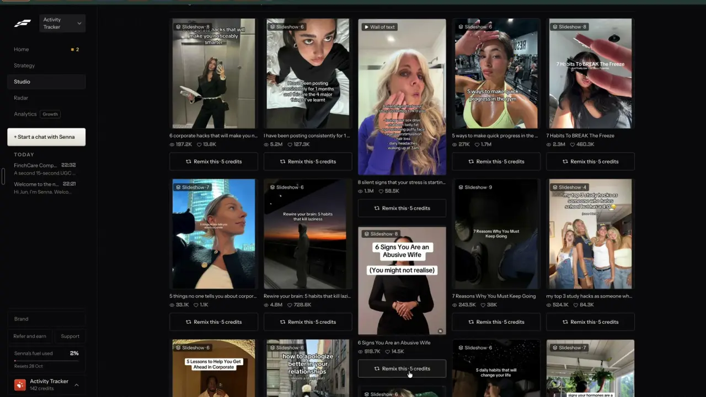
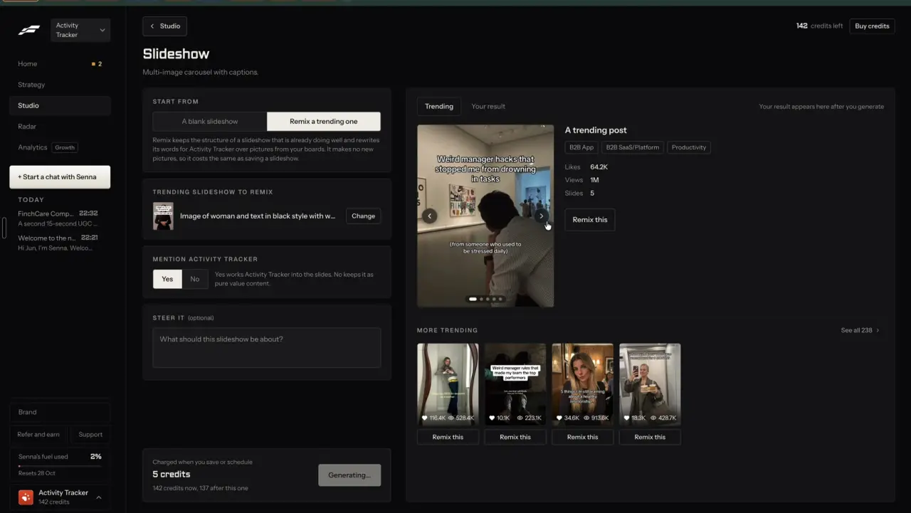

# Trending formats and templates

`find-trending-formats` | find | phase 3 | status: partial | /north-star#find-trending-formats

## Leo asked

19 Oct 2026: "the idea is that one can remix any content format and the ai will regenerate"

A format template is the plainest case of that: a slideshow or wall of text whose shape is proven, remixed into the adviser's own words.

## How the best do it

Fastlane (Leo's recording, 2:25 to 2:35 and 3:19, notes-2.md F7 and F12, notes-3.md F5b). Studio has a two-way toggle "Trending posts" | "Template trends". The template tab is headed "Template trends" with the line "Trending slideshows and walls of text you can remix".



- About 30 to 35 cards, 5 across. Each has a tag at the top left, "Slideshow - 8" (the number is the slide count) or "Wall of text", the cover, the caption cut to one line, views and likes, and a full-width "Remix this - 5 credits".
- The posts are niche-agnostic lifestyle and self-help, picked for their shape and reach: "7 Habits To BREAK The Freeze" 2.3M views, "POV: waking up and seeing a $6847 p..." 7.4M views (a wall of text), "6 Signs You Are an Abusive Wife" 919.7K.
- Pressing Remix greys the button to "Opening..." (t203), then opens the Slideshow page with "Remix a trending one" already picked and that post loaded. Nothing is charged on the click. The page says "Charged when you save or schedule", "5 credits" and "142 credits now, 137 after this one".
- A "Wall of text" card opens the Wall of Text page instead (notes-3.md F6, 3:24 to 3:32), and generation starts with no extra click. Its helper reads "Remix keeps the video, sound and shape of a wall of text that is already doing well and rewrites the text for Activity Tracker." The result plays the original creator's footage with only the overlay text rewritten. We do not copy that part: our wall of text runs over a stock or own clip, never the source video.


- Above the price, the setup panel explains the remix: "Remix keeps the structure of a slideshow that is already doing well and rewrites its words for Activity Tracker over pictures from your boards. It makes no new pictures, so it costs the same as saving a slideshow."
- A "Trending" tab in the editor shows "A trending post" with tags ("B2B App", "B2B SaaS/Platform", "Productivity"), Likes "64.2K", Views "1M", Slides "5", then "MORE TRENDING" with "See all 238".



Other competitors:

- CapCut leads its template gallery with "Trending Templates". Each card shows a usage count (for example 2.2M), a length and a label such as "New trend", and a TikTok video made from a template carries a "Try this template" link that opens the editor with it loaded ([templates](https://www.capcut.com/templates), [how-to](https://www.capcut.com/resource/how-to-use-capcut-on-tiktok)).
- TikTok Creative Center lists songs under "Popular" and "Breakout", filterable by "New to Top 100" and "Approved for business use", which matters for a brand account ([TikTok help](https://ads.tiktok.com/help/article/how-to-use-trends?lang=en)).
- Virlo labels each sound Rising, Early or Peaking with uses and growth ("2.4K uses, +340%"); its breakout endpoint costs USD 0.25 a call ([changelog](https://dev.virlo.ai/changelog), [reels](https://virlo.ai/reels-analytics)).
- Sandcastles keeps a team-picked library of 22 Formats, 30 Editing Styles, 47 Visual Hooks and 6 Signature Series, adds videos weekly and charges no credits for it ([collections](https://sandcastles.ai/collections)).
- Motion shows a strip "Formats you haven't tried": example ads in formats missing from the user's own ad account ([help](https://help.motionapp.com/en/articles/12589123-getting-started-with-inspo-in-motion)).
- ReelFarm offers a free slideshow template library filterable by most viewed ([ReelFarm](https://reel.farm/)).
- Pentos tracks sounds and hashtags over time to split a rising trend from a saturated one, from USD 99 a month ([review](https://argil.ai/blog/viral-finder), [GetApp](https://www.getapp.com/marketing-software/a/pentos/)).
- Instagram's Reels Trends (in the Instagram Inspiration hub) lists the top audio of the past three days with a reel count and rank movement, per third-party guides (top 50 and the 3-day window are unverified by Meta) ([IZEA](https://izea.com/resources/reels-trends-feature/)).

The pattern: a library of proven shapes, each card showing its proof (views or uses) and its shape (slide count, format), and a Remix that keeps the shape and replaces the words.

## What we have today

- `/swipe` has a "Formats working now" card (`formatsWorkingNow` in `src/lib/postInsights.ts`): for the last 90 days of top posts it shows Reels, Carousels and Single posts with each one's engagement against the creator's usual ("1.4x"), plus the top topics and angles, and tapping one filters the list. Only 3 formats, from 136 Instagram posts by 47 Singapore finance creators (`src/data/topPosts.json`).
- `/trends` (`src/pages/TrendsPage.tsx`, data `src/data/trends.json`) shows 10 trend kits: title, why it works, hooks, talking points, CTA, how to film, and the source video, with "Write this" (to Write), "Clone", "Source" and a copy-link button. These are topics riding a moment; none is a reusable template shape. The drop is `scripts/trend-scout.mjs`, run daily at 09:37 SGT by `.github/workflows/trend-scout.yml`, using Apify TikTok hashtags (fintok, moneytok, personalfinance, financialliteracy, budgeting) and recent reels from known Instagram finance creators (it skips Instagram hashtag feeds, which return only new, low-engagement posts), with the Anthropic API writing the kits.
- The same page ends with "Popular on YouTube in Singapore" (`src/components/YouTubeTrends.tsx`, `src/data/youtubeTrends.json` from `scripts/sg-feeds.mjs`): this month's most-viewed Singapore finance videos, Jev-filtered. They are videos to watch, not templates.
- `/hub/trends` has niche trend cards, but the hub is unlinked.
- Missing: TikTok photo slideshows and walls of text as remixable templates, a slide count, sounds, and a template library of any kind. The carousel maker (`/carousel`) has one layout family and no template gallery (`formats-carousel-designs`).

Status partial: format trends exist as three ratios and a topic feed, with no templates to remix.

## Build

Scope: a weekly drop of trending TikTok slideshows and walls of text, shown as a Formats view on `/trends` with one-tap Remix. Sounds are left for Leo to decide, see Open questions.

### Screens and states

Files:

- `scripts/format-scout.mjs` (new) is the weekly drop, described under Data.
- `src/data/formatTrends.json` (new) is what it writes.
- `src/lib/formatTrends.ts` (new) holds the types, the filters and `buildFormatRemixUrl(item)`.
- `src/components/FormatTrends.tsx` (new) draws the grid and the open card.
- `src/pages/TrendsPage.tsx`: a two-way toggle under the header, "Trend kits" | "Formats", read from `?view=`. The toggle shows only when `leoOnly(email)`; for anyone else `?view=formats` falls back to kits.
- `src/lib/links.ts`: `trends` gains `view`, `kind` and `template`.

Formats view:

```
Trend kits | Formats
Trending slideshows and walls of text, re-checked every Monday.
[All 31] [Slideshows 24] [Walls of text 7]
+------------------+ +------------------+
| Slideshow, 8     | | Wall of text     |
| [cover]          | | [cover]          |
| 6 money habits.. | | POV: your first..|
| 2.3M views 460K  | | 7.4M views 771K  |
| [ Remix this ]   | | [ Remix this ]   |
+------------------+ +------------------+
[ Show 12 more ]
```

Cards: 2 across under 640 px, 3 to 5 across above. Tapping the cover opens the card in place (the same open pattern as a trend kit, `?template=<id>`, push): the cover large, "What each slide does" as a numbered list, posted date, "Open on TikTok", and the same "Remix this" button.

States:

- Loading: none. The data is bundled, like trends.
- Empty file or a drop older than 21 days: "No formats this week. They arrive with Monday's update." with a link "See trend kits" that switches the view.
- Filter with no matches: "No formats of that kind this week." and "Show all".
- Cover fails: a muted tile with the format's icon and "No preview".
- Remix pressed: navigates at once (it only builds a URL), so no busy state.
- Over the cap, refused, failed: none on this page. Remix runs no paid call here; Write and the slideshow editor own their states.

### Copy

- Toggle labels: "Trend kits", "Formats".
- Line under the toggle in the Formats view: "Trending slideshows and walls of text, re-checked every Monday."
- InfoTip next to it, label "About formats": "Picked for their shape. Remix keeps the slides and their jobs and writes your own words."
- Filter chips: "All", "Slideshows", "Walls of text", each with its count.
- The card tag reads "Slideshow, 8" or "Wall of text", and the numbers line reads "2.3M views", "460K likes" (`compactNum` from `src/lib/topPosts.ts`).
- Button: "Remix this". No price chip while it opens Write, which is free; it takes the chip from `business-cost-preview` once it opens a paid editor.
- Open card heading for the list: "What each slide does". Link: "Open on TikTok".

### Data

`src/data/formatTrends.json`:

```
{ "fetched": "2026-10-26",
  "items": [ {
    "id": "tiktok-7412345678901234567",
    "kind": "slideshow" | "wall-of-text",
    "url": "https://www.tiktok.com/@handle/photo/7412345678901234567",
    "author": "handle",
    "caption": "first 240 characters",
    "views": 2300000, "likes": 460300,
    "slides": 8,                      // null for wall-of-text
    "cover": "/format-trends/7412345678901234567.jpg",
    "hook": "the first slide's words, at most 100 characters",
    "structure": ["Hook: a numbered list promise", "One habit with a one-line reason", "..."],
    "postedAt": "2026-10-20",
    "fit": 0.81 } ] }
```

`scripts/format-scout.mjs`, run weekly on Leo's Mac through `~/.local/bin/content-studio-drop.sh format-trends`. That needs a new case (`SCRIPT=scripts/format-scout.mjs`, `PATHS=(src/data/formatTrends.json public/format-trends)`), the Apify key loaded the way the `top-posts` case loads it, and `format-trends` added to the condition that loads `TYPESAFE_API_KEY` (today only `sg-feeds` and `industry-news`). The launchd plist `~/Library/LaunchAgents/com.leo.format-trends.plist` runs Mondays at 06:30; copy it from `com.leo.top-posts-refresh.plist`, which is already weekly (the industry-news plist runs daily). Steps:

1. Apify `clockworks~tiktok-scraper` (already used by `trend-scout.mjs` and `clone-reel`) on 8 hashtags at 30 results each, with the input shape `trend-scout.mjs` uses (`{ hashtags, resultsPerPage }`): moneytips, personalfinance, financetips, careeradvice, corporatelife, productivitytips, selfimprovement and adulting. Read the actor's price live and refuse to start above `FORMAT_SCOUT_MAX_USD` (default 1.5), as `refresh-top-posts.mjs` does.
2. Keep posts from the last 30 days with 50,000 views or more. A photo-mode post is a slideshow; the actor's field names for photo posts and their image links are unverified, so check them on a 5-result run before writing the parser.
3. For each video that is left, the free Claude CLI (`claude -p --model sonnet`) looks at the cover and answers one word, `wall-of-text` or `other`. Leo's rule lets an LLM decide when the input is an image, since Jev reads text only.
4. For each slideshow, Claude CLI reads up to 10 slide images and returns JSON: the first slide's words as `hook`, and one line per slide saying what that slide does, never its exact words, as `structure`. For a wall of text it reads the cover the same way.
5. Jev (jev-1.13.0, via `supabase/functions/_shared/jev.ts`, the way `sg-feeds.mjs` imports it) asks two questions per post, below. Keep a post when `reusable` is 0.5 or more and `unsafe` is under 0.3.
6. Save the cover at 720 px to `public/format-trends/<id>.jpg` (the `fetch-covers.mjs` approach), keep the 40 best by `fit` then views, carry forward items under 28 days old from the last file, and never write a file with fewer than 8 items.

Nothing per user is stored. No table, no synced key.

### AI and cost

Jev questions, both type `noul`, state = the hook, the structure lines and the caption:

- `reusable`: "Could a Singapore financial adviser reuse this post's format, with the same number of slides and the same job for each slide, for a post about money, careers or family finances, changing every word?"
- `unsafe`: "Does this post rely on sexual content, medical or mental-health claims, hate, or harm to a named person?"

Proposed thresholds: keep at `reusable` >= 0.5 and `unsafe` < 0.3. Before the first live drop, run the script with `--dry` on one week's scrape, print every post with both scores, and read the ones between 0.35 and 0.65; set the thresholds from that read. Without a Jev key the script keeps posts whose caption Claude CLI already read and marks `fit: null`; they sort after scored ones.

Cost per weekly run: Apify about 240 results; at the `refresh-top-posts.mjs` fallback of USD 0.0027 a result that is about USD 0.65 (the TikTok actor's own price is unverified, and the script reads it live). Jev about 480 short questions, well under 1 US cent. Claude CLI free on Leo's Max plan. No runtime cost and no new cap in `usageCaps.ts`.

Remix today, `buildFormatRemixUrl(item)` in `src/lib/formatTrends.ts`:

- Slideshow: `links.generate({ pillar: "topic", format: "carousel", platform: "tiktok", detail: "<slides>-slide <kind> format", ctx })`, where `ctx` lists the slide count and each `structure` line, then: "Write my own carousel on a money topic for my audience with the same number of slides and the same job on each slide. Do not reuse its words, topic or claims. No promised returns, no named insurer products, no invented numbers." From Write the user goes on to "Make a carousel".
- Wall of text: `format: "short-video"` with a `ctx` that says it is one block of on-screen text over a looping background clip of the adviser's own or from stock (never the source post's video) with no talking, asks for 60 to 90 words of on-screen text and a caption, and carries the same rules.
- When `formats-slideshow` and `formats-wall-of-text` ship, Remix opens `/make/slideshow?source=format:<id>` and `/make/wall-of-text?source=format:<id>`. Add the key shape `format:<id>` to `resolveSource` in `src/lib/remixSource.ts` (`remix-source-trail`), reading `src/data/formatTrends.json`, so the editors get the hook, slide count and slide jobs. Those editors own the price chip.

### Deep links

- `/trends?view=formats` opens the Formats view (default `kits`, left out of links). Replace.
- `/trends?view=formats&kind=slideshow` filters (`all` default; `slideshow`, `wall-of-text`). Replace.
- `/trends?view=formats&template=tiktok-7412345678901234567` opens that card and scrolls to it. Push. An unknown id is dropped quietly.
- Add the three rows to the `/trends` table in `docs/deep-links.md` and the params to `links.trends`.

## Done when

- [ ] `node scripts/format-scout.mjs --estimate` prints the run's price and scrapes nothing; `--dry` prints the items with their Jev scores and writes nothing.
- [ ] One real run writes `src/data/formatTrends.json` with 8 to 40 items, each with a cover file that exists in `public/format-trends/`.
- [ ] On Leo's sign-in, `/trends` shows the "Trend kits" | "Formats" toggle; Formats shows the cards with the tag, cover, caption, views, likes and "Remix this".
- [ ] "Remix this" on a slideshow opens Write with format carousel and a brief that lists the slide jobs and contains none of the caption's words.
- [ ] "Remix this" on a wall of text opens Write with format short-video and a brief that asks for a stock or own clip, not the source video.
- [ ] `?view=formats&kind=wall-of-text&template=<id>` opens that card after a reload, and Back closes it.
- [ ] On another sign-in the toggle is absent and `?view=formats` shows trend kits.
- [ ] The drop job is in `content-studio-drop.sh` and its launchd plist, and its first scheduled run committed and pushed.
- [ ] Checked by eye at 390 px and 1440 px.
- [ ] `npm run build` and the full `npx vitest run` pass, then `find-trending-formats` is flipped in `src/data/northStar.ts`.

## Tests

- `scripts/format-scout.test.mjs` (new, no network): picking candidates keeps photo posts and 50K+ views within 30 days and drops the rest; shaping a raw actor item gives the item shape above with the caption cut to 240; carry-forward keeps items under 28 days and drops older; the file is not written below 8 items; the structure cleaner rejects a list of 1 or more than 10 lines and turns curly quotes into ASCII.
- `src/lib/formatTrends.test.ts` (new): `buildFormatRemixUrl` sets format carousel for a slideshow and short-video for a wall of text, includes every structure line and the MAS sentence, never includes the caption text, and for a wall of text says the clip is stock or the adviser's own; the kind filter and counts match a fixture.
- `src/lib/links.test.ts`: `links.trends({ view: "formats", kind: "all" })` gives `/trends?view=formats`, and `kind` and `template` appear only when set.

## Open questions

- Should there be a sound list? Advisers post as businesses, so only commercially cleared sounds are safe, and TikTok marks those "Approved for business use" in Creative Center. There is no official API for that list, and the Apify actors for it are unverified. Leo decides whether a sound list is worth a paid scraper, or whether the format cards are enough.
- How wide should the niche be? Fastlane's templates are niche-agnostic. This spec mixes money hashtags with broad self-improvement ones and lets Jev keep what an adviser could reuse. Leo may prefer money-only hashtags, which gives fewer and safer cards.
- Instagram carousels. Top posts already carry Instagram carousels from Singapore creators. Should their best ones also appear here as "Carousel" templates? Left out to keep one source per page.

## Related

find-niche-feed, find-outlier-score, find-viral-search, formats-gallery, formats-slideshow, formats-wall-of-text, formats-carousel-designs, edit-slideshow, edit-text-video, remix-source-trail, remix-everywhere, remix-any-format, find-save-anywhere, business-cost-preview
