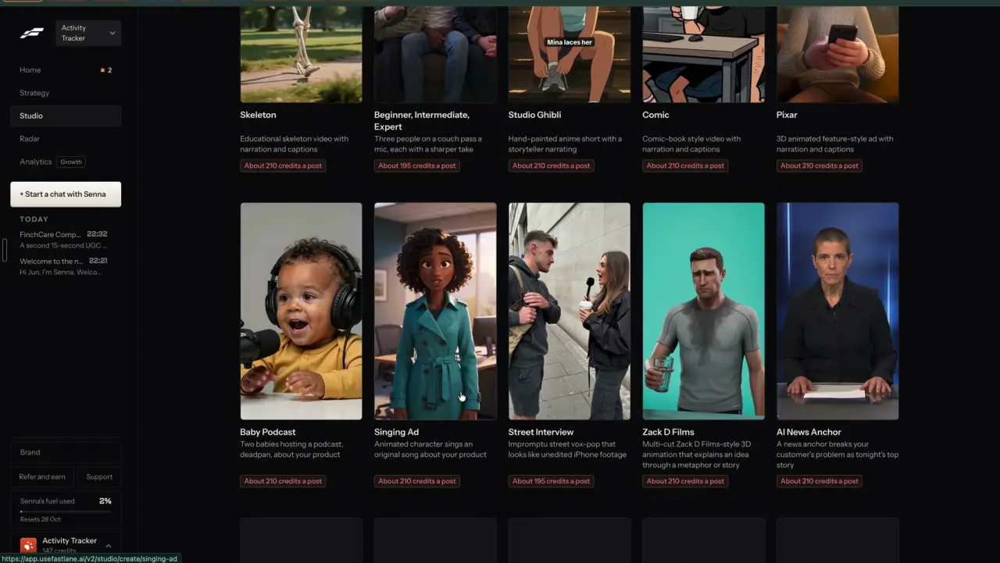
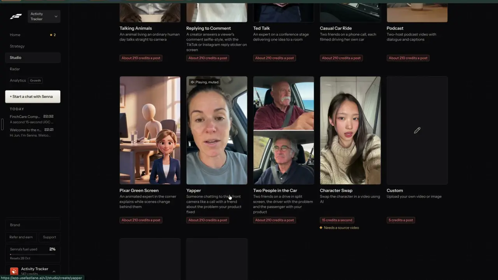

# Animated explainers

`formats-animated` | formats | phase 3 | status: partial | /north-star#formats-animated

## Leo asked

19 Oct 2026: "the idea is that one can remix any content format and the ai will regenerate"

No direct ask for animated looks by name; the rest is from the competitor research. The north-star page already set the naming rule: no brand-named styles (Pixar, Lego, Barbie, Studio Ghibli, Zack D Films), plain names only.

## How the best do it

### Fastlane

Studio > Content formats has a block of stylised narrated videos, each a 9:16 tile with a preview, a one-line description and "About 210 credits a post" (about US$8.40 at the Starter rate of US$20 for 500 credits).


- "Claymation": "Stop-motion clay ad with narration and captions"
- "Paper Cutout": "Stop-motion paper cutout ad with narration and captions" (slug `paper-cutout`)
- "Felt": "Stop-motion felt ad with narration and captions"
- "Chalkboard": "A hand draws a chalk explainer in sync with a human voiceover"
- "Talking Objects": "A niche object talks straight at the viewer to drive the point home" (preview: a grumpy old sneaker with a face)
- "Lego" and "Barbie" sit in the same block. They are trademarks and we do not copy them as named looks.



- "Skeleton": "Educational skeleton video with narration and captions"
- "Comic": "Comic-book style video with narration and captions"
- "Singing Ad": "Animated character sings an original song about your product"
- "Studio Ghibli", "Pixar" and "Zack D Films" are in this block too, all trademarks. What they stand for in plain words: a hand-painted storybook look, a 3D cartoon look, and a 3D cartoon that explains an idea through a metaphor.



- "Talking Animals": "An animal living an ordinary human day talks straight to camera"
- "Pixar Green Screen": "An animated expert in the corner explains while scenes change behind them" (that one belongs to `formats-green-screen`)

The create pages for these were not opened in the recording. The Yapper page (`formats-talking-head`) shows the shared pattern: script with "Generate", a picker for the character, setting chips, length chips, and the price in a sticky footer before "Generate video".

### Others

- Revid.ai offers style presets on its videos: ULTRA_REALISM, MOVIE, MINECRAFT, LEGO, CLAYMATION, NINTENDO, FANTASY, ZACK_D_3D, REALISM, ANIME_SR ([revid.ai](https://revid.ai/)).
- MakeUGC's style templates include Pixar Style, Lego Style, Simpson Style and Anime, on Seedance 2.0 at 150 credits for 15 s ([makeugc.ai video templates](https://www.makeugc.ai/video-templates-feature)).
- CapCut's Instant AI video takes a script and a style (Realistic film, Cartoon 3D, Cinematic movie), with Seedance 2.5 from US$0.12 a second on Pro in the first month ([capcut.com AI video generator](https://www.capcut.com/tools/ai-video-generator), [pricing](https://www.capcut.com/pricing)).
- Creatify's agent has an `/animated` skill next to `/ugc` and `/podcast` ([creatify.ai/features/agent](https://creatify.ai/features/agent)).
- Icon lists Whiteboard Explainer, Motion Graphic and AI Cartoon style among its 18 ad formats ([icon.com/formats](https://icon.com/formats)).
- Blotato does the same looks as still infographics: Classroom Chalkboard, Whiteboard, Manga Panel, Newspaper ([help.blotato.com](https://help.blotato.com/llms.txt)).

## What we have today

The Explainer, `/edit?panel=ai&kind=explainer` (`Explainer` in `src/components/AiVideo.tsx`, `writeExplainer` and `makeExplainer` in `src/lib/aiVideo.ts`, `supabase/functions/ai-video` modes `script` and `explainer`):

- A topic becomes 3 to 6 scenes, each a line to say and a picture description (gpt-4.1, `SCRIPT_SYSTEM`, cap `ai-video-script` 10). The adviser can edit, reorder and remove scenes.
- One Soul v2 picture per scene (`pictureBody`, 0.09 credits, about US$0.006 each), always realistic, because `pictureBody` appends `PEOPLE_RULE` (`supabase/functions/ai-image/logic.ts`), whose last two sentences are "Polished lifestyle photograph. No text, no words, no logos, no watermarks."
- One ElevenLabs voiceover (7 premade voices).
- The pictures are joined with the voice on the device as a slideshow video (`startSlides` in `src/lib/videoMedia.ts`, stills only) and open in the editor with captions.
- Caps `ai-video` 2 a day, `ai-video-global` 20.

So narration, scenes and captions are live. What is missing is any look other than a photo, and any movement inside a scene. The AI B-roll path already moves a still picture with Higgsfield DoP lite for 5 s at 2 credits (`supabase/functions/ai-image/broll.ts`, `MOTION_MODEL = "higgsfield-ai/dop/lite"`, cap `ai-broll` 3 and `ai-broll-global` 20, on since 2026-10-10 behind the `AI_BROLL_ENABLED` secret), which is the piece that adds movement. Its `motionBody(imageUrl)` sends one fixed prompt that ends "Realistic, no text, no cuts.", so a stylised look needs a prompt argument.

## Build

Add a Look to the Explainer, an option to make the scenes move, and a talking character. Same panel, same job, same caps.

```
Explainer
What it explains [ why a hospital plan has a co-pay ]  [Write it]

Look   [Photo] [Clay] [Paper cutout] [Felt] [Chalkboard] [Comic book] [3D cartoon] [Storybook]
       Recommended: Paper cutout
[x] Make the scenes move   +10 credits

Scene 1 ... Scene 5 (as today)

Voice [Eric v]
5 pictures, about 30 seconds. Costs 10.45 Higgsfield credits (about US$0.65) and 1 voiceover.
[Make the video]                             AI videos: 2 left today
```

### Looks

Each look is a style line that replaces "Polished lifestyle photograph." in the picture prompt, plus a motion line for DoP. Put them in a new `EXPLAINER_LOOKS` table in `supabase/functions/ai-video/logic.ts` so the browser and server read the same list (not `LOOKS`, which already holds the six presenter descriptions in `src/lib/aiVideo.ts`).

| id | label | style line (end of the picture prompt) | motion line |
|---|---|---|---|
| `photo` | Photo | Polished lifestyle photograph. (today) | Slow, steady camera push in with gentle natural movement. |
| `clay` | Clay | Handmade stop-motion clay figures and sets, visible fingerprints in the clay, soft studio light, shallow depth of field. | Stop-motion movement at 12 frames a second, small jerky steps. |
| `paper` | Paper cutout | Layered paper cutout scene, flat cut paper shapes with soft shadows between layers, craft paper texture. | Paper layers slide and bob slightly, stop-motion steps. |
| `felt` | Felt | Needle-felted wool figures and sets, fuzzy texture, warm light. | Stop-motion movement, small steps. |
| `chalk` | Chalkboard | White and coloured chalk drawing on a dark green chalkboard, simple line drawings and arrows, chalk dust. | A hand draws the lines in; the drawing builds up. |
| `comic` | Comic book | Comic book panel, bold ink outlines, flat colours, halftone dots. | Slow pan across the panel. |
| `cartoon3d` | 3D cartoon | Bright 3D animated film look, rounded characters with big expressive eyes, soft global light. | Characters move gently, camera drifts. |
| `storybook` | Storybook | Hand-painted watercolour storybook illustration, soft edges, gentle colours. | Slow drift, light shifts. |

People stay Singaporean in every look (keep the first part of `PEOPLE_RULE`). Never a brand name in any line: a test fails the build if any look text contains Pixar, Disney, Lego, Barbie, Ghibli, Zack D, Simpsons, Minecraft or Nintendo.

The picture model: try Soul v2 with each style line first, since it is wired and costs 0.09 credits. `pictureBody` appends `PEOPLE_RULE`, so for a stylised look swap its one sentence "Polished lifestyle photograph." for the look's style line and keep the rest, including the no-text line. If Soul keeps drifting back to photos (check 5 scenes a look by eye), a second Higgsfield image model is the fallback. Seedream v4 (`bytedance/seedream/v4/text-to-image`) is the candidate, but neither its route on Higgsfield's API nor its price was checked for this spec (unverified): confirm both with Higgsfield's free `POST /estimate` before switching, and write the number next to `PICTURE_CREDITS`.

### Movement

"Make the scenes move": each scene's picture goes through DoP lite for 5 s with the look's motion line. Two calls, so no edge function sits waiting on six pictures:

1. `explainer` mode `{pictures, look, move}` makes the pictures as today and takes the `ai-video` and `ai-video-global` uses as today. The device waits for them with `waitFor` as now.
2. A new `ai-video` mode `move` `{tokens}` takes those picture tokens (signed for this adviser, `openJobToken`), reads each finished picture's link from Higgsfield's status, and submits one DoP lite job per picture with `motionBody(imageUrl, prompt)`; no new cap use is taken. Add the optional `prompt` argument in `ai-image/broll.ts` and import it the way `ai-video` already imports from `ai-image/logic.ts`. A video moves once: `claimOnce(admin, uid, "move:<first picture id>")` refuses a second call with "These scenes are already moving."

The motion tokens are polled without a refund ticket, so a DoP failure keeps the use (the video still gets made). The device polls them with a variant of `waitFor` that returns `null` for a failed job instead of throwing; that scene stays a still.

On the device, extend `startSlides` in `src/lib/videoMedia.ts` so a scene can be `{video: Blob, seconds}` as well as `{image, seconds}`: it draws the clip's current frame and holds the last one when the scene runs past 5 s. The voiceover stays the slideshow's sound track, so captions work as they do for explainers now. Joining muted clips with `startJoin` would mean handing the voice to the editor as a second track, which is more code for the same video.

Scene length follows the voice as today (`sceneSeconds`).

### Talking character

A ninth pill, "Talking character", for Talking Objects and Talking Animals. The adviser types what the character is ("an old sneaker", "a tired office cat"), picks a look, and writes or generates a short script. The server makes one stylised picture of that character facing the camera with a mouth, then runs the existing `avatar` path (Speak per slice). Speak on a non-human face is unverified: test five characters before shipping the pill, and leave the pill out if fewer than four come back with moving lips.

### Screens and states

- Empty: as today. The Look row shows once scenes are written, with Photo picked.
- Recommended: after "Write it", Jev's pick gets a small "Recommended" tag. No tag when Jev is unsure or down.
- Writing, making, putting together: as today ("Writing...", the job steps), plus "Making the scenes move, 2 of 5..." when moving.
- Done: the editor opens with captions; the draft goes to My posts with the look saved on it.
- Failed: as today, with "Try again at no cost" when pending paid jobs remain. A DoP failure on one scene keeps that scene as a still and says "Scene 3 stayed still; it didn't come through as a moving clip." The use is kept, because the video was made.
- Safety filter: "The safety filter blocked it. Try another photo or wording."
- Over the cap: "You've used all 2 for today. It resets at 8am Singapore time."
- Compliance: the scenes' lines go through `scanCompliance` and the Jev `MAS_QUESTION` (defined in `formats-skits`; add it to `ai-video/logic.ts` if it is not there yet), and a flag shows the warn chip without blocking the video.

### Copy

- "Look"
- Look pills: "Photo", "Clay", "Paper cutout", "Felt", "Chalkboard", "Comic book", "3D cartoon", "Storybook", "Talking character"
- "Recommended"
- "Make the scenes move" with the chip "+10 credits" (2 credits a scene times the scene count)
- "These scenes are already moving." (a second `move` call)
- Talking character field: "Who's talking", placeholder "An old sneaker that has walked too many MRT stairs"
- Steps: "Making the pictures, 2 of 5...", "Making the scenes move, 2 of 5...", "Putting your explainer together..."
- Price line via the existing `cost()` helper: "Costs 10.45 Higgsfield credits (about US$0.65) and 1 voiceover."

### Data

- No table and no schema change.
- The last look per brand, synced: `content-studio-explainer-look-${scoped(userId)}` (`{look, move}`).
- The look id is kept on the draft's storyboard entry so a remix can reuse it.

### AI and cost

- Script: unchanged, gpt-4.1, `ai-video-script`.
- Jev picks the look, in the same `script` call after the scenes come back:
  - type `choice`, instructions: "A licensed Singapore financial adviser is making a 30-second narrated explainer for Instagram and TikTok on the topic below. Which picture style makes it easiest to follow and most likely to be watched to the end, while still looking trustworthy for a money topic?"
  - criteria: `photo` "realistic photos of people and places", `clay` "clay stop-motion figures", `paper` "layered paper cutouts", `felt` "felt figures", `chalk` "chalk drawings on a chalkboard, good for numbers and steps", `comic` "comic book panels", `cartoon3d` "a bright 3D cartoon", `storybook` "a painted storybook".
  - Proposed threshold: tag the top pick when its probability is 0.4 or more. Set it after running 40 real topics from Leo's drafts and reading every pick. Null falls back to no tag.
- Pictures: Soul v2 at 0.09 credits a scene, or Seedream v4 at its estimate.
- Movement: DoP lite at 2 credits a scene (Higgsfield's estimate, 2026-10-09, in `broll.ts`). Five moving scenes: 0.45 + 10 = 10.45 credits, about US$0.65.
- Voice: ElevenLabs, one `ai-voice` use, as today.
- Talking character: one picture plus Speak, up to 88 credits (US$5.50), as You speaking.
- No new caps. A moving explainer costs at most 6 x 2.09 = 12.5 credits, well under the 88-credit avatar ceiling `ai-video` was sized for. It takes one `ai-video` and one `ai-video-global` use as today.
- Fastlane: about 210 credits, about US$8.40.

### Deep links

| URL | Opens |
|---|---|
| `/edit?panel=ai&kind=explainer` | As today |
| `/edit?panel=ai&kind=explainer&look=clay` | The explainer with that look picked. Values: photo, clay, paper, felt, chalk, comic, cartoon3d, storybook, character. Unknown falls back to photo. Replace. |

Add `look` to the `edit` builder in `src/lib/links.ts` and a row in `docs/deep-links.md`, and drop `look` with `kind` and `template` when the AI panel closes (`closePanel` in `src/pages/VideoEditPage.tsx`).

### Gate

The Look row and the Talking character pill show only when `leoOnly(email)`; anyone else sees today's Explainer. The server ignores `look` and `move` for anyone else and makes a photo explainer, so a typed URL costs nothing extra. Server email list in `supabase/functions/_shared/leoOnly.ts` (shared with `formats-skits`).

## Done when

- [ ] Every look makes a 5-scene explainer whose pictures are clearly in that look, checked by eye on Leo's account at 390 px and 1440 px.
- [ ] "Make the scenes move" gives a video where every scene moves and the voice runs under all of it.
- [ ] The price chip matches the credits the server reports, with and without movement.
- [ ] A DoP failure on one scene leaves a still and the rest of the video intact.
- [ ] No look text, label or prompt contains a brand-named style (test below).
- [ ] Talking character either ships with four of five test characters speaking, or is left out with a note in this file.
- [ ] Non-Leo accounts see today's Explainer only.
- [ ] `src/data/northStar.ts` item flipped with its `ours` line, in the same commit.

## Tests

- `supabase/functions/ai-video/logic.test.ts`: `pictureBody(picture, look)` carries that look's style line in place of "Polished lifestyle photograph." and still carries the Singaporean people rule and the no-text line; `pictureBody(picture)` is unchanged; `parseVideoRequest` for `explainer` accepts a known `look` and `move`, and drops an unknown look to `photo`.
- A brand-name test over `EXPLAINER_LOOKS` (labels, style and motion lines): none of the banned names, case-insensitive.
- `explainerCredits(scenes, move)` returns 0.09 a scene, plus 2 a scene when moving.
- `supabase/functions/ai-image/broll.test.ts`: `motionBody(url)` still sends today's prompt; `motionBody(url, prompt)` sends the given one.
- `supabase/functions/ai-video/logic.test.ts`: `parseVideoRequest` for `move` takes 3 to 6 tokens and refuses more; the claim key is built from the first picture id.
- `src/lib/aiVideo.test.ts`: a moving explainer hands `startSlides` its scenes in order, a video for each scene that moved and the still for a scene whose DoP job failed, and polls the motion tokens without a refund ticket.
- `src/lib/links.test.ts`: `links.edit({panel: ["ai"], kind: "explainer", look: "clay"})`.
- The Jev pick falls back to no tag when `askJev` returns null (mock it).

## Open questions

- A singing ad needs a song with words. ElevenLabs Music is wired in `text-voice` (mode `music`, instrumental only today) but hidden in the app (`AI_MUSIC = false` in `src/lib/aiMusic.ts`), and whether it sings given lyrics is unverified. Leo decides if it is worth testing.
- Skeleton: Fastlane's "Educational skeleton" is a skeleton character in everyday scenes. Fine for MoneyBees, odd for advisers. Leo decides if it joins the looks.
- If Seedream v4 is needed for the looks and costs much more than Soul, Leo approves the new price before it ships.

## Related

`formats-gallery`, `formats-faceless-video`, `formats-green-screen`, `formats-skits`, `formats-talking-head`, `remix-any-format`, `edit-video`, `edit-captions`, `people-ai-labels`, `trust-compliance-check`, `business-cost-preview`
