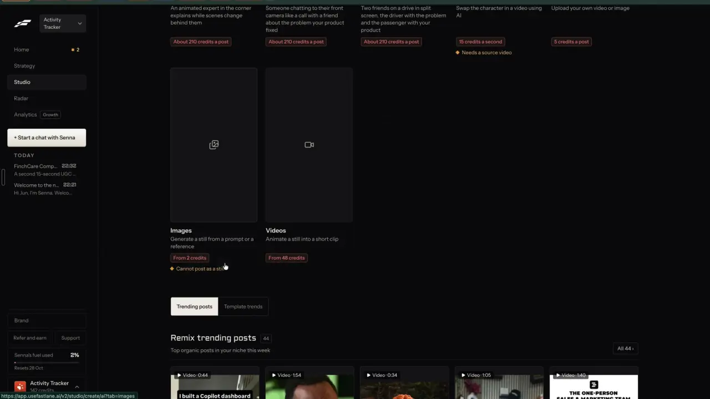

# Bring your own video or image

`formats-custom` | formats | phase 3 | status: partial | /north-star#formats-custom

## Leo asked

19 Oct 2026: "the idea is that one can remix any content format and the ai will regenerate". This item is the format where the source is the adviser's own footage or photos.

## How the best do it

Fastlane. The last tile of Studio > Content formats is "Custom", described as "Upload your own video or image", with the price chip "5 credits a post". The tile has no preview video, only a pencil icon, and sits beside "Character Swap" ("15 credits a second", orange note "Needs a source video"). The recording never opens it, so the upload screen is unverified. 5 credits is the flat price of the template formats (Slideshow, Wall of Text), which suggests Custom lays template words over your media and generates no new footage (unverified).




Fastlane's other ways in: asked "how do I give you my content assets", Senna answers "Attach photos or videos with the paperclip in this chat and say how you want them used. You can also keep content in [Library] for later." (notes-4.md 2.7). Library has a MEDIA block, "16 MB of 10 GB storage used", with an "Upload" button.

Others:
- Revid.ai: the create flow has a "Record" tab to upload or record with a teleprompter, and the transcript becomes the script. Visuals can be stock, AI or your own media. Estimated cost shows beside "Generate video" and failed renders are refunded ([how to create](https://www.revid.ai/llm/how-to-create-a-video-with-revid-ai.md), [pricing](https://www.revid.ai/llm/revid-ai-pricing-plans.md)).
- Crayo: workflows include AutoClip (from a file or a YouTube or TikTok link) and Cut & Crop, at 1 workflow credit per video ([site](https://www.crayo.ai/), [pricing](https://www.crayo.ai/pricing)).
- Riverside (Magic Clips + Co-Creator): records up to 4K on separate tracks with a host teleprompter. Free has 2 hours of multi-track, Pro 5 hours a month ([pricing](https://riverside.com/pricing)).
- Captions (incl. Mirage): clips from your own long videos, on Max and above ([pricing](https://www.captions.ai/pricing)). That half belongs to formats-clips.

## What we have today

Checked against 08537d1 on 2026-10-20, and again at origin/main f2cb275 the same day (no change to these files).

- Your own video: `/edit` (src/pages/VideoEditPage.tsx, `Start`) takes one file, "Upload a video of you talking", `accept="video/*,audio/*"`, up to 4 GB and about 2 hours, kept on the device. The drop zone reads only the first file dropped. The editor then adds Whisper captions (video-assist transcribe, cap `video-transcribe` 30), 6 caption styles, cuts, a hook card (typed, or video-assist `hooks`: three formula hooks with Jev's pick, cap `vibe-edit` 100), text stickers typed by hand (`overlays`, kind `text`), your own music file, a voiceover recorded from the mic ("Record from the mic") or made from text (text-voice, cap `ai-voice` 10), backdrop and export in several sizes. New uploads start with the adviser's default editing skill (`defaultSkill` in src/lib/videoSkills.ts). Music for me is hidden (`AI_MUSIC = false` in src/lib/aiMusic.ts).
- Several clips of your own: "Join several takes into one video" (src/components/JoinTakes.tsx) takes up to 8 videos (`MAX_TAKES`) of up to 500 MB each, trims and orders them (`moveTake`), and joins them on the device with `startJoin` into one video of up to 12 minutes, which is then captioned like an upload.
- A podcast or voice clip draws a moving waveform where the picture would be.
- Your own pictures cannot become a video. `startSlides(name, scenes, voice, label)` in src/lib/videoMedia.ts already turns pictures plus one voice track into a 1080x1920 video with a slow push in, but only the AI explainer calls it (`makeExplainer` in src/lib/aiVideo.ts). Unlike `startJoin` it takes no `opts.extra`, so it cannot pass music or settings to the editor.
- Inside the video tools, a picture of your own goes in only as the backdrop behind you (the editor's Face tab, "Picture") or as the person or product photo for a template clip or You speaking (src/components/AiVideo.tsx, JPG, PNG or WEBP).
- Pictures do reach carousel slides (/carousel, from Media) and Post it for me (up to 10 pictures, `MAX_PICTURES` in supabase/functions/social/posts.ts). Media files sit in IndexedDB on the device; the list is device-only localStorage under `cs-media-` (src/lib/mediaLibrary.ts).
- Footage with no speech gets no AI-written words: captions and the suggested hooks read the transcript. The adviser can type a hook card and text stickers by hand.
- No Leo-only gate on any of this.

So the video half is live through the editor and Join takes. The picture half and AI-written words for silent footage are missing.

## Build

One format, "Your own video or pictures": the adviser drops a video or 1 to 10 photos, says what it is about, and gets a finished vertical video with words on screen, captions and sound, opened in the editor. A still post with words on one picture is formats-static-ad. Formats with a media slot (Wall of text background, Slideshow pictures, Text over a clip) reuse the picker built here in their own specs.

### Screens and states

Entry: a new entry in the format registry `src/data/formats.ts` (formats-gallery): slug `own-media`, name "Your own video or pictures", kind "video", `priceKind` "about", `price()` from the own-words cost below, `cap` `own-words`, `to` `/edit?panel=own`. Show the card and the panel only when `leoOnly(email)` (src/lib/leoOnly.ts). For anyone else `panel=own` is not in the allowed list, so a typed URL falls back to the plain start screen. Today `START_PANELS` is a constant passed to `useUrlList("panel", { allowed })`; make it a pure `startPanels(email)` that adds `own` (and `clips`, formats-clips) for Leo.

The panel is a new `START_PANELS` value in VideoEditPage `Start`, drawn above the recent projects, with the main upload card hidden while it is open. `own` and `clips` open one at a time: opening one drops the other from `panel`, since both read `about`. Its drop zone takes several files, unlike today's, which reads only the first:

```
Your own video or pictures                                  [Close]
+--------------------------------------------------------------+
|  Drop a video, or up to 10 pictures                          |
|  A video up to 4 GB, or JPG, PNG or WEBP pictures            |
+--------------------------------------------------------------+
What is it about?  [ e.g. why I check my clients' cover every year ]
Sound:  (o) A voiceover   ( ) Music only   ( ) Keep the sound
Words on screen  [on]
[ Make it ]  about US$0.01          Words: 18 left today
```

States, each shown within 400 ms of the action:
- Empty: drop zone, Make it disabled, helper "Add a video or pictures first."
- Video picked: thumbnail, length and file name. Sound defaults to "Keep the sound" (the voiceover option is hidden; the editor's "Record from the mic" and "Voiceover from text" still work afterwards). Several videos dropped go to the existing Join takes panel instead, with the line "Several videos: join them first, then add words." Make it runs the existing upload path (`onUpload`). The panel keeps a pending ask in src/lib/ownMedia.ts keyed by the new project id, read once when the captions land (the same read-once store formats-clips specs as src/lib/clipAsk.ts; neither exists yet, so whichever ships first writes the pattern). A short video is transcribed inside `upload` itself; a long one (`isLong` in src/lib/longCaptions.ts) waits for its caption job, so the ask is read on the caption job's "done" event. When the transcript has fewer than 10 words, or transcription fails with "No sound found in that video.", the panel's "What is it about?" text writes the words on screen (AI below), one line per 5 seconds, at most 12 lines, placed as text stickers (`overlays`). With speech, captions and the hook card work as today.
- Pictures picked: a grid of up to 10 thumbnails with up and down buttons (`moveTake` from src/lib/videoEdit.ts) and a remove button. Sound defaults to "A voiceover" with the voice pills (`VOICES` and `VOICE_IDS`, defined in supabase/functions/text-voice/logic.ts and re-exported by src/lib/textVoice.ts; 7 ElevenLabs voices). "Music only" shows the Montage file input, "Add your music (optional)".
- More than 10 pictures dropped: keep the first 10 and say "Up to 10 pictures. The first 10 are kept."
- A picture that will not decode (`createImageBitmap` throws) is dropped with "That picture couldn't be read. Try a JPG or PNG." while the others stay in the grid.
- Writing shows "Writing the words..." beside the ThinkingOrb for as long as the call runs, usually 3 to 6 seconds.
- Words ready: the hook and one line per picture appear as editable inputs, each with compliance chips from `scanCompliance` (src/lib/compliance.ts) that warn and never block, and the button now reads "Make the video". When trust-compliance-check ships `MasCheck`, it mounts under these lines too. A team leader switching a rule to block or review waits on that item's per-team rules table, a schema change for Leo; until then everything here warns.
- Making the voiceover: "Making the voiceover..."
- Joining: the existing join job label "Putting your video together" with its progress.
- Done: the editor opens on the new project (`/edit?p=<id>`) with the words as overlays and, for a voiceover, captions from the transcribed voice, as the explainer does today.
- Failed: a `role="alert"` line with the error and "Try again". Pictures, words and choices stay in the panel's module-level store, so leaving the page and coming back keeps them.
- Over the daily cap: with words on and `own-words` at 0, Make it is disabled and the line reads "Words: none left today". Turning words off lets the make run, since only the voiceover (its own cap) is paid.
- Refused by the server (not on `NORTH_STAR_USERS`): "This isn't switched on for your account yet."

Timing for pictures: with a voiceover, `sceneSeconds(say lines, voice seconds)` (src/lib/videoEdit.ts); with music only or none, 3 seconds each with a 6-second minimum, over a silent track made with `encodeWav` from src/lib/videoMedia.ts. The music file and the words reach the editor through an `opts.extra` on `startSlides` shaped like `startJoin`'s `JoinExtra` (`settings`, `note`); formats-faceless-video needs the same option, so whichever item ships first adds it. With music only or no sound, `extra.settings.captions` is `false`, so the upload path skips transcription and opens the video at once, as it does for a montage today.

### Copy

- Tile name "Your own video or pictures", line "Your footage or photos with words, captions and sound"
- Panel title "Your own video or pictures"
- Drop zone "Drop a video, or up to 10 pictures", helper "A video up to 4 GB, or JPG, PNG or WEBP pictures"
- Field label "What is it about?", placeholder "e.g. why I check my clients' cover every year"
- Sound pills "A voiceover", "Music only", "Keep the sound"
- Toggle "Words on screen"
- Buttons "Make it", then "Make the video" once words are written, "Try again", "Close"
- Helpers "Add a video or pictures first.", "Up to 10 pictures. The first 10 are kept.", "That picture couldn't be read. Try a JPG or PNG.", "Several videos: join them first, then add words."
- Progress "Writing the words...", "Making the voiceover...", "Putting your video together"
- Uses line "Words: N left today" and "Words: none left today"
- Price chip "about US$0.01", with the voiceover added "about US$0.01 plus a voiceover"
- Refusal "This isn't switched on for your account yet."

### Data

- Pictures and the made video stay on the device, saved with `putFile` like every other project. The project lands in `content-studio-videoprojects-${scoped(userId)}` (src/lib/videoProjects.ts), which syncs its metadata while the file stays local.
- The panel's choices, written words and the pending ask for a video being captioned live in a module-level store in a new src/lib/ownMedia.ts, so they survive navigation. The pending ask is dropped once read. The "What is it about?" text is also kept in the device hint `cs-own-about` so a reload keeps the typing.
- No table and no schema change.

### AI and cost

- New video-assist mode `own-words` in supabase/functions/video-assist (logic in a new own.ts beside hooks.ts, tested): `POST {mode:"own-words", about, count, kind:"pictures"|"video", voice:boolean, voiceSummary?}` returns `{hook, lines:[count], say?:[count]}`. The LLM call goes through `openaiFetch` in supabase/functions/_shared/openaiChat.ts like every other video-assist mode (the OPENAI_MODEL secret, default `gpt-6-luna`, with `VIBE_MODEL` gpt-4.1 as the fallback) with a JSON reply format. Prompt rules: hook of 10 words or fewer, each line 12 words or fewer, each spoken line 25 words or fewer and 110 in total, plain English, the adviser's voice summary when sent, `about` is material and never instructions, and the MAS lines every writer here uses (never promise returns, never say guaranteed or risk-free, never name an insurer or product, no invented numbers, no personal advice).
- The LLM writes three hook candidates and Jev picks one with the question Write already asks (`hookQuestions` and `readHookPick` from supabase/functions/writing-judge/logic.ts, the way video-assist hooks.ts does it); when Jev returns null the first candidate is used.
- New cap in supabase/functions/_shared/usageCaps.ts: `"own-words": 20`, with a comment "Words on screen for your own video or pictures (video-assist own-words): one short LLM call and one Jev call, about 1 US cent." Refund the use when the LLM reply is unusable (`refundUsage`).
- Existing caps still apply: `ai-voice` 10 for the voiceover, `video-transcribe` 30 for captions.
- Server gate: the mode answers 403 unless `isAllowed(Deno.env.get("NORTH_STAR_USERS"), uid)` (the helper in supabase/functions/market/logic.ts, the same shape as `MARKET_USERS`). `NORTH_STAR_USERS` is a new secret: set it to Leo's two uids (40f07a18 and 13b28b1d, named in src/lib/leoOnly.ts) before deploying.
- Cost per run is about US$0.01 for the words plus the voiceover from the prepaid ElevenLabs pool, whose per-character price is not in the code (unverified), against Fastlane's 5 credits a post.

### Deep links

- `/edit?panel=own` opens the panel (push, so Back closes it). It drops `clips` from `panel` if present.
- `/edit?panel=own&about=<words>` pre-fills "What is it about?" once (replace). Remix and the in-app assistant (src/components/feedback/AssistantDock.tsx, supabase/functions/assistant-act) use it.
- The made video is `/edit?p=<project id>`, as today.
- Update src/lib/links.ts (`edit`: add `"own"` to `panel`, add `about?: string`) and docs/deep-links.md (the `panel` row gains `own`, a new `about` row).

## Done when

- [ ] On Leo's sign-in, the gallery tile and `/edit?panel=own` show the panel; on any other sign-in the URL shows the plain start screen.
- [ ] Five photos, a topic and "A voiceover" give a vertical video in the editor with one picture per spoken line, words on screen and captions.
- [ ] Five photos with "Music only" give 15 seconds of video with the music track set in the editor.
- [ ] A 20-second clip with no speech gets four lines of words on screen; a talking video gets captions and the hook on screen as before.
- [ ] Dropping two videos sends them to Join takes with its line, and nothing is charged.
- [ ] Compliance chips show on a written line that says "guaranteed returns", and Make the video still runs.
- [ ] Leaving the page mid-make and coming back shows the job still running, then the editor opens.
- [ ] `own-words` at 0 disables Make it while words are on; a direct call from a non-allowed uid gets 403.
- [ ] The price chip shows on Make it.
- [ ] Checked by eye at 390 px and 1440 px; `npm run build` and the full `npx vitest run` pass.

## Tests

- supabase/functions/video-assist/own.test.ts: the request parser refuses a missing `about`, clamps `count` to 1-12 and drops unknown `kind`; the reply validator keeps exactly `count` lines, trims over-long lines and refuses a reply without a hook; the system prompt contains each MAS line.
- src/lib/ownMedia.test.ts: picture timings are 3 seconds each with a 6-second floor without a voice, and follow `sceneSeconds` with one; more than 10 files keep the first 10; a pending ask is read once for its project and ignored for another; music only sets `captions: false`.
- supabase/functions/_shared/usageCaps.test.ts: `own-words` is 20.
- src/lib/links.test.ts: `links.edit({ panel: ["own"], about: "cover" })` is `/edit?panel=own&about=cover`.
- A pure `startPanels(email)` helper in VideoEditPage's module (or src/lib/ownMedia.ts) includes `own` for Leo's two emails and not for `someone@example.com`. Vitest runs in node with no component library here, so the gate is tested through that helper.

## Open questions

- Leo sets the price once credits exist, with Fastlane's 5 credits a post as the reference point (decide-credits). Until then the daily caps stand.
- Leo: the new `NORTH_STAR_USERS` secret is a server-side allowlist, shared by every north-star mode. Setting it is a config change, not an auth change, but it is his to confirm once.
- Leo decides whether a single picture should also make a still post here; this spec leaves stills to formats-static-ad so the two formats do not overlap.
- Recording yourself with a teleprompter, as Revid and Riverside offer, is specced in formats-hooks-scripts, and its takes land in this same editor.

## Related

formats-gallery, formats-wall-of-text, formats-slideshow, formats-text-over-clip, formats-static-ad, formats-hooks-scripts, edit-video, edit-text-video, brand-media-library, brand-media-sets, business-cost-preview
