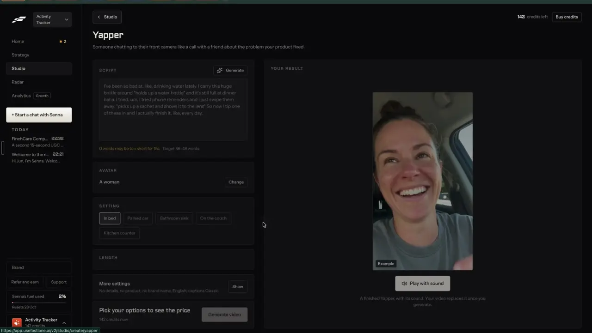

# Hooks and scripts you film yourself

`formats-hooks-scripts` | formats | phase 3 | status: partial | /north-star#formats-hooks-scripts

## Leo asked

19 Oct 2026: "the idea is that one can remix any content format and the ai will regenerate". For an adviser who films, the format the AI regenerates is the script: a proven hook, the points, the call to action and the shots.

## How the best do it

Fastlane makes scripts for its own AI videos rather than for the adviser to film. Senna's composer has a "Script" chip, and Home's "Ask Senna for" tiles include "Scripts and captions" ("Write 3 captions for my next post"). When it proposes a video, the approval card carries a "STORYLINE AND SHOTS" grid: numbered beats ("1 Open with the overlooked problem of inconsistent outreach.") each with a direction ("Same person filming selfie-style in a quiet, everyday workspace, looking directly into camera."). The footer has "Change the script" and "Try another format", greyed once approved. A remix of an ad says "Senna breaks the video down, writes a script and storyboard for Activity Tracker, then makes it with Seedance."


The one format page the recording opens, Yapper, starts with a "SCRIPT" card; whether every format page has one is unverified. Its "Generate" button (sparkle icon) writes the script, and the textarea's grey example shows the style: spoken filler words and stage directions in asterisks ("*holds up a water bottle*"). Under it a live word count checks the length: "0 words may be too short for 15s" in orange and "Target 36-48 words" in grey for the default 15 seconds. Only 15 seconds was seen; the notes read the target as scaling with the LENGTH chips, about 2.4 to 3.2 words a second (unverified; notes-2.md F5).



Others:
- Foreplay Briefs: an AI script generator from product, company, audience and language. "Regenerate Versions" makes new hooks, CTAs and copy variants to split test, and Multi-Language translates into 150 or more languages. Its storyboard builder gives scene descriptions, an AI sketch per scene, the on-screen text and scene iterations. The script generator is unlimited on its pricing table ([briefs](https://www.foreplay.co/briefs), [pricing](https://www.foreplay.co/pricing)).
- Sandcastles: "dozens of hooks in seconds" from hook templates that have millions of views, and an MCP server that hands out working hook patterns as reusable templates ([site](https://www.sandcastles.ai/), [MCP](https://www.sandcastles.ai/mcp)).
- ViralBrain (2026 entrant): "AI hooks that stop the scroll", built from 100K or more viral hooks ([site](https://www.viralbrain.ai/)).
- YouTube Studio Inspiration tab (native): picking an idea shows cards labelled Hooks, Outlines, Titles, Thumbnails and Related videos ([help](https://support.google.com/youtube/answer/15575509?hl=en)).
- CapCut "Script to video" gives five script options to pick from before anything is made ([tool](https://www.capcut.com/tools/script-to-video-maker)).
- Revid.ai and Riverside (Magic Clips + Co-Creator) both record with a teleprompter in the browser; in Revid the transcript of that take becomes the script ([Revid](https://www.revid.ai/llm/how-to-create-a-video-with-revid-ai.md), [Riverside](https://riverside.com/pricing)).

## What we have today

Checked against 08537d1 on 2026-10-20, and again at origin/main f2cb275 the same day (no change to these files). Write already makes a filmable script. What it lacks is proof behind the hooks, titles for the script, and a way to film it in the app.

- Write (/generate, src/pages/GeneratePage.tsx): a "Pick a hook" card of three hooks for every format, each written with a different named formula from src/lib/hookFormulas.ts (21 formulas such as "Contrarian take", "Number reveal", "Mistake confession", each with a template, an example, what it is best for and its trap; each row shows "<name>. Trap: <trap>"). Jev marks one "Recommended" (writing-judge, cap 60). Each new hooks run takes the next set of three (`hookFormulaSet`). Picking a hook drafts "Three variations" with "Re-roll 3". For format "short-video" the script comes as HOOK, BODY and CTA plus a caption (`splitScriptCaption` in src/lib/scriptCaption.ts), at 15, 30 or 60 seconds picked in `ReelLengthPicker` (`reelLengthRule` in src/lib/platformCounters.ts). A chip reads "Script: N words, about Ns" (`spokenWords`, `spokenSeconds`) and warns "Long for 15s. Aim for 35-40 words." (`reelTooLong`), with no warning for a script that is too short. `?formula=<id>` pre-picks a formula from Plan, Coach, Carousel and the assistant.
- The formulas are written shapes, ported from an MIT LinkedIn skill, and none is tied to someone else's post or its numbers. The adviser's own results by formula already exist: Analytics breaks engagement down by hook formula (`/analytics?by=hook-formula`, src/lib/analytics.ts, from the `hookFormula` saved on each draft).
- "Make a storyboard" (src/lib/storyboard.ts, edge function storyboard through `openaiFetch`: the OPENAI_MODEL secret first, gpt-4.1 as the fallback; cap `storyboard` 30) splits the script into beats (say, on screen, show, seconds), saved on the draft and shown by src/components/ShotList.tsx. "Mark ready to film" moves the draft to the board's "To film" column.
- Clone a reel (/clone) writes hook options by formula, a script, a shot list and "Filming notes" from a reel, with "Add to board". Trend kits (src/data/trends.json, 10 kits) carry three hooks each.
- Titles exist only for a finished video (video-assist `publish`, cap `video-publish` 30). There is no teleprompter: /create-guide only tells advisers "use the script from Write as your teleprompter".
- Recording in the browser exists for sound only: the editor's "Record from the mic" voiceover (`startVoice` in VideoEditPage.tsx, `getUserMedia` plus `MediaRecorder`). Nothing records the camera. `pickMime` in src/lib/videoMedia.ts picks a recording format but is not exported.
- The Write hooks call goes to generate-social-content, which lives on the academy project and is not deployed from this repo, so hook shapes travel inside the brief (`hookFormulaFields` puts the formula into `styleReference`).

Two neighbours own parts of this item's scope, and this spec builds on them:
- remix-patterns builds the weekly hook bank (`src/data/hookBank.json`, written by `scripts/hook-bank.mjs`, real opening lines filed under each formula with the creator and their ratio) and the `/swipe?tab=hooks` tab.
- remix-variations builds "Try new hooks" on a draft (three new hooks over the same body, "Save all as a hook test") and the test's results.

## Build

Three pieces on Write's short-video script, plus one small check: proven hooks in "Pick a hook", titles for the script, a teleprompter that records, and a warning when a script is too short for its length.

### Screens and states

All of it shows only when `leoOnly(email)`.

1. Proven hooks. The "Pick a hook" card gets a two-pill switch above the list: "Formulas" (today's rotation) and "Proven in your niche". The second picks the three formulas with the strongest real lines in the hook bank (most lines at ratio 1.0 or more, then best ratio), still written through `hookFormulaFields`, and each row adds the bank's evidence line with "Open post": "Seen in @handle, 3.4x their usual". The pill is disabled with the tip "Proven hooks arrive with the weekly refresh." until the bank has lines under at least 3 formulas. Streaming, failure and the Recommended tag behave as today.

```
Pick a hook                    [ Formulas | Proven in your niche ]
A  I reviewed 40 young families' plans this year. 31 had the same gap.
   Number reveal. Seen in @handle, 3.4x their usual   [Open post]
B  ...
```

2. Titles. "Write 3 titles" under a short-video script calls video-assist `publish` with the script lines as sentences (times spread at 2.5 words a second, so `duration` passes the 3-second floor) and shows three titles and a cover line, each with Copy, saved on the draft. The reply's `at` (Jev's cover moment) is ignored for a script. States: "Writing titles..." within 400 ms; done; failed with "Couldn't write titles right now. Try again in a minute."; over the cap with "Titles: none left today" and the button disabled.

Too short. Write's word chip warns only when a script runs long. Add the short side Fastlane shows: a `reelTooShort(words, seconds)` beside `reelTooLong` in src/lib/platformCounters.ts returns "Short for 15s. Aim for 35-40 words." under `reelWordRange(seconds).min`, shown in the same amber alert line. It is arithmetic on the page, with no AI.

3. Teleprompter. "Film it" on a short-video script opens a full-screen view at `/generate?draft=<id>&view=prompter`:

```
  [x]                                        Slow | Normal | Fast   A- A+  Mirror
  -----------------------------------------------------------------------------
        The lines scroll here, large, in the top third, near the camera.
  -----------------------------------------------------------------------------
   [ Start ]    [ Record with my camera ]
```

- The text is the storyboard's `say` lines when the draft has a storyboard, else HOOK, BODY and CTA from `splitScriptCaption`.
- Start runs a 3-second count-in, then scrolls at 2.0, 2.6 or 3.2 words a second (Slow, Normal, Fast). Space pauses and resumes; Esc or the close button leaves.
- "Record with my camera" asks for the front camera and microphone (`getUserMedia({ video: { facingMode: "user" }, audio: true })`, the pattern of the editor's mic voiceover), shows the camera behind the dimmed text and records with `MediaRecorder` in the format `pickMime` chooses (export it from src/lib/videoMedia.ts). Stop shows "Use this take" and "Record again".
- "Use this take" opens /edit with the take as an upload, through a module-level hand-off that VideoEditPage reads on mount, and moves the draft to the board's Editing column (`setStage` in src/lib/board.ts).
- Camera refused: "Camera blocked. Allow the camera for this site in your browser settings, or film on your phone and upload it in Edit a video." With no camera at all the Record button is hidden.
- A take stays in memory until it is used or the page closes; leaving with an unused take asks "Leave without using this take?"

### Copy

- Hook switch pills "Formulas", "Proven in your niche"; disabled tip "Proven hooks arrive with the weekly refresh."
- Evidence line "Seen in @handle, N.Nx their usual" (the same words as remix-patterns' hook cards) and link "Open post"
- Buttons "Write 3 titles", "Copy", "Film it", "Start", "Pause", "Record with my camera", "Stop", "Use this take", "Record again"
- Labels "Titles", "Cover line"; speed pills "Slow", "Normal", "Fast"; size "A-", "A+"; toggle "Mirror"
- Progress "Writing titles..."
- Short warning "Short for <s>s. Aim for <min>-<max> words."
- Errors "Couldn't write titles right now. Try again in a minute.", "Camera blocked. Allow the camera for this site in your browser settings, or film on your phone and upload it in Edit a video."
- Uses "Titles: N left today", "Titles: none left today"
- Leave prompt "Leave without using this take?"

### Data

- Hook bank: read-only, `src/data/hookBank.json` as remix-patterns defines it. A new pure `provenFormulas(bank, n)` in src/lib/hookFormulas.ts returns the n formulas with the strongest lines and the best line for each.
- On the draft (`content-studio-drafts-<scope>`, synced through cloudSync): optional `titles?: string[]` and `cover?: string`, added to `DraftEntry` in src/lib/draftHistory.ts and cleaned on read. These are new optional fields in JSON the app already syncs, so no table and no schema change.
- Teleprompter settings are device hints: `cs-prompter-speed`, `cs-prompter-size`, `cs-prompter-mirror`.
- A recorded take is a Blob in memory, then a project file on the device once used, like any upload.

### AI and cost

- Proven hooks need no new AI. The formula travels through `hookFormulaFields` exactly as today, MAS line included, and the real line is shown as evidence only and never sent to the writer, which is how remix-patterns treats it too. Jev's Recommended pick is unchanged.
- The bank's Jev questions and thresholds (formula Choice at 0.4, psychology Choice at 0.5) belong to remix-patterns; this item adds none.
- Titles run on video-assist `publish` under the existing `video-publish` cap of 30: one LLM call through `openaiFetch` and one Jev call for the cover moment, about 1 US cent a run (unverified; the code states no price), which is what the price chip on "Write 3 titles" says.
- The teleprompter and recording use no AI and cost nothing.
- There is no new cap and no new server code: the client gate is `leoOnly(email)`, and nothing here can spend beyond caps that already exist. A typed URL reaching `publish` from another account only spends that account's own `video-publish` uses, as the editor already allows.

### Deep links

- `/generate?draft=<id>&view=prompter` opens the teleprompter (push; Back closes it).
- `/generate?hooks=proven` opens the hook card on "Proven in your niche" (replace; "formulas" is the default and left out). The hook bank's "Use this hook" (remix-patterns) can add it.
- Add `view` and `hooks` to `links.generate` in src/lib/links.ts and to the /generate rows in docs/deep-links.md.

## Done when

- [ ] With the hook bank built, "Proven in your niche" on Leo's sign-in writes three hooks whose rows show "Seen in @handle, N.Nx their usual" and open the source post.
- [ ] Before the bank exists, the pill is disabled with its tip and Formulas works as today.
- [ ] "Write 3 titles" shows three titles and a cover line and they are still there after a reload.
- [ ] A 15-second short-video script of 20 words shows "Short for 15s. Aim for 35-40 words."; at 38 words neither warning shows.
- [ ] The teleprompter scrolls the script at three speeds, pauses on Space and mirrors; on a phone it records a front-camera take that opens in Edit a video, and the draft moves to Editing.
- [ ] A refused camera shows the plain line, and the prompter still scrolls without recording.
- [ ] Other sign-ins see Write unchanged; build and full vitest green; 390 px and 1440 px checked by eye.

## Tests

- src/lib/hookFormulas.test.ts: `provenFormulas` ranks formulas by lines at ratio 1.0 or more, then best ratio; it returns fewer than n when the bank is thin, and the pill rule disables under 3.
- src/lib/draftHistory.test.ts: `titles` (at most 3) and `cover` survive save and load, and malformed values are dropped.
- A pure `prompterLines(draft)` test: storyboard lines when present, else HOOK, BODY and CTA; and `scrollSeconds(words, speed)` for the three speeds.
- src/lib/platformCounters.test.ts: `reelTooShort` warns under `reelWordRange(seconds).min` for 15, 30 and 60 seconds and returns null inside the range.
- src/lib/links.test.ts: `links.generate({ draft: "d1", view: "prompter" })` is `/generate?draft=d1&view=prompter`, and `hooks: "formulas"` is left out.

## Open questions

- Leo: a sketch per shot, as Foreplay draws, would cost one Soul picture a shot (about US$0.006 each) under the `ai-image` cap; this spec leaves it out until he asks.
- Leo: whether a take recorded in a phone browser is good enough, or advisers should keep filming in the camera app and uploading. The prompter helps either way on a laptop beside the phone.
- The bank reads caption first lines, because the weekly drop has no reel transcripts. When find-competitor-posts stores transcripts, the spoken first line is the better proof.
- Leo: whether "Proven in your niche" should also weigh the adviser's own results by formula (the Analytics breakdown that exists today) once a formula has enough of their posts. This spec uses the hook bank only.
- Which hook won after posting is remix-variations' hook test, and learn-format-winners rolls it up.

## Related

remix-patterns, remix-variations, learn-format-winners, edit-snippets, formats-faceless-video, formats-custom, formats-talking-head, find-competitor-posts, edit-video
