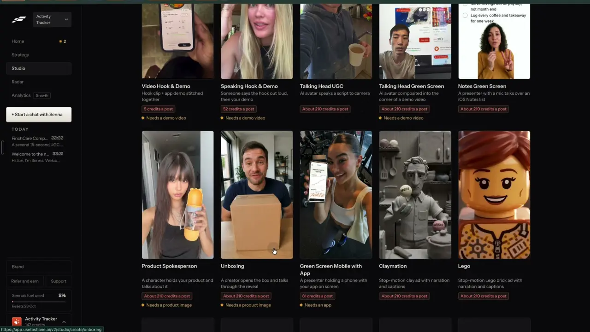
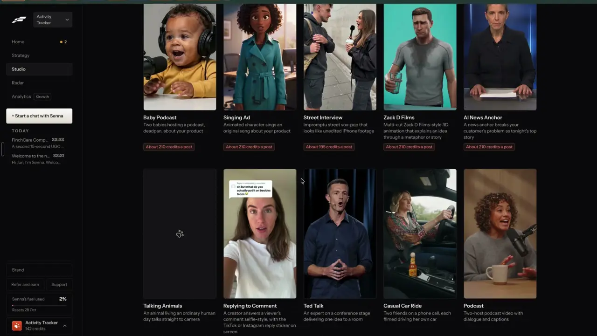

# Spokesperson, news anchor, stage talk

`formats-presenter` | formats | phase 3 | status: partial | /north-star#formats-presenter

## Leo asked

19 Oct 2026: "the idea is that one can remix any content format and the ai will regenerate"

No direct ask for these four formats by name; the rest is from the competitor research. The page's face rule applies: your own saved face first, labelled AI presenters second.

## How the best do it

### Fastlane

Four presenter formats sit in Studio > Content formats, each "About 210 credits a post", which is about US$8.40 at the Starter rate of US$20 for 500 credits, and two of them show a requirement line with an orange diamond before you click.



- "Product Spokesperson": "A character holds your product and talks about it", "Needs a product image". The preview is a woman holding an orange bottle up to the lens.
- "Unboxing": "A creator opens the box and talks through the reveal", "Needs a product image" (slug `unboxing`).



- "AI News Anchor": "A news anchor breaks your customer's problem as tonight's top story". The preview is an anchor at a desk with papers, blue studio behind.
- "Ted Talk": "An expert on a conference stage delivering one idea to a room". The preview is a man on a dark stage with a headset mic. TED is a trademark, so ours is "Stage talk".

The create pages were not opened. They follow the Yapper pattern (`formats-talking-head`): SCRIPT with "Generate", AVATAR "Change", SETTING chips, LENGTH chips, a price footer, then "Generate video".

### Others

- Arcads lets you "make them hold your product, show your app, and wear your clothes", priced per preset: Show Your App 200 credits, Unboxing POV 400, Camera movement 240 ([arcads.ai](https://www.arcads.ai/), [Arcads credits](https://help.arcads.ai/en/articles/13725589-how-are-credits-counted)).
- MakeUGC's Product in Hand puts your uploaded product photo in the actor's hands, on all plans ([makeugc.ai](https://www.makeugc.ai/)), and it has an Unboxing template ([MakeUGC templates](https://www.makeugc.ai/video-templates-feature)).
- TopView's link-to-video asks for the product page and a visual style, Unboxing among them ([topview.ai](https://www.topview.ai/link-to-video)). Its Product Avatar takes a product photo or link, picks or makes an avatar, and makes the product-holding shot itself; product avatars are unlimited on all plans ([topview.ai product avatar](https://www.topview.ai/ai-avatar/product-avatar), [pricing](https://www.topview.ai/pricing)).
- HeyGen's Video Agent writes the script and adds an AI presenter from a 500-character prompt, scene by scene preview before render ([heygen.com/video-agent](https://www.heygen.com/video-agent)).
- Zebracat makes a custom "product presenter" avatar, 5 custom a month on Super Cat ([zebracat.ai](https://www.zebracat.ai/features/ai-avatar-generator)).
- Icon lists Unboxing and Testimonial among its human-made ad formats ([icon.com/formats](https://icon.com/formats)).

## What we have today

- You speaking, `/edit?panel=ai&kind=avatar` (`Avatar` in `src/components/AiVideo.tsx`, `supabase/functions/ai-video` modes `presenter` and `avatar`). "Who speaks" is "My photo" (with the line "Use a photo of yourself, or of someone who agreed to it.") or "AI presenter": a description of up to 300 characters that starts on one of six `LOOKS` presets, each a different Singaporean, with "Another look" to cycle them. `presenterBody` always puts the presenter in "Softly blurred office or home background". You type a script (600 characters, up to 30 s), pick one of 7 ElevenLabs voices, "Make the voiceover", then Higgsfield Speak animates each slice (11 credits up to 4.5 s, 22 up to 9.5 s; up to 88 credits, about US$5.50). Caps `ai-video` 2, `ai-video-global` 20, `ai-image` 5 for the presenter picture.
- Template clips, `/edit?panel=ai&kind=template`: "Creator review" (unboxes your product, uses it, says why; product or person photo) and "Product ad" (timed product shots) on Seedance 2.5, 4 or 8 s (US$0.82 to US$3.70). Caps `ai-clip` 2, `ai-clip-global` 8.
- The editor's "slides" frame mode (`drawSlides` in `src/lib/stacked.ts`) is for a screen recording with the speaker's camera in a corner: it draws that one video's screen across the top and crops the same video to the face below. It cannot put a separate picture on top. The editor's name tag (`nameTag`, `roleTag` in `EditSettings`) draws a lower third.
- The editor can already swap what is behind a speaker: `backdrop` in `EditSettings` (`src/lib/videoEdit.ts`) is a blur, a plain colour or a picture stored on the device, and `src/lib/faceVision.ts` cuts the person out on the device and paints the backdrop behind them. It is free.
- Brand kit offers (`src/pages/BrandPage.tsx`, up to 5, `MAX_OFFERS` in `src/lib/carousel.ts`) hold each offer's name and link: a guide, a free review, an app.

So a talking presenter is live, and a short product clip is live. What is missing: a setting other than an office, a news or stage format with its own script shape and on-screen banner, and a presenter shown with your offer for longer than 8 seconds.

## Build

Add a "Format" row to You speaking with five choices. Each picks a setting for the picture, a script shape for "Write it for me", and what the editor adds on screen.

```
You speaking
Format  [Plain] [News anchor] [Stage talk] [Spokesperson] [Unboxing]

Who speaks   [My photo]  [AI presenter]
             (My photo) Behind you: [Keep my background] [News studio]

Script   [Write it for me]
[ Tonight's top story: most people pay for their hospital stay twice... ]
         62 words, about 25 seconds

Your offer (Spokesperson)  [Free policy review v]  [Add its picture]

Voice [George v]
25 seconds in 3 parts. Costs 66 Higgsfield credits (about US$4.13).
[Make the video]                              AI videos: 2 left today
```

| id | pill | setting line in `presenterBody` | script shape | on screen |
|---|---|---|---|---|
| `plain` | Plain | Softly blurred office or home background (today) | as typed | as today |
| `news` | News anchor | Behind a TV news desk, papers on the desk, blue studio screens behind, studio light | "Tonight's top story" opener, the viewer's problem as the news, two facts, one next step | a red and white `banner` sticker with the headline for the first 4 s |
| `stage` | Stage talk | On a dark conference stage, a spotlight, a small headset mic, a glowing screen far behind | one idea, a short story, a pause line, a closing line to the room | none |
| `spokesperson` | Spokesperson | Bright tidy room, facing the camera | the problem, your offer, what the viewer gets, a soft next step | the offer's picture across the top, drawn in at the join (below) |
| `unboxing` | Unboxing | (none: it opens the Creator review template) | (template fields) | (template) |

Unboxing opens `/edit?panel=ai&template=ugc-creator-review&offer=<n>`, where `n` is the offer's place in the brand kit (0 to 4). The template form has no prefill today (its fields live in component state), so add a small one: on open, `offer` fills "Your product" with that offer's name once, then leaves the address (replace).

### Setting for your own photo

An AI presenter takes the setting through `presenterBody(look, setting)` (the same optional `setting` argument `formats-skits` adds), so the picture is made in the studio or on the stage.

Your own photo is never edited. Speak animates it as today, and the setting goes behind you in the editor through the backdrop it already has: the join passes `extra.settings.backdrop = {kind: "picture", key}` and the editor cuts you out on the device and paints the setting behind you. The setting picture is one Soul v2 picture of the empty set ("An empty TV news studio, a desk, blue screens, studio light, no people" or "An empty conference stage with a spotlight and a glowing screen, no people"), made by a new `ai-video` mode `set` `{talk}` that sends a fixed prompt for that set through `PICTURE_MODEL` at 9:16 like `presenter` mode does, and takes one `ai-image` use (5 a day, about US$0.006). `ai-image`'s own Make the image is fixed at 3:4 (`buildImageBody`), too short for a 9:16 backdrop, so it is not used here. The set is kept in the device media library so the next news video reuses it free. "Keep my background" skips it. Restaging the photo itself with an image edit model is left to Open questions.

### Your offer on screen

Spokesperson asks for one of the brand kit's offers and an optional picture of it (a guide cover, a phone screenshot of a tool, a flyer). With a picture, the join draws it across the top 45% of every frame and the speaker's clip below, cropped to the face. The editor's slides mode cannot do this (it only works from one screen recording), so this is a new `top?: Blob` option on `JoinExtra` in `src/lib/videoMedia.ts`, using `slidesHeight` and `halfCrop` from `src/lib/stacked.ts`; it shares its drawing helper with the `split` option `formats-skits` adds. The result is a plain 9:16 file. No AI puts the offer in anyone's hands; that is the step most likely to come out garbled, and the split screen reads clearly on a phone. Without a picture, the video is plain with the offer's name as the name tag's second line (`roleTag`).

### Write it for me

New `ai-video` mode `talk-script` `{talk, topic, offer?}` returns `{say}`: 50 to 75 words, about 20 to 28 s. gpt-4.1 through `writeJson`, with `SCRIPT_SYSTEM`'s rules plus the format's shape from the table. For `spokesperson` the offer is named as the brand kit has it, with no claims beyond what the offer's own name and link say. For `news` it writes a `headline` too (under 8 words) for the banner. With a remix source it keeps the structure, never the words. One use of `ai-video-script`.

### Banner sticker

Add `"banner"` to `OverlayKind` in `src/lib/videoEdit.ts`: a full-width lower third, a red block with "EXPLAINER" in white and the headline in dark text on white, under 50 characters. The block says EXPLAINER, never BREAKING or NEWS, so a money video never passes for a real news report (MAS fair dealing); the adviser can edit the headline but not the block word. `drawOverlay` in `src/lib/videoMedia.ts` draws it. The news format adds one automatically from 0 to 4 s; the adviser can move, edit or delete it on the Stickers tab, labelled "News banner".

### Screens and states

- Empty: Format row on Plain, as today's You speaking.
- Writing: "Writing your script..." with the orb.
- Making the set (own photo with News studio or Stage): "Making the set..." then a small preview of the empty set beside your photo, with "Use this" and "Keep my background". A set already in the media library is reused with no call.
- Making: today's steps ("Making the voiceover...", "Making the video, 2 of 3...", "Putting it together...").
- Done: the editor opens with captions, the banner, the backdrop or the offer band in place, and the draft saved to My posts with its source.
- Failed: today's errors with "Try again at no cost" when paid clips are still pending. A set picture that fails leaves "Keep my background" picked and says "Couldn't make the set. Your own background stays."
- Refused by the safety filter: "The safety filter blocked it. Try another photo or wording."
- Compliance: the script goes through `scanCompliance` and Jev's `MAS_QUESTION` (from `formats-skits`; add it if missing). A flag shows the warn chip and does not block.
- Over the cap: the server's words, "You've used all 2 for today. It resets at 8am Singapore time." (videos) or "You've used all 5 for today. It resets at 8am Singapore time." (the set picture).
- Over 30 s: "Keep the voiceover under 30 seconds." (today's words).

### Copy

- "Format", pills "Plain", "News anchor", "Stage talk", "Spokesperson", "Unboxing"
- "Write it for me", "Write it again"
- "Behind you", "Keep my background", "News studio", "Stage", "Use this", "Making the set...", "Couldn't make the set. Your own background stays."
- "Your offer", "Add its picture", "Change picture"
- Sticker label "News banner", block word "EXPLAINER", then the headline
- Price line via `cost()`: "Costs 66 Higgsfield credits (about US$4.13)." and, on the set button, "0.09 Higgsfield credits (about US$0.01)"
- Uses left via the `Left` component: "AI videos: 2 left today", "Scripts: 9 left today"
- Under an AI presenter: "AI presenter. Label the post as AI-made."

### Data

- No table and no schema change.
- The last format per brand, synced: `content-studio-presenter-talk-${scoped(userId)}` (`{talk, offer?: number}`, the offer's place 0 to 4 in the brand kit's `offers`, which have no ids).
- Offer pictures go into the device media library (`src/lib/mediaLibrary.ts`), folder "Offers", and set pictures into folder "Sets". The library index is device-only today; `brand-media-library` moves it to the cloud later.
- The backdrop and the offer band are a device file key in the project, as backdrops are today.

### AI and cost

- Script: gpt-4.1, under 1 US cent, `ai-video-script` (10 a day).
- Jev: `MAS_QUESTION` on the script (noul, proposed threshold 0.5, set from a side-by-side run against `scanCompliance` on 50 scripts). Null falls back to `scanCompliance`.
- Presenter picture: Soul v2, 0.09 credits, `ai-image`.
- Set picture for your own photo: Soul v2 through the new `ai-video` mode `set`, about US$0.006, cap `ai-image` 5; the backdrop itself is drawn on the device for free.
- Video: Higgsfield Speak, where a 25 s script in three slices of about 8.5 s comes to 66 credits (about US$4.13) and the ceiling stays at 88 credits (US$5.50), on the existing `ai-video` and `ai-video-global` caps, so nothing new goes into `usageCaps.ts`.
- Fastlane: about 210 credits, about US$8.40. Arcads: 200 to 800 of its credits a preset.

### Deep links

| URL | Opens |
|---|---|
| `/edit?panel=ai&kind=avatar&talk=news` | You speaking on that format. Values: plain, news, stage, spokesperson. Unknown falls back to plain. Replace. |
| `/edit?panel=ai&template=ugc-creator-review&offer=1` | Unboxing: the Creator review form with "Your product" filled from offer 1 once, then `offer` leaves the address (replace) |

Add `talk` and `offer` to the `edit` builder in `src/lib/links.ts` and rows to `docs/deep-links.md`, and drop `talk` with `kind` and `template` when the AI panel closes (`closePanel` in `src/pages/VideoEditPage.tsx`).

### Gate

The Format row shows only when `leoOnly(email)`. Anyone else sees today's You speaking, and a typed `talk=` is ignored. The server checks `supabase/functions/_shared/leoOnly.ts` and answers anyone else on `talk-script` and `set` with 403 "That isn't something this can make."

## Done when

- [ ] News anchor, Stage talk and Spokesperson each make a video on Leo's account with the right setting, script shape and on-screen extra, checked by eye at 390 px and 1440 px.
- [ ] Unboxing opens the Creator review template with the offer filled in.
- [ ] With Leo's own photo and News studio, the finished video shows his face unchanged with the studio behind him, and "Keep my background" leaves it as filmed.
- [ ] Spokesperson with an offer picture gives a 9:16 video with the picture across the top and the speaker below for its whole length.
- [ ] The banner sticker can be edited and deleted, and survives a reload of the project.
- [ ] Price chip matches the server's credits.
- [ ] Non-Leo accounts see today's You speaking only, and the server refuses the new modes.
- [ ] `src/data/northStar.ts` item flipped with its `ours` line, in the same commit.

## Tests

- `supabase/functions/ai-video/logic.test.ts`: `presenterBody(look, setting)` carries the setting and still the Singaporean rule; `parseVideoRequest` for `talk-script` accepts the four talks and refuses others; the news reply needs a headline under 8 words; `set` accepts `news` and `stage` only, and its body asks for 9:16 with no people.
- `src/lib/aiVideo.test.ts`: an avatar job with a set passes `extra.settings.backdrop` with the stored key, and with an offer picture passes `top` to `startJoin`.
- `src/lib/stacked.test.ts`: the offer band and face rectangles for a 1080x1920 frame (shared helper with `formats-skits`).
- The template form test: `offer=1` fills "Your product" with that offer's name and is removed from the address.
- `src/lib/videoEdit.test.ts`: a `banner` overlay survives sanitising and its text is cut to 50 characters.
- `src/lib/links.test.ts`: `links.edit({panel: ["ai"], kind: "avatar", talk: "news"})`.

## Open questions

- Restaging your own photo with an image edit model (Qwen Image 3, `FIX_MODEL`, wired for "Fix it" on pictures Make the image made) would light you to match the set, where the backdrop only cuts you out. It changes a real person's photo, needs an upload path `ai-image` does not have, and its price at 2k is not written down. The backdrop covers it for now; Leo decides if restaging is ever wanted.
- Arcads and MakeUGC put the product in the presenter's hands. We would need an edit model that takes two pictures at once, and whether Qwen Image 3 does is unverified, so Leo decides if the split screen is enough for now.
- A news-anchor format about money could look like real news to a viewer, so this spec fixes the banner's block word to "EXPLAINER". Leo decides if a "BREAKING" or "NEWS" option is ever allowed, and whether the News anchor format should show for adviser brands at all.

## Related

`formats-talking-head`, `formats-skits`, `formats-gallery`, `people-my-face`, `people-presenters`, `people-ai-labels`, `brand-products`, `brand-media-library`, `edit-video`, `remix-any-format`, `trust-compliance-check`, `business-cost-preview`
