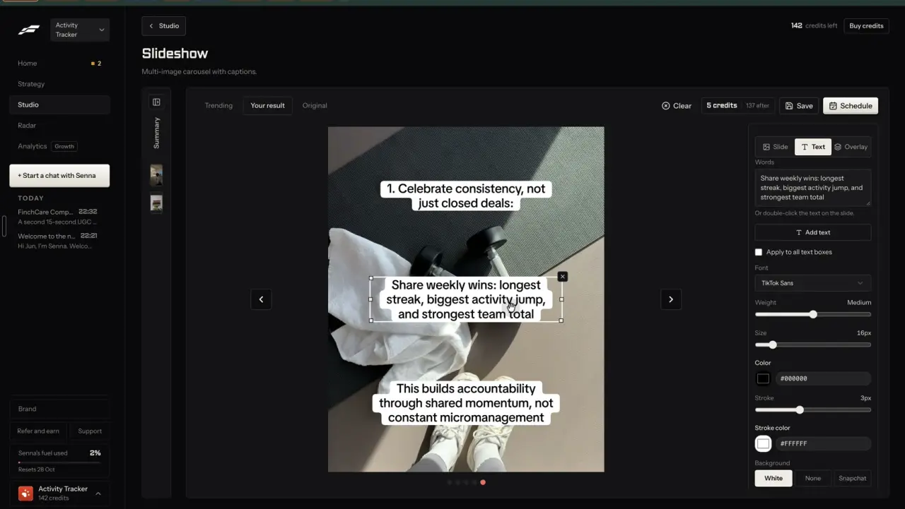

# Slideshow

`formats-slideshow` | formats | phase 1 | status: partial | /north-star#formats-slideshow

## Leo asked

19 Oct 2026: "the idea is that one can remix any content format and the ai will regenerate"

He did not name slideshows. The format itself comes from the competitor research and his Fastlane recording.

## How the best do it

### Fastlane

Fastlane lists Slideshow first in its format gallery: "Slideshow", "Multi-image carousel with captions", "5 credits a post". The usual way in is a trending one. Studio > "Template trends" shows cards tagged "Slideshow | 8" (the slide count) with views, likes and a full-width button "Remix this | 5 credits". Clicking it lands on the Slideshow page in setup mode with "Remix a trending one" picked and nothing charged. (On a wall of text card the button read "Opening..." while the page loaded, t203.)


The setup column, top to bottom, as on screen:

1. "START FROM": a two-part toggle, "A blank slideshow" | "Remix a trending one". Helper under remix: "Remix keeps the structure of a slideshow that is already doing well and rewrites its words for Activity Tracker over pictures from your boards. It makes no new pictures, so it costs the same as saving a slideshow."
2. "TRENDING SLIDESHOW TO REMIX": a small thumbnail, an AI description of the source picture ("Image of woman and text in black style with w..."), and "Change".
3. "MENTION ACTIVITY TRACKER" (the brand name is put into the label): "Yes" | "No". Helper: "Yes works Activity Tracker into the slides. No keeps it as pure value content."
4. "STEER IT (optional)": a textarea, placeholder "What should this slideshow be about?"
5. A sticky footer: "Charged when you save or schedule", "5 credits", "142 credits now, 137 after this one", and the main button "Generate slideshow".

The right panel has tabs "Trending" | "Your result" and the line "Your result appears here after you generate".

Pressing the button turns it grey with "Generating...". The right panel switches to "Your result" with a dashed placeholder, a spinner and "Generating your content...". The setup column stays usable and the Trending tab can be browsed while it runs. The result came about 12 seconds later. The setup then folds into a narrow "Summary" rail, a third tab "Original" appears, and the header shows "Clear", a chip "5 credits | 137 after", "Save" and the main button "Schedule". The balance did not move: the charge comes on save or schedule.


What the remix did with "6 Signs You Are an Abusive Wife (You might not realise)" (8 slides): it kept the hook formula and the kicker and moved the topic to the brand. Slide 1 became "6 Signs Your Prospecting Habit Is Costing You Deals" / "You might not realise it yet". The middle slides are numbered items, a bold title over one or two sentences ("1. You Only Reach Out When It's Quiet"). Then comes a reframe slide, and the last slide names the product ("Use ActivityTracker to log outreach, protect your streak, and make daily prospecting visible"). It made 9 slides from an 8-slide source. Text sits in white rounded boxes, black bold sans, centred, over full-bleed photos (books, a coffee and an open book, gym kit). The pictures match Fastlane's preset media sets in Library > SETS, "Bundles of your media that a slideshow or video build can draw from" (link unverified).



That frame is an earlier 5-slide slideshow in the same editor, with the Text tab open. The slide editor (slide, text and overlay tabs; sizes 1:1, 4:5, 3:4, 9:16; "Swap image", "My images"; font "TikTok Sans", weight, size, colour, stroke, background "White" | "None" | "Snapchat") is its own item, `edit-slideshow`. "Schedule" first draws each slide to a picture ("Preparing slides 0/5", "Cancel preparation"), about 2 seconds for 5 slides, then opens the schedule dialog.

Fastlane's public page says each angle from a URL becomes a slideshow with a hook slide, one idea per middle slide and a closing product slide. The same slides go out as TikTok photo mode (played to a sound) and as an Instagram carousel, with a caption per platform and a closing ask (save on Instagram, follow on TikTok) ([tiktok-slideshow-maker](https://usefastlane.ai/tools/tiktok-slideshow-maker)). Template names, slide counts and picture sources are not published.

### Others

- ReelFarm builds slideshows from image collections. "Add" searches Pinterest inside ReelFarm, you pick 9 to 15 images, then "Create Collection". An automation uses one collection for the hook slide and one for the rest ([guide](https://reel.farm/guides/automate-tiktok-slideshows-with-ai), [reel.farm](https://reel.farm/)). Per text item you set colour, size, alignment and width; overlay opacity defaults to 30%, slide count to 5, and the size is 9:16 or 4:5 ([guide](https://reel.farm/guides/automate-tiktok-slideshows-with-ai)). Its hook library has 100+ slideshow hooks by category, finance among them ([guides](https://reel.farm/guides)). Plans count slideshow formats: 10, 20 or 200 ([reel.farm](https://reel.farm/)).
- Genviral copies an existing TikTok slideshow into an editable draft, can save any slideshow as a reusable template and regenerates one slide at a time, with image packs feeding the slides ([genviral-skill](https://github.com/fdarkaou/genviral-skill)).
- Blotato's template list includes "Image Slideshow with Text Overlays", "Image Slideshow with Prominent Text" and "When X then Y Text Slideshow", each paid for with its image and video credits ([help](https://help.blotato.com/web-app-features/videos.md)).
- Contentdrips turns a carousel into a video ("Carousel to Video", MP4 or GIF). Format details unverified ([contentdrips.com](https://contentdrips.com/)).

## What we have today

Checked against origin/main 08537d1, rechecked 2026-10-20.

- Carousel maker at `/carousel` (`src/pages/CarouselPage.tsx`). Sources: drafts, paste, topic, saved. `splitDraftIntoSlides` in `src/lib/carousel.ts` makes 2 to 10 slides: a cover of up to 20 words (`COVER_WORDS`; the editor warns past 6, `COVER_HOOK_WORDS`), one point per slide at up to 40 words, a call to action. `Slide` is `{id, title, body, image?, recap?}`.
- Slides are drawn by `src/lib/carouselLayout.ts` on a fixed 1080x1350 (4:5) page: paper colour, brand bar, title and body text, an optional picture above the text. `src/lib/carouselRender.ts` turns that into PNG and `src/lib/pdf.ts` makes a LinkedIn PDF, all in one layout family with system fonts.
- Saved carousels: `content-studio-carousels-<scoped(uid)>`, newest 20 (`SavedCarousel` in `src/lib/carousel.ts`: id, title, platform `"instagram" | "linkedin"`, slides, draftId, align, scale, font, paper, updatedAt). `sanitizeSaved` drops anything it does not know.
- `carouselLayout.ts` fixes the page at `SLIDE_WIDTH` 1080 and `SLIDE_HEIGHT` 1350, so a 9:16 slide needs the height passed in.
- `layoutSlide` takes a slide picture only as a data URL under `MAX_IMAGE_CHARS` (350,000 characters), checked by `sanitizeImage` in `src/lib/carousel.ts`. A remote https link is dropped, so a stock photo has to be fetched and shrunk first.
- "Tighten with AI": edge function `carousel-copy` (OpenAI through `_shared/openaiChat.ts`, MAS-safe rewrite), cap `carousel` 30 a day.
- Slide pictures come from Media, which lives on this device only (IndexedDB, `src/lib/deviceFiles.ts`, keys `cimg-...`).
- Free stock photos: edge function `stock-media` (Pexels), cap `stock-search` 100; the same search within the hour comes from a cache and counts nothing (`src/lib/stockMedia.ts`). Each photo carries `alt` text (up to 250 characters), `src` (about 1080 wide), `by` and `byUrl`; `downloadStock(url)` fetches one as a Blob.
- Jev picks stock already: `video-assist` mode `montage-pick`, cap `montage-pick` 20. Its question is "Which stock clip, described by its page name, best shows `beat`?" with a "none" option (`supabase/functions/video-assist/montage.ts`). `parsePickRequest` keeps up to 10 beats, cuts each beat's `say` to 90 characters and each candidate's `desc` to 100, and takes at most 6 candidates; Jev is asked only when the beats are mostly English, and a beat with no answer comes back null.
- Sources to remix: 61 Instagram carousels ("Sidecar") in `src/data/topPosts.json`, each with caption and cover picture; 54 of them also carry `idea` {hook, format, why, adapt}. The slides' own words are not stored. The swipe file ranks by `engagementScore` (likes plus 3 x comments) in `src/lib/topPosts.ts`; there is no score against the creator's own average until `find-outlier-score` ships.
- Post it for me (`src/components/PostItForMe.tsx`) posts a carousel's slides as PNGs. Its `carouselPngs` finds the saved carousel by `draftId` and redraws every slide with `layoutSlide` and pictures from this device only, so a photo slide would go out without its photo until that function learns the new style. A TikTok photo post's caption goes in `description` (`docs/zernio-connection.md`). Social is gated server side by `SOCIAL_CONNECT_USERS` and in the browser by `socialConnectShown()` (`src/lib/socialConnect.ts`).
- `startSlides` in `src/lib/videoMedia.ts` turns pictures plus a voiceover into a video.

So it is partial. There is no full-bleed photo slide with caption boxes, no 9:16, no remix of a trending slideshow, and nothing picks pictures for the slides.

## Build

This is the first format page, so it also adds the shared pieces the other format items reuse. If another format ships first, it adds them exactly as written here.

Shared pieces:

1. Route `/make/:format` in `src/App.tsx`, page `src/pages/MakeFormatPage.tsx`. It reads the slug, finds the entry in `src/data/formats.ts` and renders that format's component. For anyone but Leo it renders `NotFoundPage`, with the same `getSession` email check as `src/pages/NorthStarPage.tsx` and `leoOnly` from `src/lib/leoOnly.ts`. Add `"/make/:format"` to EXCEPTIONS in `src/lib/navRoutes.test.ts` with the reason "a format's create page, opened from Remix buttons and the /make gallery".
2. `src/components/make/FormatShell.tsx`: back link, h1, one-line description, a column of option cards with a sticky footer (price chip, uses left today, one main button), and a result panel. The chip is `PriceChip` from `business-cost-preview` once that ships, and a plain span with the same words until then. Two columns from 1024 px. One column at 390 px with the result under the options and the footer pinned to the bottom of the screen.
3. `src/data/formats.ts`: one entry per format (slug, name, blurb, kind, needs, price, main cap, route). `formats-gallery` lists it later.
4. Sources come from `src/lib/remixSource.ts` (remix-source-trail). `resolveSource(key, userId)` returns the `RemixSource` record for keys such as `top:<advisorId>-<shortCode>`, `follow:<platform>:<postId>`, `trend:<trendId>` and `clone:<platform>:<postId>`, or null when the key is unknown. If that file has not shipped, build it first as its spec says.
5. Words come from the `remix` edge function of remix-everywhere, mode `make`. This item adds `as: "slideshow"` with its own output check in `supabase/functions/remix/logic.ts`, and lets a request carry `topic` (up to 200 characters) in place of `source` for a make with no source. The prompt keeps that function's compliance block (`COMPLIANCE_RULES` in `clone-reel/logic.ts`, a private const today that remix-everywhere exports and imports: no promised returns, never "guaranteed" or "risk-free", no insurer or product names, no invented numbers, general education only) and the brand block from remix-your-brand (`brandPack(userId)` in `src/lib/remix.ts`, whose `mention` flag is this page's Mention toggle). The slideshow shape carries `refuse` and `reason`; a refusal comes back as 422 `{code: "refused", error}`, and a failed OpenAI call gives the use back with `refundUsage`, as that function already does. If remix-everywhere has not shipped, build its function first as its spec says.
6. No new cap: the words count against `remix-make` (30 a day) from remix-everywhere.

### Screens and states

Page `/make/slideshow`, component `src/components/make/Slideshow.tsx`, job `src/lib/slideshowJob.ts` (module level, so leaving the page does not lose it).

Setup, left column:

```
Start from      [ A topic | Remix a trending one ]
Slideshow to remix   [cover] "5 things I wish I knew before..."   @handle | 1.2K likes   [Change]
   (or)  Topic   [ Like 5 things to check before you buy a hospital plan ]
Mention <brand>  [ Yes | No ]
Steer it (optional)  [ What should this slideshow be about? ]
Size            [ 4:5 | 9:16 ]
Pictures        [ Stock photos for me | From my media ]
-------------------------------------------------------------
About US$0.02 a post      28 left today      [ Make the slideshow ]
```

"Change" opens a sheet with the swipe file's carousels, sorted by `engagementScore` until `find-outlier-score` ships and by that score after. When a Following account has posted carousels, they show too.

The right panel has tabs "Your result" | "Original". Before the first make it shows two example slides from `public/formats/slideshow-1.webp` and `-2.webp` with the line "An example. Yours replaces it once you make it." "Original" shows the source's cover, caption, likes and views, with "Open on Instagram".

Making: the main button reads "Making..." and is disabled. Within 400 ms the result panel shows a dashed slide-shaped placeholder and the current step: "Writing the slides...", then "Finding pictures, 3 of 8...", then "Drawing the slides...". The setup stays editable, and changes apply to the next make. Leaving and coming back shows the same step or the result.

Done: one slide at a time with "<" and ">" buttons, dots, and "Slide 1 of 8". Under it come the compliance chips from `src/lib/compliance.ts` on all slide text, and the caption with Copy. Actions:

- Main: "Schedule". It saves first, then opens Post it for me with the slides drawn as PNGs. When social is off for this account, the main button is "Download all" instead.
- "Save". It writes the saved carousel and a My posts draft, then shows "Saved. It's in My posts as a draft." with "Open My posts".
- "Edit slides": opens `/carousel?carousel=<id>`. The fuller editor is `edit-slideshow`.
- "Swap picture" on each slide moves to the next result of the same search, at no cost.
- "Make again" is a quiet text button. It uses another one of today's uses.

Failed: "Couldn't write the slides. Try again in a minute." with "Try again". The use is given back. When no picture fits a slide, that slide uses the brand colour behind the text and the job still finishes. When Jev does not answer, the first portrait result is used.

Refused: the writer says no when the source cannot be made safe to post. Show "That slideshow can't be turned into something safe to post. Pick another one." with "Pick another".

Source gone: when `resolveSource` returns null, show "That post isn't in the swipe file any more." and switch Start from to "A topic".

Over the daily cap: the main button is disabled, and the footer shows the server's words: "You've used all 30 for today. It resets at 8am Singapore time."

Not Leo: `NotFoundPage`.

### Copy

| Where | Words |
| --- | --- |
| Page | Title "Slideshow". One line "Photo slides with words on them, for Instagram and TikTok." |
| Start from | "Start from", "A topic", "Remix a trending one" |
| Remix helper | "Keeps the shape of a slideshow that did well and writes new words for <brand> over stock photos. Never its words." |
| Topic helper | "Writes slides on your topic over stock photos." |
| Source card | "Slideshow to remix", "Change" |
| Topic field | "Topic", placeholder "Like 5 things to check before you buy a hospital plan" |
| Mention | "Mention <brand>", "Yes", "No", helper "Yes works <brand> into the slides. No keeps it as pure value content." With no brand name in the kit, "your business" |
| Steer | "Steer it (optional)", placeholder "What should this slideshow be about?", at most 300 characters |
| Size and pictures | "Size", "4:5", "9:16", "Pictures", "Stock photos for me", "From my media" |
| Footer | "About US$0.02 a post", "<n> left today", button "Make the slideshow", while running "Making..." |
| Steps | "Writing the slides...", "Finding pictures, <n> of <total>...", "Drawing the slides..." |
| Result | "Slide <n> of <total>", "Schedule", "Download all", "Save", "Edit slides", "Swap picture", "Make again" |
| Saved | "Saved. It's in My posts as a draft." with "Open My posts" |
| Errors | The exact lines given under each state above |

### Data

- The made slideshow is a `SavedCarousel` in `content-studio-carousels-<scoped(uid)>`. Add optional fields: `style: "photo"`, `aspect: "4:5" | "9:16"`, and on each slide `photo: {src, by, byUrl}` (an https link on `images.pexels.com` and its credit). Only the link is synced, never the picture. `platform` stays `"instagram"` at both sizes, since the type allows only Instagram or LinkedIn. Media pictures keep using `image` with a `cimg-` key. Extend `sanitizeSaved` so old saves still load and bad values are dropped. This is synced JSON, not a schema change.
- `carouselPngs` in `src/components/PostItForMe.tsx` reads `style`, `aspect` and `photo` and draws photo slides with the new layout, fetching each `photo.src` once, so Schedule posts the slides the user saw.
- Photos reach the layout through one pure-plus-canvas helper, `photoDataUrl(src, w, h)` in `src/lib/carouselRender.ts`: `downloadStock(src)`, cover-crop to the slide size on a canvas, then JPEG at quality 0.85, 0.75 and 0.65, then at half size, until the data URL is under `MAX_IMAGE_CHARS`. The job, the result view and `carouselPngs` all use it.
- A My posts draft (`content-studio-drafts-<scoped(uid)>`): format "carousel", platform "instagram" for 4:5 and "tiktok" for 9:16, hook = slide 1, draft = the caption, and the saved carousel keeps its `draftId`. The draft carries `source`, the `RemixSource` snapshot from remix-source-trail, so the post keeps where it came from.
- Nothing else is stored, and the job's progress lives only in memory.

### AI and cost

- Words: `remix` mode `make` with `as: "slideshow"`. Input: the `RemixSource` (caption, cover, teardown; for a swipe carousel also `idea.hook`, `why` and `adapt`) or the topic; `brandPack(userId)` with this page's mention; the voice from `voiceForClone`; the steer as `note`. Output: `{refuse, reason, slides: [{title, sub, search}], caption}`. 3 to 10 slides; title up to 12 words, sub up to 25 words; `search` is a 2 to 4 word stock photo search with no text, no logos and no close-up faces. The prompt asks for the source's shape: a hook slide in the same formula, numbered middle slides, a reframe slide, then a last slide that names the brand only when mention is yes. remix-everywhere puts a run at 1 to 2 US cents (unverified until it logs its first 20 runs). Cap `remix-make`.
- Pictures: one `stock-media` photo search per slide, portrait for 9:16 and any for 4:5 (cap `stock-search`, cached searches free). Then one `video-assist` `montage-pick` call for the whole slideshow: one beat per slide, with the slide title (cut to 90 characters) as `say` and the first 6 results' alt text (cut to 100) as candidates (cap `montage-pick`). Add an optional `noun` to `parsePickRequest` so the question reads "Which stock photo, described by its page name, best shows `beat`?" for photos. Montage keeps "stock clip". Jev's "none" moves on to the next page of results once, then to the brand colour.
- Drawing: a new `photo` style in `carouselLayout.ts` takes the slide height as an input (1350 or 1920; today's styles keep `SLIDE_HEIGHT`), cover-crops the picture to fill it and puts each line of text in a white rounded box, black bold sans, centred, with the title in the top third and the sub in the middle. The existing `carouselRender.ts` draws it on the device at no cost.
- Cost per slideshow: 1 to 2 US cents for OpenAI, about US$0.0001 for Jev, Pexels free.

### Deep links

- `/make/slideshow?source=top:<advisorId>-<shortCode>` opens a remix with that source (any `RemixSource` key works). `from` defaults to remix when there is a source and to topic when there is not.
- `?from=topic`, `?mention=no` (default yes), `?size=9x16` (default 4x5), `?pictures=mine` (default stock), `?tab=original` (default result). All replace history.
- `?show=<saved carousel id>` reopens a made slideshow and pushes history. Making on arrival comes only from navigation state `{ go: true }`, which remix-any-format's "Slideshow" link sets alongside `source`; a `?go=1` in the address does nothing (security review, 20 Oct 2026), and the state is cleared once read so a reload never makes again.
- Add `links.makeFormat(slug, params)` to `src/lib/links.ts`, and a "/make/slideshow" row to `docs/deep-links.md` under Create pages.
- Entry points for Leo only: "Remix as a slideshow" in the swipe file's post drawer (`src/components/PostDetailDrawer.tsx`) on carousel posts, and a "Photo slideshow" button on `/carousel`'s start, while everyone else keeps today's buttons.

## Done when

- [ ] `/make/slideshow` opens for Leo's two sign-ins and shows NotFound for anyone else, also by typed URL.
- [ ] From a swipe file carousel, one click on "Make the slideshow" gives 3 to 10 photo slides in that post's shape, with new words and no sentence of the source.
- [ ] A topic with no source works the same way.
- [ ] Mention "No" leaves the brand name off every slide, and "Yes" names it once.
- [ ] 4:5 and 9:16 both draw with every text box inside the slide, checked at both sizes.
- [ ] "Save" puts it in My posts. "Edit slides" opens it in `/slideshow?s=<id>` with the photos. Old saved slideshows still open. (Rewritten 2026-10-20, see Open questions.)
- [ ] Schedule hands the PNGs to Post it for me when social is on, and the PNGs show the photos, checked by opening one.
- [ ] Leaving mid-make and coming back shows the step or the result.
- [ ] Over the cap, a failed writer and a refused source each show their message. A failed writer gives the use back.
- [ ] Checked by eye at 390 px and 1440 px. `npm run build` and the full `npx vitest run` pass.
- [ ] `src/data/northStar.ts` item flipped with its `ours` line.

## Tests

- `supabase/functions/remix/logic.test.ts`: `as: "slideshow"` is accepted; a request with neither source nor topic is refused, and so is a note over 300 characters; the prompt holds the compliance block and "never the words"; the slideshow check keeps 3 to 10 slides, cuts long titles, strips em dashes and passes `refuse` through.
- `src/lib/carouselLayout.test.ts`: the photo style keeps every box inside the slide at 4:5 and 9:16, shrinks a long title instead of overflowing, and computes the cover crop for a landscape photo.
- `src/lib/carousel.test.ts`: `sanitizeSaved` keeps `style`, `aspect`, `source` and `photo`, drops a `photo.src` that is not https on `images.pexels.com`, and still loads a save from before these fields.
- The size loop inside `photoDataUrl`, with a fake encoder: it stops at the first quality under `MAX_IMAGE_CHARS`, and halves the size only after 0.65 is still too big.
- A test beside `carouselPngs` (move it to a small module if needed): a photo-style carousel produces one PNG per slide at the saved aspect.
- `src/lib/slideshowJob.test.ts`, with `callFn` and `searchStock` mocked: uses Jev's pick, falls back to the first portrait result when Jev is null, uses the brand colour when nothing is found, ends in `failed` with the server's message when the writer fails, and can start again.
- A pure `startFrom(source)` helper: a null source gives "topic" and a carousel source gives "remix".
- `video-assist` montage test: with `noun: "photo"` the question says "stock photo". Without it, the montage question is unchanged.
- Update `src/lib/nav.test.ts` and `src/lib/navRoutes.test.ts` for the new route.

## Open questions

- 2026-10-20, formats-slideshow build: the made slideshow is a `Slideshow` (edit-slideshow's model, `src/lib/slideshow.ts`, which gains `caption`, `source` and a per-slide `fill`), not a `SavedCarousel`, because phase 1 keeps one slideshow model. So "Edit slides" opens `/slideshow?s=<id>`, not `/carousel`, and the Data section's `style`, `aspect` and `photo` fields on `SavedCarousel`, `photoDataUrl` and the `photo` style in `carouselLayout.ts` are not built; `slideshowDraw.ts` draws the slides and `slideshowPngs` makes the PNGs. The Done-when line above was rewritten to match.
- 2026-10-20: "Swap picture" lives in the slideshow editor (Edit slides), not on the result panel. The swipe drawer and `/carousel` entry buttons are replaced by "Also make: Slideshow" under the Remix sheet's Make chips and "Remix a trending one" on `/slideshow`'s start card. The example slides from `public/formats/` are left out; a dashed slide-shaped placeholder says "Your result shows here once you make it."
- 2026-10-20, Leo's dogfood bar, checked in code: no photo twice in one slideshow, and none this brand used in its last 5 (`content-studio-slideshow-photos-<scoped uid>`, `src/lib/slideshowJob.ts`); a caption of complete sentences that ends with its call to action and is never the slide text (`slideshowCaption`, `supabase/functions/remix/logic.ts`); a hook that names a number gets exactly that many numbered slides, and a business with Mention on gets a slide that names it and says what it does (`slideshowProblem`: one fixing pass, then a 422 refusal with the use given back). "Says what it does" is checked as the naming slide carrying at least 5 more words; the words themselves are not judged.
- 2026-10-20, review fix: the page does not call `ensureTeardown` (that spends `remix-teardown`). When this device has no breakdown of the source, the make sends the snapshot's own idea instead: `idea.hook` as the hook (quoted in the message as "Its hook", since a swipe carousel's caption often opens on something else), and its format and why as beats. A hook number counts only before a list noun or after "Top", and is at most what fits in 10 slides (7 with Mention on, 8 with it off); the prompt says so.

- The slides' own words of a trending slideshow are not stored today: only the caption and cover of 61 Instagram carousels. Reading every slide needs the scraper's child posts plus a picture read, which belongs to `find-trending-formats`. Builder default: write from the caption, cover and idea. Leo decides when to pay for reading slides.
- Fastlane charges on save or schedule. Our caps count on make. Leo decides if that should change once credits exist.
- Whether TikTok photo posts through Zernio can carry a sound is unverified.

## New evidence (20 Oct 2026)

What Fastlane's 12 slideshows for Activity Tracker actually say, slide by slide, and their flaws (stock photos reused, captions cut mid-sentence): [review notes](../videos/fastlane-2026-10-20-review/notes.md) sections 2.3 and 2.4. This format is part of the [dogfood run](../dogfood-activity-tracker.md).

## Related

edit-slideshow, find-trending-formats, remix-any-format, remix-your-brand, remix-compare, remix-source-trail, brand-media-sets, formats-carousel-designs, formats-gallery, business-cost-preview, publish-schedule
