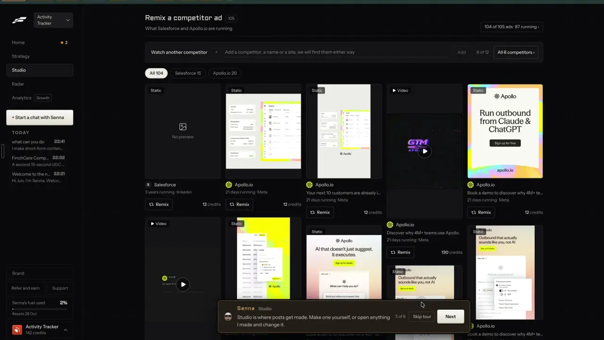

# Static ads and quote cards

`formats-static-ad` | formats | phase 3 | status: missing | /north-star#formats-static-ad

## Leo asked

19 Oct 2026, two lines: "the idea is that one can remix any content format and the ai will regenerate" and "find ways where one can key in their competitors and the app will scrape their ads and top performing social media posts"

On 15 Oct 2026: "embed it within the tool so it depends on the person's market/website"

A competitor's static ad is the most common thing the scraped ads will hold, so this format is where many remixes land. The brand kit and website decide how the result looks.

## How the best do it

### Fastlane

Studio > Overview opens with "Remix a competitor ad" ("105" ads, "What Salesforce and Apollo.io are running"). Each card has a "Static" or "Video" badge, the advertiser, a line of the ad text, how long it has run ("21 days running | Meta"), a "Remix" button and the price: "12 credits" for a static ad, "130 credits" for a video. A watch bar sits above: "Add a competitor: a name or a site, we will find them either way", "6 of 12". The footer says "Senna checks your competitors for new Meta ads every week."



12 credits is about US$0.48 at the Starter rate (US$20 for 500 credits). The remix itself was not pressed in the recording. From the ad detail modal on a video ad, the remix hands the ad to the chat with "Tell Senna what to keep or change" and charges once when you press "Remix, 130 credits" (notes-3 F10). Fastlane's public site shows a "Competitor static ad" beside its remix and a batch of "30 ads ready" with "Approve all" ([usefastlane.ai](https://usefastlane.ai)).

### Others

- Gethookd's Clone Ads: pick a winning ad (or upload one) and press Clone. It keeps the structure and swaps colours, people, styles and sizes (square, portrait, landscape) using the brand profile, and the result stays editable. It spends "AI Image Ads" credits; Starter is US$29 a month for 50 credits. Its home page puts Clone on Pro while the ad generator page lists it on all plans ([gethookd.ai/ai-ad-generator](https://www.gethookd.ai/ai-ad-generator), [gethookd.ai](https://www.gethookd.ai/)).
- Predis.ai's static ad generator takes a product, copy and an optional reference ad, keeps the reference's structure, and outputs headline, copy and CTA sized for Meta, TikTok, YouTube, LinkedIn, Pinterest and display, with safe zones. About 325 images for 1,300 credits on Core ([predis.ai/features](https://predis.ai/features/), [pricing](https://predis.ai/pricing/)).
- Arcads makes static ads from a product image one at a time or in batches, and ships a `clone-static-ad` skill for Claude ([Arcads Mark](https://help.arcads.ai/en/articles/17594959-ai-ad-agent-mark), [ad cloning](https://help.arcads.ai/en/articles/17595003-competitor-ad-research-and-ad-cloning)).
- Foreplay sorts image ads by message style: Before and After, Facts and Stats, Features and Benefits, Testimonial and Review, and more ([foreplay.co](https://www.foreplay.co/post/introducing-content-style-filters)). That list is a good guide to which layouts we need.
- Blotato has Quote Card templates (Monocolor, Paper Background and Highlight) and scene templates that set text on a billboard, newspaper or chalkboard ([help.blotato.com](https://help.blotato.com/llms.txt)).
- Kleo makes graphics to match a post, capped at 20 a month even on the top plan ([wf.kleo.so](https://wf.kleo.so/), [review](https://authoredup.com/blog/kleo-review)). Hypefury turns text posts into images, 2 a day on Flexible and 5 on Full ([hypefury.com/pricing](https://hypefury.com/pricing/)).
- Adviser tools: Snappy Kraken has an AI graphics builder ([snappykraken.com/campaigns](https://snappykraken.com/campaigns)), ContentIn a quote card designer ([contentin.io](https://contentin.io/)).

## What we have today

Nothing makes a designed single image.

- `/swipe?tab=ads` shows 21 Meta ads from seven advertisers (Singlife, Prudential Singapore, DBS, Thomson Medical, Virgin Active Singapore, SleekFlow, WATI - WhatsApp Team Inbox), three each: 11 image, 6 video and 4 carousel ads (`src/data/adsSwipe.json`, `src/components/AdsSwipe.tsx`, `src/lib/adsSwipe.ts`). Each has our copy of its picture at `/ads/<adId>.jpg`, headline, body, CTA, start date and a Jev-picked hook family. "Write a post like this" (`buildAdWriteUrl`) opens Write with a text brief. The picture is never read.
- The carousel maker (`/carousel`) draws slides as SVG in the browser (`src/lib/carouselLayout.ts` `layoutSlide` and `renderSvg`, `src/lib/carouselRender.ts` `svgToPng`) with the brand kit's colour, headshot and logo, three font pairs (`SLIDE_FONTS`) and three papers. `renderSvg` already takes any width and height. Slides are 1080x1350 only.
- "Make the image" in Write makes one Soul v2 photo at 3:4 with no text (`supabase/functions/ai-image`, cap `ai-image` 5), saved to Media (`src/lib/aiImage.ts`).
- `carousel-copy` does one job today: "Tighten with AI" `{slides, platform, recap}`, cap `carousel` 30. It has no `mode` field.
- `reel-visuals` already sends pictures to OpenAI (`gpt-4.1`, `image_url` parts) and then lets Jev pick the editor's look from the written description (`reel-visuals/style.ts`). That is the same read-then-pick shape this item needs.
- Post it for me (`src/components/PostItForMe.tsx`, `src/lib/autoPost.ts`) opens on a draft and takes up to 10 JPG, PNG or WebP pictures of 8 MB or less, or one MP4 or MOV video. Instagram, Threads and LinkedIn refuse WebP, so this page exports PNG. It already picks up files a draft carries in `attached` (device-file keys, set with `setDraftAttached` in `src/lib/draftHistory.ts`) and renders a saved carousel's slides to PNG itself (`carouselPngs`).

## Build

A new page, Image, at `/image`, in the Write section next to Carousel. One purpose: make one designed picture in the brand, in the sizes you need, and post or download it. It uses the carousel's drawing code, so text is always sharp and spelled right, and costs nothing to draw.

```
Image                                        [Copy link]
Layout  [Headline ad] [Quote card] [Stat card] [Testimonial]
Size    [Feed 4:5] [Square] [Story 9:16] [Link 1.91:1]

+-----------------------+   Headline   [ Your hospital bill, split in two     ]
|                       |   Line       [ Why your plan has a co-pay, in 60 s  ]
|      preview          |   Button     [ Message me                           ]
|      (live SVG)       |   Picture    [Use my headshot] [From Media] [Make one]
|                       |   Font [Classic v]  Background [Light v]
+-----------------------+
                            [Write it for me]   Image words: 29 left today
[Download]  [Download all sizes]  [Post it for me]
```

### Layouts

New file `src/lib/imageLayout.ts`, pure, reusing `wrapText`, `ellipsize`, `fontCss`, `paperColors`, `readableOn`, `contrastRatio` and `renderSvg` from `carouselLayout.ts`. `layoutImage(input, size, measure)` returns a `SlideLayout`. The image node's `shape` is required today and is `"circle" | "rounded"`; add a third value `"square"` (no rounded corners) for full-bleed pictures, and have `renderSvg` clip it with a plain rect.

| id | label | fields (limits) | drawing |
|---|---|---|---|
| `headline` | Headline ad | headline (8 words), line (16 words), button (3 words), picture | picture top 55% full bleed, headline below in the title font, line in body, a filled button in the brand colour, logo or handle in the footer |
| `quote` | Quote card | quote (25 words), who (name, from the brand kit), picture optional | big quote marks in the brand colour, the quote in serif, the headshot circle and name at the foot |
| `stat` | Stat card | number (8 characters), what it means (12 words), source (60 characters, required) | the number huge on a brand-colour block, the line under it, "Source: ..." small at the foot |
| `testimonial` | Testimonial | client's words (30 words), first name and initial | quote card shape with no star rating, the client name, the adviser's name and logo |

Sizes: `4x5` 1080x1350 (default), `1x1` 1080x1080, `9x16` 1080x1920, `wide` 1200x628. Each layout scales its type sizes to the height and keeps 96 px side margins and, for 9:16, 250 px clear at top and bottom for the app's buttons.

The stat card never fills the number by itself. When a reference ad has a number, the number box stays empty and says "Type your own number and where it's from." Make is disabled until number and source are filled. This keeps to the MAS rule against invented numbers.

### Write it for me

`carousel-copy` gets a `mode` field: no mode stays "Tighten with AI" exactly as today, and `mode: "image"` is new (the function already has the auth, the OpenAI call and the MAS-safe rules). Request `{mode: "image", layout?, topic? | draftId text? | ad?: {adId}, brand: {name, offers}}`. Reply `{layout, words: {headline?, line?, button?, quote?, stat_label?}}`.

- From a topic or a post: the LLM writes the words for the chosen layout.
- With a reference ad, the server builds the picture link itself from `adId` (`https://consultant-content-studio.vercel.app/ads/<adId>.jpg`, only when `adId` is digits) and sends the picture plus the ad's text to OpenAI with vision on `gpt-4.1` (`image_url` parts, as `reel-visuals` does; the default model in `openaiChat.ts` is not proven on pictures here). The LLM returns one sentence describing the layout ("big number on an orange block with one line under it") and new words in the adviser's brand that keep the ad's structure and none of its words, brand, claims or numbers.
- Jev then picks our layout from that sentence (below). The LLM never picks.

The words pass `scanCompliance` (`src/lib/compliance.ts`) in the browser and Jev's MAS question on the server. Both warn, neither blocks, unless a team leader set the rule to block (`trust-compliance-check`).

### Remix entry points

- `/swipe?tab=ads`: each of the 11 image ad cards gets a second button, "Make it as an image", which opens `/image?ad=<adId>`. The page shows the original small at the top left ("Original, Singlife, 40 days running", the days from `daysRunning` in `src/lib/adsSwipe.ts`) beside the preview, so the adviser sees both.
- When `find-competitor-ads` ships, its static cards use the same `ad=` param with that item's ad id.
- My posts and Write: "Make an image" on a text post opens `/image?draft=<id>`.

### Screens and states

- Empty: Headline ad, Feed 4:5, the brand kit's colour, font and headshot, sample words in grey ("Your headline"). Download is disabled until the headline has words.
- Brand kit missing: one line under the layout row, "Add your colour and photo in Brand kit to see them here." with a link to `/brand`.
- Writing: "Writing your words..." with the orb on the button, inputs locked.
- Reference ad loaded: the original shows at the top left while the words are written, which takes about 4 seconds, and Jev's layout comes back picked with a small "Matches the original" tag.
- Ready: live preview on every keystroke (under 50 ms, it is SVG).
- Too long: a field over its limit turns its counter red and the preview ends the line with "..."; Download still works.
- Making a picture: "Make one" runs `ai-image` (Soul v2, a 3:4 picture the layout crops to fill) from a one-line prompt the adviser can edit; "Making your picture..." then it drops in.
- Done: Download saves `<slug>-<size>.png` (`downloadBlob` in `src/lib/carouselRender.ts`); "Download all sizes" saves four files. "Post it for me" renders the PNG (`svgToPng`), stores it with `putFile` (`src/lib/deviceFiles.ts`), saves a draft in My posts with the headline as its text and the key in `attached` (`upsertDraft`, then `setDraftAttached`), and opens `PostItForMePanel` on that draft, which already loads attached files first. The design is saved to the list under the page ("Your images").
- Failed: "Couldn't write it right now. Try again in a minute." The words typed so far stay.
- Refused: the warn chip from compliance on the flagged field.
- Over the cap: "You've used all 30 for today. It resets at 8am Singapore time." Typing and drawing still work.

### Copy

- Page title "Image", nav label "Image", browser tab "Image - Content Studio"
- "Layout", "Headline ad", "Quote card", "Stat card", "Testimonial"
- "Size", "Feed 4:5", "Square", "Story 9:16", "Link 1.91:1"
- Fields: "Headline", "Line", "Button", "Quote", "Who said it", "Number", "What it means", "Source", "Client's words", "Client's first name"
- "Use my headshot", "From Media", "Make one" with its price chip "0.09 Higgsfield credits (about US$0.01)"
- "Write it for me", "Write it again", "Matches the original"
- "Download", "Download all sizes", "Post it for me"
- "Your images"
- "Type your own number and where it's from."
- "Original" label over the reference ad
- Uses left, in the `Left` format used on the AI video panel: "Image words: N left today"

### Data

- No table and no schema change.
- Saved designs per brand, synced: `content-studio-images-${scoped(userId)}`, newest first, latest 20, same pattern as `content-studio-carousels-`. Each: `{id, layout, size, words, font, paper, align, pictureKey?, source?: {kind: "ad" | "draft", id, label}, updatedAt}`.
- Pictures stay in the device media library (`src/lib/mediaLibrary.ts`) as today; `pictureKey` points there. On another device the design reopens without its picture and says "The picture is on another device." `brand-media-library` fixes that later.
- The source is kept for `remix-source-trail`.

### AI and cost

- Drawing: free, in the browser.
- Words: `carousel-copy` mode `image`, on the default model from `openaiChat.ts` for text and on `gpt-4.1` when a reference picture goes with it, under 1 US cent for text and about 1 to 2 US cents with the picture (unverified, so log the token counts for the first 20 runs), counted against a new cap `"image-copy": 30` in `DAILY_LIMITS`.
- Jev, two questions in one call after the words come back:
  - `layout`, type `choice`: "Here is a description of a static social media ad's layout. Which of these layouts is the closest match?" Criteria: `headline` "a picture with a headline and a button", `quote` "a quotation in large type with the person's name", `stat` "one big number with a short line explaining it", `testimonial` "a customer's words about the product". Proposed threshold: use the pick when its probability is 0.5 or more, else Headline ad. Set after reading 21 picks over the ads swipe.
  - `mas`, type `noul`: the `MAS_QUESTION` wording from `formats-skits`, applied to the words. Proposed threshold 0.5 shows the warn chip.
  - Null falls back to Headline ad and to `scanCompliance` alone.
- Picture: Soul v2 at 0.09 credits (about US$0.006), cap `ai-image` 5.
- Fastlane charges 12 credits (about US$0.48) a static remix; ours is about 2 US cents with a picture.

### Deep links

| URL | Opens |
|---|---|
| `/image` | Empty, last layout and size used |
| `/image?layout=stat&size=1x1` | That layout (headline, quote, stat or testimonial) at that size (4x5, 1x1, 9x16 or wide), with defaults left out of the link; replaces the history entry |
| `/image?ad=2095783381019179` | Pre-filled once from that swipe ad, then the param leaves the URL (as Write's pre-fill params do) |
| `/image?draft=<postId>` | Pre-filled once from that post |
| `/image?image=<savedId>` | A saved design open; the address takes it once an edit is kept, replacing the history entry |

Add a builder `image` to `src/lib/links.ts`, a row per param to `docs/deep-links.md`, and a CopyLinkButton on an open design.

### Gate and wiring

- Route `<Route path="/image" element={<ImagePage />} />` in `src/App.tsx`, lazy, inside the studio block.
- Nav: one entry in the `write` section of `src/lib/nav.ts`, `{ to: "/image", label: "Image", owners: LEO_EMAILS }`. Add `/image` to the routes list in `src/lib/nav.test.ts`; owner-only pages stay out of the More sheet for `someone@example.com`.
- The page renders `NotFoundPage` when `!leoOnly(email)`, since a typed URL skips the nav. The "Make it as an image" button on `/swipe` shows only for `leoOnly`.
- `carousel-copy` refuses mode `image` for anyone else with 403, via `supabase/functions/_shared/leoOnly.ts`.

## Done when

- [ ] Each layout draws in all four sizes with the brand kit's colour, font, headshot and logo, checked by eye at 390 px and 1440 px.
- [ ] "Make it as an image" on three swipe ads gives words that keep the ad's shape and share no phrase of four or more words with it.
- [ ] A stat card cannot be downloaded without a number and a source.
- [ ] Download all sizes gives four PNGs with the right pixel sizes.
- [ ] Post it for me schedules the PNG on Leo's connected account.
- [ ] A design saved on one device reopens from `/image?image=<id>` on another, without its picture and with the line saying so.
- [ ] Non-Leo accounts get the 404 page at `/image` and no button on `/swipe`.
- [ ] `npm run build` and the full `npx vitest run` pass; `src/data/northStar.ts` item flipped in the same commit.

## Tests

- `src/lib/imageLayout.test.ts`: every layout and size fits inside its frame with the fake measure; long words end in "..." and set `overflow`; a 9:16 layout keeps text out of the top and bottom 250 px; the stat layout refuses to draw a number without a source.
- `supabase/functions/carousel-copy/logic.test.ts`: a request with no `mode` parses as today's tighten request; `image` mode parsing (layout known, `adId` digits only, no client-sent picture URL accepted); the reply validation cuts each field to its limit.
- A copy test: the words for a reference ad share no 4-word run with its headline or body (`nearDuplicate`-style check in the function, refusing and retrying once).
- `src/lib/links.test.ts`: the `image` builder drops defaults.
- `src/lib/nav.test.ts` and `src/lib/navRoutes.test.ts` stay green with the owner-gated page.
- The Jev layout pick falls back to `headline` when `askJev` returns null.

## Open questions

- Testimonials in an adviser's ads may be restricted by MAS guidance and insurers' own rules (unverified). Until Leo says, the Testimonial layout shows only on brands that are not adviser brands (MoneyBees, FINternship, ActivityTracker).
- Batch: Fastlane and Gethookd make many versions at once. That belongs to `remix-variations`; this page makes one at a time.
- Route: `formats-gallery` builds `/make`, whose cards link to "a new `/make/<slug>` page or an existing deep link", and `formats-prompt-media` uses `/make/ai`. `edit-design-canvas` already builds on `/image`, so this spec keeps `/image` and adds its four layouts to the gallery registry `src/data/formats.ts` with `to: "/image?layout=<id>"`. If Leo wants every format page under `/make`, move it to `/make/image` before it ships; the params stay the same.
- Should `formats-prompt-media` and `edit-design-canvas` share this page? Simplest is yes, as more layouts and tools here, rather than new pages. Whoever builds second decides with Leo.

## Related

`formats-memes`, `formats-carousel-designs`, `formats-prompt-media`, `edit-design-canvas`, `find-competitor-ads`, `find-ad-library`, `remix-any-format`, `remix-your-brand`, `remix-source-trail`, `remix-variations`, `brand-kit`, `brand-media-library`, `trust-compliance-check`, `publish-schedule`
