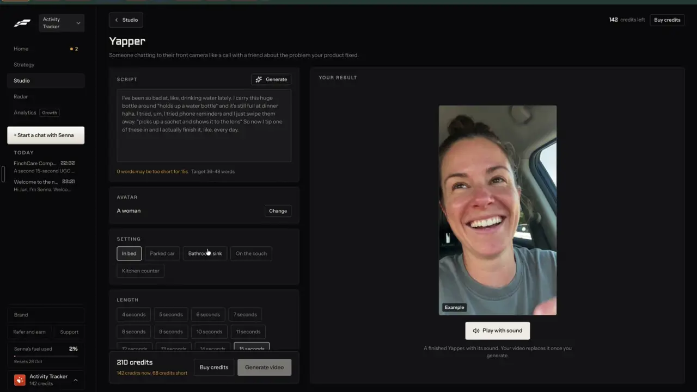

# Talking head UGC

`formats-talking-head` | formats | phase 3 | status: partial | /north-star#formats-talking-head

## Leo asked

19 Oct 2026: "the idea is that one can remix any content format and the ai will regenerate"

He did not name this format; it comes from his Fastlane recording and the competitor research.

## How the best do it

### Fastlane

The gallery has two cards for it: "Talking Head UGC", "AI avatar speaks a script to camera", and "Yapper", "Someone chatting to their front camera like a call with a friend about the problem your product fixed", both "About 210 credits a post".


The Yapper create page (`/v2/studio/create/yapper`) is the template for every talking-head format. Under "< Studio", the H1 "Yapper" and its one line, the left column holds:

1. "SCRIPT" with a "Generate" button (sparkle icon) and a textarea whose grey placeholder shows the style: "I've been so bad at, like, drinking water lately. I carry this huge bottle around \*holds up a water bottle\* and it's still full at dinner haha..." Stage directions sit in asterisks and fillers ("like", "um") are part of the voice. Under it, in orange, "0 words may be too short for 15s" and, in grey, "Target 36-48 words". That is 2.4 to 3.2 words a second; only the 15-second target was seen, so the rate at other lengths is our inference.
2. "AVATAR": "A woman" with "Change".
3. "SETTING": "In bed" (selected), "Parked car", "Bathroom sink", "On the couch", "Kitchen counter".
4. "LENGTH": "4 seconds" up to "15 seconds" one second apart, then "30 seconds", "45 seconds", "60 seconds", with 15 selected. The card loads a moment after the page.
5. "More settings" folded, summarised as "No details, no product, no brand name, English, captions Classic", with "Show".
6. The sticky footer, first "Pick your options to see the price" with "Generate video" disabled, then "210 credits", in orange "142 credits now, 68 credits short", "Buy credits" and "Generate video" still disabled because the balance is short.



The right panel, "YOUR RESULT", plays a finished example with an "Example" tag and a "Play with sound" button that turns into "Pause", above the line "A finished Yapper, with its sound. Your video replaces it once you generate."

In the recording the chat line "wanna do UGC content creation" (notes-4 2.3) produced this format as an approval card: "Talking Head UGC for ActivityTracker", "Make a 15-second talking head UGC video.", "210 credits charged. Usually renders in 4 to 10 min, then it lands in the Library." The agent then says "Your 15-second Talking Head UGC video is being made now. It usually takes 4 to 10 minutes and will show here in this chat." A "MADE" block arrives after "3m 43s" with a 0:15 video and burned-in captions ("Sporadic outreach has").


The creator came out white. After a chat line asking for Asian creators, Fastlane recorded "For future AI UGC content, generally use Asian creators." When he asked for another, it answered "A second 15-second UGC video did not get drafted because it needs 210 credits and you have 142." and "A 10-second version is 140 credits", so the price is about 14 credits a second. At the homepage price (US$20 for 500 credits, [usefastlane.ai](https://usefastlane.ai)) 210 credits is about US$8.40.

### Others

- HeyGen's UGC video generator runs in four steps, "Choose your format", "Write your script" (hook, benefits, CTA), "Pick your presenter" (1,100+ creator-style presenters, voice, background) and "Generate and export", at 9:16, 1:1 or 16:9, paid from US$24 a month ([heygen](https://www.heygen.com/apps/ugc-video-generator)).
- Hedra keeps a product photo fixed while the person and the room change ("A different person every time"), with settings like "a bathroom at 7am", a parked car or a kitchen ([ugc](https://www.hedra.com/uses/ai-ugc-video-generator)). Its Character-3 model turns a start frame plus audio into a talking video of up to 10 minutes at 2.5 US cents a second at 540p and 5 cents at 720p ([character-3](https://www.hedra.com/models/video/hedra/character-3)).
- Captions (incl. Mirage) has a Script Generator (template, keywords, tone, length, 9 languages) and an iOS camera with a teleprompter that scrolls continuously or scene by scene, for people who film themselves ([script](https://captions.ai/help/docs/project/script.md), [camera](https://captions.ai/help/docs/project/camera.md)).
- CapCut's "Instant AI video" takes a style, a pasted or generated script, a voiceover and a length; desktop adds an avatar and voice per scene, on Seedance 2.5 from US$0.12 a second ([tool](https://www.capcut.com/tools/ai-video-generator), [pricing](https://www.capcut.com/pricing)).
- SageContent writes 150 to 210 word scripts in a Hook, Body, CTA shape at a 6th to 8th grade reading level for financial advisers ([sagecontent](https://www.sagecontent.ai/)).
- Arcads clones the user from one continuous take of at least 2 minutes, on its PRO plan at 1,600 credits a video ([clone](https://help.arcads.ai/en/articles/13239662-how-to-clone-yourself-into-a-talking-actor)); that is `people-my-face`.

## What we have today

Checked against origin/main 08537d1, rechecked 2026-10-20.

- "You speaking" at `/edit?panel=ai&kind=avatar` (`src/components/AiVideo.tsx`, `src/lib/aiVideo.ts`, `supabase/functions/ai-video`). "Who speaks" is "My photo" (with "Use a photo of yourself, or of someone who agreed to it.") or "AI presenter", a Higgsfield Soul v2 picture made from a typed look with "Another look" and "Make the presenter" (`presenterBody` in `logic.ts`, mode `presenter`, cap `ai-image` 5: head and shoulders, the fixed phrase "Softly blurred office or home background", Singaporean unless described otherwise; 6 starter `LOOKS`, each a different Singaporean).
- The script is typed by hand (placeholder "What you say, up to about 30 seconds", 600 characters at most, with a live "<n> words, about <s> seconds" at 2.5 words a second) and voiced by one of 7 premade ElevenLabs voices (Alice, Lily, George, Eric, Matilda, Sarah, Liam; `text-voice`, cap `ai-voice` 10), as a separate "Make the voiceover" step before "Make the video".
- Higgsfield Speak (`SPEAK_MODEL` "v1/speak/higgsfield", quality mid, `SPEAK_PROMPT` with a fixed camera and hands out of frame) animates each slice of the voiceover. `sliceVoiceover` cuts slices at quiet moments (`planSlices`), each under 9.5 s, at most 4, so 30 s at most; a slice up to 4.5 s bills 11 credits and a longer one 22. The price is known only after the voiceover: "Costs <n> Higgsfield credits (about US$<x>)", up to 88 credits, about US$5.50. The voiceover is made by the component itself (`speak` in `src/lib/textVoice.ts`, then `sliceVoiceover`), and only then does `makeAvatar` run, with the steps "Sending your voiceover and photo..." and "Making your video, 0 of <n> parts ready. This takes a few minutes.".
- There is no saved face yet: "My photo" is a file picked each time. `people-my-face` adds one (`src/lib/myFace.ts`).
- Caps: `ai-video` 2 a day and `ai-video-global` 20 across everyone, plus `ai-image` 5 for the presenter picture; a failed job gives the use back. The clips are joined on the device and open in the editor with captions, and paid tokens are kept in `cs-ai-video-pending` for "Try again at no cost".

So it is partial: a face speaking a script works, but there are no settings, no script writer with a word target, no length choice with its price, no remix into it and no format page.

## Build

Page `/make/talking-head`, component `src/components/make/TalkingHead.tsx`. It drives the existing functions in `src/lib/aiVideo.ts` and changes the server only where listed. "You speaking" in `/edit` keeps working as it is.

### Screens and states

```
Script                                            [ Write it for me ]
[ I used to check my policies once a year, if that... ]
36 words. Aim for 36 to 48 for 15 seconds.
Who speaks        [ My photo | AI presenter ]
                  [photo] [Change photo]     Use a photo of yourself, or of someone who agreed to it.
Setting           [ Office desk | Parked car | Kitchen counter | On the couch | Cafe table ]   (AI presenter only)
Voice             [ Alice, British, clear, female | Lily, British, soft, female | ... ]
Length            [ 8 s | 15 s | 20 s | 30 s ]
------------------------------------------------------------------
About US$2.75 a post        2 left today        [ Make the video ]
```

"Write it for me" fills the script (see AI below) and keeps the old text one Undo away. "My photo" starts on the saved face from `people-my-face` when one is on and verified, and otherwise asks for a photo as today. With "My photo" the setting row is replaced by the line "Your photo keeps its own background." With "AI presenter" the look box and "Another look" from today's flow sit under the toggle, together with the line "The person is made by AI."

The word line updates on every keystroke: under the target it reads "<n> words may be too short for <s> seconds", over it "<n> words. Over <s> seconds, the end will be cut.", and inside it "<n> words. Aim for <low> to <high> for <s> seconds."

The right panel plays `public/formats/talking-head.mp4` with "Play with sound" / "Pause" and the line "An example. Yours replaces it once you make it."

Making: one press runs every step in order, each with today's words: "Making your presenter..." (AI presenter only, when none is made yet), "Making the voiceover..." (the job calls `speak` and `sliceVoiceover`, which the component does by hand today), "Sending your voiceover and photo...", then "Making your video, 0 of 2 parts ready. This takes a few minutes.", "Downloading your video..." and "Putting your video together...". The job lives in `src/lib/talkingHeadJob.ts`, outside React, so leaving the page carries on, and a reload resumes from `cs-ai-video-pending`. At "Putting your video together..." the page pushes `/edit` (the hand-off from `formats-wall-of-text`).

Done: the editor opens on the video with captions on, and the toast "Your talking head video is ready. Export it when it looks right." The toast rides in `extra.toast`: `makeAvatar` gains an optional `extra` that goes into `Pending`, the same field `formats-text-over-clip` adds for template clips.

Price check: the chip is an estimate until the voiceover exists. Once it does, the job prices it with `avatarCredits` on the real slices. When that is more than the chip showed, the run stops before Speak is paid for and the footer shows "The voiceover runs <s> seconds, so this costs about US$<x>." with the main button "Make it for US$<x>" and a quiet "Shorten the script". The voiceover is kept, so pressing on does not pay for it again.

Failed: each step's existing message ("Couldn't make the presenter. Try again in a minute.", "Couldn't start the video right now. Try again in a minute.", "The safety filter blocked it. Try another photo or wording.") with "Try again", and "Try again at no cost" when a paid clip is waiting. A failed paid job gives its use back as today. A failed voiceover stops the run before Speak is paid for.

Refused: the script writer's refusal shows "That can't be turned into a script that's safe to post. Try another topic." The user can still type their own script; the compliance chips from `src/lib/compliance.ts` run on the script before the voiceover and warn, and they do not block (a team leader's block rule is `trust-compliance-check`).

Over the daily cap: `ai-video` refuses with "You've used all 2 for today. It resets at 8am Singapore time.", and the button is disabled with that line before anything is paid for (read from `useUsesLeft`).

Not Leo: `NotFoundPage`.

### Copy

| Where | Words |
| --- | --- |
| Page | Title "Talking head". One line "You, or an AI presenter, saying your script to the phone camera." |
| Script | "Script", button "Write it for me", placeholder "What you say, or a topic to write it from" |
| Word line | as given above |
| Who | "Who speaks", "My photo", "AI presenter", "Change photo", "Use a photo of yourself, or of someone who agreed to it.", "The person is made by AI.", "Your photo keeps its own background." |
| Setting | "Setting", "Office desk", "Parked car", "Kitchen counter", "On the couch", "Cafe table" |
| Voice | "Voice", then today's voice labels |
| Length | "Length", "8 s", "15 s", "20 s", "30 s" |
| Footer | "About US$<x> a post", "<n> left today", button "Make the video" |
| Price check | "The voiceover runs <s> seconds, so this costs about US$<x>.", "Make it for US$<x>", "Shorten the script" |
| Done toast | "Your talking head video is ready. Export it when it looks right." |

### Data

- No new synced data. The video is an editor project on the device, and an export saves the caption to My posts as today.
- The script being typed is kept in the device key `cs-make-talking-head-script` so a reload never loses it; it is cleared after a successful make.
- The presenter picture link lives in the AI job for the session. A saved presenter per brand is `people-presenters`.
- No schema change.

### AI and cost

- Script: `remix` mode `make` with `as: "speaking"`, the shape remix-any-format adds (`{script, caption}`, no stage directions, at most 70 words). This item adds an optional `seconds` that replaces the 70-word ceiling with the range `low` to `high` for that length, and lets the request carry `topic` in place of `source`. Input: the `RemixSource` (for a Clone a reel source, its own script is used as is and nothing is written), or the words in the script box as the topic; `brandPack(userId)` as remembered by remix-your-brand; the voice from `voiceForClone`. The prompt asks for first person, spoken English with contractions and at most one filler word, and no stage directions, since Speak animates a still picture and cannot act them. Cap `remix-make`, 1 to 2 US cents.
- Word target: `low = round(2.4 x s)`, `high = round(3.2 x s)`, so 8 s is 19 to 26, 15 s is 36 to 48, 20 s is 48 to 64 and 30 s is 72 to 96.
- Setting: `presenterBody(look, setting)` in `supabase/functions/ai-video/logic.ts` swaps its fixed "Softly blurred office or home background" phrase for one line from a fixed map `SETTINGS` (ids `office`, `car`, `kitchen`, `couch`, `cafe`), for example "Sitting in the driver's seat of a parked car in daylight, framed as if the phone is on the dashboard." The lines never put a phone or hands in frame, since `SPEAK_PROMPT` keeps hands out of frame and the camera fixed. With no setting the phrase stays as today. `parseVideoRequest` accepts only those ids, never free text.
- Price: a pure `estimateAvatarCredits(seconds)` in `logic.ts` beside `avatarCredits` (it does not exist yet), with `n = ceil(s / 9.5)` slices; each slice bills 11 credits when `s / n <= 4.5` and 22 when it is longer. That gives 8 s 22 credits (US$1.38), 15 s 44 (US$2.75), 20 s 66 (US$4.13) and 30 s 88 (US$5.50), plus US$0.006 for a presenter picture and the ElevenLabs voice from the prepaid pool. Real slices are cut at pauses, so the charged figure can differ; the price check above handles that.
- Caps used: `remix-make`, `ai-image` (presenter), `ai-voice`, `ai-video` and `ai-video-global`. No new cap.
- No Jev question: the user picks every option, and the compliance chips are the existing rules.

### Deep links

- `/make/talking-head?who=presenter` (default `photo`, own face first), `?setting=car` (default `office`), `?length=30` (default 15), `?voice=<voice id>`; all replace history. `?go=1` starts making on arrival when a script can be written, and is removed once read.
- `?source=<RemixSource key>` writes the script from a source, and `clone:<platform>:<postId>` starts from that Clone a reel result's script.
- Add "Make it as a talking head" on the Clone a reel result (`src/pages/CloneReelPage.tsx`) for Leo; it links with `source=clone:<platform>:<postId>`. Once this page ships, remix-any-format's "You speaking" chip can link here with `source` and `go=1` instead of `/edit?panel=ai&kind=avatar`.
- Builder `links.makeFormat("talking-head", ...)`, a row in `docs/deep-links.md`.

## Done when

- [ ] For Leo, a topic plus one press gives a 15-second talking head video in the editor, with captions, through every step and no second button.
- [ ] My photo is the default, and an AI presenter is labelled as AI on the page.
- [ ] Each setting changes the AI presenter's background, and with my photo the setting row is hidden.
- [ ] The word line matches the target for every length, and the price chip matches `estimateAvatarCredits` for every length.
- [ ] A Clone a reel result opens here with its script filled.
- [ ] A voiceover that would cost more than the chip stops before Speak and shows the real price.
- [ ] A reload mid-make resumes at no cost, and a failed paid job gives the use back.
- [ ] The typed script survives a reload.
- [ ] `/edit` "You speaking" still works as before.
- [ ] Checked at 390 px and 1440 px; `npm run build` and the full `npx vitest run` pass; the `src/data/northStar.ts` item is flipped.

## Tests

- `supabase/functions/ai-video/logic.test.ts`: `estimateAvatarCredits` for 8, 15, 20 and 30 seconds; `presenterBody` with each setting holds that setting's line and still says Singaporean; `parseVideoRequest` refuses an unknown setting id.
- `supabase/functions/remix/logic.test.ts`, `as: "speaking"`: with `seconds: 15` it accepts 36 to 48 words and refuses 60; without `seconds` the 70-word ceiling still applies; asterisks are refused; `refuse` is passed through.
- `src/lib/talkingHead.test.ts` (pure helpers): the word target for each length, the three word-line strings, and `needsPriceCheck(estimate, real)` true only when the real credits are higher.
- `src/lib/talkingHeadJob.test.ts`, with `callFn`, `speak` and `makeAvatar` mocked: the steps run in order with one press, a failed voiceover stops before `makeAvatar`, and a real price above the estimate stops before `makeAvatar` and keeps the voiceover.
- `src/data/formats.test.ts`: the talking-head price string comes from `estimateAvatarCredits(15)`.

## Open questions

- Speak moves a still portrait, so the presenter does not gesture or hold things the way Fastlane's creators do. A fuller UGC look would need another Higgsfield model; which one fits is unverified (check `list_models` first). Any new paid model goes to Leo.
- Fastlane goes to 60 seconds. We stop at 30 because `MAX_SLICES` is 4; going longer is a cost call for Leo.
- "In bed" and "Bathroom sink" are left out as unsuited to advisers. Leo can add them back for his own brands.

## Related

people-my-face, people-presenters, people-my-voice, people-ai-labels, formats-green-screen, formats-presenter, formats-hooks-scripts, edit-video, agent-budget, remix-your-brand, formats-gallery
