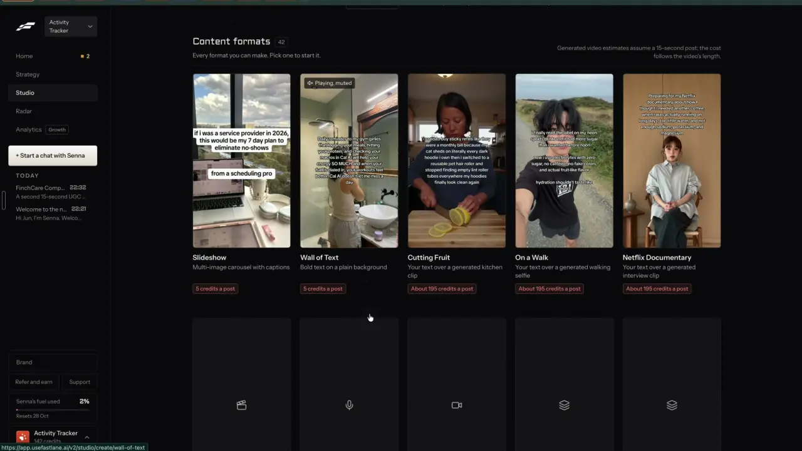

# Your text over a generated clip

`formats-text-over-clip` | formats | phase 3 | status: live (Leo's sign-ins, 21 Oct 2026) | /north-star#formats-text-over-clip

## Leo asked

19 Oct 2026: "the idea is that one can remix any content format and the ai will regenerate"

He did not name this format; it comes from his Fastlane recording.

## How the best do it

### Fastlane

Three cards in the first row of Fastlane's gallery put the user's text over a scene that Fastlane generates, each priced "About 195 credits a post" under the gallery note "Generated video estimates assume a 15-second post; the cost follows the video's length."



| Card name | Description, verbatim | Text on the preview |
| --- | --- | --- |
| "Cutting Fruit" | "Your text over a generated kitchen clip" | "i used to buy sticky refills like they were a monthly bill because my cat sheds..." over a woman slicing lemons |
| "On a Walk" | "Your text over a generated walking selfie" | "I finally read the label on my neon sports drink..." over a walking selfie by the sea |
| "Netflix Documentary" | "Your text over a generated interview clip" | "Preparing for my Netflix documentary about how I thought I needed another coffee..." over a seated interview shot |

The text is first person, lower case in places, and reads like a confession that the scene quietly backs up. Leo did not open these create pages, so their options are unverified; they most likely follow the other create pages (options on the left, a sticky price footer, an example on the right). "Netflix" is a trademark and we use a plain name instead.

At the homepage price (Starter, US$20 a month for 500 credits, [usefastlane.ai](https://usefastlane.ai)) 195 credits is about US$7.80. The /pricing page lists different plans, so treat that figure as approximate.

### Others

No other competitor in the research sells "your words over a made scene" as a format. Nearby:

- MakeUGC's style templates run on Seedance (2.0 Fast, 2.0 or 2.5) at 10 or 15 seconds, with "Seedance 2.0 at 15s = 150 credits per video" and a volume picker of x1, x5 or x10 that makes distinct variants ([templates](https://www.makeugc.ai/video-templates-feature)).
- CapCut's "Instant AI video" uses Seedance 2.5 from US$0.12 a second on Pro in the first month ([pricing](https://www.capcut.com/pricing), [tool](https://www.capcut.com/tools/ai-video-generator)).
- Hedra describes settings in the words people use, like "a bathroom at 7am", a parked car or a kitchen ([ugc](https://www.hedra.com/uses/ai-ugc-video-generator)).

## What we have today

Checked against origin/main 08537d1, rechecked 2026-10-20.

- Seedance 2.5 template clips in the editor's "Make a video without filming" > "From a template" (`src/components/AiVideo.tsx`, `supabase/functions/ai-video/templates.ts`). There are 8 templates; "Phone vlog", "City walk", "Food close-up" and "Through your eyes" are the closest to these scenes. The adviser fills a few blanks, gpt-4.1 writes the shot prompt (`templateSystem`, up to 1,500 output tokens, inside the same request), and Seedance makes a 4 or 8 second clip at 480p or 720p with `generate_audio: true`, US$0.82 to US$3.70, shown as Higgsfield credits and US$. The prompt writer already sets people in Singapore and forbids on-screen text, and it always asks for "Spoken lines: few, each under 8 words", so today every template clip may have someone talk.
- Caps: `ai-clip` 2 a day per adviser and `ai-clip-global` 8 a day across everyone, with the use given back when Higgsfield fails the job (`refundFailed` in `supabase/functions/ai-video/logic.ts`).
- The clip downloads, is joined on the device (`finishAvatar` in `src/lib/aiVideo.ts` calls `startJoin` with no `extra`, so nothing can ride along today) and opens in the editor. Paid job tokens are kept in `cs-ai-video-pending`, so a reload picks the clip up again at no cost.
- Text over the clip is possible by hand with a sticker, but a long paragraph shrinks to one unreadable line (see `formats-wall-of-text`).

So it is partial: the paid scene clip exists, but there is no text writer, no wall-of-text style and no format that puts the two together.

## Build

Build this on top of `formats-wall-of-text`: the same page gains a third background, "A made scene", and the gallery gets its own card that opens that page with the scene picked, so one page serves both formats.

### Screens and states

`/make/text-over-clip` renders `WallOfText` with `bg=scene` fixed and the title changed. The left column:

```
Start from        [ A topic | Remix a trending one ]
Post to remix     (as on wall of text)
Scene             [ Kitchen counter | Walking selfie | Interview ]
Who is in it (optional)  [ A Malay woman in her 30s in a grey cardigan ]
Quality           [ 480p | 720p ]
Mention <brand>   [ Yes | No ]
What it's about (optional)  [ What should the words be about? ]
------------------------------------------------------------------
About US$1.64 a post        2 left today        [ Make it ]
```

The right panel plays one example per scene from `public/formats/scene-kitchen.mp4`, `scene-walk.mp4` and `scene-interview.mp4` until the first make.

Making follows the existing AI video job, with its strings: "Writing the text..." first, then the scene clip's "Writing the shots...", then "Making your video, 0 of 1 part ready. This takes a few minutes.", "Downloading your video..." and "Putting your video together...", with Seedance taking one to four minutes of that. The job and its pending token live outside React, so leaving the page or reloading carries on. At "Putting your video together..." the page pushes `/edit`, using the hand-off from `formats-wall-of-text`.

Done: the editor opens on the project with the wall of text over the scene for the clip's full 8 seconds, and the toast "Your video is ready. Export it when it looks right." (`extra.toast`, with `extra.tab` "stickers").

Failed: Higgsfield's failures come back in today's words ("The safety filter blocked it. Try another photo or wording." or "It didn't come through. Try again.") and the use is given back by the existing refund. A download or join that fails keeps the paid clip, and the button "Try again at no cost" picks it up.

Refused: the writer's refusal shows "That post can't be turned into something safe to post. Pick another one." and nothing is paid for, because the words are written before the clip is ordered.

Over the daily cap: `ai-clip` refuses with "You've used all 2 for today. It resets at 8am Singapore time." and the button stays disabled; a full `remix-make` cap stops it the same way before the clip is ordered. When the global cap is the one that is full, the server answers 429 with "Today's AI clips for the whole studio are used up. Try again after 8am Singapore time." and that line shows instead.

Not Leo: `NotFoundPage`.

### Copy

| Where | Words |
| --- | --- |
| Page | Title "Words over a made scene". One line "Your words over a short clip we make for you: a kitchen, a walk, an interview." |
| Scene | "Scene", "Kitchen counter", "Walking selfie", "Interview" |
| Person | "Who is in it (optional)", placeholder "A Malay woman in her 30s in a grey cardigan" |
| Quality | "Quality", "480p", "720p" |
| Footer | "About US$1.64 a post" at 480p, "About US$3.70 a post" at 720p, "<n> left today", button "Make it" |
| AI label line under the footer | "The person in it is made by AI." |
| Done toast | "Your video is ready. Export it when it looks right." |

The other strings are the wall-of-text ones.

### Data

- Three new templates in `supabase/functions/ai-video/templates.ts`, ids `scene-kitchen`, `scene-walk` and `scene-interview`, with two new flags: `hidden: true`, so the editor's template list in `AiVideo.tsx` filters them out, and `silent: true`, so `templateSystem` replaces its "Spoken lines" rule with "Nobody speaks. Ambient room or street sound only." They have one optional field, `person`. `templateById` and `parseVideoRequest` keep accepting them. Their `structure` and `guidance` describe the scene, the light and a phone or documentary look; `avoid` lists speech, on-screen text, logos and close-up hands on small objects.
  - Kitchen counter: someone at a home kitchen counter in Singapore slicing fruit, filmed on a phone propped up, face partly in frame.
  - Walking selfie: someone walking outdoors along a park connector, holding the phone at arm's length; now and then they look at the lens.
  - Interview: someone seated for a documentary interview, soft window light, looking just off camera, a slow push in.
- `TemplateAsk` and `Pending` in `src/lib/aiVideo.ts` gain an optional `extra` (the `JoinExtra` with the wall overlay), which `makeTemplateClip` copies into `Pending` and `finishAvatar` hands to `startJoin` as `{extra}`. `pendingAvatar` keeps reading old entries that have no `extra`. `Pending` is stored in `cs-ai-video-pending`, so the words survive a reload too.
- The project lives on the device as every editor project does; no synced data and no schema change.

### AI and cost

- Words: `remix` mode `make` with `as: "wall"` (from `formats-wall-of-text`) and two more inputs, `scene` and `maxWords: 30`, so the text fits the scene and can be read in 8 seconds. Cap `remix-make`, 1 to 2 US cents.
- Scene: `ai-video` mode `template` with the scene's template id, `seconds: 8`, and `quality` 480p by default. Seedance 2.5 bills by the second: 8 x US$0.2056 = US$1.64 (26.3 Higgsfield credits) at 480p, and 8 x US$0.4622 = US$3.70 (59.2 credits) at 720p. Caps `ai-clip` and `ai-clip-global`, refunded on failure as today. `seedanceRequest` keeps `generate_audio: true`; the `silent` rule in the written prompt is what keeps the scene to ambient sound. The shot prompt itself is one more OpenAI call inside the same request, under a cent.
- The price chip comes from `clipCredits(8, quality) * CREDIT_USD`, never a typed number.
- No Jev question: the user picks the scene, and nothing else is decided.

### Deep links

- `/make/text-over-clip?scene=walk` (default `kitchen`), `?quality=720p` (default 480p), plus the wall-of-text params `source`, `from`, `mention` and `go`.
- Gallery card and registry entry `text-over-clip` in `src/data/formats.ts`; a row in `docs/deep-links.md`.

## Done when

- [ ] For Leo, each of the three scenes makes an 8-second 9:16 clip with the written words over it, opened in the editor.
- [ ] Nobody in the clip speaks, there is no text in the picture, and people look Singaporean unless the person field says otherwise.
- [ ] The words are written before any clip is paid for, and a refusal costs nothing.
- [ ] A reload during the make picks the clip up at no cost and still puts the words on it.
- [ ] The price chip matches `clipCredits` for both qualities.
- [ ] The editor's own template gallery still shows its 8 templates, without the 3 hidden ones.
- [ ] Over the cap and a safety block each show their message; a failed job gives the use back.
- [ ] Checked at 390 px and 1440 px; `npm run build` and the full `npx vitest run` pass; the `src/data/northStar.ts` item is flipped.

## Tests

- `supabase/functions/ai-video/templates.test.ts`: the three scene templates exist, are hidden and silent, have only the optional `person` field, and no title or prompt part names a brand (`/netflix|pixar|lego|barbie|ghibli/i`); `templateSystem` for a silent template has no "Spoken lines" rule and says nobody speaks, and for every other template it is unchanged.
- `src/lib/aiVideo.test.ts` (or the closest existing test): a `Pending` with `extra` survives the localStorage round trip and `finishAvatar` passes it to `startJoin`; a `Pending` saved before `extra` existed still resumes.
- `supabase/functions/remix/logic.test.ts`: `as: "wall"` with `maxWords: 30` rejects 31 words and puts the scene in the prompt.
- `src/data/formats.test.ts`: the `text-over-clip` price equals `clipCredits(8, "480p") * CREDIT_USD` rounded to cents.

## Open questions

- Fastlane prices for 15 seconds. We make 8 seconds because `CLIP_SECONDS` is `[4, 8]` from Higgsfield's estimate on 2026-10-10; whether Seedance 2.5 accepts longer clips there is unverified, and two joined clips would cost US$3.29 at 480p. Leo decides if 8 seconds is enough.
- Posts with AI-made people may need a label (`people-ai-labels`). The line under the footer is the default until Leo rules on it.

## Related

formats-wall-of-text, edit-text-video, formats-prompt-media, people-presenters, people-ai-labels, formats-gallery, business-cost-preview
