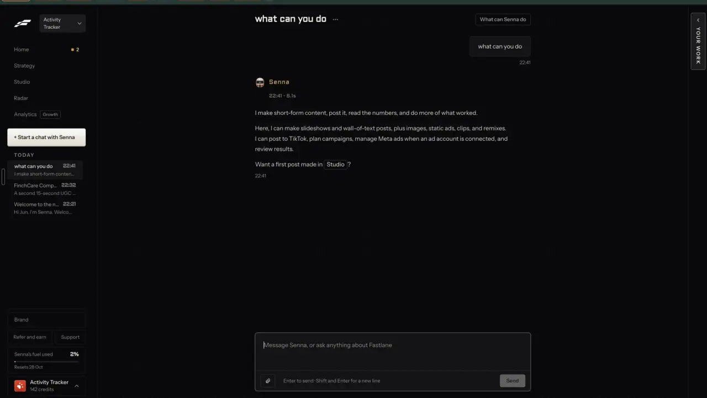

# Text posts and threads

`formats-text-threads` | formats | phase 3 | status: partial | /north-star#formats-text-threads

## Leo asked

19 Oct 2026: "the idea is that one can remix any content format and the ai will regenerate"

8 Oct 2026: "an all in one tool for my social media management, and for each person too"

A remix of a reel or a carousel often reads best as words. Threads is one of the six networks advisers already connect, and today nothing writes a thread for it. No direct ask for threads by name; the rest is from the competitor research.

## How the best do it

Fastlane makes neither text posts nor threads: asked "what can you do", its agent answers "Here, I can make slideshows and wall-of-text posts, plus images, static ads, clips, and remixes." (notes-4, 5:13), so the schedulers and personal-brand writers below are the reference.



- Buffer composes X threads and Threads posts as several posts in one composer, previews them, schedules them, and publishes each in order. Free: 1 threaded post; paid: unlimited ([buffer.com/publish](https://buffer.com/publish), [pricing](https://buffer.com/pricing)).
- Publer plans one thread for X, Threads, Mastodon and Bluesky at once (December 2025) ([Publer 2025 review](https://publer.com/blog/de/2025-jahresrueckblick/)).
- Typefully: one editor for X, LinkedIn, Threads, Bluesky, Mastodon and Substack Notes, thread splitting, drag media between posts in a thread, and a true-to-size preview per network ([typefully.com](https://typefully.com/)).
- Tweet Hunter: "Thread Ideas", "Thread Hook Generator", and a lightning button to rewrite your best tweets from analytics. Grow plan and up ([tweethunter.io](https://tweethunter.io/), [pricing](https://tweethunter.io/pricing)).
- Hypefury cross-posts a thread to LinkedIn as a post or a carousel ([hypefury.com](https://hypefury.com/)).
- Taplio's post builder writes several angles at once from one idea: Actionable, Storytelling, Thought-provoking, Promotional, one "Expert Mode credit" each ([Taplio help](https://intercom.help/taplio/en/articles/17233357-using-taplio-s-ai-for-content-inspiration)). Postwise writes several options from one idea, 400 AI credits a month on Basic ([postwise.ai](https://postwise.ai/)).
- Quso's Viddy writes a LinkedIn or X post from a video's transcript ([Quso help](https://helpdesk.quso.ai/help/what-is-viddy.md)).
- For advisers, Hearsay Social writes on-brand posts and lets agents make compliant original and modified content ([yext.com/platform/hearsay-social](https://www.yext.com/platform/hearsay-social)).

## What we have today

Text posts are live. Threads exist only as a copy-only X caption in the video editor; nothing posts a thread.

- Write, `/generate` (`src/pages/GeneratePage.tsx`): format "Text post" ("100-250 words, mobile-readable") for LinkedIn, Instagram, Facebook and TikTok (`PLATFORMS`, and `PlatformId` in `src/lib/platformCounters.ts`). Hooks first with named formulas and Jev's "Recommended", "Three variations", "Re-roll 3", one-tap rewrites, the post checks (sounds human, predicted score, fact flags, compliance chips, near-duplicate), and adapt for another platform (Instagram, LinkedIn, Facebook). The writer is `generate-social-content`, hosted on the academy project and not deployed from this repo; its snapshot knows only those four platforms.
- Weekly batch (`/generate/batch`): one topic, one post per platform.
- Post it for me (`src/components/PostItForMe.tsx`, `supabase/functions/social/posts.ts`) posts text to Facebook, LinkedIn and Threads (Threads caption up to 500 characters, first comment allowed). It sends one post per account, never a chain.
- The video editor's "Other platforms" panel ("Write for each platform", `src/components/PlatformCaptions.tsx`, `video-assist` mode `captions`, cap `video-captions` 30) already writes an X caption as a thread when the point needs room: 2 to 6 posts numbered "1/3", each up to 270 characters and ending on a full sentence. The fitting is pure code in `supabase/functions/video-assist/captions.ts`: `fitX` (splits a long part between sentences with `sentencesOf` and `cutAtWord`, then numbers the parts), `xParts` (reads the numbered parts back) and `fitThreads` (one Threads post, whole paragraphs up to 500). The panel shows "3 posts, the longest 262 of 280 characters" and flags "Post 2 is over X's 280 character limit by 12. Trim before posting." It is copy only.
- X is never connected for posting: `SOCIAL_PLATFORMS` in `supabase/functions/_shared/zernio.ts` leaves it out because Zernio bills X's API calls through.

Zernio's Threads settings take `threadItems`, "Complete sequence of posts in a Threads thread. The first item becomes the root post, subsequent items are chained as replies" (zernio.com/openapi.json, `ThreadsPlatformData`, read 2026-10-20). Each reply counts toward the 250 posts a Threads profile may publish a day. Bluesky has the same field; X has it too but stays off.

## Build

A "Make it a thread" step that turns any finished post into a thread, a writer for it in this repo, and Post it for me sending the thread to Threads in one go.

```
Write > (finished post)
[Copy] [Post it for me] [Make it a thread]  Reads well as a thread

Thread for  [Threads 500] [X 280]           5 posts
 1  [ Most people pay for their hospital stay twice.          ] 214/500
 2  [ First through the premium. Then through the co-pay...  ] 388/500
 3  ...
 [+ Add a post]  [Number them 1/5]
 [Split it myself]  [Write it as a thread]
 [Copy all]  [Post it for me]
```

### 1. Split it myself (free)

Reuse the splitter X captions already use instead of writing a second one. In `supabase/functions/video-assist/captions.ts`, pull the body of `fitX` out into `fitThread(parts, max, maxParts)`, which returns the posts as an array, and keep `fitX(parts)` as `fitThread(parts, 275, 6)` numbered and joined exactly as today, so X captions do not change. The browser already imports from that file through `src/lib/platformCaptions.ts`.

"Split it myself" calls `fitThread` with the post's paragraphs as the parts (blank lines first, then between sentences with `sentencesOf`, and inside a sentence only at a word with `cutAtWord`), with `max` 495 for Threads or 275 for X and `maxParts` 10. The hook stays alone as post 1 when it fits. Before splitting, the page lifts hashtags, the sign-off and the disclosure lines (`DISCLOSURES` in `src/lib/plainText.ts`) off the text and adds them back to the last post. "Number them" puts "1/5 " in front of each post, the way `fitX` does, which is why `max` leaves 5 characters spare.

### 2. Write it as a thread (AI)

A new `video-assist` mode `thread` `{post, network: "threads" | "x", posts?: 3-8}` returns `{posts: string[]}`. It sits next to mode `captions` because the X thread rules (`PLATFORM_RULES.x`), the dash and hashtag clean-up (`noDash`, `capHashtags`) and `fitThread` all live in `captions.ts` already, so its reply parser `parseThreadReply` goes in that file too, beside `parseCaptionsReply`. The system prompt: rewrite the post as a thread for that network, post 1 is the hook and stands alone, each later post makes one point and reads on its own, keep every fact, number and call to action from the post and add none, plain spoken English, no em dashes, no hashtags except up to 3 in the last post, and the house MAS rules (no promised returns, no guaranteed or risk-free, no insurer or product names, no personal advice). The reply goes through `fitThread`, then is checked for 3 to 8 posts; anything else is refused and the use refunded (`refundUsage`). This keeps thread writing in this repo, since the academy-hosted writer cannot be changed from here.

### 3. The thread panel in Write

- "Make it a thread" sits under a finished text post. The `/drafts` row menu gets the same item, and it opens the same panel on that draft.
- Network toggle "Threads" (500 characters) and "X" (280). X is copy-only: it shows "Copy all" and no Post it for me.
- Each post is an editable box with its own counter, move up, move down and remove; "+ Add a post" adds an empty one below; a post over the limit turns its counter red and blocks Post it for me with the line the captions panel already uses, "Post 3 is over Threads's 500 character limit by 12. Trim before posting."
- The post checks run on the joined thread: compliance chips (`scanCompliance`), the sounds-human check and fact flags, as for a text post.
- The thread is saved on the draft (below), so it reopens.

### 4. Post it for me with a thread

In `supabase/functions/social/posts.ts`: the `schedule` input gets an optional `thread: string[]` (2 to 10 posts, each up to `CAPTION_MAX.threads`), allowed only when every chosen account is Threads. `platformData()` puts it on that account's entry in `platforms` as `platformSpecificData: {threadItems: [{content, mediaItems?}]}`, the first post carrying the media; Zernio then ignores the top-level `content` for publishing, so `content` stays the first post for display. A Threads account alongside LinkedIn or Facebook in the same send is refused with "Send the thread to Threads on its own, then the post to the others." `platformProblem` and the panel show the same words before sending, and the send counts against `social-schedule` as it does today. Zernio has no dry run for posts: `posts.test.ts` proves the body with no network call, and the first real check is one thread scheduled a week ahead on Leo's own Threads account with his OK, read back as scheduled, then cancelled.

### 5. When to suggest a thread

Jev decides, through `writing-judge` with a new mode `thread` `{post}` (one `writing-judge` use, cap 60). When the answer is yes, a small "Reads well as a thread" tag sits beside the button. It is a hint only; the button is always there.

### Screens and states

- Empty: no thread panel until "Make it a thread" is pressed.
- Opened: the panel shows the free split straight away (instant, no AI), with "Write it as a thread" offered.
- Writing: "Writing your thread..." with the orb; the boxes are locked; the free split stays visible underneath until the new one arrives.
- Ready: the posts sit in editable boxes with their counters, and the checks run on the whole thread.
- Over the limit: that post's counter turns red and Post it for me is disabled, with the reason shown under it.
- Posting: Post it for me's own states (Scheduled, Posted with links, Failed with Retry, Cancel).
- Failed writing: "Couldn't write the thread right now. Try again in a minute." The free split stays.
- Refused by checks: the warn chip on the flagged post; it warns and does not block, unless a team leader set the rule to block (`trust-compliance-check`).
- Over the cap: the server's words, "You've used all 30 for today. It resets at 8am Singapore time.", while "Split it myself" keeps working because it costs nothing.

### Copy

- "Make it a thread", "Reads well as a thread"
- "Thread for", "Threads", "X"
- "Split it myself", "Write it as a thread", "Write it again"
- "+ Add a post", "Number them"
- "Copy all", "Copy post 1" (on each box's menu)
- "Post 3 is over Threads's 500 character limit by 12. Trim before posting." (the existing shape from `PlatformCaptions.tsx`; on X, "X's 280")
- "Send the thread to Threads on its own, then the post to the others."
- "Writing your thread..."
- The chip on "Write it as a thread": "Under 1 US cent"
- InfoTip next to X: "X is copy only. Paste it into X yourself."

### Data

- No table and no schema change.
- `DraftEntry` in `src/lib/draftHistory.ts` gets `thread?: {network: "threads" | "x"; posts: string[]}`. The draft sanitiser keeps up to 10 strings of up to 500 characters and carries an existing thread over on save, as it does for `storyboard`, and the thread syncs with the draft like every other field.
- Nothing new on the server.

### AI and cost

- Free split: no cost.
- Thread writer: `video-assist` mode `thread`, on gpt-4.1 like mode `captions`, under 1 US cent a call. New cap `"thread-copy": 30` in `DAILY_LIMITS`, refunded when the reply is refused.
- Jev, `writing-judge` mode `thread`:
  - type `noul`, instructions: "This is a social media post by a Singapore financial adviser. Would it read better on Threads as a chain of 3 to 8 short posts than as one post? Yes when it has several separate points, steps or examples that each stand on their own; no when it is one short thought or one story that needs to be read in one piece."
  - Proposed threshold: show the tag at 0.6 or more. Set it after running Leo's last 50 text posts and reading every answer. Null shows no tag.
- Posting: Zernio, cap `social-schedule`. Each reply in a thread is one of Threads' 250 posts a day.
- Buffer allows 1 free threaded post; Taplio spends a credit per version. Ours is free to split and under 1 US cent to write.

### Deep links

| URL | Opens |
|---|---|
| `/generate?draft=<id>&panel=thread` | That post in Write with the thread panel open. Push (Back closes it). |
| `/generate?draft=<id>&panel=thread&network=x` | The same on X. `network` values threads, x; default threads, left out of links. Replace. |

Add `"thread"` to the `panel` union of the `generate` builder in `src/lib/links.ts`, add `network`, and rows to `docs/deep-links.md`.

### Gate

"Make it a thread", the `/drafts` menu item and the panel show only when `leoOnly(email)`; a typed `panel=thread` does nothing for anyone else. The server refuses `video-assist` mode `thread`, `writing-judge` mode `thread` and a `schedule` with `thread` for anyone else (403), via `supabase/functions/_shared/leoOnly.ts`.

## Done when

- [ ] On Leo's account, a 250-word post splits into Threads-sized posts with no sentence cut in half, and the AI version comes back as 3 to 8 posts within the limit.
- [ ] `posts.test.ts` shows a thread built into `threadItems` in order with media on the first; one thread scheduled a week ahead on Leo's own Threads account, with his OK, comes back from Zernio as scheduled and is then cancelled.
- [ ] Mixing Threads with another network in one send is refused with the message above, in the panel and on the server.
- [ ] The thread reopens with the draft from `/generate?draft=<id>&panel=thread` on another device.
- [ ] X shows Copy all and no Post it for me.
- [ ] Non-Leo accounts see today's Write.
- [ ] `src/data/northStar.ts` item flipped with its `ours` line, in the same commit.

## Tests

- `supabase/functions/video-assist/captions.test.ts`: `fitX` gives exactly today's output on the existing cases (so X captions do not move); `fitThread` keeps every post within `max`, never breaks inside a sentence that fits, breaks a 700-character sentence at a word, and stops at `maxParts`; numbering keeps every post within the network's limit.
- The page's split helper: the hook is post 1; hashtags and disclosure lines end up on the last post.
- `video-assist` mode `thread`: request parsing (network threads or x, 3 to 8 posts); `parseThreadReply` refuses 2 or 9 posts and fits any post over the limit; a refused reply gives the `thread-copy` use back.
- `supabase/functions/social/posts.test.ts`: `thread` passes for Threads accounts alone, is refused alongside LinkedIn, and `postBody` puts it on the Threads entry as `platformSpecificData.threadItems` in order, with the media on the first item only.
- `src/lib/draftHistory.test.ts`: `thread` survives sanitising and an older draft without it still loads.
- `supabase/functions/writing-judge/logic.test.ts`: `thread` mode parsing and the null-answer path.
- `src/lib/links.test.ts`: `links.generate({draft: "d1", panel: "thread", network: "x"})`.

## Open questions

- Bluesky: Zernio supports Bluesky threads, but it is not on our server's platform allowlist. Adding a network to connect is Leo's call.
- X posting stays off because X bills per call: Zernio passes X's cost through at US$0.015 a post or reply, and US$0.20 for a post with a link in its text (zernio.com/openapi.json, the `quoteTweetId` note in X's post settings, read 2026-10-20). A 6-post thread is about US$0.09. Leo decides if that ever changes.
- Writing a Threads post (not a thread) straight from the brief would need the academy-hosted writer to learn a fifth platform. Not needed while "Make it a thread" covers it; Leo decides if the academy function should change.

## Related

`edit-text-post`, `publish-per-network`, `publish-schedule`, `publish-accounts`, `formats-hooks-scripts`, `remix-any-format`, `remix-own-winners`, `trust-compliance-check`, `trust-disclosures`, `edit-score`
