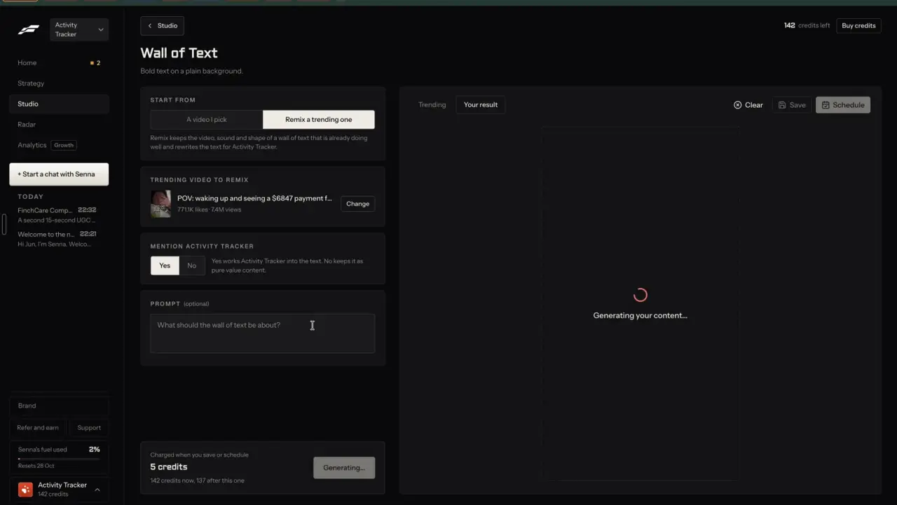

# Wall of text over a video

`formats-wall-of-text` | formats | phase 1 | status: partial | /north-star#formats-wall-of-text

## Leo asked

19 Oct 2026: "the idea is that one can remix any content format and the ai will regenerate"

He did not name this format; it comes from his Fastlane recording and the competitor research.

## How the best do it

### Fastlane

The gallery card reads "Wall of Text", "Bold text on a plain background", "5 credits a post", although its preview is bold text over a selfie video and plays muted on hover with the badge "Playing, muted" (link `/v2/studio/create/wall-of-text`).


Studio > "Template trends" ("Trending slideshows and walls of text you can remix") mixes walls of text in with slideshows, for example "8 silent signs that your stress is startin..." at 1.1M views and 58.5K likes, and "POV: waking up and seeing a $6847 p..." at 7.4M views and 771.1K likes, each with a "Remix this | 5 credits" button. On click the button reads "Opening...", then the Wall of Text page opens and starts making by itself, with no second click.



The setup column, as on screen:

1. "START FROM": "A video I pick" | "Remix a trending one". Helper: "Remix keeps the video, sound and shape of a wall of text that is already doing well and rewrites the text for Activity Tracker."
2. "TRENDING VIDEO TO REMIX": thumbnail, "POV: waking up and seeing a $6847 payment f...", "771.1K likes | 7.4M views", "Change".
3. "MENTION ACTIVITY TRACKER": "Yes" | "No", with the helper "Yes works Activity Tracker into the text. No keeps it as pure value content."
4. "PROMPT (optional)", placeholder "What should the wall of text be about?"
5. Footer: "Charged when you save or schedule", "5 credits", "142 credits now, 137 after this one", and the button showing "Generating..." while it runs.

The result came about 3 seconds after the page opened.


The result is a 9:16 video with rounded corners that plays muted, with a pause button. The background is the original trending creator's own selfie footage, and only the text was rewritten: "POV: it's month-end and instead of guessing why revenue's down, you open ActivityTracker and see the missed follow-ups, calls, and meetings before your pipeline dries up", followed by the source's scream and skull emoji. The text is white, medium weight and centred with a dark shadow and no box, and clicking it shows handles to move and resize it. Beside the video sit "AUDIO" ("Unmute audio", "Sound off", "Swap audio"), "VIDEO" ("Swap video") and "OVERLAY" ("Add overlay"). The header has "Clear", "5 credits | 137 after", "Save" and "Schedule". Pressing "< Studio" with an unsaved result left at once with no prompt.

That reuse of a stranger's face is the part we do not copy. Leo left "other people's faces" and word-for-word copying out on purpose, so our remix keeps the text's shape and puts it over your own video, a stock clip, or a made scene (`formats-text-over-clip`).

### Others

No other competitor in the research has a named wall-of-text maker. The nearest pieces are:

- Blotato's "Tweet Card (Minimal / Photo-Video Background)" and "Single Centered Text Quote" templates ([help](https://help.blotato.com/web-app-features/videos.md)).
- OpusClip's "Auto headline", a one-line text overlay at the start of a clip that is styled once in the brand template ([auto-headline](https://help.opus.pro/docs/article/auto-headline.md)).
- Virlo's API returns each post's on-screen text and lets you filter trending hooks by `content_type` video or slideshow, at USD 0.25 a request ([hooks](https://dev.virlo.ai/docs/hooks)), which is one way to find walls of text later (`find-trending-formats`).

## What we have today

Checked against origin/main 08537d1, rechecked 2026-10-20.

- The video editor `/edit` (`src/pages/VideoEditPage.tsx`) has a stickers tab with "Add text". A text sticker (`Overlay` in `src/lib/videoEdit.ts`: id, kind `"text" | "arrow" | "circle" | "underline"`, text, x, y, size, turn, color, from, to; `MAX_OVERLAYS` 20) is added at the playhead by `newOverlay` for 3 seconds and can be dragged.
- `sanitizeOverlays` cuts a sticker's text to 60 characters whenever a project loads, so a paragraph cannot even be kept today.
- `drawOverlay` in `src/lib/videoMedia.ts` draws a text sticker as one line on a rounded colour pill, weight 800 "DM Sans", and shrinks the font until it fits 86% of the width. There is no wrapped, shadowed text style. `ensureCaptionFonts` loads DM Sans at weights 500 to 700 only.
- Free stock video: `stock-media` with `kind: "video"` (Pexels, about 720p, cap `stock-search` 100); `chooseClip` in `src/lib/autoBroll.ts` keeps results the right way up and long enough.
- Montage (`src/lib/montage.ts`) already does most of the plumbing this format needs: up to 5 portrait stock clips per beat, described to Jev by their Pexels page name (videos carry no alt text), picked through `video-assist` `montage-pick` (cap 20), words on screen as `"text"` overlays, and the result handed to `startJoin` in `src/lib/videoMedia.ts` with `extra` `{note, settings: {filter, captions: false, overlays}}`, so the editor opens it like an upload. `startJoin` records in real time and takes its frame from the first take. `parsePickRequest` cuts a beat's `say` to 90 characters.
- A finished join reaches the editor only while `/edit` is open: `VideoEditPage.tsx` watches `onJoinJob`, takes the file with `endJoin()` and calls its own `upload(file, extra)`, which makes the project and puts `p=<id>` in the address. Montage, the AI presenter and the template clips all start from `/edit`'s own panel, so they never had to leave the page.
- Export, a My posts draft on export and Post it for me (video under 300 MB) all exist.
- Sources to remix: `src/data/trends.json` (10 kits, 5 TikTok and 5 Instagram, with hooks, talking points, the source video link and its views and likes), 55 Instagram videos in `src/data/topPosts.json` with caption (36 of them also carry `idea.hook`), Following posts, and Clone a reel, which reads a reel's caption and transcript and, for Instagram, the on-screen text in sampled frames (`reel-visuals`).

So it is partial. Text over video is possible by hand, but there is no wall-of-text style, no writer and no remix flow.

## Build

Page `/make/wall-of-text`, component `src/components/make/WallOfText.tsx`, job `src/lib/wallJob.ts` (module level). It uses the shared pieces from `formats-slideshow` (route `/make/:format`, `FormatShell`, `src/data/formats.ts`, sources through `resolveSource` in `src/lib/remixSource.ts`, and the `remix` function's `make` mode with `topic`); if this item ships first, it adds them as written there.

This is the first video format, so it also adds the hand-off to the editor that `formats-text-over-clip`, `formats-talking-head`, `formats-green-screen` and `formats-hook-demo` reuse:

1. `JoinExtra` in `src/lib/videoMedia.ts` gains `tab?: EditTab` and `toast?: string`. `upload` in `VideoEditPage.tsx` puts `tab` in the address with the new `p` and shows `toast` once the project opens.
2. `handToEditor(file, extra)` in `src/lib/videoMedia.ts` sets the join job straight to done with that file and emits it, so a ready file reaches the same pickup without being re-recorded.
3. When a format job reaches its join (or hands a file over), the format page pushes `/edit`. The editor shows the join's own line ("Putting your wall of text together, 40%...") and opens the project when it is done.
4. If the user has left for another page, the finished video waits in memory until `/edit` is opened, and the format page shows "Your video is ready." with the button "Open it in the editor".

### Screens and states

Setup, left column:

```
Start from        [ A video I pick | Remix a trending one ]
Post to remix     [thumb] "POV: waking up and seeing..."  771K likes | 7.4M views  [Change]
Background        [ Stock clip | My video ]
                  [clip thumb] "Woman at a desk at night"  [Change clip]
Mention <brand>   [ Yes | No ]
What it's about (optional)  [ What should the wall of text be about? ]
---------------------------------------------------------------
About US$0.02 a post       28 left today       [ Make it ]
```

"Change" opens a sheet of sources: trend kits with a TikTok or Instagram video, swipe file videos sorted by `engagementScore` (by the outlier score once `find-outlier-score` ships), then Following posts. "Change clip" shows the 6 stock clips found for the text as a grid of muted looping thumbnails. "My video" picks a file that stays on this device, and only its first 15 seconds are used.

The right panel shows `public/formats/wall-of-text.mp4` muted and looping before the first make, with the line "An example. Yours replaces it once you make it."

Arriving with `?go=1` (from a Remix button) starts making at once, as Fastlane does. The param is read once and removed.

Making: the button reads "Making..." and the panel shows the steps "Writing the text...", "Finding a clip...", then "Putting it together...". Writing takes a few seconds and the join records in real time, so a 10-second video takes about 10 seconds. Leaving the page does not stop it, because the job lives outside React and the join job already survives navigation.

Done: the editor opens on the new project (`/edit?p=<id>&tab=stickers`, through `extra.tab`) with the toast "Your wall of text is ready. Export it when it looks right." (`extra.toast`). The words can be changed there, and the fuller text-over-video editor is `edit-text-video`. The project's note says where it came from: "Remixed from @handle, <link>".

Failed: a writer failure shows "Couldn't write the text. Try again in a minute." with "Try again", and the use comes back. When no stock clip fits, the page says "No stock clip fits these words. Pick your own video or change what it's about." with "Pick my video". A join failure shows the join's own message, as montage does today.

Refused: "That post can't be turned into something safe to post. Pick another one."

Over the daily cap: the button is disabled with "You've used all 30 for today. It resets at 8am Singapore time."

Not Leo: `NotFoundPage`.

### Copy

| Where | Words |
| --- | --- |
| Page | Title "Wall of text". One line "Bold words over a video, the kind people stop to read." |
| Start from | "Start from", "A video I pick", "Remix a trending one" |
| Remix helper | "Keeps the shape of a wall of text that did well: the opening, the length, the emoji. Writes new words for <brand>. The video is yours or stock, never theirs." |
| Source card | "Post to remix", "Change" |
| Background | "Background", "Stock clip", "My video", "Change clip", and under My video "Only the first 15 seconds are used." |
| Mention | "Mention <brand>", "Yes", "No", helper "Yes works <brand> into the text. No keeps it as pure value content." |
| Prompt | "What it's about (optional)", placeholder "What should the wall of text be about?" |
| Footer | "About US$0.02 a post", "<n> left today", button "Make it", while running "Making..." |
| Steps | "Writing the text...", "Finding a clip...", "Putting it together..." |
| Done toast | "Your wall of text is ready. Export it when it looks right." |
| Ready while away | "Your video is ready.", button "Open it in the editor" |
| Errors | The exact lines given under each state above |

### Data

- The made video is an editor project, which lives on this device as every `/edit` project does. The words travel in `extra.settings.overlays` and the source in `extra.note`.
- Add an overlay kind `"wall"` to `OverlayKind` in `src/lib/videoEdit.ts` and to the `kinds` list in `sanitizeOverlays`, with text up to 400 characters for `"wall"` while `"text"` keeps its 60.
- Exporting saves the caption to My posts as today, so nothing new is synced and there is no schema change.
- The last background choice is a device hint, `cs-make-wall-bg`.

### AI and cost

- Words: `remix` mode `make` with `as: "wall"`, a shape this item adds to `supabase/functions/remix/logic.ts`. Input: the `RemixSource` (caption, teardown and, for an Instagram reel already cloned, its on-screen text) or a topic; `brandPack(userId)` with this page's mention; the voice from `voiceForClone`; the prompt field as `note`. It returns `{refuse, reason, text, scene, search, caption}`, where `scene` is one plain sentence of at most 90 characters describing the shot behind the words (Jev's beat, since `parsePickRequest` keeps only 90 characters of `say`). The prompt asks it to keep the source's opening (a "POV:" scene stays a "POV:" scene), its length within 20%, its emoji count and kind, and its line breaks, and never its words, numbers, brand or claims. Text is at most 60 words and 400 characters, and `search` is a 2 to 4 word stock video search for a calm scene with no text. When mention is yes the brand is named once, plainly. About 1 to 2 US cents a run (remix-everywhere's estimate), cap `remix-make`.
- Clip: one `stock-media` video search (portrait, cap `stock-search`), then `video-assist` `montage-pick` with one beat whose `say` is the writer's `scene` and whose candidates are the first 6 clips' page names (cap `montage-pick`). When Jev returns "none", the job searches once more with the caption's topic; when Jev returns nothing, it takes the first clip `chooseClip` accepts.
- Length: `wallSeconds(words) = clamp(words / 3 + 1.5, 6, 15)` seconds. A shorter clip is looped by repeating it in `startJoin`'s `takes`, the last take cut to fit. "My video" is one take from 0 to `min(15, its length)`.
- Drawing the `"wall"` kind in `drawOverlay`: wrap the words to 80% of the width; white `#FFFFFF`, weight 700, `"DM Sans"` (the heaviest weight `ensureCaptionFonts` loads); shadow `rgba(0,0,0,0.6)` with blur `10u`; no plate; the block shrinks until it fits 45% of the height, centred at `y` 0.45 by default. Put the wrapping in a pure `wrapWall(text, measure, maxWidth)` so it can be tested.
- Cost per video: 1 to 2 US cents for OpenAI plus about US$0.0001 for Jev, with Pexels and the on-device join free.

### Deep links

- `/make/wall-of-text?source=trend:<trendId>`, or any other `RemixSource` key such as `top:<advisorId>-<shortCode>`, `follow:<platform>:<postId>` or `clone:<platform>:<postId>`.
- `?from=pick` (default remix when there is a source), `?bg=mine` (default stock), `?mention=no` (default yes). These replace history.
- `?go=1` starts making on arrival and is removed once read.
- Builders in `src/lib/links.ts` (`links.makeFormat`), and a row in `docs/deep-links.md`.
- Entry points for Leo only: "Remix as a wall of text" on trend cards (`src/pages/TrendsPage.tsx`) and on video posts in the swipe file's drawer, both linking with `go=1`. Once remix-any-format's sheet exists, its "Wall of text" chip links here the same way.

## Done when

- [ ] `/make/wall-of-text` works for Leo's two sign-ins and is NotFound for anyone else, also by typed URL.
- [ ] From a trend kit, one click makes a 9:16 video of new words over a stock clip and opens it in the editor.
- [ ] The words keep the source's opening and emoji style and share no sentence with it.
- [ ] No result ever reuses the source's own video.
- [ ] A 60-word text wraps inside the frame at 9:16 and 4:5 and stays readable, checked by eye.
- [ ] "My video" works with a phone clip, using its first 15 seconds.
- [ ] Leaving during the make and coming back finds the result in the editor.
- [ ] Over the cap, a failed writer, no clip found and a refused source each show their message.
- [ ] Checked at 390 px and 1440 px; `npm run build` and the full `npx vitest run` pass; the `src/data/northStar.ts` item is flipped.

## Tests

- `supabase/functions/remix/logic.test.ts`, `as: "wall"`: rejects over 60 words, cuts `scene` to 90 characters, keeps the emoji count within one of the source's, strips em dashes and hashtags, passes `refuse` through, and the prompt holds the MAS lines and "never its words".
- `src/lib/videoEdit.test.ts`: the sanitizer keeps a `"wall"` overlay and caps its text at 400 characters, and still cuts a `"text"` sticker at 60; `wrapWall` keeps every line inside the width with a fake `measure`, and a single long word does not loop forever.
- `src/lib/wallJob.test.ts`, with `callFn`, `searchStock` and `startJoin` mocked: uses Jev's clip, falls back to the first accepted clip when Jev is null, sends the writer's `scene` as the beat, repeats a 4-second clip into takes that add up to `wallSeconds`, passes one `"wall"` overlay from 0 to the video's end with `captions: false`, `tab: "stickers"` and the toast, and never passes the source's video.
- `src/lib/videoMedia` hand-off: `handToEditor(file, extra)` leaves a done join job that `endJoin()` returns once, with the same `extra`.
- `wallSeconds`: 9 words gives 6 s, 30 words gives 11.5 s, 80 words gives 15 s.

## Open questions

- Fastlane reuses the trending video itself. A source clip with no person in it (a screen, a street) might be fair to reuse, but the default here is never; Leo decides.
- TikTok's trending sounds cannot be attached through the API as far as we know (unverified), so the sound is your own track or none.
- Built 2026-10-20 (formats-wall), where the build differs from the text above (the phase-1 brief and edit-text-video settle these):
  - The words are edit-text-video's `block` overlay through `wallSettings`, `wrapBlock` and `readSeconds`; there is no `"wall"` kind or `wrapWall`. The video runs `clamp(readSeconds(text), 6, 15)` seconds (3.5 words a second: 9 words 6 s, 30 words 9 s, 50 or more 15 s), not `words / 3 + 1.5`. The block is white "Clean" (DM Sans 600) with the block's dark outline and shadow, no plate, centred, its size stepped down from 1 until it fits 45% of a 9:16 frame. The text allows 60 words and 400 characters, as above.
  - "Start from" reads "A topic" | "Remix a trending one" (`from=topic`), as on /make/slideshow: "A video I pick" clashed with Background's "Stock clip". Your own video is Background > "My video" (`bg=mine`). "What it's about" is the topic with no post, else the optional steer.
  - The editor opens a wall project on edit-text-video's short panel because `settings.wall` is true, so there is no `tab=stickers`. There is no example mp4: the panel is a dashed 9:16 frame. "Change clip" (the grid of 6 stock clips) is not built: Jev picks the clip, and the editor's short panel swaps the video.
  - The entry point is the Remix sheet's "Also make: Wall of text" link (making on arrival through navigation state, never `?go=1`), not separate buttons on /trends and the swipe drawer.
  - Over the cap, "Make it" turns off with the format shell's shared line, as on /make/slideshow.
  - Checks in code after writing (one fixing pass, then a refusal that keeps the use): the emoji count within one of the original's (an original full of emoji counts as 3), a business never says I (a quoted objection may) and names its product exactly once in the words with Mention on, and no brand is named with Mention off.
  - "Pick my video" after no clip fits, or Try again after a dropped download, finishes with the words already written: no second remix use.

## New evidence (20 Oct 2026)

Fastlane's 12 walls of text for Activity Tracker, verbatim, over UGC-style clips: [review notes](../videos/fastlane-2026-10-20-review/notes.md) sections 2.3 and 2.4. This format is part of the [dogfood run](../dogfood-activity-tracker.md).

## Related

edit-text-video, formats-text-over-clip, find-trending-formats, remix-any-format, remix-closeness, remix-your-brand, formats-gallery, business-cost-preview, people-ai-labels
