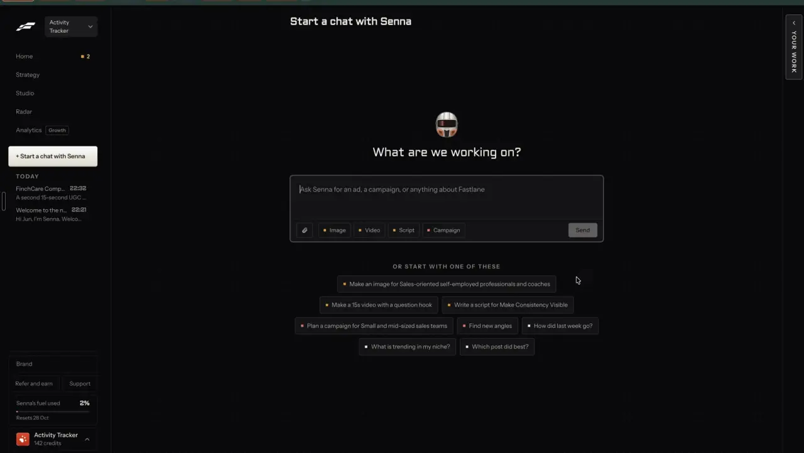

# A weekly report that says what to do

`learn-weekly-report` | learn | phase 7 | status: partial | /north-star#learn-weekly-report

## Leo asked

No direct ask; from the competitor research.

## How the best do it

Fastlane keeps the week on Home: the "PACE" card shows views a day on a 0 to 100 gauge ("views a day, Sun", "No views yet."), with "POSTS OUT 0 of 0 this week" and "AD SPEND THIS WEEK" beside it. Analytics sits in the sidebar with a "Growth" plan tag, and Leo did not open it in the recording, so what it holds is unverified.


The chat's starter chips include "How did last week go?" and "Which post did best?", drawn with a white square, which marks analytics questions apart from the orange make-content chips.



Others:
- Buffer's Insights end each finding in a button that starts the fix. "Revise Posting Schedule" offers "Adjust Your Schedule", "Boost Posting Frequency" offers "Create a Post", and "Repost Your Engaging Content" offers "View Post Details". Free plans keep 30 days of history; reports start on Essentials ([analyze](https://buffer.com/analyze), [pricing](https://buffer.com/pricing)).
- Supergrow sends a weekly briefing that explains results in words, and teams get per-member and team-wide weekly reports ([pricing](https://www.supergrow.ai/pricing)).
- Hootsuite gives a weekly or monthly social performance score across Facebook, Instagram and LinkedIn, the most and least engaging posts of the week, and "AI recommendations and highlights" to raise the score ([analytics](https://www.hootsuite.com/platform/analytics)).
- Motion's Home shows "your top 10 ads of the week" with an up or down marker against last week, plus "Performance shifts" for ads that scaled or declined ([faq](https://motionapp.com/faq)).
- Sandcastles schedules a "Content Strategy Audit" every day, 7 or 30 days, over at least 15 videos picked by most recent, most views, highest engagement or biggest outliers, and emails it. Verifying an account creates a paused monthly audit by itself ([reports](https://help.sandcastles.ai/reports)).
- Agorapulse's "AI insights" > "Summarize" writes "Profile performance summary", "Content Analysis" and "Actionable Recommendations" from 50 posts, and can go into the PDF ([help](https://support.agorapulse.com/en/articles/12041180-how-to-generate-an-ai-summary)).
- Sprout Social's Trellis agent turns results into summaries and flags spikes, with 100 agent credits per seat a month ([press](https://sproutsocial.com/insights/press/now-generally-available-sprout-socials-ai-agent-trellis-is-helping-reshape-how-social-teams-prove-their-value/)).

## What we have today

- Analytics has a "This week" card (`ThisWeekCard` in `src/pages/AnalyticsPage.tsx`, around line 320). It shows posts, impressions and engagements against the 7 days before, the best and weakest posts, what the best share (format, pillar or hook formula) and how followed accounts moved.
- `weekReport` and `weekMoves` in `supabase/functions/notify/logic.ts` build the report and up to 5 moves: `pattern`, `reuse`, `numbers`, `cadence`, `rival`. A `Move` is only `{ id, text }`. `week-pick` (Jev choice, cap `week-pick` 10) picks one, cached in `content-studio-weekpick-<scoped uid>` as `{ sig, pick }` with `sig = "<report end>:<move ids>"`. The card shows it as "One thing this week" in plain text. No move has a button. With fewer than 2 moves there is no Jev call and no move shows at all, on the card or in the email; the other moves Jev did not pick never show either.
- The Monday email (`weeklyEmail(profiles, now, picks, marketCheckOpen)`, sent by `notify` through Resend, plain text) carries the same report and pick. `notify` asks Jev itself in `weekPicks` (`run.ts`), counted against the same `week-pick` cap. Its links are `/home` and, for uids in `MARKET_USERS` when the week's market check is open, `/market`.
- The assistant's `week` act (`weekAct` in `src/lib/assistantActs.ts`) answers "how did my week go" with the report text and one "Open Analytics" button. It reads drafts without `withReal`, so a post with Zernio numbers counts its typed numbers there and not on the card.
- Best and weakest rows open the post in Write.
- Write fills a brief from the URL only when the link carries `pillar`, `detail`, `funnel`, `idea` or `ctx` (`GeneratePage.tsx`, the prefill effect around line 1031). A link with only `format` or `formula` opens an empty Write.
- Nothing here is gated. `leoOnly` lives in `src/lib/leoOnly.ts`; AnalyticsPage calls `supabase.auth.getUser()` but keeps only the id. No function reads a `NORTH_STAR_USERS` secret yet.

Status partial: the report and Jev's pick exist on the card and in the email; no insight ends in an action.

## Build

### Screens and states

1. Every move gets an action. Add `moveAction(m: Move): { button: string; href: string }` to `notify/logic.ts`, so the card, the email and the assistant share it. `weekMoves` fills in what the link needs: a `pattern` move gets `on` (`format`, `pillar` or `hookFormula`, the `label` of the `Shared` it came from) and `key`; a `reuse` move gets `postId`, the best post's draft id.

   | Move | Button | href |
   |---|---|---|
   | pattern, format | Write one | `/generate?format=<key>&ctx=<move text>` |
   | pattern, pillar | Write one | `/generate?pillar=<key>&ctx=<move text>` |
   | pattern, hook formula | Write one | `/generate?formula=<key>&ctx=<move text>` |
   | reuse | Remix it | `/analytics#this-week` (see below) |
   | numbers | Add numbers | `/analytics#add-numbers` |
   | cadence | Plan the week | `/calendar?view=week` |
   | rival | See their posts | `/following` (Following has no per-account param) |

   The `ctx` on the three Write links is what starts Write's prefill (see What we have today); it carries the move's own text, URL-encoded. `formula` only takes effect because `ctx` is there.

   `reuse` cannot be built in `notify/logic.ts`, which never sees the full draft. The email keeps `/analytics#this-week`. The card and the assistant swap in `buildRepurposeUrl(draft, repurposeTargetsFor(draft)[0])` from `src/lib/repurpose.ts` when the draft with `postId` is on the device (it opens Write prefilled to turn the post into another format, which is what the move says), and `/analytics?remix=own:<postId>` once `remix-everywhere` and `remix-own-winners` ship.

2. The card's move block becomes a short list on Leo's sign-ins (`leoOnly(email)`; everyone else keeps today's block). AnalyticsPage keeps `data.user?.email` from its existing `getUser()` call and passes `leo` to `ThisWeekCard`.

   ```
   ONE THING THIS WEEK
   Make 2 more carousels this week, like 2 of your top 3.      [ Write one ]
   Also worth doing
   Add the numbers for 2 recent posts with none yet.           Add numbers
   Remix a post from @rival, who gained 120 followers.         See their posts
   ```

   Jev's pick goes first with the filled button. At most 2 others follow, in `weekMoves` order, as quiet text buttons.
   - Picking: the list shows at once without the pick label; "Picking..." sits where the label goes, and the pick moves to the top when it arrives (under 400 ms after the call returns).
   - One move only: no Jev call, as today. Unlike today, the move shows, under "One thing this week".
   - Jev returns null, `week-pick` fails or answers 429: the list shows under "Worth doing this week" with no pick and no error.
   - No posts in 14 days: the card stays hidden (today's rule).
   - Posts but no numbers: today's line, with an "Add numbers" button after it.

3. Anchors. Give the card `id="this-week"` and the "Add your numbers" card `id="add-numbers"` (both `scroll-mt-20`), and call `useScrollToHash(userId !== undefined)` in `AnalyticsPage`.

4. The Monday email, on Leo's two uids only: `weeklyEmail` takes a fifth parameter `withLinks = false`, and `run.ts` passes `isAllowed(o.northStarUsers, uid)`, where `index.ts` reads the `NORTH_STAR_USERS` secret the same way it reads `MARKET_USERS` today. The secret holds Leo's two uids, `40f07a18-b087-4c95-ba1f-d5444222968a` and `13b28b1d-2ecb-40be-b3a9-aefc90366f9b`. It is new: set it with `supabase secrets set` if `find-competitors` has not already. `Options` in `run.ts` gains `northStarUsers`. Each move line is followed by its link on its own line:
   - With a pick: "One thing this week: {text}", its link, then "Also worth doing:" and up to 2 more moves in `weekMoves` order, each with its link.
   - With one move: that move as "One thing this week", with its link (today it is left out).
   - With 2 or more moves and no pick (Jev null, no key or over the cap): "Worth doing this week:" and up to 3 moves with links.
   The rest of the email is unchanged.

5. The assistant. `proposeAct` and `actFor` take a `leo` flag. `act` in `src/components/feedback/AssistantMount.tsx` already reads the uid from `getSession()` at send time; it reads `session.user.email` there too and passes `leoOnly(email)`, since the `user` state can still be loading. Only with it does `weekAct` add up to 3 move buttons to `go` before "Open Analytics". It never calls `week-pick` itself: the cached pick from `content-studio-weekpick-<scoped uid>` goes first when its signature matches, otherwise the buttons keep `weekMoves` order. `weekAct` maps drafts through `withReal` as the card does, so its moves and signature match the card's.

### Copy

- Pick label: "One thing this week" (as today)
- Others label: "Also worth doing"; with no pick: "Worth doing this week"
- Buttons: "Write one", "Remix it", "Add numbers", "Plan the week", "See their posts"
- Email, after a move line: "{Button}: {APP_URL}{href}", for example "Write one: https://consultant-content-studio.vercel.app/generate?format=carousel&ctx=Make%202%20more%20carousels%20this%20week%2C%20like%202%20of%20your%20top%203."
- Email heading for the others: "Also worth doing:"; with no pick: "Worth doing this week:"

### Data

- No new keys and no schema change; `content-studio-weekpick-<scoped uid>` keeps `{ sig, pick }`.
- `Move` gains optional `on`, `key` and `postId`. `moveBody` rebuilds each move as `{ id, text }`, so the extra fields never reach Jev and `week-pick` needs no change.

### AI and cost

- Nothing new to pay for and no new cap: the pick stays one Jev choice through `week-pick` (question in `moveAsk`), capped at 10 a day at under US$0.0001 a call.

### Deep links

- `/analytics#this-week` scrolls to the card; `/analytics#add-numbers` to "Add your numbers". Add both to "Still read" in `docs/deep-links.md`.
- Every button's href is listed in the table above; all are existing params.

## Done when

- [ ] On Leo's sign-in, each move on the card has its button, and each opens the right page. The three Write links show the "Filled in for you" toast with the format, pillar or formula set and the move text as context.
- [ ] The pick shows first; with Jev off (no `TYPESAFE_API_KEY` locally) the list shows under "Worth doing this week".
- [ ] `/analytics#add-numbers` and `/analytics#this-week` scroll to their cards.
- [ ] A `notify` dry run on a Monday morning (`{ dryRun: true, only: <Leo uid>, now: "2026-10-26T01:00:00Z" }`, 9am Singapore, with Leo's Monday email switched on) shows a link line under each move; the same dry run for any other uid matches today's email. Each dry run uses up to 3 of that uid's `week-pick` count for the day.
- [ ] "how did my week go" in the assistant shows the move buttons.
- [ ] Other sign-ins see today's card unchanged.
- [ ] Checked by eye at 390 px and 1440 px.
- [ ] `src/data/northStar.ts` item flipped (status and `ours`) in the same commit, and this spec's status line ticked.

## Tests

- `supabase/functions/notify/logic.test.ts`: `moveAction` gives the button and href in the table for each move kind and for all three `on` values, and every `/generate` href carries `ctx`. `weekMoves` sets `on` and `key` on a pattern move and `postId` on a reuse move.
- Same file: `weeklyEmail(profiles, now, picks, false, true)` puts each link under its move and adds at most 2 "Also worth doing" lines; with one move it shows that move; with no pick it lists up to 3 under "Worth doing this week:". With `withLinks` false the text equals the four-argument call's output. The existing `weeklyEmail` tests stay green unchanged.
- `src/lib/assistantActs.test.ts`: with `leo` true the week act returns move buttons, cached pick first, and makes no `week-pick` call; with `leo` false it returns exactly today's answer.

## Open questions

- The email stays plain text for now; buttons in an HTML email can come later, since Resend takes `html` beside `text`.
- Account audit advice (double down, fix, stop) could feed more moves into this list, which this build leaves for later.
- Week-over-week rank arrows on best posts, as in Motion's leaderboard, are left out.

## Related

learn-pace, learn-post-grade, learn-format-winners, learn-real-numbers, learn-reports-export, remix-everywhere, remix-own-winners, agent-chat, agent-home, find-alerts-digest
