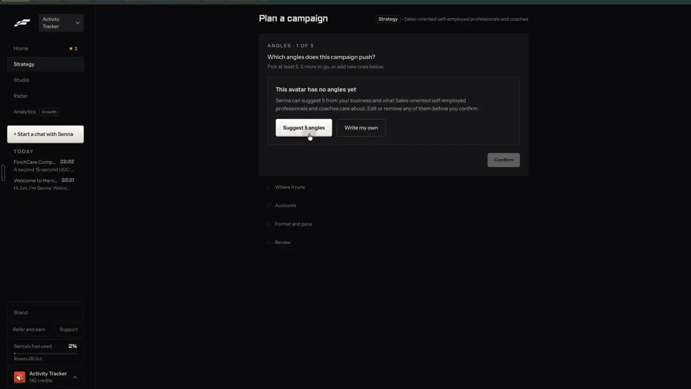
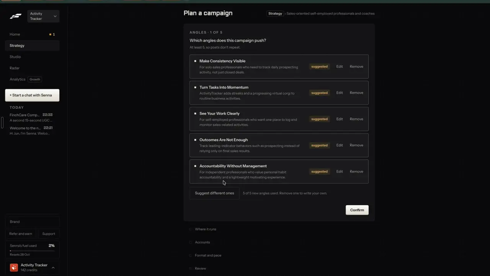

# Angles

`plan-angles` | plan | phase 5 | status: partial | /north-star#plan-angles

## Leo asked

15 Oct 2026: "embed it within the tool so it depends on the person's market/website". It applies here because each angle is suggested from the brand's own positioning (which `brand-dna` can fill from the brand's website) and from the questions saved on Your market, so two advisers get different angles.

## How the best do it

Fastlane makes angles the first step of a campaign, and they belong to an avatar (an audience), so the next campaign for the same avatar starts with them.

1. Empty state (t009). Header "ANGLES | 1 OF 5", question "Which angles does this campaign push?", sub "Pick at least 5. 5 more to go, or add new ones below." A dashed box: "This avatar has no angles yet" / "Senna can suggest 5 from your business and what Sales-oriented self-employed professionals and coaches care about. Edit or remove any of them before you confirm." Buttons "Suggest 5 angles" (primary) and "Write my own". "Confirm" stays grey until there are 5.



2. Suggesting (t010, t013). Five dashed skeleton rows and the status line "Writing 5 more angles for Sales-oriented self-employed professionals and coaches. This takes a few seconds." The button reads "Suggesting..." and "Add an angle" stays usable. It took about 4 seconds.
3. Filled (t014). The sub becomes "At least 5, so posts don't repeat." Each row has a marker, a bold title of two to four words, a one-line description, an orange "suggested" tag, and "Edit" and "Remove". Under the list: "Suggest different ones" and "5 of 5 new angles used. Remove one to write your own." (5 new per round). Example: "Make Consistency Visible" / "For solo sales professionals who need to track daily prospecting activity, not just closed deals."



4. After Confirm the step collapses to one row: "Angles", the titles joined by " | ", and "Change". The review step marks new ones "(new)".
5. On the campaign page, "THE GOAL" panel shows "5 ANGLES | 28 POSTS", a bar of five coloured segments, and a chip per angle with its post count: 6, 6, 6, 5, 5. Each post in the queue names its angle ("Angle: Make Consistency Visible").


Others:

- Atria writes concepts and ad scripts from competitor URLs and mines customer reviews for the words buyers use, on 4,000 to 25,000 AI credits a month by plan ([pricing](https://www.tryatria.com/pricing), [review](https://www.trendtrack.io/blog-post/atria-review)).
- Taplio's Post builder generates one topic in several angle variations at once (Actionable, Storytelling, Thought-provoking, Promotional) so the user picks instead of prompting; each version costs "1 Expert Mode credit" ([source](https://intercom.help/taplio/en/articles/17233357-using-taplio-s-ai-for-content-inspiration)).
- Agorapulse's Archie proposes four angles from a source with up to five drafts per angle ([source](https://support.agorapulse.com/en/articles/15385025-archie-explained)).
- Revid.ai's Auto-Mode gives each day of a 7-day plan an 'Objective' and an 'Angle' ([source](https://www.revid.ai/auto-mode)).
- Later generates content pillars, then post ideas inside each pillar ([source](https://later.com/social-media-ai-tools/)).

## What we have today

- `/plan` gives every slot an angle string, built in code from a positioning topic plus an idea-source label and an inspiration seed topic: `"<Topic> - <idea label> (angle: <seed topic>)"` in `generatePlan`, `src/lib/contentPlan.ts` (the code joins them with an em dash; social-pillar slots use the subject alone). Each slot card shows its own angle (`PlanPage.tsx` line 986), but there is no list of angles, no way to edit one, and no way to ask for new ones; "Reshuffle" only changes the salt.
- `/plan` shows a funnel mix as three chips with counts ("A | Attraction (n)") in the plan header (`src/pages/PlanPage.tsx`), with nothing counted per angle.
- Idea Dump (`/coach#idea-dump`, edge function `idea-dump`, cap "idea-dump" 30) writes an angle sentence per idea from the user's own notes. Clone a reel writes 3 concepts per source. Neither keeps angles per audience.
- The pattern to reuse for suggestions already exists: `market` mode "suggest" (`supabase/functions/market/index.ts` `suggest`, `logic.ts` `keepAsk`, `keepTop`) has the LLM write candidates and Jev keep the ones that fit. When Jev is unavailable it keeps the LLM's own first five.
- Positioning has one audience per brand (`audience`, `audienceDetail` in `src/lib/positioning.ts`). Several audiences per brand are brand-audiences' job.
- What a suggestion can read already: `buildIdeaDumpContext(userId)` in `src/lib/ideaDump.ts` (voice summary, positioning, platforms); `brand-dna`, which pre-fills positioning from the brand's home page; and Your market (`/market`, Leo only, `src/lib/market.ts`, key `content-studio-market-<scoped(uid)>`), whose `questions` are up to 5 things the audience would ask ChatGPT about their money.
- The fallback check exists on the server: `complianceIssues(text)` over `COMPLIANCE_RULES` in `supabase/functions/_shared/socialAudit.ts`, kept equal to the app's `COMPLIANCE_FLAGS` by a mirror test.

## Build

Gate with `leoOnly(email)`. Build after plan-goal and before plan-campaign; the wizard's angles step is this item's component.

### Screens and states

A component `src/components/campaign/AnglesStep.tsx` used as step 2 of the campaign wizard (plan-campaign), and `src/components/campaign/AngleMix.tsx` used on the campaign page (plan-campaign-page).

AnglesStep, header `ANGLES | 2 OF 5`, question `Which angles does this campaign push?`

- Empty (this audience has no saved angles):
  ```
  No angles for <audience> yet
  Suggest 5 from your positioning and what <audience> care about.
  Edit or remove any before you go on.
  [Suggest 5 angles]  [Write my own]
  ```
  `Confirm` disabled, with the reason under it: `Pick at least 3.`
- Price: `Suggest 5 angles` and `Suggest different ones` carry the price chip from business-cost-preview for `campaign-angles` (`Under US$0.01 | <n> left after this`); until that item ships, the same text in a plain span.
- Suggesting: 5 skeleton rows, status line `Writing 5 angles for <audience>. This takes a few seconds.`, button `Suggesting...` disabled, `Write my own` still enabled. Feedback appears within 400 ms of the click.
- Filled: each row is a checkbox (selected by default for new ones), bold title, one-line description, tag `suggested` or `yours`, compliance chips from `scanCompliance` on title plus line (warn only, never blocks), and `Edit` and `Remove`. Under the list: `Suggest different ones` and the counter `<n> picked. 3 to 8 work best.` Angles saved for this audience from earlier campaigns show first, unticked, with the tag `used before`.
- Editing a row: title (max 40 characters) and line (max 140) become inputs in place, with `Save` and `Cancel`; Enter saves and Escape cancels.
- Write my own: adds an empty row in edit mode at the top.
- Failed: `Couldn't suggest angles right now. Write your own, or try again.` with `Try again`. Rows already there stay.
- Over the cap (429): `You've used all 10 angle suggestions for today. It resets at 8am Singapore time. Write your own below.`
- Usage unreadable (503): `Suggestions are unavailable for a moment. Write your own below.`
- Picked fewer than 3: `Confirm` disabled with `Pick at least 3.`; more than 8: disabled with `Pick 8 or fewer.`
- Confirm collapses the step to `Angles | <title> | <title> ... | Change`.

AngleMix on the campaign page, inside the "THE GOAL" panel:

```
5 ANGLES | 12 POSTS
[====red====][===green===][==purple==][==amber==][==pink==]
* Fees are not the whole story 3   * Your CPF is already working 3
* The hospital bill question 2     * One plan for two incomes 2   * Start before 30 2
```

- Segment widths are post counts per angle, skipped posts excluded. Colours come from five new tokens to add in `src/index.css` (`--angle-1` to `--angle-5`, then they repeat), with light and dark values; the file has no chart tokens today. Every chip carries its count as text, so colour is never the only signal.
- Clicking a chip filters the review queue to that angle (`?angle=<id>`) and outlines the chip; clicking it again clears the filter.
- Empty: a campaign whose posts are all skipped shows `No posts left in this campaign.`

### Copy

- `ANGLES | 2 OF 5`, `Which angles does this campaign push?`
- `No angles for <audience> yet`
- `Suggest 5 from your positioning and what <audience> care about. Edit or remove any before you go on.`
- `Suggest 5 angles`, `Suggesting...`, `Suggest different ones`, `Write my own`, `Edit`, `Remove`, `Save`, `Cancel`, `Confirm`, `Change`
- `Writing 5 angles for <audience>. This takes a few seconds.`
- Tags: `suggested`, `yours`, `used before`
- `<n> picked. 3 to 8 work best.`, `Pick at least 3.`, `Pick 8 or fewer.`
- The error lines are the ones listed under states above, and the mix header is `<n> ANGLES | <m> POSTS`.
- When someone edits an angle that drafted posts already use, show this under the row: `Posts already written keep their words. Swap a post to rewrite it.`

### Data

- New `src/lib/angles.ts`, synced key `content-studio-angles-<scoped(uid)>`:
  ```ts
  interface Angle { id: string; title: string; line: string; origin: "suggested" | "mine"; createdAt: string; usedAt?: string }
  type AngleStore = Record<string, Angle[]>; // audience key -> angles, newest first
  ```
- The audience key is `"main"` until brand-audiences ships an audience id; then it is that id.
- Keep at most 30 angles per audience (drop the oldest unused). Nothing is saved until Confirm: then every ticked angle is saved (new ones added, `usedAt` set). Unticking leaves an angle out of this campaign only. `Remove` on a new row drops it from the list, and on a `used before` row deletes it from the store after the Undo toast `Angle removed. Undo` (5 s). This is content, not security state, so a returning row from another device is acceptable.
- A campaign stores the picked `angleIds` and a copy of each title and line (plan-campaign), so later edits here never change a campaign's history.

### AI and cost

- `idea-dump` gets mode "angles". Request: `{mode: "angles", audience, avoid: string[] (titles already saved), context: {positioning, goal, platforms, voice, questions?: string[], examples?: string[]}}`. The browser starts from `buildIdeaDumpContext(userId)` and adds the goal (plan-goal). `questions` is Your market's saved questions when the brand has any. `examples` is the caption of the best post (`followStats(a).best` in `src/lib/following.ts`, one post per account, by reach) of up to 5 followed accounts, sent as structure examples only.
- The LLM (idea-dump's pinned `gpt-4.1`, structured output) writes 8 candidates `{title, line}`: title 2 to 5 words, line under 20 words, each a distinct reason this audience would care. The prompt reuses idea-dump's MAS compliance block (move those lines from `buildIdeaDumpPrompt` into one exported `COMPLIANCE_LINES` constant that every mode uses), forbids naming insurers or products, promised returns and invented numbers, and tells the model never to copy wording from `examples`.
- Jev, one `askJev` call per candidate, state `{audience, adviser: positioning.oneLiner, goal, country: "Singapore", angle: "<title>: <line>"}`:
  - `fits` (noul): "Would `audience` in `country` stop to read a post built on `angle` from `adviser`?" Keep at 0.5 or above.
  - `unsafe` (noul): "Does `angle` promise a return or payout, name a specific insurer or product, or claim a result for the reader?" Drop at 0.5 or above.
  - Keep the top 5 by `fits` that pass both. Thresholds are proposed; log the scores of the first 20 rounds and set them from that run (Leo's Jev rule).
- Without Jev: the first 5 candidates that pass the server copy of the compliance regex (`complianceIssues` in `_shared/socialAudit.ts`), the `keepTop` fallback.
- Add `"campaign-angles": 10` to `DAILY_LIMITS` in `supabase/functions/_shared/usageCaps.ts`, commented "Angle suggestions for a campaign (idea-dump mode angles): one gpt-4.1 call, about US$0.01, plus 8 Jev reads." A failed OpenAI call gives the use back through `refundUsage`.
- One round costs about US$0.008 by list prices (gpt-4.1 at US$2 per million input tokens and US$8 per million output, roughly 1,200 in and 700 out). The 8 Jev calls add under US$0.0002. These are estimates, so measure the first runs and correct the cap comment.
- Server gate: mode "angles" answers 404 `{code: "not_enabled"}` unless `leoOnly(user.email)` (`supabase/functions/_shared/leoOnly.ts`, added by plan-goal).
- The mix is arithmetic (posts per angle), not a judgment, so it needs no Jev.

### Deep links

- The wizard step is `/campaigns/new?step=angles`, a param plan-campaign owns.
- The mix filter is `/campaigns/<id>?angle=<angle id>` on the campaign page, written with replace; an unknown id falls back to no filter. Add that `angle` row to the `/campaigns/:id` table in `docs/deep-links.md`.

## Done when

- [ ] On `/campaigns/new?step=angles` with no saved angles, Suggest 5 angles shows skeletons within 400 ms and 5 angles within about 15 s (one gpt-4.1 call, then 8 Jev calls in parallel; Fastlane took about 4 s).
- [ ] Every suggested angle names something an adviser's audience in Singapore would recognise and none names an insurer, a product or a return (read 5 rounds by eye, on two brands).
- [ ] Suggest different ones returns angles whose titles differ from every row already listed.
- [ ] Edit, Remove, Write my own and Undo work with the keyboard alone.
- [ ] The 11th suggestion of the day shows the cap message and Write my own still works.
- [ ] With `TYPESAFE_API_KEY` unset on a branch deploy, suggestions still arrive (fallback path).
- [ ] Angles saved in one campaign show as `used before` when the next campaign for the same audience starts.
- [ ] The campaign page mix bar shows one segment per angle with counts that add up to the campaign's unskipped posts, and a chip click filters the queue.
- [ ] A demo sign-in gets 404 from mode "angles".
- [ ] Checked at 390 px and 1440 px; rows and chips wrap without overflow.
- [ ] Build and full vitest pass; the item flips in `src/data/northStar.ts`.

## Tests

- `src/lib/angles.test.ts`: save and load per audience key and per brand scope; the 30-per-audience trim drops the oldest unused first.
- `supabase/functions/idea-dump/logic.test.ts`: the angles prompt contains `COMPLIANCE_LINES` and the `avoid` titles; `validateAngles` drops empty, over-length and duplicate titles; every existing mode still includes `COMPLIANCE_LINES` (guards the move).
- `keepAngles(candidates, answers)`: keeps at `fits` 0.5, drops at 0.49, drops `unsafe` 0.5, returns 5 at most, falls back to the first 5 regex-clean candidates when every answer is null.
- `angleCounts(campaign)` in `src/lib/campaigns.ts`, tested in `src/lib/campaigns.test.ts`: 12 posts over 5 angles count 3, 3, 2, 2, 2, and skipped posts are left out. AngleMix only draws these numbers. The repo's vitest runs in node with no component library, so keep the logic in the lib and add no test dependency.
- `usageCaps` test: `campaign-angles` exists and is 10.

## Open questions

- Fastlane asks for at least 5 angles. This spec asks for 3 to 8 because an adviser's campaign is often 12 posts, not 28. Leo decides.
- Should angles also come from the competitors' best posts once find-competitor-posts ships (Atria's approach)? Proposed: yes, as `examples`, structure only. Leo decides when that item lands.

## Related

plan-campaign, plan-goal, plan-campaign-page, plan-review-queue, brand-audiences, find-competitor-posts, remix-patterns, plan-content-plan
