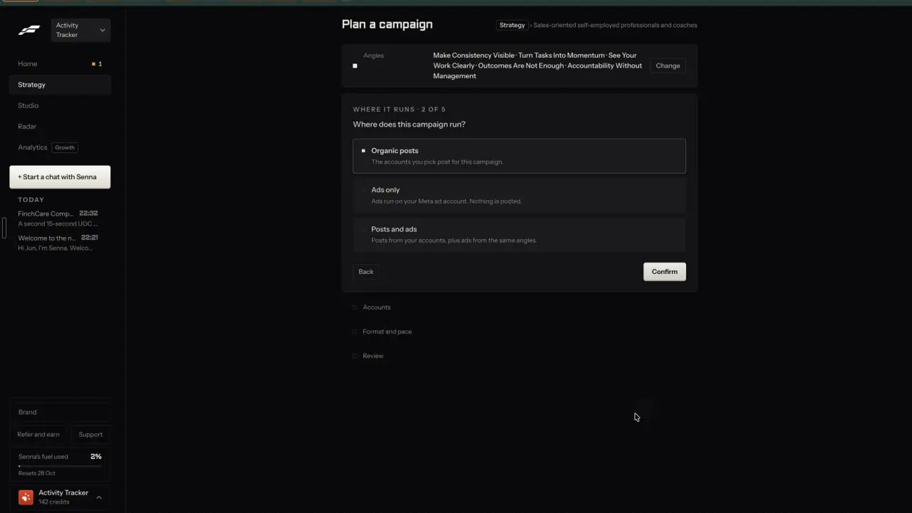
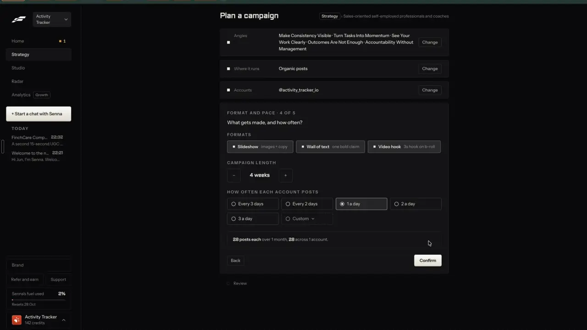
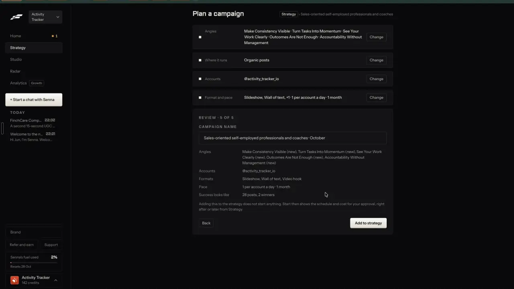
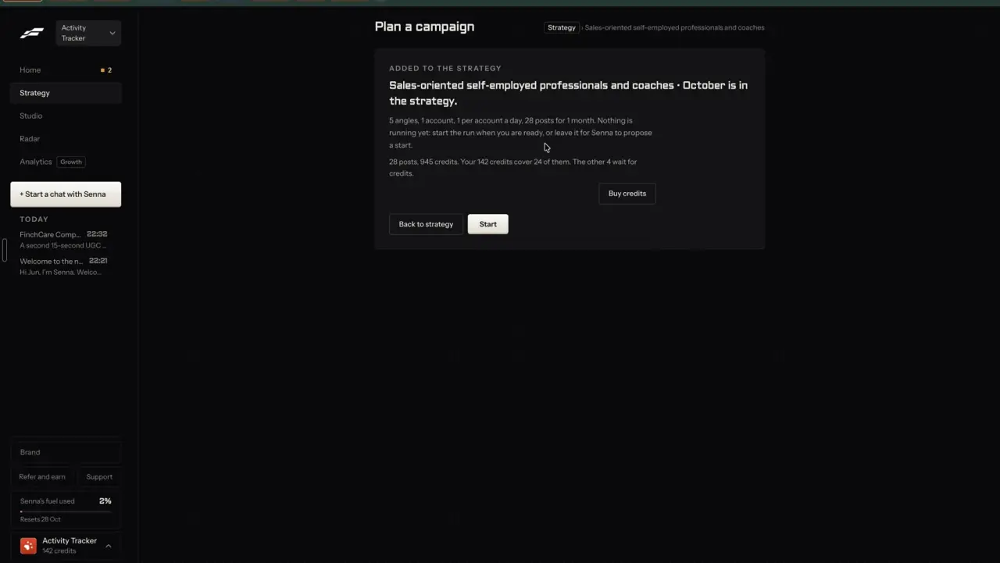
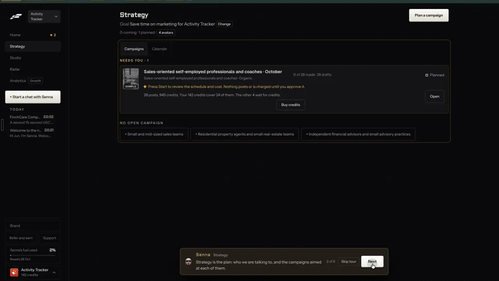

# Plan a campaign in five steps

`plan-campaign` | plan | phase 5 | status: partial | /north-star#plan-campaign

## Leo asked

8 Oct 2026: "an all in one tool for my social media management, and for each person too". Planning a month of posts is part of that management, for Leo's brands and for each adviser's.

## How the best do it

Fastlane plans a campaign per avatar (audience) on its Strategy page, in a five-step wizard at `/v2/strategy/<id>/plan`. On screen its separators are middle dots; this spec writes them as "|". One step card is open at a time. Finished steps collapse into summary rows with "Change", and the steps still to come sit below as greyed rows. The breadcrumb names the avatar, and a "Loading your plan" chip covers the load (t008).

1. Angles (plan-angles has the detail, t009 to t016).
2. "WHERE IT RUNS | 2 OF 5", "Where does this campaign run?": "Organic posts" / "The accounts you pick post for this campaign." (default), "Ads only" / "Ads run on your Meta ad account. Nothing is posted.", "Posts and ads" / "Posts from your accounts, plus ads from the same angles."



3. "ACCOUNTS | 3 OF 5", "Which accounts post it?", "up to 5": the row "@activity_tracker_io" / "TIKTOK | CONNECTED", an upsell to buy warmed accounts (left out on purpose here), and the rule "An account posts for one avatar at a time." (t019).
4. "FORMAT AND PACE | 4 OF 5", "What gets made, and how often?": format chips "Slideshow" ("images + copy"), "Wall of text" ("one bold claim"), "Video hook" ("3s hook on b-roll"), all on; "CAMPAIGN LENGTH" stepper at "4 weeks"; "HOW OFTEN EACH ACCOUNT POSTS" radios "Every 3 days", "Every 2 days", "1 a day" (default), "2 a day", "3 a day", "Custom"; and a live total "28 posts each over 1 month. 28 across 1 account."



5. "REVIEW | 5 OF 5": "CAMPAIGN NAME" prefilled "<avatar> | October", rows Angles (new ones marked "(new)"), Accounts, Formats, Pace "1 per account a day | 1 month", and "Success looks like" "28 posts, 2 winners". The note above the button reads "Adding this to the strategy does not start anything. Start then shows the schedule and cost for your approval, right after or later from Strategy." The button is "Add to strategy"; while saving it shows three dots, Back hides and every Change greys out (t025).



6. Result: "ADDING TO THE STRATEGY" for about 2 seconds, then "ADDED TO THE STRATEGY" / "<name> is in the strategy." / "5 angles, 1 account, 1 per account a day, 28 posts for 1 month. Nothing is running yet: start the run when you are ready, or leave it for Senna to propose a start." / "28 posts, 945 credits. Your 142 credits cover 24 of them. The other 4 wait for credits." with "Buy credits", "Back to strategy" and "Start" (which read "Open" a second later). The Home badge went from 1 to 2.



The Strategy page then lists the campaign under "NEEDS YOU | 1" with "0 of 28 made | 28 drafts", "Planned", the note "Press Start to review the schedule and cost. Nothing posts or is charged until you approve it.", and a "NO OPEN CAMPAIGN" row of "+ <avatar>" buttons for audiences without one. Settings > Activity logged the plan with its reasons: "24 templated, 4 generated. Mostly templated: a business with no product listed to show yet. No video hook posts: there is no demo video. Add one on Brand, on the Demo videos tab."



Others:

- Ocoya: a goal, an audience and a date range in; up to 90 drafts out along an Awareness, Consideration, Decision arc; approve the run or edit single lines; 1 credit per post ([source](https://www.ocoya.com/features/campaigns)).
- Blaze: campaigns set goal, frequency, volume and channels, and "Edit Schedule & Channels" changes one campaign ([source](https://help.blaze.ai/en/articles/9535151-getting-started-with-blaze), [volume](https://help.blaze.ai/en/articles/12417963-how-do-i-change-the-volume-or-type-of-content-being-generated)).
- Twenty Over Ten Lead Pilot (adviser marketing): an adviser picks a ready-made campaign from a topic list, then goes through Edit Details, Share Settings, Day and Time, and Start Campaign ([source](https://help.twentyoverten.com/en/curated-campaigns)).
- Snappy Kraken: "150+ Pre-Built Campaigns", FINRA-reviewed, such as a 90-Day New Client Campaign. Foundations (USD 199 a month plus 199 setup) carries only the birthday, timely update and newsletter campaigns; lead-gen and prospect campaigns start on Grow at USD 299 a month ([campaigns](https://snappykraken.com/campaigns), [pricing](https://snappykraken.com/pricing)).
- FMG Suite: event promotion kits with posts, invitations and slides on its top tiers ([source](https://fmgsuite.com/marketing/)).
- Sprout Social Campaigns plan, run and measure campaigns on a shared calendar ([source](https://sproutsocial.com/features/social-media-publishing/)).
- Simplified's Riley takes a brief (goal, audience, offer, channels, brand rules) and queues posts for approval; 5, 15 or 40 campaigns a month by plan ([source](https://simplified.com/pricing)).

## What we have today

- `/plan` (`src/pages/PlanPage.tsx`, 1,042 lines) builds one content plan per brand from positioning: posts per week (the weekly goal, `src/lib/goals.ts`), length 1, 2 or 4 weeks, up to 3 reference competitors, and the user's best format and days from analytics. `generatePlan` in `src/lib/contentPlan.ts` gives each slot a funnel stage, pillar, format (text post, carousel, short video), a derived angle, a hook formula and a day and time from the brand's posting slots. Slots open Write one at a time (`planItemToGenerateUrl`), and "Add N posts to calendar" puts empty placeholder posts (`plan_<slot>` ids) on the calendar.
- The plan is stored under `content-studio-plan-<scoped(uid)>`, one per brand. Building a new one replaces it.
- Missing: an audience choice, picked angles, picking accounts, a format choice, a name, a success target, more than one campaign, and words written ahead for every post. Nothing is drafted until the user opens a slot in Write.
- Writers that already put out several posts in one call: `idea-dump` mode "long" (5 posts, cap "repurpose-long" 20, about 4 US cents) and `/generate/batch`. The post writer `generate-social-content` lives on the shared academy Supabase project and is not deployed from this repo, so it cannot be capped here; campaign drafting goes through `idea-dump` (pinned `gpt-4.1`, structured output). `idea-dump` does not refund a use when OpenAI fails today; `refundUsage` is used by `ai-video`, `text-voice` and `market`.
- What the writer already gets: `buildIdeaDumpContext(userId)` in `src/lib/ideaDump.ts` returns the voice summary, positioning and preferred platforms, and `brandRulesLine(brand, platform)` and `applyBrandRules(text, brand, platform)` in `src/lib/brandRules.ts` carry the brand kit's emoji, hashtag and avoid-word rules into a prompt and enforce the countable parts afterwards (Write, Batch, Tighten and video captions use them).
- Placing posts on days: `planCalendarEntries`, `upcomingMonday` and `planItemDate` in `contentPlan.ts` turn slots into scheduled `plan_<slot>` drafts at the brand's posting times. `generatePlan`'s day list holds each weekday once, so above 7 a week a second post lands on a day already used, at the same time.
- A "winner" already has a house definition for the adviser's own posts: `BREAKOUT_RATIO` 1.5 against the account's own median in `supabase/functions/_shared/socialAudit.ts`, which `src/lib/accountAudit.ts` already imports into the app. A second `BREAKOUT_RATIO` of 1.8 in `src/lib/postInsights.ts` is for other creators' top posts; do not use that one here.
- Connected accounts per brand: `socialStatus(profileId)` in `src/lib/socialConnect.ts` (counts against "social-read"), shown only when `socialConnectShown()`, which the `social` function answers from its `SOCIAL_CONNECT_USERS` secret. `PostItForMe` already schedules one draft to several `accountIds`.

## Build

Gate with `leoOnly(email)` on the nav entry and on each page. Build after plan-goal and plan-angles. plan-campaign-page and plan-review-queue build the campaign page this wizard ends on.

### Screens and states

Routes in `src/App.tsx` (lazy):

- `/campaigns`: `src/pages/CampaignsPage.tsx`, the list. Nav: add `{ to: "/campaigns", label: "Campaigns", owners: LEO_EMAILS }` to the pipeline section in `src/lib/nav.ts`, after Plan.
- `/campaigns/new`: `src/pages/CampaignWizardPage.tsx`.
- `/campaigns/:id`: `src/pages/CampaignPage.tsx` (plan-campaign-page).
- Pages render `NotFoundPage` unless `leoOnly(email)`, the way `NorthStarPage` does. Add `/campaigns/new` and `/campaigns/:id` to EXCEPTIONS in `src/lib/navRoutes.test.ts` ("reached from /campaigns") and `/campaigns` to the routes list in `src/lib/nav.test.ts`.

The list, `/campaigns`:

```
Campaigns                                           [Plan a campaign]
GOAL  Get more enquiries from people I can help   [Change]
1 running | 1 planned

NEEDS YOU | 1
[thumb] Young families | November        0 of 12 made | 12 written   Draft   [Open]
        Young families | LinkedIn, Instagram

NO OPEN CAMPAIGN
[+ Pre-retirees]
```

- Loading: skeleton rows under the header (local data, one frame at most).
- First run (no campaigns): a card `Plan your first campaign` / `Pick who it should reach. Every post is written for you to check before anything goes out.` with one row per audience (`<audience>` / `Start here.` / chevron).
- No usable positioning (`isPositioningUsable` false): `Say who you serve first, so the posts are about them.` with `Set up positioning` linking to `/plan?view=setup`.
- A row's progress reads `Writing 4 of 12` while the drafting job runs, `0 of 12 made | 12 written` when done, and `3 posts could not be written` in the warning colour when some failed.
- Status chip: `Draft` (nothing made), `Running` (something made and the last post day is today or later), `Done` (every post made or skipped and the last day passed). Status is worked out from the posts, never stored.
- Sections: `NEEDS YOU` holds campaigns with written but unmade posts; `RUNNING`; `DONE` collapsed under `Show <n> done`.

The wizard, `/campaigns/new`, a centred column at most 680 px wide, H1 `Plan a campaign`, breadcrumb `Campaigns > <audience>`:

- Step header format `<STEP> | <n> OF 5`, then a question. Finished steps collapse to `<label> | <value> | Change`; later steps show greyed. `Back` and `Confirm` sit at the bottom of the open card.
- Step 1, `WHO IT REACHES | 1 OF 5`, `Who should this campaign reach?` One row per audience. Until brand-audiences ships there is one, from positioning (`audienceDetail`, else the life-stage label), with `Change on Plan` linking to `/plan?view=setup`. Arriving with `?audience=` skips straight to step 2 with step 1 collapsed.
- Step 2, angles: `AnglesStep` from plan-angles.
- Step 3, `WHERE IT POSTS | 3 OF 5`, `Where does it go out?` When `socialConnectShown()` and the brand has connected accounts: one selectable row per account (`@handle` / `INSTAGRAM | CONNECTED`, `up to 5`), all picked by default. Otherwise platform chips LinkedIn, Instagram, Facebook, TikTok (positioning's platform picked) with the helper `You post these yourself, or connect an account.` and the link `Connect an account` to `/accounts`. At least one is required (`Pick at least one place.`).
- Step 4, `FORMAT AND PACE | 4 OF 5`, `What gets made, and how often?`
  - `FORMATS`, multi-select chips with hints: `Text post` (`words only`), `Carousel` (`slides from the words`), `Short video script` (`you film it`), `AI video` (`no filming`) with a price chip `about US$2.75 each`. Text post and Carousel start on, and at least one must stay picked (`Pick at least one format.`).
  - `CAMPAIGN LENGTH`: a stepper from 1 to 8 weeks, default 4.
  - `HOW OFTEN`: radios `2 a week`, `3 a week`, `5 a week`, `1 a day`. The default is the option nearest the weekly goal for the first picked platform (`loadGoals`), else `3 a week`. Fastlane's 2 and 3 a day are left out: `generatePlan` has one posting time per weekday, so a second post that day would go out at the same minute. The most a campaign can hold is 56 posts (1 a day for 8 weeks).
  - Live summary: `12 posts over 4 weeks, each on LinkedIn and Instagram.` With AI video on, a second line: `4 of them AI videos, about US$11.00. One a week, so the daily limit of 2 covers them.`
- Step 5, `REVIEW | 5 OF 5`:
  - `CAMPAIGN NAME` input, prefilled `<audience> | <Month>` where Month is the start week's month, max 80 characters.
  - Rows: `Who`, `Angles` (new ones end in ` (new)`), `Where`, `Formats`, `Pace` (`3 a week | 4 weeks | starts Mon 27 Oct`), `Goal` (the plan-goal text, or `Not set` with `Set goal` linking to `?goal=change` on `/campaigns`), `Success looks like` (`12 posts, 1 winner`) with an InfoTip `A winner gets half again your usual engagement.`
  - Note above the buttons: `Adding this writes the words for every post. Nothing is posted, and no AI video is made, until you press Make on it.`
  - Buttons `Back` and `Add campaign`. Saving: the button shows `Adding...`, Back hides and every Change is disabled.
  - Add campaign writes words with a paid model, so it carries the price chip from business-cost-preview (`PriceChip` with feature `campaign-draft` and `uses` = posts / 7 rounded up), for example `About US$0.07 | 2 uses, 18 left after this`. Until that item ships, show the same text in a plain span beside the button. When the campaign needs more uses than are left today, Add stays enabled and the line under it reads `Today's limit writes <k> of these posts. The rest are written after 8am Singapore time.`
- Result card in the same column:
  - `ADDED` / `<name> is in your campaigns.`
  - `<a> angles, <where>, <pace> for <w> weeks, <n> posts. The words are being written now, and you can leave this page.`
  - The cost line from plan-campaign-page's `campaignCost()`, for example `8 posts cost nothing to make. 4 AI videos come to about US$11.00, and today's limit covers 2.`
  - Buttons `Back to campaigns` and `Open campaign` (primary).
- Over the campaign limit (12 per brand): Add disables with `You have 12 campaigns. Delete a done one first.`
- Typed work: every field of the wizard lives in `sessionStorage` key `cs-campaign-wizard-<scoped(uid)>` until Add or `Start over`, so leaving and coming back keeps it.

How the posts are laid out (`buildCampaignPosts` in `src/lib/campaigns.ts`, pure):

- Reuse `generatePlan` with three new optional inputs: `angles` (slot i takes angle i mod n, which spreads posts evenly; 12 posts over 5 angles gives 3, 3, 2, 2, 2), `formats` (the rotation uses only the picked free formats), and `weights` (plan-goal). It gets a copy of positioning with `cadence` set to the wizard's posts a week and `platform` set to the first picked platform. Days and times come from the brand's posting slots through the same options `/plan` passes: `planOptions` in `PlanPage.tsx` (near line 279) reads component state, so extract it as `planOptionsFor(userId, platform, { competitors, performance, plan })` in `contentPlan.ts` and call it from both pages. It needs `loadBrand` (`src/lib/carousel.ts`), `getTrackedPosts` and `postingTimeOn` (`src/lib/analytics.ts`) and `loadDrafts`; none of them imports `contentPlan.ts`, so no import cycle.
- When AI video is picked, one post a week becomes `ai-video`: the middle post of each week, by index `floor(perWeek / 2)`.
- The start is `upcomingMonday(today)`, shown in the review. Choosing a start date is left out.
- Success target: `winners = max(1, round(posts / 14))` (Fastlane shows 28 posts, 2 winners). `isWinner(draft, drafts)` is true when a made post's engagement is at least `BREAKOUT_RATIO` (1.5, imported from `_shared/socialAudit.ts`) times the median of the brand's posts with numbers (`engagement()` in `draftHistory.ts`). This is arithmetic on numbers, so it needs no Jev.

Drafting the words (`src/lib/campaignJob.ts`, outside React):

- On Add, the campaign is saved with every post `waiting`, then `startDrafting(userId, campaignId)` runs. It takes posts in order in batches of up to 7, marks them `drafting`, calls `callFn("idea-dump", {mode: "campaign", ...})`, and writes each batch into the store as it lands, so the strip fills in progressively.
- One job per campaign at a time. Listeners (`onCampaignJob`) let pages re-render. Leaving the page does not stop it; closing the tab does, and the next visit to `/campaigns` or the campaign page resumes any `waiting` or `drafting` posts.
- OpenAI failure: that batch's posts become `failed` with `error: "This post could not be written."` The campaign page offers `Try again` (plan-review-queue).
- 429 from the cap: the batch goes back to `waiting` and the campaign gets `waitUntil` (the next 08:00 Singapore time). The list row reads `Writing paused until 8am. Today's limit for writing campaign posts is used.`

### Copy

All strings above are exact. The nav label is `Campaigns`, the H1s are `Campaigns` and `Plan a campaign`, and the list's main button is `Plan a campaign`. Collapsed rows use the labels `Who`, `Angles`, `Where`, `Format and pace` and `Review`, and format names everywhere else read `Text post`, `Carousel`, `Short video script` and `AI video`. A text button `Start over` under the wizard asks `Clear this campaign plan?` before it clears anything.

### Data

- `src/lib/campaigns.ts`, synced key `content-studio-campaigns-<scoped(uid)>`, an array newest first, at most 12 per brand:
  ```ts
  type CampaignFormat = "text-post" | "carousel" | "short-video" | "ai-video";
  type PostState = "waiting" | "drafting" | "ready" | "failed" | "making" | "made" | "skipped"; // "making": an AI video in progress (plan-review-queue)
  interface CampaignPost {
    n: number; day: string; time?: string;            // n is 1-based, the ?post= value
    angleId: string; format: CampaignFormat; stage: FunnelStageId; pillar: PlanPillar; formulaId?: string; ctaType: string; // pillar from the plan slot: My posts needs it
    hook?: string; body?: string; script?: string; cta?: string;
    state: PostState; error?: string; draftId?: string;
    prev?: { hook?: string; body?: string; script?: string };   // one step of undo for Swap
  }
  interface Campaign {
    id: string; name: string; createdAt: string; audience: string;
    angles: { id: string; title: string; line: string }[];      // copies, so later edits don't rewrite history
    platforms: PlanPlatform[]; accountIds?: string[];
    formats: CampaignFormat[]; weeks: number; perWeek: number; startDay: string;
    goal?: string; target: { posts: number; winners: number };
    waitUntil?: string; posts: CampaignPost[];
  }
  ```
- One key for the brand's campaigns, last write wins (cloudSync). Deleting a campaign rewrites the array, so no key is removed and nothing depends on a tombstone.
- Size: about 1.5 KB a post, so the largest campaign (56 posts) is about 85 KB, and 12 of them about 1 MB in one key. Keep posts lean (no slide renders stored; those are made on device from `body`). `saveCampaigns` catches a storage quota error, keeps the wizard's typed work and shows `Couldn't save. Delete a done campaign to make room.`
- Made posts go into My posts (`upsertDraft`, ids `cmp_<campaignId>_<n>`) only when made (plan-review-queue), which keeps the 50-post My posts list (`MAX_DRAFTS`) from filling up on Add. A My posts entry has one platform, so each made post takes the campaign's first platform and the others are listed under GOES OUT. None of this needs a table or a migration.

### AI and cost

- `idea-dump` gets mode "campaign". It takes `{mode: "campaign", posts: [{n, angle: {title, line}, format, stage, formula?: {name, template}, ctaType, platforms}] (1 to 7), context: {positioning, goal, audience, voice?, rules?}, swap?: true, avoid?: string[]}` and answers `{posts: [{n, hook, body?, script?, cta, ctaType}]}`. The browser builds `context` from `buildIdeaDumpContext(userId)` plus the goal and audience, and `rules` is `brandRulesLine(loadBrand(uid), platform)`. Each post that lands goes through `applyBrandRules` before it is stored.
- A request with `swap: true` must hold exactly one post (plan-review-queue's Swap) and counts against "campaign-swap"; every other request counts against "campaign-draft". `avoid` lists hooks the new words must not repeat.
- Model: idea-dump's pinned `gpt-4.1` with a JSON schema (`CAMPAIGN_SCHEMA`), `max_tokens` 6000. Format rules in the prompt: text post 80 to 220 words; carousel as 4 to 8 points of at most 40 words each, separated by blank lines so `splitDraftIntoSlides` makes slides, with a cover hook of at most 6 words; short video script as HOOK, BODY and CTA in 60 to 90 words (about 30 s); AI video script at most 40 words (about 16 s at the AI video maker's 2.5 words a second, so the voiceover fits two Speak slices of at most 9.5 s, 44 Higgsfield credits).
- Every mode shares `COMPLIANCE_LINES` (plan-angles moves them into one constant): no promised returns or payouts, no "guaranteed", no named insurers or products, no invented numbers (write `[check the latest figure]`), no pressure, general education only. Posts in one batch must open differently; each follows its angle and stage.
- Add `"campaign-draft": 20` to `DAILY_LIMITS`, commented "Writing a campaign's posts (idea-dump mode campaign): one gpt-4.1 call per 7 posts, about US$0.03." One use per call. Refund with `refundUsage(admin, uid, feature, utcDay)` when OpenAI fails or returns nothing usable; idea-dump's service-role client already has the `from` that `refundUsage` needs.
- Cost, estimated from list prices (about 2,500 input and 3,500 output tokens a call at US$2 and US$8 per million): about US$0.033 a call, so about US$0.07 for 12 posts and US$0.13 for 28. Measure the first five campaigns and correct the comment. When business-cost-preview's `PRICES` table exists, add `campaign-draft` at about US$0.03 a use so the chip reads from it.
- No Jev call in this item: the layout is arithmetic, and angle choice is plan-angles'. The format reason line is a rule, not a judgment.
- Server gate: mode "campaign" answers 404 `{code: "not_enabled"}` unless `leoOnly(user.email)` (`_shared/leoOnly.ts`).

### Deep links

- `/campaigns`: `goal=change` (plan-goal). No other state.
- `/campaigns/new`: `step` = who, angles, where, pace, review (replace; default the first unfinished step); `audience` = an audience key (read once, then kept in the wizard's session state).
- `/campaigns/<id>` has params owned by plan-campaign-page and plan-review-queue.
- Add the builders `links.campaigns()`, `links.campaignNew({ step, audience })` and `links.campaign(id, { post, view, angle })` to `src/lib/links.ts`, and the three rows to `docs/deep-links.md`.

## Done when

- [ ] Leo's sign-in sees Pipeline > Campaigns; a demo sign-in sees no tab and gets the 404 page at `/campaigns`, `/campaigns/new` and `/campaigns/x`.
- [ ] On a brand with no campaigns, the first-run audience row opens the wizard on step 2 with step 1 collapsed; once a campaign exists, `+ <audience>` under NO OPEN CAMPAIGN does the same.
- [ ] Each step collapses to a summary row with Change, Change reopens that step with its values, and the URL's `step` follows.
- [ ] 4 weeks at 3 a week with Text post and Carousel gives 12 posts, angles spread 3, 3, 2, 2, 2 over 5 angles, days on the brand's posting days.
- [ ] Adding AI video makes exactly one post a week `ai-video` and the summary shows the price.
- [ ] Add campaign shows its price and uses before the press, then `Adding...`, then the result card; Open campaign lands on `/campaigns/<id>`.
- [ ] The words for 12 posts are written within about two minutes (two gpt-4.1 calls, one after the other), batch by batch, and leaving the page mid-way does not lose them.
- [ ] A brand kit set to no emoji and no hashtags gets posts with neither, and an avoid-word in the kit never appears in a stored post.
- [ ] A batch that fails can be tried again, and the 21st call of the day pauses writing with the 8am line.
- [ ] Ten posts read by eye on two brands: no promised returns, no insurer names, no invented numbers.
- [ ] Refreshing mid-wizard keeps every field.
- [ ] 390 px and 1440 px checked by eye on the list, every wizard step and the result card.
- [ ] Build and full vitest pass; the item flips in `src/data/northStar.ts`.

## Tests

- `src/lib/campaigns.test.ts`: `buildCampaignPosts` counts (weeks x perWeek), even angle spread, only picked formats, one `ai-video` a week at the middle index, days inside the campaign weeks; `winnersFor(12)` is 1 and `winnersFor(28)` is 2; store round trip per brand; the 12-campaign limit.
- `src/lib/contentPlan.test.ts`: `generatePlan` without the new options is unchanged (snapshot), with `angles` cycles them, with `formats` uses only those.
- `src/lib/campaignJob.test.ts` (fake `callFn`): batches of 7 in order; a failed batch marks only its posts failed; a 429 sets `waitUntil` and leaves posts waiting; a second `startDrafting` while one runs is a no-op; resume picks up `drafting` posts left by a closed tab.
- `supabase/functions/idea-dump/logic.test.ts`: `parseCampaignRequest` refuses 0 or 8 posts, unknown formats and `swap` with more than one post; `campaignCap(request)` is "campaign-swap" for a swap and "campaign-draft" otherwise; the prompt carries `COMPLIANCE_LINES`, the goal, the rules line, each angle and the `avoid` hooks; `validateCampaign` drops posts whose `n` was not asked for and trims over-length fields.
- `src/lib/nav.test.ts` and `navRoutes.test.ts` stay green with the owner-gated tab (the More sheet for someone@example.com is unchanged).
- `usageCaps` test: `campaign-draft` is 20.

## Open questions

- Fastlane's step 2 offers "Ads only" and "Posts and ads". This spec builds organic only, since running ads is AdLauncher's job. Should "Posts and ads" hand the angles and made posts to AdLauncher? Leo decides.
- My posts keeps 50 entries (`MAX_DRAFTS`, shared code), so a campaign of 28 made posts pushes older ones out, and posted ones with numbers go too. Raising it to 200 is a one-line change in shared code with sync-size risk, so it waits for Leo; plan-review-queue warns before it happens meanwhile.
- A start date other than next Monday is left out. Leo decides whether he wants it.
- Fastlane offers 2 and 3 posts a day; this spec stops at 1 a day because the plan engine keeps one posting time per weekday. More than one a day needs a second time per day. Leo decides whether he wants it.

## Related

plan-angles, plan-goal, plan-campaign-page, plan-review-queue, plan-autopilot, plan-content-plan, brand-audiences, publish-accounts, publish-schedule, formats-gallery, agent-chat, agent-home
