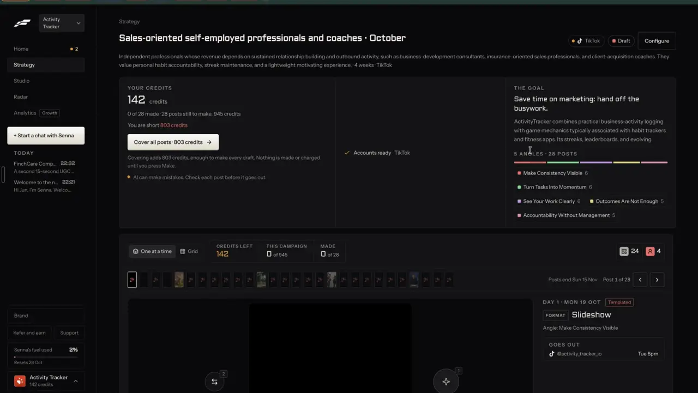

# Content plan and pillars

`plan-content-plan` | plan | phase 5 | status: partial | /north-star#plan-content-plan

## Leo asked

No direct ask; from the competitor research.

## How the best do it

Fastlane plans around angles per audience (plan-angles has its flow). Its closest thing to a pillar mix sits in the campaign page's "THE GOAL" panel, where "5 ANGLES | 28 POSTS" heads a five-colour bar with one chip per angle and its post count: "Make Consistency Visible 6", "Turn Tasks Into Momentum 6", "See Your Work Clearly 6", "Outcomes Are Not Enough 5", "Accountability Without Management 5" (notes-1, F6). That is an even spread with no weights and no angle by format view. The "Post labels" row in Settings (t346) covers AI and ad disclosure labels, which is a different thing.



The weighted pillar pattern comes from the social suites:

- Later's Ideas tab writes content pillars first, free, then post ideas inside each pillar for the calendar. Ideas cost 1 credit per batch of 3, the first 3 per pillar are free, and it is a desktop-only beta ([features](https://later.com/social-media-ai-tools/), [help](https://help.later.com/hc/articles/14711113026327)).
- SocialBee keeps posts in content categories, and each category gets its own posting schedule so the feed mixes content types; the bulk editor schedules, pauses or edits a whole category. 10, 50 or unlimited categories by plan ([features](https://socialbee.com/features/), [pricing](https://socialbee.com/pricing/)). Its AI Copilot asks 8 questions and returns networks, categories, a posting plan and posts for each category, which the user approves ([help](https://help.socialbee.com/article/359-social-media-copilot)).
- koomastudio shows a content matrix: topics such as "Career Growth" down the side, formats such as "Hot Take" across the top, and each cell marked "Published", "Scheduled", "Draft" or "Empty", so the gaps say what to write next ([source](https://koomastudio.com/)).
- Planable uses colour labels for campaigns, pillars or owners: 5, 10 or unlimited labels by plan ([pricing](https://planable.io/pricing/)).
- Eden builds a strategy from answers ("Build your strategy", "Add pillar") into pillars, trending topics and post ideas ([source](https://eden.so/)). Taplio's AI profile has four steps, one of them "Content pillars", and those settings shape every idea and draft ([help](https://intercom.help/taplio/en/articles/17233357-using-taplio-s-ai-for-content-inspiration)).
- Zebracat reads the website and niche and proposes a plan for short videos, which goes nowhere until the user has approved its themes and cadence ([source](https://www.zebracat.ai/); which plan includes it is unverified).

## What we have today

Most of this item is live:

- `/plan` (`src/pages/PlanPage.tsx`, 1,042 lines) has a setup view (one-line positioning, audience, who exactly, topics, edge, primary platform, posts per week 3, 4, 5 or 7, up to 3 reference competitors, plan length, "What happened this week?") and a plan view.
- The plan view header reads `<n> posts / week | <w> weeks`, with posted out of total, a progress bar, the funnel counts (A Attraction, B Building Trust, C Conversion) and the buttons "Add N posts to calendar", "Reshuffle", "Edit positioning" and delete. Week cards list slots with stage, day and time, format, platform and pillar chips (Interest, Identity, Topic, Market), the angle, the hook formula, the CTA and "Draft in Studio", which opens Write prefilled (`planItemToGenerateUrl`).
- `generatePlan` (`src/lib/contentPlan.ts`) orders each week attraction, trust, conversion by the weights 4, 4 and 2 (`src/data/funnelFramework.ts`). Topic and market slots rotate evenly through `positioning.topics`; identity and interest slots use `SOCIAL_SUBJECTS`. It also rests themes posted in the last two weeks, starts on the brand kit's posting days, rotates hook formulas from `nextFormulaStart` and leans toward the best format from Analytics.
- Slot ids are `plan-<week>-<slot>-<index>`: same cadence and length, same ids. A topic slot's `angle` opens with its title-cased `pillarDetail`, then a spaced em dash and the idea source.
- Reshuffle (`handleReshuffle`) rebuilds with `salt + 1` and resets every posted tick ("Posted ticks were reset."). Ticks live on `PlanItem.posted`; a slot also counts as posted when its `plan_<slot>` calendar post is.
- Labels (`src/lib/labels.ts`, key `content-studio-labels-<scope>`): up to 12 per brand (`MAX_LABELS`), each with a colour and an optional `target` weight. Until the person saves any, `loadLabels` returns up to 6 seeded from the positioning topics (`seedLabels`, ids `t-<slug>`), and nothing is stored. `updateLabel`, `addLabel` and `setDraftLabels` write the whole list, which pins the seeded ones.
- `labelMix` compares what went out against the targets in Analytics' Mix card (`src/components/LabelMixCard.tsx`, "Set targets", which saves each typed % with `updateLabel`). A label with no `target` counts as `100 / labels.length`, so "equal shares" is the default. My posts filters by label (`/drafts?label=`) and manages them (`LabelChip`, `LabelPicker`, `LabelManager` in `src/components/Labels.tsx`).
- Write reads `pillar`, `detail`, `audience`, `format`, `platform`, `cta`, `funnel`, `idea`, `ctx`, `ref` and `formula` from the URL (`GeneratePage.tsx` around line 1043), plus `day` and `time` from a calendar day, but no `label`.

The gap: the plan never reads labels. Topics rotate evenly whatever the targets say, slots carry no label, Write has no `label` param to pass one on, so a post written from a slot gets none, and nothing shows which pillar and format pairs are empty. `labels.ts` has no exported way to tell saved labels from seeded ones.

## Build

Gate the new parts with `leoOnly(email)`. For everyone else `/plan` stays exactly as it is. plan-goal changes the stage weights; this item changes which topic each slot takes, so the two do not touch.

### Plan engine (`src/lib/contentPlan.ts`)

- `GeneratePlanOptions.pillars?: { id: string; name: string; weight: number }[]`. When given, topic and market slots take their `pillarDetail` from `weightedOrder(pillars, count)` instead of the even topic rotation, and each such slot gets `labelId`. Identity and interest slots keep `SOCIAL_SUBJECTS` and get no label. Without the option the output is byte for byte what it is today.
- `weightedOrder(pillars, count)`: largest-remainder shares, then spread so one pillar does not take two slots in a row while another is left. Weights 2, 1, 1 over 8 slots give 4, 2, 2. When every weight is 0 it returns nothing and the slots fall back to today's even topic rotation.
- Pillars skip the two-week rest: the weights decide. Rest still applies to plain topics.
- `PlanItem.labelId?: string`. `planItemToGenerateUrl` adds `label=<id>`, and `planCalendarEntries` puts `labels: [labelId]` on the calendar placeholder.
- In `src/lib/labels.ts`: `labelWeights(labels)` returns each label's weight by the rule `labelMix` already uses (`target` when set and 0 or more, else `100 / labels.length`), and `labelMix` switches to it, so the plan and the Mix card can never disagree. `pillarsFromLabels(labels)` maps labels to `{ id, name, weight }` with those weights. `hasSavedLabels(userId)` is true when the labels key exists in storage.
- `slotLabel(item, labels)` (pure): the slot's `labelId` when that label still exists, else the label whose name equals the slot's `pillarDetail` (case and spaces ignored, `themeKey`), else none. Seeded labels are named after the positioning topics, so a plan built before any label was saved still counts against them.
- `pillarGrid(labels, drafts, plan, now)` (pure) returns, for each label and each of `text-post`, `carousel` and `short-video`, `{ posted, planned }`: posted counts posts out in the last 28 days with that label and format, planned counts this plan's slots by `slotLabel`.
- `relabelSlot(item, label | null)`, also pure, sets or clears `labelId`; on a topic or market slot given a label it renames `pillarDetail` and the start of `angle` to match, so Write gets one topic, and leaves the hook alone.
- `rebuildPlan(plan, positioning, options)`: `generatePlan` with the plan's `salt` and `weeks`, `formulaStart` set to the index of the plan's first slot formula (so hooks do not move on), `thisWeek` carried over, and `posted` copied across by slot id. Save and rebuild uses it; Reshuffle stays as it is.

### Screens and states

On `/plan`, plan view, Leo only:

- `/plan` passes `pillars: pillarsFromLabels(loadLabels(uid))` to `generatePlan` and Reshuffle when `hasSavedLabels(uid)`. With only seeded labels it passes nothing, so the plan behaves as today until the person sets pillars.
- Slot cards: after the pillar chip, the slot's label as a `LabelChip`. Because the chip reads `slotLabel`, seeded labels show on old plans as well. Next to it a text button, `Change`, opens a small menu of the brand's labels plus `No label`; picking one applies `relabelSlot`, saves the plan (`savePlan`) and shows `Slot moved to <name>. Undo` or `Label taken off. Undo`.
- A `Pillars` section between the header card and week 1, id `pillars`, heading `Pillars` with the InfoTip `Same as your labels on My posts.`:

```
Pillars                                                [Edit pillars]
CPF            aim 40%   4 in this plan
Insurance      aim 30%   2 in this plan
Retirement     aim 30%   2 in this plan

               Text post    Carousel    Short video
CPF            2 | 1        0 | 2       +
Insurance      1 | 1        +           0 | 1
Retirement     +            1 | 0       0 | 1
               posted in the last 4 weeks | in this plan
```

  - Each row: swatch and name, `aim <n>%` (the share from the targets), `<k> in this plan`.
  - The grid: a cell reads `<posted> | <planned>`. A cell with both at 0 shows `+`, a link to `/generate?pillar=topic&detail=<name>&format=<format>&label=<id>` with the aria-label `Write a <format> about <name>`. A note under the grid: `posted in the last 4 weeks | in this plan`.
  - At 390 px the grid scrolls sideways inside its own box, with the first column fixed, so the page itself never scrolls sideways.
- `Edit pillars` opens an inline panel:
  - one row per label with a number input `Aim` (0 to 100, in %) and the existing rename, colour and delete from `LabelManager`;
  - `Add a pillar` (max 12, `addLabel`), and a live total `Adds up to <t>%`;
  - when the total is not 100: `They don't need to add up to 100. Each is read as a share of the total.`
  - buttons `Cancel` and `Save and rebuild plan` (primary). Save writes the targets with `updateLabel` (this pins the seeded labels, as `setDraftLabels` already does), rebuilds with `rebuildPlan` (same salt, same hooks, posted ticks kept), and shows the toast `Plan rebuilt around your pillars. Undo`, where Undo restores the previous plan object. Calendar placeholders already added keep their ids and are refreshed the next time `Add N posts to calendar` runs.
- Empty states:
  - no labels at all (no topics, nothing saved): `Add the 3 to 5 topics you post about, and the plan rotates through them.` with `Add pillars`, which opens the same panel;
  - seeded labels only: the rows show with `aim` equal and the plan counts from `slotLabel`, with the line `These come from your topics. Set an aim for each to steer the plan.`
- Loading: everything is local, so there is no loading state beyond the first render.

In Write (`src/pages/GeneratePage.tsx`), read `label` once with the other plan params; when the id exists in `loadLabels(uid)`, a new draft saved from this visit gets `labels: [id]`, and an unknown id is ignored (`upsertDraft` already keeps labels on later saves).

### Copy

All strings above are exact. The grid's column heads reuse `FORMAT_LABEL` from `PlanPage.tsx` (`Text post`, `Carousel`, `Short video`) so the plan and the grid never name a format two ways.

### Data

- `PlanItem.labelId` is a new optional field inside the existing plan key `content-studio-plan-<scoped(uid)>`, and old plans without it read fine.
- Targets live on the labels (`content-studio-labels-<scoped(uid)>`), which Analytics' Mix card already reads, so setting an aim on `/plan` also moves the Mix card's target. That is why this item needs no new key, table or migration.

### AI and cost

None. The spread is arithmetic and the grid is counting. No Jev question, no cap, no paid call. Writing a slot still goes through Write and its own limits.

### Deep links

- `/plan#pillars` scrolls to the section (`useScrollToHash` from `src/lib/urlState.ts`).
- `/plan?pillars=edit` opens the edit panel (push, so Back closes it).
- `/generate?label=<id>` is read once, like the other Create params. Add it to the "Still read (Create pages)" list in `docs/deep-links.md`.
- Extend `links.plan()` in `src/lib/links.ts` with `pillars?: "edit"` and `section?: "pillars"` (the `#section` pattern `links.coach` and `links.brand` use).

## Done when

- [ ] Leo's sign-in sees the Pillars section and slot labels on `/plan`; a demo sign-in sees `/plan` unchanged.
- [ ] With labels CPF 50, Insurance 25, Retirement 25 and 8 topic or market slots, the plan gives CPF 4, Insurance 2, Retirement 2, never the same pillar twice in a row while another is left.
- [ ] Change on a slot moves it to another label, its topic and angle follow, and Undo puts it back.
- [ ] Save and rebuild plan keeps every posted tick and every hook formula a slot already had.
- [ ] A plan built before any label was saved shows seeded labels on its slots and counts them in the grid.
- [ ] Draft in Studio from a labelled slot saves a post that wears that label in My posts.
- [ ] Add N posts to calendar gives placeholders that wear their slot's label.
- [ ] The grid counts match My posts for the last 4 weeks, and a `+` cell opens Write with the pillar and format set.
- [ ] Save and rebuild plan changes the spread, and the Analytics Mix card shows the same targets.
- [ ] 390 px (grid scrolls inside its box, page does not) and 1440 px checked by eye.
- [ ] Build and full vitest pass; the item flips in `src/data/northStar.ts`.

## Tests

- `src/lib/contentPlan.test.ts`:
  - `generatePlan` without `pillars` is unchanged (snapshot of a fixed positioning and salt).
  - With pillars 2, 1, 1 over 8 topic and market slots: counts 4, 2, 2 and no repeat in a row; social slots have no `labelId`.
  - `weightedOrder` with a zero weight never picks that pillar, and with one pillar fills every slot.
  - `planItemToGenerateUrl` carries `label`, and `planCalendarEntries` sets `labels`.
  - `pillarGrid` counts posted (last 28 days, by label and format, fixed `now`) and planned separately.
  - `slotLabel` prefers `labelId`, falls back to a name match on `pillarDetail`, and ignores a deleted label id.
  - `relabelSlot` renames `pillarDetail` and the head of `angle` on a topic slot, touches only `labelId` on an identity slot, and `No label` clears it.
  - `rebuildPlan` with new weights keeps `posted` by slot id, starts formulas at the old first slot's, and keeps `thisWeek`.
- `src/lib/labels.test.ts`: `labelWeights` gives `target` when set and `100 / n` when unset; `labelMix` targets are unchanged by the switch (the existing cases stay green); `pillarsFromLabels` carries those weights; `hasSavedLabels` is false with only seeded labels and true after `updateLabel`.
- `weightedOrder` with every weight 0 returns nothing, and `generatePlan` then matches the plan without pillars.
- A GeneratePage-level test is heavy; instead, put the label-from-link rule in a small pure helper (`labelsForNewDraft(param, labels, existing)`) in `src/lib/labels.ts` and test that an unknown id gives nothing and an existing draft's labels are left alone.

## Open questions

- Should labels be called pillars across the app? This spec says `Pillars` on `/plan` with a tip that they are the labels from My posts, which keeps one store and two words. Leo decides whether to rename Labels everywhere.
- Personal slots (identity, interest) take no pillar. If Leo wants a pillar such as "Life outside work" to land on those slots, that is a small change to the engine.

## Related

plan-goal, plan-angles, plan-campaign, plan-autopilot, plan-ideas-inbox, learn-format-winners, brand-audiences
