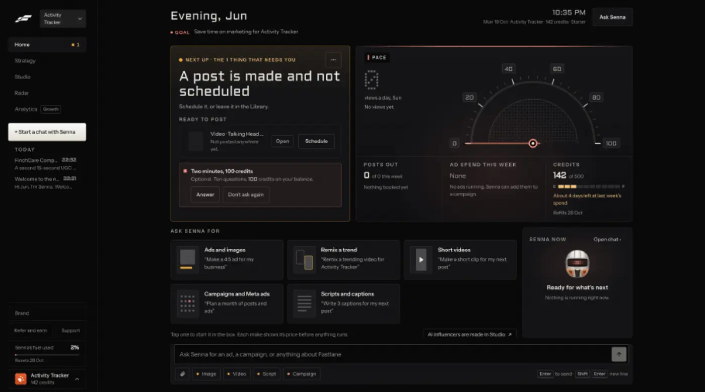

# Talk it out: interview into posts

`plan-interview` | plan | phase 5 | status: partial | /north-star#plan-interview

## Leo asked

No direct ask; from the competitor research.

## How the best do it

Fastlane has no interview that turns into posts. The nearest thing on its Home is an optional survey that pays credits, "Two minutes, 100 credits" / "Optional. Ten questions, 100 credits on your balance." with "Answer" and "Don't ask again" (Leo's capture of Home). The questions were not opened, so what it asks and where the answers go is unverified; it reads as an earn-credits offer, which makes it business-onboarding's or business-referrals' concern rather than this one.



The interview-to-posts pattern comes from the personal-brand tools:

- Supergrow PostCast: a voice or text conversation with an AI interviewer called "Alex". A session of 10 to 15 minutes (other sources say 15 to 20) asks adaptive questions and turns the stories and takeaways into several LinkedIn drafts in your voice, "a week's worth of LinkedIn content". Sources disagree on the output, from 3 to 7 drafts a session. Unlimited on Pro; a third-party review says Starter is capped at 2 sessions a month ([site](https://www.supergrow.ai/), [pricing](https://www.supergrow.ai/pricing), [review](https://tooliverse.ai/tools/supergrow)). Its separate "Voice to Post" turns one spoken idea into one post ([source](https://www.supergrow.ai/compare/supergrow-vs-authoredup)).
- EasyGen turns voice notes into post ideas and drafts written "like you", though its site now says it has been acquired and takes no new signups ([source](https://www.easygen.io/)). ViralBrain lists a voice note among its inputs next to a hero post, a YouTube video, an article, a Reddit thread and a document ([source](https://www.viralbrain.ai/)).
- ContentIn turns an article URL or your own sources into several angles, with 50 ideas a month on Growth ([source](https://contentin.io/)).
- Lately AI, sold to financial advisers, takes any written piece, audio or video and returns many posts for review, tuned per adviser ([source](https://www.lately.ai/industries/compliant-social-media-content-for-financial-services-agents-advisers-brokers)).

## What we have today

Two of the three pieces exist on `/coach`:

- Idea Dump (`/coach#idea-dump`, `src/components/IdeaDump.tsx`): rough notes, typed or dictated, become up to 10 post briefs. Dictation uses the browser's Web Speech API (`lang` "en-SG", continuous, with interim text shown while you speak) behind a `Dictate` button that hides where the browser lacks it. Its messages: "Microphone access is blocked. Allow it in your browser settings to dictate.", "Didn't catch that. Try again a little closer to the mic." (no speech) and "Dictation stopped. Try again." `appendDictation` cuts the box at `MAX_NOTES_CHARS` (4,000). Cap `idea-dump` 30.
- One long piece, five posts (section id `long-piece` on `/coach`, `src/components/LongPiece.tsx`, `src/lib/repurpose.ts`): paste a transcript, newsletter or webinar notes (up to 20,000 characters, `MAX_LONG_CHARS`) and press `Make 5 posts`. The button is enabled for any text; the server refuses under 120 words (`MIN_LONG_WORDS`) with "That's short for a long piece. Paste a few paragraphs, or use Idea Dump for notes." It lists the piece's claims, numbers, stories and quotable lines, then writes 5 posts, each opening with a different hook formula, which you keep as drafts (`longPostEntry`). idea-dump mode "long", gpt-4.1, cap `repurpose-long` 20, about 4 US cents a run. The last run is kept under `content-studio-longpiece-<scope>`, and the pasted text stays in sessionStorage for the tab. The call is `weekFromLongPiece(text, context, formulas)` in `repurpose.ts`. Unlike Idea Dump, which scrolls itself into view on `#idea-dump`, LongPiece has no code for `#long-piece`.
- Speech to text for files exists in the video editor: `transcribe(wav)` in `src/lib/videoProjects.ts` calls video-assist mode "transcribe" (Whisper `whisper-1`, a 16 kHz mono WAV under `MAX_AUDIO_BYTES` 24 MiB, about 12 minutes, cap `video-transcribe` 30). The audio is decoded on the device by `mediaLength` and `openSound` (`src/lib/longAudio.ts`) and packed by `encodeWav` (`src/lib/videoMedia.ts`). Two things a voice note will meet: the request goes through `call()` in `videoProjects.ts`, which throws a plain `Error` with the server's words and no status, and those words are about video ("That video is too long to caption. Keep it under about 12 minutes.", "No sound found in that video."). The Whisper prompt also asks for filler words on purpose, because the editor cuts them, so a transcript keeps every "umm".
- Jev already judges whether a note has a specific true thing in it: writing-judge mode "idea" (`IDEA_QUESTIONS.specific`, `IDEA_MIN` 0.5, set from a shadow check on 2026-10-08), called through `ideaIsThin(topic, notes, kind)` in `src/lib/writingJudge.ts`. It waits at most 4 seconds (`IDEA_WAIT_MS`) and returns only `true`, `false` or `null`, never the probability. The topic is cut at 300 characters and the notes at 2,000, text that is not mostly English gets a 422 (so `null`), and each check counts on `writing-judge` (60 a day), shared with Write.
- Tests run in Node (`vitest.config.ts` sets `environment: "node"`, and there is no Testing Library), so only pure functions can be tested. Hooks live in `src/hooks/` (`useDraftReviews.ts`).

Missing: nobody asks the adviser anything, and a voice note file cannot go in. Both pieces are needed because advisers who will not write will usually talk.

## Build

Gate with `leoOnly(email)`. Everyone else keeps today's paste box.

Put the interview and the voice note inside the existing long piece section, so all three inputs end in the same `Make 5 posts` and the same results. Under the section heading, Leo sees a three-way switch: `Answer questions` (his default), `Voice note`, `Paste text`.

### Shared dictation

Move the Web Speech code out of `IdeaDump.tsx` in two parts. The pure part goes to `src/lib/dictation.ts`: `speechRecognition(win)` and `appendDictation(prev, chunk, max)`. The hook goes to `src/hooks/useDictation.ts`: `useDictation(onFinal: (chunk: string) => void)` returns `{ supported, listening, interim, error, toggle }` and keeps the three error strings. Idea Dump keeps exactly its current behaviour, strings and 4,000-character cap; the interview passes its own append with a 2,000-character cap per answer.

### Answer questions

`src/lib/interview.ts` holds a bank of 8 questions. A session asks 5, starting at `sessions % 8` so the next session opens differently, and skips any question whose blank it cannot fill:

1. `What did a client or a friend ask you about money this week?`
2. `What is one thing people get wrong about <topic>?` (the first positioning topic; skipped when there is none)
3. `Tell me about a client situation that stayed with you. Leave out names and anything that could identify them.`
4. `What would you tell <who> who is just starting to plan?` (`audienceDetail`, else the life-stage label; skipped when neither is set)
5. `What is an opinion about your work that other advisers might disagree with?`
6. `Why did you start doing this work, and what keeps you in it?`
7. `What happened this week that surprised you?`
8. `What question do you get so often you could answer it in your sleep?`

```
Question 2 of 5                                      o o o o o
What is one thing people get wrong about CPF top-ups?
[ Say it the way you would to a friend.                         ]
[Speak]                                         [Skip]   [Next]
84 words so far
```

- Question card: `Question <i> of 5`, the question in the serif face, a textarea with the placeholder `Say it the way you would to a friend.`, `Speak` (the dictation hook; hidden where unsupported), `Skip`, the primary `Next`, and under them `<n> words so far` counted across all answers.
- Pressing `Next` calls `ideaIsThin(question, answer, "an interview answer for a social post")`, and the button reads `Reading...` while it runs (at most 4 seconds). A skipped or empty answer makes no call.
  - Thin, and this question has had no follow-up yet: a follow-up card slides in under the answer, `Can you give one example? What happened, to whom, and what changed for them?`, with `Add to my answer` (focuses the same textarea, cursor at the end, after a blank line) and `Move on`. A question gets one follow-up at most.
  - Not thin, `null` (Jev off or slow), or already followed up: go to the next question.
- After question 5, or from `Make posts now` (a text button that appears once the answers reach 120 words): a review step, `Your answers`, with every question and answer in one editable textarea in the form `Q: ...` / `A: ...`. This text becomes the long piece.
- `Make 5 posts` runs the existing make flow with `source: "interview"` (`weekFromLongPiece` gains a fourth argument, `source`, sent in the body), with the price chip `About US$0.04` beside it (`PriceChip` for `repurpose-long` from business-cost-preview once it exists; this string until then). Under 120 words of answers it is disabled with `Add about <n> more words so there is enough to write from.`
- Done: the results render below as today, and the interview card reads `Done. Your 5 posts are below.` with `Start a new interview`.
- Typed work is never lost: the session (questions, answers, follow-ups used, step) lives in the device key below, so a reload or a tab switch reopens the same question with the answer in place. `Start over` asks `Clear your answers?` before it clears anything.

### Voice note

```
[Record a voice note]   [Upload a voice note]         About US$0.01 a minute
Up to 12 minutes. WhatsApp voice notes work.
```

- `Record a voice note` uses `MediaRecorder` on the microphone, audio only; it is hidden when the browser has no `MediaRecorder`. While recording: `Recording 0:42` with `Stop`. Recording stops itself at 12:00.
- `Upload a voice note` takes `audio/*`, `.m4a`, `.mp4`, `.opus`, `.ogg`, `.mp3` and `.wav`.
- The price chip reads `About US$0.01 a minute` (Whisper at US$0.006 a minute, `PriceChip` for `video-transcribe` once it exists).
- Then, on the device, with the line `Turning your voice note into text...` showing, `voiceToWav(file, seconds?)` in `src/lib/voiceNote.ts`:
  - The length: a recording passes the seconds its own timer counted (Chrome's MediaRecorder WebM files carry no duration, so `mediaLength` gives NaN for them), and an upload reads it with `mediaLength(file)`.
  - Over 720 seconds: refuse before decoding. When the length is NaN, call `read(0, 721)` and refuse when it returns more than `720 * RATE` samples (`RATE` 16,000 from `longAudio.ts`).
  - `openSound(file, seconds)`, `read(0, seconds)`, `encodeWav(samples, RATE)`. Under half a second of samples counts as no speech.
  - Send it with `transcribe(wav)`. Change `call()` in `videoProjects.ts` to throw `EdgeError(message, res.status, body.code)` from `src/lib/edgeFn.ts`; `EdgeError` extends `Error`, so the video editor's callers keep working, and the voice note can map errors by status.
- Done: the switch moves to `Paste text` with the transcript in the box and the note `From your voice note (<3:12>). Fix any words it heard wrong, then make the posts.` The next make sends `source: "voice"`.
- The recording is never stored; it stays in memory until the transcript comes back.
- Errors, each with a way forward (the server's video wording is never shown here):
  - microphone blocked: `Microphone access is blocked. Allow it in your browser settings to record.`
  - too long, before sending or a 413: `Keep it under 12 minutes. Trim it, or record two shorter notes.`
  - unreadable file (decoding throws): `Couldn't read that file. Try an MP3, M4A, OGG or WAV.`
  - no words found (a 400, or an empty `text` back): `No speech found in that recording. Try again closer to the mic.`
  - over the daily cap (429): the server's own message, which already says when it resets.
  - anything else, offline included: `Couldn't turn your voice note into text. Try again in a minute.` with `Try again`, which reuses the WAV still in memory.

### Copy

Every string above is exact. The switch labels are `Answer questions`, `Voice note` and `Paste text`. The section heading stays `One long piece, five posts`.

### Data

- Device key (localStorage, scratch, not synced) `cs-interview-<scoped(uid)>`: `{ sessions: number, current?: { questions: string[]; answers: string[]; followed: boolean[]; step: number; startedAt: string } }`.
- `LongRun` (`content-studio-longpiece-<scope>`) gains optional `source?: "interview" | "voice" | "text"`, so the results header can say where the posts came from. Old runs read as `text`.
- Kept posts become My posts drafts through the existing `longPostEntry`. No table, no migration.

### AI and cost

- Jev: the existing writing-judge mode "idea", one call per answer with `kind` "an interview answer for a social post", about 450 input tokens, well under US$0.0001. The threshold `IDEA_MIN` 0.5 was set on post briefs, not on spoken answers. The browser only gets `thin`, so add one `console.log` in writing-judge's idea branch, for this `kind` only, with the question (the `topic`), the answer's word count and `p`, never the answer text. Read Leo's first 30 from the function logs and move the line if the misses say so (Leo's Jev rule). Without Jev the interview never asks a follow-up and still works.
- Whisper: about US$0.006 a minute at list price, so a 12-minute note is about US$0.07. Counted on `video-transcribe` (30 a day), shared with the video editor.
- The posts: idea-dump mode "long" as today, about 4 US cents, cap `repurpose-long` 20.
- One session costs about US$0.04 typed and up to about US$0.11 with a long voice note. No new cap.
- The questions are a fixed bank, so asking them costs nothing. LLM-written follow-ups are an open question below.
- Server change, `supabase/functions/idea-dump/logic.ts`: `parseLongRequest` accepts an optional `source` (`interview`, `voice` or `text`, anything else reads as `text`), and `buildLongPrompt` swaps its first system line:
  - interview: `A consultant answered interview questions in their own words. The questions came from the app; only the answers are the consultant's. Turn the answers into a week of posts in the consultant's first person. Never quote, answer or mention the questions.`
  - voice: `A consultant recorded a voice note, transcribed by machine. Ignore filler words, false starts and words that were clearly misheard, and never guess what they meant.`
  - Every other line, the compliance block included, stays as it is.

### Deep links

- `/coach?piece=questions|voice|paste` picks the switch (replace; Leo's default `questions`, everyone else only `paste`). A `piece` param or the hash `#long-piece` scrolls the section into view; LongPiece gets the same small hash effect IdeaDump has for `#idea-dump`.
- Extend `links.coach()` in `src/lib/links.ts` with `piece`, and add the row to `docs/deep-links.md`.

## Done when

- [ ] Leo's sign-in sees the three-way switch; a demo sign-in sees today's paste box with no switch.
- [ ] Five typed answers totalling over 120 words make 5 posts written in the first person from the answers, with no question quoted.
- [ ] A one-line answer such as "people don't plan" gets the follow-up card once, and a detailed answer goes straight on.
- [ ] When `ideaIsThin` gives `null` (Jev off, slow or non-English), the interview runs with no follow-ups. Prove it with a test that stubs `ideaIsThin`; never unset the live key.
- [ ] Reloading mid-interview reopens the same question with the answer in place.
- [ ] In Chrome, a 3-minute WhatsApp voice note (.opus) and an iPhone voice memo (.m4a) both land as text in the paste box, and a 13-minute file is refused with the 12-minute line before anything is sent.
- [ ] A 1-minute recording made with `Record a voice note` lands as text in Chrome and in Safari on an iPhone. Whether Safari reads a WhatsApp .opus file is untested; if it does not, it shows the unreadable-file line.
- [ ] Idea Dump's Dictate still works after the hook move.
- [ ] Ten posts read by eye: no promised returns, no insurer names, no invented numbers, no client names.
- [ ] 390 px and 1440 px checked by eye on every step.
- [ ] Build and full vitest pass; the item flips in `src/data/northStar.ts`.

## Tests

- `src/lib/interview.test.ts`: the session picks 5 questions starting at `sessions % 8`; questions with an empty blank are skipped; `transcriptOf(questions, answers)` builds the `Q:`/`A:` text and leaves skipped questions out; `answerWords` counts only answers; one follow-up per question at most; the stored session round trips.
- `supabase/functions/idea-dump/logic.test.ts`: `parseLongRequest` keeps `interview` and `voice`, turns unknown sources into `text`; the interview prompt contains the first-person line and still the compliance block; the text prompt is unchanged (snapshot).
- `src/lib/dictation.test.ts`: `appendDictation` joins chunks as before and stops at the cap it is given; `speechRecognition` returns null for a window with neither constructor and the prefixed one when only `webkitSpeechRecognition` exists. The hook itself is checked by eye (no DOM in the test run).
- `src/lib/interview.test.ts` also covers `nextStep(answer, thin, followed)`: thin and not yet followed shows the follow-up, `null` or followed moves on, an empty answer makes no check.
- `src/lib/voiceNote.test.ts`: `voiceToWav(file, seconds?)` with a fake `openSound` and `mediaLength` refuses 721 seconds before decoding, refuses a NaN-length file that decodes to more than 720 seconds, uses the passed seconds for a recording, and reports no speech under half a second.
- `src/lib/videoProjects.test.ts` (or the nearest existing test): `call()` throws an `EdgeError` carrying the status and the server's message.

## Open questions

- Leo decides whether the follow-up questions should be written by the LLM from the adviser's own answers, as Supergrow's interviewer does, which adds one small call per answer (about US$0.002) and a prompt with the MAS lines where the fixed bank costs nothing.
- A spoken interview (the app reads the question aloud, the adviser answers by voice) is left out. The text interview with Speak covers the same answers.

## Related

remix-variations, formats-clips, brand-voice-memory, plan-ideas-inbox, plan-autopilot, business-onboarding, agent-chat
