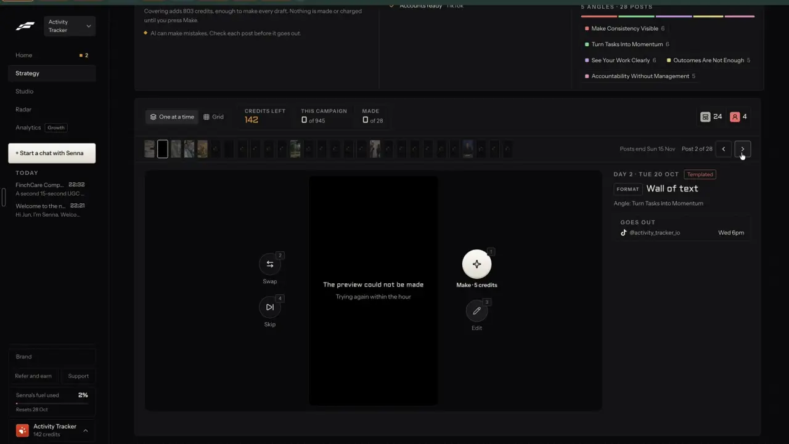
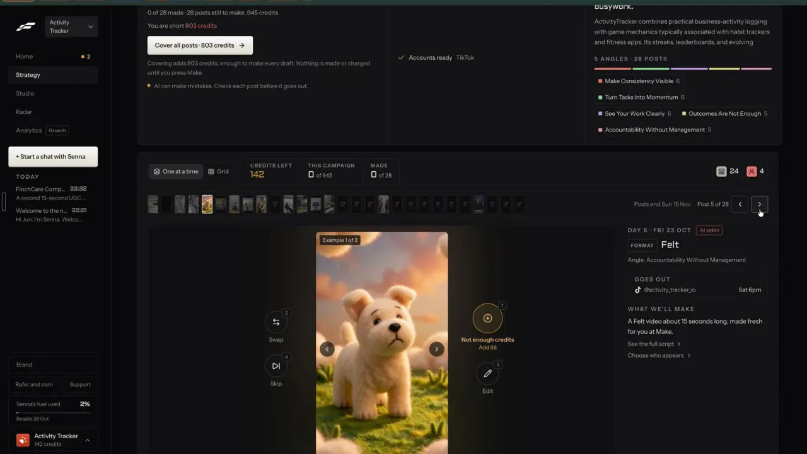

# Review posts one at a time

`plan-review-queue` | plan | phase 5 | status: partial | /north-star#plan-review-queue

## Leo asked

19 Oct 2026: "the idea is that one can remix any content format and the ai will regenerate". In the queue that is Swap: one key asks the AI to write a post again, and the person keeps or undoes it.

## How the best do it

Fastlane puts a post reviewer under every campaign (notes-1, F7).

- Toolbar: a toggle "One at a time" | "Grid", then "CREDITS LEFT" "142" in orange, "THIS CAMPAIGN" "0" "of 945" and "MADE" "0" "of 28", and at the right two count badges, 24 (templated) and 4 (AI video, label unverified).
- A strip of 28 small thumbnails that fill in as free previews render in the background (a few at 0:36, about 17 by 1:15), where a red dotted glyph marks one not made yet, the selected one has a white outline, and a click jumps to it; "Posts end Sun 15 Nov", "Post 1 of 28" and the "<" and ">" buttons sit to its right.
- The stage: a 9:16 preview with round buttons around it, each with a small number badge: "Make | 5 credits" (1), "Swap" (2), "Edit" (3) and "Skip" (4). The badges are probably keyboard keys; that is unverified. Moving between posts plays a one-second crossfade.
- The detail column: "DAY 1 | MON 19 OCT" with a "Templated" or "AI video" tag, "FORMAT Slideshow | 8 slides", "Angle: Make Consistency Visible", a "GOES OUT" box with the account and "Tue 6pm", a link by type ("See every slide", "See all the words", "See the full script", "Choose who appears"), and "CAPTION | TIKTOK" with the caption.


Preview states, verbatim: "Still making this post", "Loading", and the failed state "The preview could not be made" / "Trying again within the hour". There is no retry button; it retries by itself.



An AI video post shows an example of the format ("Example 1 of 3"), the line "A Felt video about 15 seconds long, made fresh for you at Make.", and, when the balance is short, "Not enough credits" / "Add 68" in place of Make.



Fastlane's public pages describe a swipe review called "Blitz mode", also called "Tinder mode": swipe to approve or reject each video, and "Nothing publishes without your approval", on the Free plan too ([source](https://usefastlane.ai/tools/ai-ugc-video-generator), [pricing](https://usefastlane.ai/pricing)). Whether that is this queue is unverified: in Leo's recording "Blitz" shows up only as the maker of posts saved in the older product (Settings > Activity, notes-4 2.16).

Others:

- Sandcastles triages ideas with keys: S shortlist, D discard, A analysis, C turn into a script, E export, and arrows to move. "Discard all" has no confirmation and no undo ([source](https://help.sandcastles.ai/ideas)).
- Simplified's Client Review bundles a campaign's drafts into one link to approve, reject or comment on each post without logging in ([source](https://simplified.com/agencies)).
- Proofpoint Patrol, a compliance tool used by advisers' firms, works a review queue with Approve, Reject, Reject & Remove and Flag per item, showing the policy matches beside it ([source](https://www.proofpoint.com/uk/resources/data-sheets/patrol)).

## What we have today

- Leo's team posts are reviewed one at a time in a drawer on the calendar (`src/components/TeamPostReview.tsx`, `src/lib/teamPosts.ts`): Approve, Skip, a comment thread, and statuses "Waiting for you", "Approved", "Revising", "Posted" and "Skipped". Escape closes it and Cmd or Ctrl+Enter sends a note. It works only for the account that holds the team posts, has no Make or Swap, and no keys move between posts.
- Leo's reels board (`/reels`, `src/components/reels/*`) has a feed and a drawer per post, for his own brands only.
- Agency review (`/team`) lets a leader approve, ask for changes or reject a member's submission. Its list is already a component named `ReviewQueue` (`src/components/team/ReviewQueue.tsx`, with `FlagList` for compliance flags); it has tabs and no keys. The campaign queue below is named `CampaignQueue` so the two never get mixed up.
- Nothing reviews a batch of AI-written drafts. `/plan` slots are opened in Write one by one, and Idea Dump's briefs go to the board or Write one at a time.
- The parts a queue needs already exist: `PostPreview` (`src/components/PostPreview.tsx`, props `text`, `platform`, `format`, `disclosure`, `media`), carousel slides from text (`splitDraftIntoSlides` in `src/lib/carousel.ts`, drawn by `layoutSlide` and `renderSvg` in `src/lib/carouselLayout.ts`, as `PostItForMe` does), `scanCompliance` (`src/lib/compliance.ts`), `upsertDraft` and `deleteDraft` (`src/lib/draftHistory.ts`), `scheduleAt` and `planItemDate` for the day and time (`src/lib/contentPlan.ts`), and the AI video job (`speak` in `src/lib/textVoice.ts`, `sliceVoiceover` and `makeAvatar` in `src/lib/aiVideo.ts`, with `onAiJob`, `aiBusy`, `pendingAvatar` and `resumeAvatar`).
- `/carousel?draft=<id>` rebuilds slides from the post's text and hook with `splitDraftIntoSlides` each time it opens (`?carousel=<saved id>` reopens a kept carousel instead). The saved-carousel store keeps only the newest 20 (`MAX_SAVED_CAROUSELS`), so saving one per campaign carousel would push the adviser's own saved carousels out.
- The AI video job makes the clips, joins them on the device and opens the result in Edit a video; nothing is stored in the cloud. There is no saved face yet: Edit a video asks for a photo each time or makes an AI presenter, and the brand kit's `photo` is a small square headshot for carousel footers.

## Build

Gate with `leoOnly(email)`. Build after plan-campaign and plan-campaign-page; the queue sits on the campaign page under `#queue`.

### Screens and states

`src/components/campaign/CampaignQueue.tsx`, with the actions in `src/lib/campaignJob.ts` (`makePost`, `swapPost`, `skipPost`, `editPost`, `retryFailed`, `makeFreePosts`).

```
[One at a time | Grid]   MADE 3 of 12   AI VIDEOS LEFT TODAY 2      8 free  4 AI video
[#][#][#][~][ ][ ][!][ ][ ][ ][ ][ ]          Posts end Fri 21 Nov  Post 4 of 12  [<] [>]
+----------------------------------------------+-------------------------------------+
|                                              | DAY 4 | THU 30 OCT          Free    |
|  [Swap 2]      +--------------+   [Make 1]   | FORMAT  Carousel | 6 slides         |
|                |   preview    |              | Angle: The hospital bill question   |
|  [Skip 4]      |              |   [Edit 3]   | GOES OUT  LinkedIn, Instagram | 8pm |
|                +--------------+              | See every slide >                   |
|                                              | CAPTION | LINKEDIN                  |
|                                              | ...                                 |
|                                              | [warn] Check: "guaranteed"          |
+----------------------------------------------+-------------------------------------+
AI can make mistakes. Check each post before it goes out.
```

At 390 px the detail column goes under the preview and the four buttons sit in one row under it, each at least 44 px.

Toolbar: the view toggle (`?view=grid`), `MADE <m> of <n>`, `AI VIDEOS LEFT TODAY <k>` (from `useUsesLeft`, hidden when the campaign has no AI video), and the counts `<f> free` and `<a> AI video`.

Strip: one square per post, in order, with its state drawn in:

- `waiting`: a dotted outline; `drafting`: a pulsing fill; `ready`: the first slide or the first line of text; `failed`: a warning mark; `making`: a spinner; `made`: a check; `skipped`: dimmed with a slash.
- The current post has an outline, a click on any square moves to that post, and the strip scrolls sideways inside its own box so the page never does.

Stage, by the current post's state:

- `waiting`: `Waiting to be written.`
- `drafting`: `Writing this post...` over a skeleton the size of the preview.
- `failed`: `This post could not be written.` with `Try again` (re-runs the drafting job for failed posts).
- Writing paused by the cap: `Today's limit for writing campaign posts is used. The rest are written after 8am Singapore time.`
- `ready` or `made`, by format:
  - Text post: `PostPreview` with the post's platform, the brand's disclosure and the text (hook, body, CTA).
  - Carousel: the slides from `splitDraftIntoSlides(body, { hook })` drawn as SVG with the brand kit, a badge `Carousel | slide 1 of 6`, and left and right slide arrows. Nothing is uploaded or stored to show them.
  - Short video script: HOOK, BODY and CTA blocks with `About 30 seconds. You film it.`
  - AI video: the script, then `WHAT WE'LL MAKE` / `A 15-second AI video of you saying this script, made when you press Make.` when a face is saved, else `A 15-second AI video of this script. You pick who appears when you press Make.`, with the price chip `About US$2.75`.
- `making` (AI video): the AI job's own step line, for example `Making your video, 1 of 2 parts ready. This takes a few minutes.`, from `onAiJob`.
- `made`: a band over the preview, `On your calendar for Thu 30 Oct, 8pm.` with `Open in My posts`; for an AI video, `Made. Open it in the editor to add captions and export.` with `Open in editor` (`/edit`).
- `skipped`: the preview dimmed with `Skipped. Press Skip again to bring it back.`

Actions. Each button shows its key at 1024 px and wider and carries `aria-keyshortcuts`. Keys do nothing while focus is in an input, a textarea or a dialog, or while a modifier key is held.

- `1` Make, labelled `Make` (free formats) or `Make | About US$2.75` (AI video).
  - Free formats: `makePost` adds the post to My posts as `cmp_<campaignId>_<n>`: status `scheduled` at `scheduleAt(<day>, <time>)`, format from the post, platform the campaign's first platform, `hook` and `draft` from the words, `pillar` from the post, the angle title as `pillarDetail`, `ctaType`, `audience` from the campaign and `hookFormula` from `formulaId`. A carousel needs nothing more: `/carousel?draft=<id>` rebuilds the same slides from the same text and hook, so no carousel is saved. Then the post is `made`, the toast `Post <n> is on your calendar for <Day D Mon>, <time>. Undo` shows, and the queue moves to the next post that is ready and not made. Undo deletes the draft and sets the post back to `ready`.
  - If My posts is full and the entry that would drop out is posted or has numbers, ask first: `My posts is full, so this drops "<oldest hook>" from it. Make anyway?` with `Cancel` and `Make anyway`.
  - AI video: a confirm dialog, `Make this AI video?` / `About US$2.75 in Higgsfield credits. <k> of 2 left today.` with `Cancel` and `Make it`. When people-my-face has shipped and a face is saved, `Make it` runs the job in place: `makeAvatar(name, face, await sliceVoiceover(await speak(script, voiceId)))` (`speak` in `src/lib/textVoice.ts` returns the MP3, `sliceVoiceover` turns it into the `Voiceover` that `makeAvatar` takes), with the post `making` and `n` and the campaign id kept with the job so a reload can tie the result back. `voiceId` is the brand's saved voice (people-my-voice), else the first premade voice, Alice (`VOICE_IDS[0]` in `text-voice/logic.ts`, "British, clear, female"). Either way Make first saves a scheduled `short-video` draft `cmp_<campaignId>_<n>` with the script, so the day stays on the calendar (My posts formats have no `ai-video`). Without a saved face, Make opens the AI video maker at `/edit?panel=ai&kind=avatar&draft=<draftId>`, the param edit-video adds to prefill the script from a draft; until that param exists it copies the script and says `Script copied. Paste it into the AI video maker.` There the person picks their own photo or a labelled AI presenter. The post is marked `made` when the job ends (in place) or when the maker is opened (handed over).
  - Disabled with a reason: `No AI videos left today. Back at 8am Singapore time.`, `Another AI video is being made. Wait for it to finish.`, `This post is still being written.`
  - A failed AI job puts the post back to `ready` with `The AI video could not be made. Your use was given back.` (ai-video refunds today).
- `2` Swap writes the post again with the same angle and format: `swapPost` calls `idea-dump` mode "campaign" with this one post, `swap: true` and `avoid: [the current hook]` (counted against "campaign-swap", plan-campaign), keeps the old words in `prev`, and shows `New words for post <n>. Undo`. Swap carries the price chip for `campaign-swap` (`Under US$0.01 | <n> left after this`, business-cost-preview's `PriceChip`, or the same text in a plain span until it ships). While it runs the button reads `Swapping...` and the stage shows the skeleton. Disabled on made posts with `Made posts are changed in My posts.` Over its cap: `You've used all 40 swaps for today. It resets at 8am Singapore time. Edit the words instead.`
- Making an AI video counts `ai-voice` (10 a day) for the voiceover as well as `ai-video`, so the disabled reason also covers `No voiceovers left today. Back at 8am Singapore time.`
- `3` Edit turns the hook and the body (or script) in the detail column into text boxes with `Save` and `Cancel`; compliance chips update as the person types, and Cmd or Ctrl+Enter saves. Unsaved text is kept in `sessionStorage` (`cs-campaign-edit-<campaignId>-<n>`) until Save or Cancel. On a made post Edit opens it instead: `/generate?draft=<draftId>` for text and scripts, `/carousel?draft=<draftId>` for carousels.
- `4` Skip toggles `skipped`, shows `Post <n> skipped. Undo` and moves on. Skipped posts leave the cost and the angle mix.
- Left and right arrows move to the previous and next post. Moving between posts uses a 150 ms fade, and none at all under `prefers-reduced-motion`.

Detail column:

- `DAY <i> | <DOW D MON>` and a tag, `Free` or `AI video`.
- `FORMAT` with `Text post`, `Carousel | <s> slides`, `Short video script` or `AI video`.
- `Angle: <title>`.
- `GOES OUT`: the platforms or account handles and the time, or `You post it, <Dow> <time>` when no account is picked.
- A link by type: `See every slide` (a sheet with every slide), `See all the words`, `See the full script`, and for AI video `Choose who appears` (people-presenters; until it ships, it links to `/edit?panel=ai&kind=avatar`, where the person picks their own photo or a labelled AI presenter).
- `CAPTION | <PLATFORM>` with the text that goes out.
- Compliance chips from `scanCompliance(hook + body or script)`: warn only, never blocking, worded as `/generate` words them today. `scanCompliance` is the app's existing pattern list, reused as Write uses it; moving that check to Jev and letting a team leader switch a rule to block or review is trust-compliance-check's job, and the queue calls whatever Write calls then.

Grid view (`?view=grid`): cards, 2 across at 390 px and 4 at 1440 px, each with a small preview, `Day <i>`, format, angle and a state chip. A card click opens one-at-a-time on that post.

Finished (every post made or skipped): `Nothing left to review.` with `Open calendar`. plan-campaign-page shows the full completion card above.

### Copy

Every string above is exact, and the keys are `1` Make, `2` Swap, `3` Edit, `4` Skip, as in Fastlane. The safety line under the queue is always `AI can make mistakes. Check each post before it goes out.`

### Data

- Post states, words, `prev` and `draftId` live in the campaign (`content-studio-campaigns-<scoped(uid)>`, plan-campaign). Made posts also live in My posts (`content-studio-drafts-<scoped(uid)>`), an existing synced key. No carousel is saved (see Make).
- The AI video job keeps `{ campaignId, n }` beside its own pending record (`pendingAvatar` in `aiVideo.ts`), so `resumeAvatar` after a reload can still mark the right post. Nothing here needs a table or a migration.

### AI and cost

- Swap: `idea-dump` mode "campaign" with one post. Add `"campaign-swap": 40` to `DAILY_LIMITS`, commented "Swap in a campaign's review queue (idea-dump mode campaign, one post): about US$0.005." Refund when OpenAI fails. The estimate assumes about 600 input and 500 output tokens on gpt-4.1 and should be measured.
- AI video Make: the existing `ai-video` caps (2 a day per person, 20 a day across everyone) and the existing `ai-voice` cap (10) for the voiceover. A 15-second video is 44 Higgsfield credits, about US$2.75, from the prepaid pool, refunded on failure.
- Free Make costs nothing: no AI call, slides drawn on the device.
- No Jev question: the queue only orders and acts. The words were checked when written (`COMPLIANCE_LINES`) and are scanned again by `scanCompliance` here.
- Server gate: mode "campaign" already answers only `leoOnly` emails (plan-campaign).

### Deep links

- `/campaigns/<id>?post=<n>`: the post shown (1-based; replace while stepping, since it is a position in the queue). Out of range falls back to the first post not yet made.
- `/campaigns/<id>?view=grid` (replace; default one-at-a-time, left out of links).
- `/campaigns/<id>?angle=<angle id>` filters the queue (plan-angles).
- Add the rows to `docs/deep-links.md`, and use `links.campaign(id, { post, view, angle })` from plan-campaign.

## Done when

- [ ] On a 12-post campaign the strip fills in as the words arrive and every state above can be reached (force `failed` with a stubbed `callFn` on a branch).
- [ ] Keys 1 to 4 and the arrows work, and do nothing while typing in Edit.
- [ ] Make on a text post and on a carousel puts each on the calendar at its day and time; the carousel opens in `/carousel?draft=<id>` with the same slides; Undo takes each off the calendar.
- [ ] Swap gives new words with the same angle and format, Undo brings the old ones back, and the 41st swap of the day shows the cap line.
- [ ] Skip removes a post from the cost and the angle mix, and Skip again restores it.
- [ ] An AI video Make shows the price and uses left before anything runs; with no uses left the button is disabled with its reason.
- [ ] Without a saved face, AI video Make leaves a scheduled short-video draft on the calendar and opens `/edit?panel=ai&kind=avatar&draft=<id>` with the script filled in (or the copied-script line before edit-video ships).
- [ ] Swap shows its price chip and uses left.
- [ ] Reloading during an AI video job still marks the right post made when it finishes.
- [ ] Typed edits survive leaving the page and coming back in the same tab.
- [ ] Grid view opens the right post on click and keeps `?view=grid` in the URL.
- [ ] 390 px and 1440 px checked by eye; buttons at least 44 px on touch; the strip scrolls inside its box with no page overflow.
- [ ] Build and full vitest pass; the item flips in `src/data/northStar.ts`.

## Tests

The repo's vitest runs in node with no component library, so the logic lives in `src/lib/campaignJob.ts` and `src/lib/campaigns.ts` and is tested there:

- `makePost` (fake stores): a text post becomes a scheduled draft with id `cmp_<id>_<n>` at the right `scheduledFor` and with `pillar`, `audience` and `hookFormula` set; a carousel draft's `splitDraftIntoSlides(draft, { hook })` gives the same slides the queue showed; nothing is written to the saved-carousel store; its undo removes the draft and resets the state; a made post is never made twice.
- `nextToReview(campaign, from)`: skips made, skipped and still-drafting posts and wraps to the start.
- `keyAction(event)`: maps 1 to 4 and the arrows, and returns null for events from inputs, textareas and dialogs or with a modifier held.
- `swapPost` (fake `callFn`): keeps `prev`, its undo restores it, a 429 leaves the words untouched and returns the cap message.
- `skipPost`: toggles, and `campaignCost` and `angleCounts` leave skipped posts out.
- `dropsPostedDraft(drafts)`: true only when the entry that would drop out is posted or has metrics.
- `usageCaps` test: `campaign-swap` is 40.

## Open questions

- Which premade voice should an AI video use when the brand has no saved voice? Leo decides; Alice, the first premade voice, is the stopgap.
- Should AI video posts render on their own the night before their day (Fastlane's "made fresh for you at Make" waits for a press)? That is plan-autopilot's call, under Leo's spending rules.
- Should Make on a free post also schedule it through Post it for me when accounts are picked? Leo decides. Until then Make only puts it on the calendar, and scheduling is one more press in My posts or on the calendar.

## Related

plan-campaign, plan-campaign-page, plan-angles, plan-autopilot, people-my-face, people-my-voice, people-presenters, edit-video, edit-carousel, edit-text-post, trust-compliance-check, trust-approval, publish-schedule, agent-approvals
