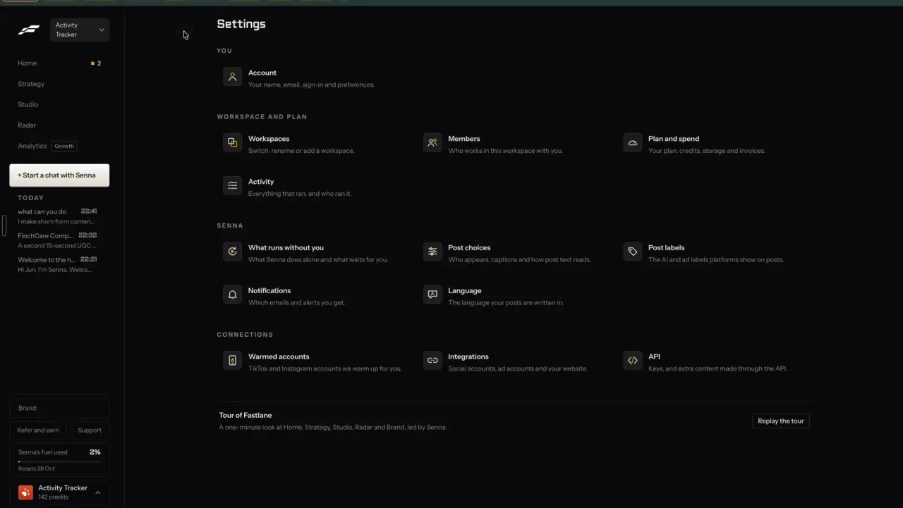
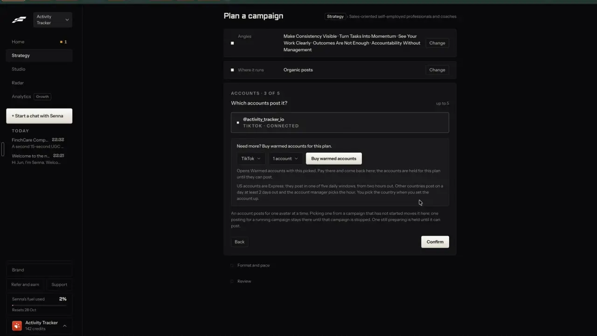

# Connected accounts for everyone

`publish-accounts` | publish | phase 7 | status: partial | /north-star#publish-accounts

## Leo asked

8 Oct 2026: "an all in one tool for my social media management, and for each person too". Each person, each brand, connects their own accounts once and posts to them from anywhere in the app.

## How the best do it

Fastlane asks for an account at the moment you need it. Inside "Schedule post", a ticked network with no account shows a card, "Connect Your Instagram Account" / "Connect Instagram to schedule Reels directly to your profile." / "Connect Instagram", and a connected one has an account dropdown with "+ Add another account" (notes-2.md F14).


Its Settings group them under "CONNECTIONS": "Integrations" / "Social accounts, ad accounts and your website.", beside "Warmed accounts" / "TikTok and Instagram accounts we warm up for you." (notes-4.md 2.17).



A campaign's step 3 asks "Which accounts post it?" with "up to 5", rows like "@activity_tracker_io" / "TIKTOK | CONNECTED", and the rule "An account posts for one avatar at a time." Below it sits the upsell "Need more? Buy warmed accounts for this plan." (notes-1.md F5.3). Leo left bought accounts out on purpose.



Fastlane's plans: the homepage gives Starter 1 social account (the pricing page lists TikTok, Instagram, YouTube and LinkedIn for it instead), and Growth and up get unlimited accounts ([site](https://usefastlane.ai), [pricing](https://usefastlane.ai/pricing)).

Others:

- OpusClip connects YouTube, Instagram Reels (Business or Creator), TikTok, Facebook Page, LinkedIn Business, X, Pinterest, Threads and Bluesky; Pro allows several accounts per platform. Its limits: TikTok 4 a minute and 15 a day, Instagram 40 a day, YouTube about 15 a day. [accounts](https://help.opus.pro/docs/article/add-social-accounts.md), [limits](https://help.opus.pro/docs/article/posting-rate-limits.md)
- Vizard: Free is TikTok only with 1 account, Creator 6 accounts, Business 20; LinkedIn needs reauthorising yearly. [help](https://help.vizard.ai/en/articles/10367893-how-to-connect-your-social-media-accounts), [limits](https://help.vizard.ai/en/articles/14631679-posting-limits-best-practices)
- Quso.ai "Social Sets": a named group with one account per platform, to keep brands or clients apart; 1 free set, up to 5. [help](https://helpdesk.quso.ai/help/what-is-a-social-set.md)
- Blotato: 9 platforms; Starter 20 accounts, Creator 40. [pricing](https://www.blotato.com/pricing)
- AuthoredUp: company pages free on every plan; you pay only for profiles. [pricing](https://authoredup.com/pricing)
- Buffer: 12 channels; for some Instagram, TikTok and YouTube formats it sends a reminder so you finish in the app (which formats is unverified). [publish](https://buffer.com/publish)

Zernio, our publisher, bills per connected account across the whole team: the first 2 free, then US$6 a month each for accounts 3 to 10, US$3 for 11 to 100, US$1 beyond, prorated by the day, with no per-post charge outside X ([pricing](https://docs.zernio.com/pricing.mdx)). Picking a Facebook Page or a LinkedIn page should happen on Zernio's hosted connect screen, since we send people to its `authUrl` (unverified for our account).

## What we have today

- Playbook > Social accounts at `/accounts` (`src/pages/AccountsPage.tsx`, `src/lib/socialConnect.ts`, `supabase/functions/social`): a flat "Connected" list, then "Connect an account" with one button per platform labelled with its name (Instagram, Facebook, TikTok, LinkedIn, YouTube, Threads), each connected account with its health ("Working", "Reconnect needed", "Checking", "Needs a look"), Reconnect, and Disconnect with a confirm. Accounts belong to the open brand profile; each brand has its own Zernio profile (`cs_social_profiles`, docs/zernio-connection.md).
- Several accounts on one platform already work: each Connect adds one more, and Post it for me lists them all. Nothing on the page says so.
- Caps: 6 accounts per adviser across their brands (`USER_ACCOUNT_CAP` in `supabase/functions/_shared/zernio.ts`), a team cap `ZERNIO_MAX_ACCOUNTS` (2 when unset, `teamCapOf`), a recount on every `status` and `connect`, a daily recount and a weekly orphan sweep (`social-sweep`, `supabase/hub/021_social_sweep.sql`). The cap line shows only when full. Daily caps `social-connect` 3 and `social-read` 300.
- Removing a brand disconnects its accounts first.
- Gate: nothing works unless `ZERNIO_API_KEY` is set and the caller is in `SOCIAL_CONNECT_USERS`; the nav shows Social accounts only after the server says so (`cs-social-connect`, rechecked every 6 hours).
- Live since 17 Oct 2026 on a restricted Zernio key, with TikTok @activity_tracker_io under the ActivityTracker brand.
- Missing: anyone but Leo, connecting from the place you schedule, coming back to that place after connecting, a default account per platform, and a visible count before the cap is hit.

## Build

Gate: `leoOnly(email)` for the page changes below. Opening Social accounts to everyone is a separate step that only Leo can take, in his words ("on for everyone"), listed under Done when.

### Screens and states

/accounts, grouped by platform:

```
Social accounts                                     (i)
3 of 6 accounts connected.
Zernio: first 2 free, then US$6 a month each.        (Leo only)

Instagram (#instagram)
  @leotan.sg        Working        (o) Default   [Disconnect]
  @moneybees.sg     Reconnect needed  ( ) Default [Reconnect] [Disconnect]
  [Add another Instagram account]
TikTok (#tiktok)
  @activity_tracker_io  Working                   [Disconnect]
  [Add another TikTok account]
LinkedIn (#linkedin)
  [Connect LinkedIn]
...
```

- One card per platform, in the order of `SOCIAL_PLATFORMS`. A platform with no account shows "Connect {Platform}"; with one or more, "Add another {Platform} account".
- "Default" radios appear when a platform has two or more accounts. The default is ticked first in the schedule steps (publish-schedule); the first connected account is the default until one is picked.
- The count line is always visible: "{user} of {cap} accounts connected.", where `cap = min(userCap, user + max(0, teamCap - team))`, so it names whichever limit stops the next connect (with today's team cap of 2 and one account: "1 of 2 accounts connected."). When full, today's `capLine` replaces it and the connect buttons disable, as now.
- Leo's sign-in also sees the price line, so he sees the bill before he connects.

Connecting from the schedule steps:
- The connect card's "Connect {Platform}" saves the current path and query as `cs-connect-return` in sessionStorage (a device hint, `cs-` prefix) with the time, then calls `connectLink` as /accounts does.
- Back on `/accounts?connected=<platform>`, the existing banner ("Instagram connected: @leotan.sg.") gains "Back to your post", which opens the saved path and clears it. A failed connect ("Instagram didn't connect. ...") gets the same link. A saved return older than 30 minutes is ignored.

States:
- Loading, off and error: as today.
- Connecting: the button reads "Opening {Platform}..." as today.
- Over the connect cap: the server's "You've used all 3 for today. It resets at 8am Singapore time." in the toast, as today.
- Over the account cap: today's lines.
- Removed by the recount: today's warning list at the top.

### Copy

- "Connect {Platform}", "Add another {Platform} account", "Default", "Back to your post"
- "{user} of {cap} accounts connected."
- Leo-only price line: "Zernio: first 2 free, then US$6 a month each."
- InfoTip on the page title (existing): "Each brand profile connects its own accounts, through Zernio."

### Data

- `content-studio-social-defaults-${scoped(userId)}`: `{ [platform]: zernioAccountId }`, synced per brand. An id that is no longer among the brand's accounts is ignored. Not security state: the server checks every id.
- sessionStorage `cs-connect-return`: `{ path: string; at: number }`, this tab only.
- No schema change.

### AI and cost

- No model and no Jev question.
- Existing caps only: `social-connect` 3 a day, `social-read` 300 a day.
- Zernio money, at its list price: 20 advisers with 3 accounts each is 60 accounts, so 2 free + 8 x US$6 + 50 x US$3 = about US$198 a month. The team cap `ZERNIO_MAX_ACCOUNTS` is the guard; Leo sets it.

### Deep links

- `/accounts#instagram`, `#facebook`, `#tiktok`, `#linkedin`, `#youtube`, `#threads` scroll to that platform's card. In docs/deep-links.md, take /accounts out of the "(none)" row it shares with /home and /bio and give it its own row for these anchors.
- `/accounts?connected=` and `?error=` stay as today (read once, then removed).
- No link starts a connect by itself: a connect sends the person to another site, so it always takes a tap.

## Done when

- [ ] On Leo's sign-in /accounts groups accounts by platform, shows "Add another {Platform} account", the count line and the price line.
- [ ] Picking a Default for Instagram makes that account ticked first in the schedule steps, on another device too.
- [ ] Connecting TikTok from the schedule steps returns to /accounts with "Back to your post", which reopens the same post and step.
- [ ] Other sign-ins see today's page.
- [ ] `npm run build`, the full `npx vitest run`, and a by-eye check at 390 px and 1440 px pass.
- [ ] `src/data/northStar.ts` item flipped with its `ours` line, in the same commit.

For everyone (Leo's call, not part of the build). Before he says "on for everyone":
- [ ] `select jobname from cron.job` on the academy project lists `social-sweep-recount` and `social-sweep-orphans` (021 applied).
- [ ] A card is on the Zernio account; without one Zernio refuses the third account with 402.
- [ ] `ZERNIO_MAX_ACCOUNTS` is set to the number Leo will pay for.
- [ ] Then `SOCIAL_CONNECT_USERS='*'` is set by Leo's session, and the gate on this page comes off.

## Tests

- `src/lib/socialConnect.test.ts`: `countLine` reads "3 of 6 accounts connected." with a team cap of 20, and "1 of 2 accounts connected." with one account and a team cap of 2; `capLine` still wins when full; the connect-return reader returns the path within 30 minutes and null after, and null for a path that is not this app's (must start with "/").
- `src/lib/socialConnect.test.ts`: the defaults reader ignores an account id that is not in the list and falls back to the first connected account.
- `src/lib/socialConnect.test.ts`: a new pure `groupAccounts(accounts, defaults)` (the page renders its output) gives one group per platform in `SOCIAL_PLATFORMS` order, flags `showDefault` when a platform has two or more accounts, and labels the button "Connect {Platform}" or "Add another {Platform} account". The suite runs in node, so the page logic is tested through this helper.
- Prove each case bites by breaking the code once.

## Open questions

- Money: the team cap and a card on Zernio are Leo's. Plans and credits that charge advisers for accounts wait for him (business-plans).
- Quso.ai-style named sets of accounts inside one brand are left out: a brand profile already is the set.
- TikTok accounts connect on one of two lanes (Business app or developer app) with different rules (publish-tiktok). Showing the lane needs a field Zernio's account list may not return (unverified).
- X is left out on purpose: Zernio passes X's per-request fees through (US$0.015 a post).

## Related

publish-schedule, publish-tiktok, publish-auto-dm, publish-inbox, learn-real-numbers, trust-workspaces, business-plans, plan-campaign
