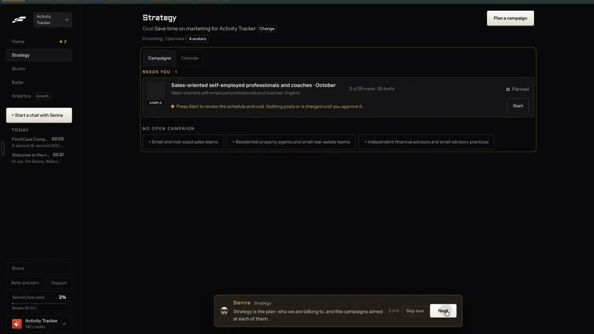

# Calendar

`publish-calendar` | publish | phase 7 | status: partial | /north-star#publish-calendar

## Leo asked

8 Oct 2026: "an all in one tool for my social media management, and for each person too". The calendar is the one place a person sees everything that will go out, for every brand they run.

## How the best do it

Fastlane keeps its calendar as a tab beside campaigns: Strategy shows a bordered tab pair "Campaigns" | "Calendar", with "NEEDS YOU | 1" under Campaigns (notes-4.md 2.11). The Calendar tab was not opened in the recording.



What needs the person surfaces on Home instead: "NEXT UP | THE 1 THING THAT NEEDS YOU", "A post is made and not scheduled" / "Schedule it, or leave it in the Library.", and the stat "POSTS OUT" / "0 of 0 this week" / "Nothing booked yet" (notes-4.md 2.10). Fastlane's public page describes one calendar for TikTok, Reels, Shorts and LinkedIn, weeks ahead, the same slot on every platform or staggered, and "Automations can fill an entire content calendar in one click". [source](https://usefastlane.ai/tools/tiktok-scheduler)

Others:

- Buffer: all channels in one grid, week and month views, filter by channel, tag or post type, drag to reschedule, edit in place. [publish](https://buffer.com/publish)
- Hootsuite: calendar or list of organic and paid posts, best times as a heat map, and a crisis pause that suspends every scheduled post at once. [publishing](https://www.hootsuite.com/platform/publishing)
- Planable: Feed, Calendar, Grid (Instagram) and List views; List with bulk actions is Enterprise only. [pricing](https://planable.io/pricing/)
- Later: calendar plus an Instagram grid preview, with best times highlighted in the calendar. [scheduler](https://later.com/social-media-scheduler/)
- Vizard: "+" on a slot in month or week view starts a post; drag to reschedule; Edit and Delete from the post's menu. [help](https://help.vizard.ai/en/articles/10441547-how-to-schedule-using-the-calendar)
- OpusClip: "Scheduled posts continue if the browser closes or the subscription expires. No pause yet." [help](https://help.opus.pro/docs/article/schedule-clips.md)
- Levitate (adviser market): advisers review and approve personalised content months ahead and drag templates onto the calendar. [page](https://www.levitate.ai/industry/financial)

## What we have today

- /calendar, `src/pages/CalendarPage.tsx` (2,165 lines): Month, Week and Upcoming views; filters for business, platform and status; a day panel; "Write a post for this day"; open posting slots from the brand kit (`src/lib/postingSlots.ts`), with drag onto a slot; day notes; coverage, which business runs out of planned posts within 14 days (`src/lib/calendarCoverage.ts`); an overdue block (`#overdue`); recurring posts shown as ghosts; Team posts and channel feeds for Leo; the Instagram grid at /grid.
- Drag to move on desktop (`dragProps`, `moveTo`), a date input on phones, quick buttons "Today", "Tomorrow", "Next slot", and "Back in drafts". Every move has Undo.
- "Needs you" lists team posts waiting for approval and reels nobody posts unless Leo does.
- Auto-posts: a post sent through Post it for me carries its chip on the week card and Upcoming row ("Auto-post", "Posted", "Failed"), and a dot on the month grid. `useZernioRefresh` asks Zernio about up to 10 due posts on load.
- The URL holds `view`, `business`, `platform`, `status`, `month`, `week`, `day`, `post`, `teampost` and `feed` (docs/deep-links.md). The open Post it for me panel is component state (`postOpenId`), so a link can't reopen it (publish-schedule adds `schedule=`).
- Gaps found in the code:
  - Moving a post that Zernio holds changes only the draft. `reschedule` calls `setDraftStatus` and nothing tells Zernio, so the post still goes out at the old time. "Back in drafts" and deleting a post (My posts) leave the Zernio post scheduled too. The same is true of moves from My posts, Home, Board, Plan and the assistant's "move" act, which all go through `src/lib/draftHistory.ts`.
  - My posts keeps 50 entries (`MAX_DRAFTS`); the oldest is dropped when a new one comes in, even one Zernio will still publish, so its card vanishes while it goes out.
  - "Needs you" leaves out auto-posts that failed or partly posted.
  - `PLATFORM_LABEL` and the platform filter know LinkedIn, Instagram, Facebook, TikTok and Telegram only, so YouTube and Threads posts can't be filtered.

## Build

Gate: `leoOnly(email)` for the new Needs you rows. The Zernio sync fixes a live defect for everyone who can auto-post, and that list is Leo alone today (`SOCIAL_CONNECT_USERS`), so it ships ungated.

### Keep Zernio in step

One outbox per brand. Ops come from comparing the drafts before and after each save, and one runner sends them.

- `src/lib/draftHistory.ts`: every write ends in `saveDrafts` (`upsertDraft`, `setDraftStatus`, `deleteDraft`, `restoreDraft` behind every Undo, `markUnposted`, labels, the Board rename, the CSV import and its Undo). Before it writes, `saveDrafts` calls pure `zernioOps(before, after, outbox)` from the new `src/lib/zernioOutbox.ts` and saves the outbox it returns. For each draft whose `zernio.postId` is set and whose `zernio.status` is not published, partial, publishing or cancelled:
  - gone from the list, or its status back to "draft": a cancel op.
  - its `scheduledFor` names another moment than `zernio.at` (compare with `Date.parse`; Zernio sends UTC): a move op, `at: zernioTime(next) ?? "<day>T09:00:00+08:00"`.
  - back on the moment Zernio holds (an Undo before the op went out): its op is removed.
  One op per `postId`; a newer op replaces an older one.
- The draft keeps its `zernio` link until a cancel goes through, so Undo after "Back in drafts" only drops the waiting op. When a cancel succeeds, the runner removes `zernio` from the draft and adds the post id to the outbox's `gone` list (the last 50). `zernioOps` strips any link whose id is on that list, so a later Undo can't bring back a post Zernio has deleted.
- Trimming to 50 drops the oldest entries that Zernio is not holding first.
- `src/lib/zernioOutbox.ts` also holds the store and a pure `runOutbox(ops, send)` that takes the sending function as an argument. A thin hook `useZernioOutbox(userId)` in `src/components/PostItForMe.tsx` calls it with the real `social` calls and is mounted once in `src/pages/StudioLayout.tsx`. It sends the active brand's ops in order on mount and whenever the outbox store fires its own `content-studio-outbox-changed` event (pages save drafts without calling `draftsChanged`, so `onDraftsChanged` alone would miss them). Move calls the new `social` action `move`; cancel calls the existing `cancel`. Success removes the op and sets `zernio.at`. A 409 "published" removes the op and records an "Already posted" note. A 404 on cancel counts as done (the post is already gone, or the other device sent it first). Any other failure keeps the op with its error; the runner tries each op at most 3 times on its own, then waits for Retry.
- Two devices can run the same op. A move to the same time is harmless, and the second cancel gets the 404 above.
- `supabase/functions/social/posts.ts`: action `move` `{profileId, postId, scheduledFor}`. Checks: id format (H1), `scheduledFor` with an offset and at least a minute ahead (same rule as `checkSchedule`), the post check (H2). Refuses a post that is published, publishing or partial with 409 "It's already going out, so it can't move." Then `PUT /v1/posts/{postId}` with `{ scheduledFor, timezone: "Asia/Singapore" }` and returns the post through the post check, counting one use of `social-schedule`. Zernio's update-post page lists `platforms` as optional and says draft, scheduled, failed, partial and cancelled posts can be edited ([docs](https://docs.zernio.com/posts/update-post.mdx)); PUT is in the `publishing` resource group, which the app key has. Whether a time-only body passes Zernio's per-platform checks is still unverified; the first live move settles it.

States on the card while an op waits: the chip reads "Updating auto-post" (wait tone). Done: the chip shows the new time. Failed: the card keeps "Auto-post" and Needs you gets a row.

### Needs you

The section gets `id="needs-you"` and three new row kinds, under the existing ones:

```
Needs you
  Didn't post: "3 CPF myths" on Instagram. Media URL expired.      [Retry] [Open]
  Still on the old time: "Budget 2027" goes out Tue 21 Oct, 9:00 am  [Retry] [Cancel auto-post]
  Finish in TikTok: "5 signs" is in your TikTok inbox                    [Mark posted]
```

- Didn't post: drafts whose `zernio.status` is failed or partial, with Zernio's reason (`zernio.error`). Retry calls `retryPost`, as the chip does.
- Still on the old time: outbox ops that stopped after 3 tries. Retry resends; "Cancel auto-post" sends a cancel.
- Finish in TikTok: inbox drafts (publish-tiktok), with "Mark posted".
- Empty: the section hides when nothing needs the person, as today.

### Two more platforms

Add `youtube: "YouTube"` and `threads: "Threads"` to `PLATFORM_LABEL`; the platform filter takes both values, and docs/deep-links.md lists them.

### Copy

- Chip "Updating auto-post"
- Rows: "Didn't post: "{title}" on {Platform}. {reason}", "Still on the old time: "{title}" goes out {when}", "Finish in TikTok: "{title}" is in your TikTok inbox"
- Buttons "Retry", "Open", "Cancel auto-post", "Mark posted"
- Move refused toast: "Already posted on {Platform}, so it stays where it was." (from the 409)
- "Back in drafts" and delete on an auto-post add the toast description "Zernio won't post it." (the words today's Cancel post uses)
- Server refusal "It's already going out, so it can't move."

### Data

- `content-studio-zernio-outbox-${scoped(userId)}`: `{ ops: { id: string; postId: string; op: "move" | "cancel"; at?: string; title: string; tries: number; error?: string }[]; gone: string[] }`, at most 50 ops and the last 50 cancelled post ids. Synced per brand, so a move made on the phone is sent by whichever device opens the app next. Not security state: the server checks the post again.
- No schema change.

### AI and cost

- No model and no Jev question.
- `move` counts against `social-schedule` (30 a day), one use per calendar drag of an auto-post, and Zernio charges nothing for it.

### Deep links

- `/calendar#needs-you` scrolls to the section, as `#overdue` does today.
- `/calendar?platform=youtube` and `?platform=threads` join the platform values; update the /calendar `platform` row in docs/deep-links.md.
- Every row's "Open" goes to `/calendar?post=<id>`.

## Done when

- [ ] Dragging an auto-post to another day moves the Zernio post: `post` read back shows the new `scheduledFor` (Leo checks on a test post scheduled a week out, then cancels it).
- [ ] "Back in drafts" and deleting an auto-post cancel it on Zernio; the chip and the outbox clear.
- [ ] Undo after a move sends the post back to its first time.
- [ ] A move made while offline is sent on the next load, from either device.
- [ ] A post Zernio holds survives a 51st new draft.
- [ ] Needs you shows a failed auto-post with its reason and a working Retry.
- [ ] `/calendar?platform=threads` filters to Threads posts.
- [ ] `npm run build`, the full `npx vitest run`, and a by-eye check at 390 px and 1440 px pass.
- [ ] `src/data/northStar.ts` item flipped with its `ours` line, in the same commit.

## Tests

- `src/lib/zernioOutbox.test.ts` (`zernioOps`): moving a post with a scheduled Zernio link adds one move op; moving it twice leaves one op with the last time; an Undo back to the held time removes the op; back to draft adds a cancel and keeps `zernio` on the draft; a link whose id is in `gone` is stripped; a posted or failed link adds nothing.
- `src/lib/draftHistory.test.ts`: `setDraftStatus`, `restoreDraft` and `deleteDraft` each leave the matching op in the outbox; trimming at 51 (a CSV import of 5 into a full list too) keeps the Zernio-held entry and drops the oldest other one.
- `supabase/functions/social/posts.test.ts`: `move` refuses a malformed id (404), a past time (400), someone else's post (404) and a published post (409); a good one sends `PUT` with `scheduledFor` and `timezone` only.
- `src/lib/zernioOutbox.test.ts`: `runOutbox` with a fake `send` sends ops in order, clears them on success, records "Already posted" on a 409, treats a 404 on cancel as done and adds the id to `gone`, keeps the op on a 500 and counts tries up to 3.
- `src/lib/calendarCoverage.test.ts` or a new `needsYou` helper test: failed links and stalled ops become rows; nothing pending gives no rows.
- Prove each case bites by breaking the code once.

## Open questions

- The outbox ships without `leoOnly`, against the page's rollout rule, because it fixes a live defect (a moved auto-post still goes out at the old time) and only `SOCIAL_CONNECT_USERS` (Leo today) can auto-post at all. Leo confirms or asks for the gate.
- Pause every auto-post at once (Hootsuite's crisis pause) would suit advisers on a market-shock day. Zernio's update-post takes an `isDraft` flag; whether `isDraft: true` parks a scheduled post is unverified. Leo decides whether it is wanted.
- A best-time heat map (Hootsuite, Later) is left out: posting slots already start from the best time per weekday (`makeSlots` in CalendarPage). The `social` function's `best-time` action reads Zernio's best hours but is kept off screen on purpose (docs/zernio-connection.md: UTC, raw engagement, and it would disagree with ours).
- Fastlane puts the calendar under Strategy beside campaigns. Whether /calendar moves under /campaigns is plan-campaign's call.

## Related

publish-schedule, publish-queue, publish-tiktok, publish-recycle, publish-library, plan-campaign, plan-review-queue, trust-approval, agent-chat
