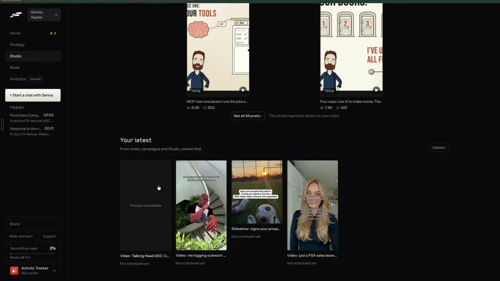

# Your library, by status

`publish-library` | publish | phase 1 | status: partial | /north-star#publish-library

## Leo asked

19 Oct 2026: "the idea is that one can remix any content format and the ai will regenerate". Every remix ends up as something made; this item is the one place where all of it shows, with what is still being made and what failed.

## How the best do it

Fastlane keeps everything made in Studio > Library (FireShot capture, not in the recording).

- Tabs "Overview", "Create", "Library", "Influencers", with Library selected.
- Format pills on the left ("All formats", "Video", "Slideshow", "Image") and status pills on the right ("All", "Ready", "Scheduled", "Posted", "Building", "Failed"), with a search box under them that reads "Search titles, copy and captions".
- A grid of 9:16 cards, each titled "<Format> | <title>" ("Video | Talking Head UGC: U...", "Slideshow | signs your prosp...") over the line "Not scheduled yet"; a card with no thumbnail reads "Preview unavailable".
- Further down the same page sit MEDIA ("16 MB of 10 GB storage used"), SETS and INSPIRATION, which belong to brand-media-library, brand-media-sets and find-niche-feed.


Studio > Overview ends with "Your latest", subtitle "From chats, campaigns and Studio, newest first", a "Library >" button and the four newest cards, each "Not scheduled yet" (notes-2 F8, notes-3 F7).



On thread pages a right drawer "Your work" opens from a vertical "YOUR WORK <" tab (notes-4 2.13):

- Header "Your work" with "Hide >", and the status line "Nothing in flight | 4 made".
- "RECENT" with "All activity >", then rows of icon or thumbnail, title, "<type> | <relative time>" and a chevron: "Plan added: ... | October" / "Update | 5 min ago", "Video made" / "Video | 10 min ago", "Me logging outreach so tomorrow's pipeline doesn't pick on..." / "Saved a green screen | 3 weeks ago".
- Each row links to the thread where it happened. While loading it shows a skeleton of 5 rows.


Home's "NEXT UP | THE 1 THING THAT NEEDS YOU" card points at the library when something is made and not scheduled: "A post is made and not scheduled" / "Schedule it, or leave it in the Library.", then "READY TO POST", "Video | Talking Head ...", "Not posted anywhere yet." with "Open" and "Schedule" (notes-1 F2). A paid make says where it goes: "Usually renders in 4 to 10 min, then it lands in the Library." (notes-4).

Others:

- Metricool's post library has a board view with one column per status; cards are dragged between columns (Ctrl or Cmd to move several), each change goes into the post's history, and posts can be assigned to team members. The library holds 250 posts per brand on every plan, up from 50 ([source](https://metricool.com/product-updates-august-2026/)).
- Taplio shows drafts as a Kanban board next to reusable snippets ([source](https://taplio.com/pricing), [help](https://intercom.help/taplio/en/collections/19726449-writing-publishing-posts)).

## What we have today

Made things live in four separate stores, and no screen lists them together.

- My posts, `/drafts` (`src/pages/DraftsPage.tsx`, `src/lib/draftHistory.ts`, synced key `content-studio-drafts-<scoped(uid)>`):
  - status pills `All (n)`, `Drafts (n)`, `Scheduled (n)`, `Posted (n)` with an "Overdue" chip for a scheduled day in the past;
  - filters for platform, pillar and label, and a search box `Hook or body keyword` that searches the hook and body only;
  - URL params `status`, `platform`, `pillar`, `label`, `q`, `review`;
  - no format filter. A draft's `format` is `text-post`, `carousel`, `short-video` or `story`;
  - `MAX_DRAFTS = 50` per brand, oldest dropped first.
- Saved carousels (`src/lib/carousel.ts`, synced `content-studio-carousels-<scoped(uid)>`, `MAX_SAVED_CAROUSELS = 20`): an id `d:<draftId>` ties a carousel to a post and `p:<time>` marks pasted text, and they show only under the Saved tab of `/carousel`.
- Video projects (`src/lib/videoProjects.ts`, synced `content-studio-videoprojects-<scoped(uid)>`) keep the name, thumb, duration, caption and settings, while the file itself stays in IndexedDB on the device that uploaded it. "Save to My posts" in the editor writes a `short-video` draft with id `video-<projectId>` (`VideoEditPage.tsx` `saveToPosts`).
- AI pictures land in Media under the folder `AI images` (`AI_FOLDER` in `src/lib/aiImage.ts`), kept on this device only (`src/lib/mediaLibrary.ts`).
- Work in progress is a module-level job per kind, one at a time, each with a `xJob()` getter and an `onXJob(fn)` listener:
  - `aiJob` / `onAiJob` in `src/lib/aiVideo.ts` (kinds presenter, avatar, explainer, template, states working, done, failed, with a `step` line; a reload resumes from `cs-ai-video-pending`). The presenter picture is made inside the avatar form, so it has no `kind=` of its own on `/edit`;
  - `montageJob` / `onMontageJob` in `src/lib/montage.ts` (Montage from a theme, states writing, finding, joining, done, failed, with `done` of `of` beats);
  - `imageJob` / `onImageJob` in `src/lib/aiImage.ts`;
  - `exportJob` / `onExportJob` / `exportQueue` in `src/lib/videoMedia.ts`.
  - Steps inside an edit or a read also run as jobs (`brollJob`, `musicJob`, `reelStyleJob`, `watchJob`, `youtubeJob`, `onJoinJob`, `onVisualsJob`, `marketJob`). They change an existing project or fetch data, so the library leaves them out.
  `ExportPill` (`src/components/ExportPill.tsx`, mounted in StudioLayout) shows the running or finished export on every page but `/edit`. Nothing lists the AI video, montage and image jobs outside their own pages.
- Post it for me puts Zernio's state on the draft (`zernio.status`; `chipOf` in `src/lib/autoPost.ts` gives Scheduled, Posting, Posted, Partly posted, Failed, Cancelled).
- Home's "Pick up where you left off" card (`src/pages/HomePage.tsx`) lists recent posts from My posts and nothing from the other stores.

## Build

Gate: the page, its nav entry and the Making now panel show only when `leoOnly(email)` (`src/lib/leoOnly.ts`, which ships with the `/north-star` page and is not on main at 08537d1), and the route renders `NotFoundPage` for anyone else because a typed URL skips the nav. No server code changes, so there is no server gate.

Files to create: `src/lib/library.ts` (the pure merge, filter and count functions below), `src/components/library/LibraryCard.tsx`, `src/components/library/MakingNow.tsx` and `src/pages/LibraryPage.tsx`.

Files to change:

- `src/App.tsx`: the lazy route `/library`.
- `src/lib/nav.ts`: `{ to: "/library", label: "Library", owners: LEO_EMAILS }` in the pipeline section after My posts, with the routes list in `src/lib/nav.test.ts` updated and its More sheet assertion for `someone@example.com` left as it is.
- `src/lib/jumpTo.ts`: `"/library": "made everything videos ready"` in `KEYWORDS` (a path to a space-separated string, like `"/drafts": "posts history saved"`).
- `src/lib/links.ts` gets `library(o: { format?, status?, q?, panel? })` and `docs/deep-links.md` gets the `/library` rows.

### The merge (`buildLibrary`)

`buildLibrary({ drafts, carousels, projects, media, jobs, now })` returns `LibraryItem[]`, newest first by `at`:

```ts
type LibraryFormat = "text" | "carousel" | "video" | "image";
type LibraryStatus = "ready" | "scheduled" | "posted" | "making" | "failed";
interface LibraryItem {
  key: string;            // "d:<draftId>", "c:<carouselId>", "v:<projectId>", "i:<mediaKey>", "j:<job kind>"
  format: LibraryFormat;
  status: LibraryStatus;
  title: string;          // 80 chars at most
  words: string;          // what search reads
  at: string;             // ISO: made or last changed
  when?: string;          // scheduledFor or postedAt
  thumb?: { kind: "slide"; carouselId: string } | { kind: "url"; url: string } | { kind: "media"; key: string };
  href: string;           // where Open goes
  scheduleHref?: string;  // drafts that are ready only
  live?: { platform: string; url: string }[];
  note?: string;          // a job's step, a failure's reason, "Script only"
}
```

Rules, in order:

1. Every draft is an item.
   - Format: `carousel` stays carousel, `short-video` becomes video and anything else is text; a `short-video` draft whose id does not start with `video-` has no project, so it gets the note `Script only`.
   - Title is the hook, else the first line of the body, and `words` holds the hook, body and `firstComment`.
   - Status is `failed` when `zernio.status` is `failed` or `partial`; otherwise it follows `draftStatus(d)`, with `draft` shown as `ready`. A `cancelled` Zernio post also follows `draftStatus(d)`.
   - `href` is `/generate?draft=<id>`, except carousels (`/carousel?draft=<id>`) and `video-<pid>` drafts (`/edit?p=<pid>`). Ready drafts also get `scheduleHref` `/calendar?post=<id>`.
2. A saved carousel whose `draftId` matches a draft adds its slides to that draft's item (`thumb` slide, `words` gains every slide's title and body) and adds no item of its own. Any other saved carousel is its own `carousel` item, status `ready`, `href` `/carousel?carousel=<id>`.
3. A video project with a `video-<id>` draft gives that draft its `thumb` and project name. Any other project is its own `video` item, status `ready`, `href` `/edit?p=<id>`.
4. Media items in the folder `AI images` are `image` items, status `ready`, `href` `/media?folder=AI%20images&q=<name>`.
5. Jobs: `aiJob` working is a `making` video item (a picture for kind `presenter`) with `note` = its `step` and `href` `/edit?panel=ai&kind=<kind>`, where `presenter` maps to `avatar` because `/edit` only allows `template`, `montage`, `avatar` and `explainer`; failed is a `failed` item with `note` = its error. `montageJob` in a working state is a `making` video item with `note` `Finding clips <done> of <of>` and `href` `/edit?panel=ai&kind=montage`. Same for `imageJob` (image, `href` `/generate`) and a running or failed `exportJob` (video, `note` `Exporting <name> <pct>%`, `href` `/edit` as `ExportPill` links it; `ExportJob.id` is a run counter, not the project id, so it cannot point at a project). Done jobs add nothing: their output is already one of the items above.

`filterLibrary(items, { format, status, q })` matches `q` case-insensitively against `title + words`. `countBy(items)` returns counts per status for the pills and `madeCount(items)` counts everything not `making` or `failed`.

### Screens and states

```
Library                                            [Making now (1)]   (button shows at < 1024 px)
[All formats] [Text] [Carousel] [Video] [Image]
[All 31] [Ready 9] [Scheduled 6] [Posted 14] [Making 1] [Failed 1]
[ Search titles, words and captions        ]
+--------+ +--------+ +--------+ +--------+        | Making now                        |
| thumb  | | thumb  | | thumb  | | thumb  |        | 1 making | 30 made                |
|        | |        | |        | |        |        | Explainer: Making the voiceover...|
+--------+ +--------+ +--------+ +--------+        | RECENT                            |
Video | CPF top-ups...   Carousel | 3 signs...     | Carousel | 2 min ago              |
Not scheduled yet        Goes out Thu 23 Oct, 8pm  | Text | 1 hr ago                  |
[Open] [Schedule]        [Open]                    +-----------------------------------+
```

- Grid: 2 cards across at 390 px, 4 at 1440 px; each card 9:16 on video, 4:5 on carousel and image, and a text tile (hook in large type on the brand colour) for text.
- Thumbs: a carousel's first slide is drawn with `layoutSlide` and `renderSvg` from `src/lib/carouselLayout.ts`, measured with `createCanvasMeasure` and turned into an image by `svgDataUrl` (both in `src/lib/carouselRender.ts`; no PNG, nothing uploaded), memoised by carousel id and `updatedAt`, and only for cards on screen. A slide picture missing on this device is left out. Video thumbs use `project.thumb`. A media thumb reads IndexedDB and shows a grey skeleton until it loads.
- Card line by status:
  - ready: `Not scheduled yet`;
  - scheduled: `Goes out <Dow D Mon>, <time>`, or `Goes out <Dow D Mon>` without a time, plus `Auto-post` when Zernio has it;
  - posted: `Posted <Dow D Mon>` and one link per live platform from `zernio.links` (`Instagram`, `TikTok`...);
  - making: the job's step, for example `Making the voiceover`, with a spinner;
  - failed: the reason in plain words, for example `Zernio couldn't post it: <reason>` or the AI job's error;
  - a video item whose file is not on this device: `The video file is on the device that made it.`
- Card buttons: `Open` on every card (a link, 44 px tall on touch) and `Schedule` on ready drafts. Failed items get `Try again`, which opens the maker for an AI job, or `/drafts?status=scheduled` for a Zernio post, where the chip already has Retry; Download and Share arrive with publish-export-share.
- Empty, nothing made: `Nothing made yet.` with the button `Find a post to remix` (`/swipe`).
- Empty, filters match nothing: `Nothing matches these filters.` with the button `Clear filters`.
- Loading: the stores are read from localStorage at once, so only thumbs load. No page spinner.

Making now panel (`MakingNow.tsx`), a right column at 1024 px and wider, a sheet from the `Making now (<n>)` button below that:

- Header `Making now`, then `Nothing making now | <m> made` or `<k> making | <m> made`.
- One row per running job with an icon by kind, the job's label (`Avatar video`, `Presenter picture`, `Explainer`, `Template clip`, `Montage`, `AI picture`, `Export`) and its step. The row is a link to the page where the job runs. A failed job keeps its row and its error until it is cleared or retried.
- `RECENT` lists the 5 newest items as `<Format> | <relative time>` (`just now`, `5 min ago`, `2 hr ago`, `3 days ago`), and each row opens its item.
- It subscribes to `onAiJob`, `onMontageJob`, `onImageJob` and `onExportJob`, so it updates while open, within 400 ms of a job's change. Jobs keep running when the page is left, as they do today.

### Copy

Exact strings: `Library`, `All formats`, `Text`, `Carousel`, `Video`, `Image`, `All`, `Ready`, `Scheduled`, `Posted`, `Making`, `Failed`, `Search titles, words and captions`, `Not scheduled yet`, `Goes out`, `Auto-post`, `Posted`, `Script only`, `The video file is on the device that made it.`, `Open`, `Schedule`, `Try again`, `Nothing made yet.`, `Find a post to remix`, `Nothing matches these filters.`, `Clear filters`, `Making now`, `Nothing making now`, `made`, `making`, `RECENT`, `Montage`, `Finding clips <done> of <of>`.

Making is our word for Fastlane's "Building"; Write and the AI video maker already say "Making your video".

### Data

Nothing new is stored. The page reads `content-studio-drafts-`, `content-studio-carousels-` and `content-studio-videoprojects-` for `scoped(uid)`, and the device media index. Brand switching works as on every page (`?profile=`). No table, no migration.

### AI and cost

None. The page sorts and filters; it calls no model, no Jev and no paid API, so there is no cap to add.

### Deep links

- `/library?format=video` (text, carousel, video, image; default all), replace.
- `/library?status=ready` (ready, scheduled, posted, making, failed; default all), replace.
- `/library?q=cpf`, replace.
- `/library?panel=making` opens the Making now sheet below 1024 px, push, so Back closes it.
- Cards link to the existing maker URLs listed above. Add the rows to `docs/deep-links.md` and use `links.library(...)` wherever something links here.

## Done when

- [ ] A brand with text posts, a carousel made from a post, an unlinked carousel, a video project saved to My posts, an unlinked project and an AI picture shows each once, with the right format and status.
- [ ] A carousel tied to a draft appears as one card, never two.
- [ ] Format and status pills, and search, filter together, and the URL follows each change and restores it on reload.
- [ ] While an avatar video is being made, the panel and the Making pill show it and its step; when it ends the card leaves Making within a second.
- [ ] A Zernio post that failed shows under Failed with Zernio's reason.
- [ ] Other accounts see no Library tab and get the 404 page at `/library`.
- [ ] 390 px and 1440 px checked by eye; no page overflow; pills scroll inside their row.
- [ ] `npm run build` and the full `npx vitest run` pass; the item flips in `src/data/northStar.ts`.

## Tests

`src/lib/library.test.ts`:

- `buildLibrary` with one of each source: formats, statuses, hrefs and the `video-<id>` link are right; the tied carousel merges into its draft.
- A draft with `zernio.status` `partial` is `failed`; a draft with a scheduled day is `scheduled`.
- A short-video draft with no project gets the note `Script only`.
- Jobs: working AI job is `making` with its step, a failed one is `failed` with its error, a done job adds nothing; a presenter job links to `kind=avatar`; a working montage job is a `making` video.
- `filterLibrary`: format and status combine; search finds a word that only appears on a carousel slide.
- `countBy` and `madeCount` leave making and failed out of made.

Nav: `src/lib/nav.test.ts` keeps its More sheet assertion for `someone@example.com`, and `/library` maps to the Library page in `pageFor`. `src/lib/navRoutes.test.ts` stays green with the new route.

## Open questions

- My posts keeps 50 posts per brand and drops the oldest, so the library forgets older work. Metricool holds 250. Raising `MAX_DRAFTS` grows the synced row in `cs_user_data`; measure the row at 200 posts before changing it. Leo decides.
- Should `/library` replace `/drafts` when it is turned on for everyone, or sit beside it? Leo decides. Until then both exist and the library is read-only apart from its links.
- Videos made on another device show a card with no file. Cloud copies of video files wait on brand-media-library step 2 (bucket and storage spend), which is Leo's call.

## Related

brand-media-library, brand-media-sets, publish-export-share, publish-schedule, publish-calendar, plan-review-queue, agent-activity, agent-home, remix-source-trail, remix-any-format, business-cost-preview
