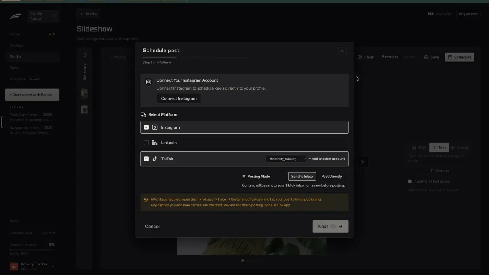
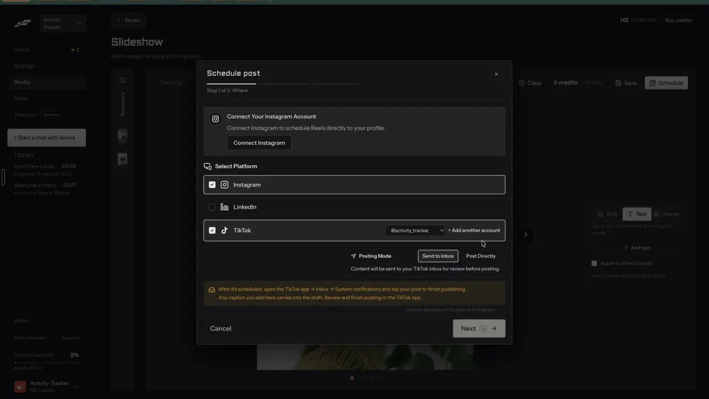

# Each network gets its own version

`publish-per-network` | publish | phase 7 | status: partial | /north-star#publish-per-network

## Leo asked

No direct ask; from the competitor research.

## How the best do it

Fastlane's "Schedule post" modal starts with "Step 1 of 3 | Where" (notes-2 F14):

- "Select Platform" with a checkbox per network ("Instagram", "LinkedIn", "TikTok"). In the recording Instagram and TikTok are ticked; only TikTok has an account, shown as a dropdown ("@activity_tracker_") with "+ Add another account".
- A connect card when an account is missing: "Connect Your Instagram Account" / "Connect Instagram to schedule Reels directly to your profile." / "Connect Instagram".
- TikTok's own setting, "Posting Mode", with "Send to Inbox" | "Post Directly" and the notice "After it's scheduled, open the TikTok app -> Inbox -> System notifications and tap your post to finish publishing. Any caption you add here carries into the draft." (that part is publish-tiktok).
- "Next" stays disabled with the tooltip "Choose an account to post to Instagram." while a checked network has no account (t129, t132). Steps 2 and 3 were not recorded, so whether Fastlane lets each network have its own caption is unverified.





In the post reviewer the caption is labelled by the network it goes to, "CAPTION | TIKTOK", under "GOES OUT" "@activity_tracker_io" "Tue 6pm" (notes-1 F7). Settings has "Post labels" / "The AI and ad labels platforms show on posts." (notes-4 2.17), which is people-ai-labels.


Others:

- Buffer's composer shows a separate text box per network, so caption, hashtags, link and time can differ by platform, and each version becomes its own post in that channel's queue ([source](https://buffer.com/publish)).
- Hootsuite's composer covers Instagram feed, Reels, Stories and carousels of up to 20 photos (Business accounts), TikTok switches for comments, Duets and Stitches, Bluesky's 300 characters and 4 images, and character-limit warnings for X ([source](https://www.hootsuite.com/platform/publishing)).
- Planable posts Instagram Trial Reels with three switches (trial on, auto-share after 72 hours, show on profile feed), which need a business or creator account with 200+ followers, plus Facebook and Instagram Stories and "Schedule first comment" ([source](https://planable.io/features/), [pricing](https://planable.io/pricing/)).
- Typefully adds the networks' own options: polls on LinkedIn, Threads and Mastodon, quote posts, LinkedIn reposts with commentary, who can reply on X, and LinkedIn mentions of people and companies ([source](https://typefully.com/changelog)).
- OpusClip lets users type hashtags, search TikTok hashtag trends with usage counts, tag Instagram collaborators and edit AI-written titles and descriptions before posting ([source](https://help.opus.pro/docs/article/9747769-customize-my-posts.md)).

What Zernio, our publishing provider, accepts per network (field pages read 2026-10-20):

- Instagram: a single video becomes a Reel and pictures go to the feed, while `contentType: "story"` makes a Story (no caption shown, no first comment). Reels take `shareToFeed` (default true) and `trialParams` (Trial Reels shown only to non-followers, `graduationStrategy` `MANUAL` or `SS_PERFORMANCE`); feed posts and Reels take `collaborators` (up to 3 public business or creator usernames) and `commentsEnabled: false`, which Zernio applies right after publishing, best effort ([docs](https://docs.zernio.com/platforms/instagram/fields.mdx)).
- Facebook: `contentType` `story` (a Page Story, no caption) or `reel` (one vertical 9:16 video of 3 to 60 seconds), otherwise a feed post ([docs](https://docs.zernio.com/platforms/facebook/posts.mdx)).
- LinkedIn: `poll` with a question of 1 to 140 characters, 2 to 4 options of 1 to 30 characters, and a duration of one, three, seven (the default) or fourteen days, and it cannot carry media ([docs](https://docs.zernio.com/platforms/linkedin/fields.mdx)).
- Threads: 500 characters at most, so a longer caption needs its own Threads version in `customContent` ([docs](https://docs.zernio.com/platforms/threads.mdx)).

## What we have today

- Post it for me (`src/components/PostItForMe.tsx`, `src/lib/autoPost.ts`, server `supabase/functions/social/posts.ts`) posts one draft to accounts on the draft's own platform only (`s.accounts.filter((a) => a.platform === platform)`), with one caption.
  - The caption gets the platform's counter (`checkLimits` in `src/lib/platformCounters.ts` for LinkedIn, Instagram, Facebook and TikTok; `CAPTION_MAX` on the server adds Threads 500 and YouTube 5,000) and compliance flags, where a red flag blocks the send.
  - TikTok privacy and the Comments, Duet and Stitch switches come from the creator's own settings; YouTube gets a title; the draft's `firstComment` goes to every platform but TikTok.
- The server already takes a caption per platform: `captions` in the schedule body becomes each account's `customContent` (`captionFor`). The page never sends it.
- No Instagram placement choice (a video always goes as a Reel), no Stories, no Trial Reels, no collaborators, no LinkedIn polls, no Facebook Reels or Stories.
- Elsewhere: Batch (`/generate/batch`) writes one draft per platform from one topic, Repurpose rewrites a draft for another platform, and the video editor's `PlatformCaptions` writes a caption for TikTok, LinkedIn, Facebook, YouTube (title and description), X and Threads in one call (`video-assist` mode `captions`, cap `video-captions` 30).

## Build

Gate: the new tabs and options show only when `leoOnly(email)`. The server reads `instagram`, `facebook`, `linkedin` and a non-empty `captions` only for `leoOnly(user.email)` (`supabase/functions/_shared/leoOnly.ts`) and drops them for anyone else, so other advisers' posts go out exactly as today.

If publish-schedule has not shipped first, widen `Post to` here to list every connected account of the brand, grouped by network, with the draft's own platform ticked.

### Screens and states

Inside Post it for me, under `Post to`, one tab per ticked network:

```
Post to:  [x] @leotan (Instagram)  [x] Leo Tan (LinkedIn)  [ ] @leo (TikTok)
[Caption | Instagram]  [Caption | LinkedIn]          [Write a version for each network]
+---------------------------------------------------------------------------+
| (textarea)                                                 1,920 / 2,200  |
| 4 hashtags                                                                |
| Post as:  (o) Reel  ( ) Story        [x] Also show in the feed           |
| [ ] Trial reel: show it to non-followers first                            |
| Collaborators: [@moneybees        ] (up to 3)                             |
| [ ] Turn off comments                                                     |
+---------------------------------------------------------------------------+
```

- Caption tab label: `Caption | <Network>`. Each tab starts with the shared caption and the line `Same as <first network>`; typing in a tab gives it its own version and shows `Use the shared caption` to undo.
- `Write a version for each network` calls `video-assist` mode `captions` with the draft body as `transcript`, the Instagram caption as `instagram`, the hook as `title` and the brand kit rules, then fills the ticked tabs (Instagram keeps the shared caption). While it runs the button reads `Writing...`. On failure the tabs stay as they were and the line reads `Couldn't write the versions. Try again in a minute.`
- Under each textarea: the counter (`<n> / <max>`), the hashtag count, and the `checkLimits` warnings for that network (`Instagram takes 5 hashtags at most. Remove 2.`, `LinkedIn works best with 3 hashtags or fewer. Remove 1.`). Over the limit, the tab label turns red and `Schedule` is disabled with `The <Network> caption is <n> characters too long.`
- Compliance flags run per tab, and a red flag in any tab disables `Schedule` with `Fix the compliance error in the <Network> caption first.`
- Instagram options:
  - `Post as`: `Feed` or `Story` for pictures, `Reel` or `Story` for one video. Default Feed for pictures and Reel for a video.
  - Reel only: `Also show in the feed` (default on) and `Trial reel: show it to non-followers first`, with the line `Instagram needs a business or creator account; Planable reports 200+ followers.`
  - Feed and Reel: `Collaborators` (up to 3 usernames, `@` optional, checked against `^[A-Za-z0-9._]{1,30}$`) and `Turn off comments`.
  - Story: the caption box is replaced by `Stories show no caption, and no first comment is posted.`
- Facebook options: `Post as` `Feed`, `Reel` (one vertical video only) or `Story`.
- LinkedIn options: `Add a poll` opens `Question` (140), `Option 1` to `Option 4` (30 each, at least 2) and `Runs for` `1 day`, `3 days`, `1 week` (default), `2 weeks`. With pictures or a video attached the switch is disabled with `A LinkedIn poll can't carry pictures or a video.`
- TikTok and YouTube keep their current fields inside their own tab.
- At 390 px the tabs scroll sideways inside their row and every control is at least 44 px tall.

### Copy

Exact strings: `Caption | <Network>`, `Same as <Network>`, `Use the shared caption`, `Write a version for each network`, `Writing...`, `Couldn't write the versions. Try again in a minute.`, `<n> hashtags`, `The <Network> caption is <n> characters too long.`, `Fix the compliance error in the <Network> caption first.`, `Post as`, `Feed`, `Reel`, `Story`, `Also show in the feed`, `Trial reel: show it to non-followers first`, `Collaborators`, `Turn off comments`, `Stories show no caption, and no first comment is posted.`, `Add a poll`, `Question`, `Option 1`, `Runs for`, `1 day`, `3 days`, `1 week`, `2 weeks`, `A LinkedIn poll can't carry pictures or a video.`

### Data

- The draft (`content-studio-drafts-<scoped(uid)>`) gains an optional `versions` field: `Partial<Record<"instagram" | "facebook" | "linkedin" | "tiktok" | "youtube" | "threads", { caption?: string; instagram?: IgOptions; facebook?: { placement: "feed" | "reel" | "story" }; linkedin?: { poll?: Poll } }>>`. A caption equal to the shared one is not stored. Old drafts without it behave as today.
- Server (`posts.ts`): the schedule body gains `instagram?: { placement: "feed" | "reel" | "story"; shareToFeed?: boolean; trial?: boolean; collaborators?: string[]; commentsOff?: boolean }`, `facebook?: { placement }` and `linkedin?: { poll?: { question: string; options: string[]; days: 1 | 3 | 7 | 14 } }`. `checkSchedule` checks their shape (more than 3 collaborators, a bad username, a poll with fewer than 2 or more than 4 options, a question over 140 or an option over 30 characters). `platformProblem`, which knows the picked platforms and the media, refuses in plain words a Reel without exactly one video, a Facebook Reel or Story without media, a poll with media, and `firstComment` on a Story. `platformData` (called from `postBody`) maps them to `platformSpecificData` (`contentType`, `shareToFeed`, `trialParams: { graduationStrategy: "MANUAL" }`, `collaborators`, `commentsEnabled: false`, `poll` with `duration` `ONE_DAY`, `THREE_DAYS`, `SEVEN_DAYS` or `FOURTEEN_DAYS`).
- Nothing here needs a table or a migration, since the versions ride inside the synced draft.

### AI and cost

- `Write a version for each network` is one `video-assist` `captions` call (OpenAI gpt-4.1 through the function; the Jev keyword question it already asks runs only when a spoken "comment X" is found). It counts on the existing `video-captions` cap (30 a day) and costs about 1 US cent (estimate, to be measured).
- No new Jev question: the placement follows the media and the user's pick, and limits are counted.
- Zernio charges nothing per post.

### Deep links

- Post it for me opens today from `/calendar?post=<id>` and `/generate?draft=<id>&panel=post`. Add `network=<platform>` to open that network's tab (replace): `/generate?draft=<id>&panel=post&network=linkedin`. An unticked or unknown network falls back to the first tab.
- Update `docs/deep-links.md` for `/generate` and `/calendar`.

## Done when

- [ ] One draft goes to Instagram and LinkedIn in one send, with a different caption on each, and each live post shows its own words (test on Leo's accounts).
- [ ] An Instagram video can go as a Reel with feed sharing off, or as a Story, and a Trial Reel reaches Zernio with `trialParams`.
- [ ] A LinkedIn poll posts with its question, options and duration, and the switch is disabled while media is attached.
- [ ] Over-limit and red-flag tabs block Schedule with the network named.
- [ ] Write a version for each network fills the ticked tabs and Undo per tab (`Use the shared caption`) restores the shared text.
- [ ] Another adviser's send with the new fields posts exactly as today (function test).
- [ ] 390 px and 1440 px checked by eye; build and full vitest pass; the item flips in `src/data/northStar.ts`.

## Tests

- `supabase/functions/social/posts.test.ts`: each new refusal in `checkSchedule` and `platformProblem`; `postBody` builds `contentType`, `shareToFeed`, `trialParams`, `collaborators`, `commentsEnabled` and `poll` with the right duration words; `customContent` follows `captions`; the new fields are dropped for a non-Leo caller.
- `src/lib/autoPost.test.ts` (or a new `src/lib/networkVersions.test.ts`): `versionFor(draft, platform)` falls back to the shared caption, an identical caption is not stored, placement defaults follow the media.
- Counter and compliance per tab: a Threads caption over 500 characters blocks Schedule.

## Open questions

- Hashtag trend counts (OpusClip's TikTok search) need a data source we do not have; find-search-topics covers it. Leo decides on any paid source.
- The AI-made label per network (Instagram `isAiGenerated`, TikTok's AI disclosure) belongs to people-ai-labels; until it ships, nothing here sets it.

## Related

publish-schedule, publish-tiktok, publish-accounts, publish-comments-followups, people-ai-labels, formats-text-threads, formats-carousel-designs, edit-text-post, trust-compliance-check
