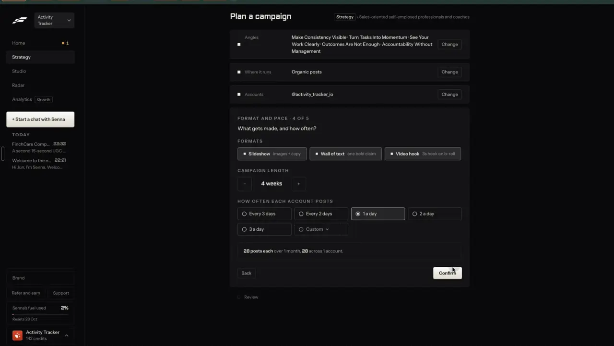

# A queue that fills your free slots

`publish-queue` | publish | phase 7 | status: partial | /north-star#publish-queue

## Leo asked

No direct ask; from the competitor research.

## How the best do it

Fastlane lays a campaign's posts into slots for you. Step 4 of its campaign wizard asks "HOW OFTEN EACH ACCOUNT POSTS" with "Every 3 days", "Every 2 days", "1 a day" (picked), "2 a day", "3 a day" and "Custom", and sums it up live: "28 posts each over 1 month. 28 across 1 account." (notes-1.md F5.4)



In the post reviewer each post then carries a "GOES OUT" box with the account and a time, "@activity_tracker_io" "Tue 6pm". The 14 posts seen go out one a day, alternating Slideshow and Wall of text, with an AI video every 7th day, every one at 6pm (notes-1.md F7).


Others:

- Buffer: each channel has recurring posting times in its own time zone; a new post can go "Next Available", "Prioritize" (top of the queue), "Now" or "Set Date and Time". Free holds 10 scheduled posts per channel. [publish](https://buffer.com/publish), [pricing](https://buffer.com/pricing)
- Taplio: Actions > "Edit Post schedule", pick a time and "Add slot" (its advice: at least one slot a day, vary the times); one click adds a post to the next slot; "Re-queue" pulls scheduled posts up to fill gaps, "Shuffle" mixes the order. [help](https://intercom.help/taplio/en/articles/8807234-setting-up-your-queue-posting-schedule)
- Revid.ai: every channel has a queue, and a post with no time takes the channel's next open slot. [docs](https://www.revid.ai/llm/revid-ai-publishing-and-automation.md)
- Vista Social: post queues with set times per profile, several schedules per profile, and "Optimal time". [page](https://vistasocial.com/social-media-publishing/)
- Blotato: post now, at a time, or "Next free slot time", with recurring weekly slots per platform and per account. [help](https://help.blotato.com/web-app-getting-started/posts.md)
- Zernio, our publisher, has queues of its own: a post sent with `queuedFromProfile` takes the profile's next slot. [guide](https://docs.zernio.com/guides/queue-scheduling.mdx)

## What we have today

- Brand kit "Posting times" at `/brand#posting-times` (`src/pages/BrandPage.tsx`): up to 14 weekly times per brand, stored as `CarouselBrand.slots` (`"<day 0 = Mon>T<HH:MM>"`, `src/lib/carousel.ts`), with Every day, Weekdays and Weekends presets. The calendar can make a starting set from a posts-per-week goal at the best time for each weekday (`makeSlots`, with Undo).
- `openSlots` (`src/lib/postingSlots.ts`) marks slots a scheduled post holds at that exact time; the calendar shows the rest for 6 weeks as chips you can drop a post on.
- `suggestPostingTime` (`src/lib/analytics.ts`) answers with one "Next slot" time for a draft. With slots it skips any day that has a post and any slot under 2 hours away; with none it falls back to the best time from results. It drives "Best time {when}" with "Schedule then" on Write's saved result, the "Next slot: {when}" (or "Best time: {when}") button on each row of the calendar's Unscheduled drafts column, the "Next slot" quick button in the post editor, and the post editor's "Duplicate" (toast "Copy scheduled for {when}").
- Missing: filling many drafts at once, times per network, and one rule for what counts as open. The two helpers disagree when a brand has two slots on one day: `openSlots` shows the second slot open, while `suggestPostingTime` skips the whole day.

## Build

Gate: `leoOnly(email)` for "Fill open slots" and the per-network times. Everyone else keeps one set of times and the one-at-a-time "Next slot".

### Times per network

In Brand kit under Posting times:

```
Posting times                                     (i)
[x] Same times on every network
    Mon 8:30 am   Wed 8:30 am   Fri 12:00 pm   + Add a time
```

Unticked, one row per network the brand uses (it has a connected account or a post on that platform), each starting as a copy of the shared times:

```
LinkedIn    Tue 8:00 am   Thu 8:00 am                 + Add a time
Instagram   Mon 7:30 pm   Wed 7:30 pm   Sat 10:00 am  + Add a time
```

- Up to 14 times per network, same editor and presets as today.
- Ticking the box back keeps the shared times and drops the per-network ones, with Undo in the toast.

### One rule for "next open slot"

New pure `nextOpenSlots(brand, platform, scheduled, now, days)` in `src/lib/postingSlots.ts`. It runs `openSlots` on the network's own times (or the shared ones) and drops slots under 2 hours away, as `suggestPostingTime` does today. With per-network times on, only posts on the same platform hold a slot; with shared times, every post does. A day with one post no longer blocks its second slot. `suggestPostingTime`'s slot branch calls it, so Write, the calendar column, the post editor and "Duplicate" give the same answer. The best-time fallback stays for brands with no times. The calendar's slot chips keep `openSlots` on the shared or per-network times, with no 2-hour lead, so a slot later today can still take a drop.

### Fill open slots

On the calendar's Unscheduled drafts column header, and on My posts when the status filter is Draft:

```
[Fill 6 open slots]
```

Shown when the brand has at least one unscheduled draft and one open slot in the next 14 days. Pressing it opens the preview in place:

```
Put 6 drafts into open slots, Tue 21 Oct to Mon 27 Oct?
  "3 CPF myths"          LinkedIn    Tue 21 Oct, 8:00 am
  "Budget 2027 in 60s"   Instagram   Wed 22 Oct, 7:30 pm
  ...
2 drafts didn't fit: no open TikTok slot in the next 14 days. Add times in Brand kit.
                                           [Cancel] [Fill slots]
```

- New pure `fillSlots(drafts, brand, scheduled, now, days = 14)` returns `{ placed: { draftId, at }[]; left: { draftId, platform }[] }`. Oldest draft first (`createdAt`), each into the next open slot for its platform, never two drafts in one slot.
- "Fill slots" schedules them all through `setDraftStatus`, then the toast "6 drafts scheduled, Tue 21 Oct to Mon 27 Oct." with Undo, which puts every one back in drafts.
- Filling sets times and sends nothing to Zernio, because media lives on the device and carousel slides render in the browser. A post meant to auto-post still goes through the schedule steps, whose step 2 offers "Next open slot" from `nextOpenSlots` (publish-schedule).

States:
- No times: the button hides; the column keeps today's "Best time" button.
- No open slot in 14 days: the preview reads "No open slots in the next 14 days. Add times in Brand kit." with a link to `/brand#posting-times`.
- Nothing unscheduled: the button hides.
- Done: the toast above; the posts appear on the grid at once.
- There is no AI call, so no making, refused or over-the-cap state.

### Copy

- "Same times on every network", "+ Add a time"
- InfoTip on Posting times (existing): "A saved post suggests your next open time."
- Button "Fill {n} open slots"; preview "Put {n} drafts into open slots, {first day} to {last day}?"; buttons "Cancel", "Fill slots"
- Left over: "{n} drafts didn't fit: no open {Platform} slot in the next 14 days. Add times in Brand kit."
- Empty: "No open slots in the next 14 days. Add times in Brand kit."
- Toast "{n} drafts scheduled, {first day} to {last day}." with "Undo"

### Data

- `CarouselBrand.slotsBy?: Partial<Record<"linkedin" | "instagram" | "facebook" | "tiktok" | "youtube" | "threads", string[]>>`, cleaned in `sanitizeBrand` with the same pattern and limit as `slots`. It syncs with the brand kit (`content-studio-carousel-brand-${scoped(userId)}`).
- No new key and no schema change.

### AI and cost

None. No model, no Jev question (the order is oldest first and slots are arithmetic), no cap, no provider cost.

### Deep links

- `/brand#posting-times` (existing).
- `/calendar?fill=1` opens the fill preview (push), so Home or the assistant can link to it. Add it to docs/deep-links.md.

## Done when

- [ ] With per-network times on, a LinkedIn post at Tue 8:00 am no longer blocks Instagram's Tue 7:30 pm slot; with them off, behaviour matches today.
- [ ] "Next slot" in Write, in the calendar column and in the post editor name the same time for the same draft.
- [ ] "Fill 6 open slots" places six drafts oldest first, one per slot, and Undo puts all six back.
- [ ] A draft whose network has no open slot is listed as left over, with the Brand kit link.
- [ ] Other sign-ins see no fill button and no per-network times.
- [ ] `npm run build`, the full `npx vitest run`, and a by-eye check at 390 px and 1440 px pass.
- [ ] `src/data/northStar.ts` item flipped with its `ours` line, in the same commit.

## Tests

- `src/lib/postingSlots.test.ts`: `nextOpenSlots` with shared times counts every post; with `slotsBy` counts only the same platform; skips slots already past today.
- `src/lib/postingSlots.test.ts`: `fillSlots` places oldest first, never doubles a slot, reports left-over drafts by platform, and returns nothing to place with no times.
- `src/lib/carousel.test.ts`: `sanitizeBrand` keeps valid `slotsBy` entries, drops bad times, unknown networks and the 15th time.
- `src/lib/analyticsBest.test.ts`: `suggestPostingTime` with times gives `nextOpenSlots`' first slot; update any case that relied on "a day with a post is busy".
- Prove each case bites by breaking the code once.

## Open questions

- Zernio's own queue (`queuedFromProfile`) would hold the order server side, but only for auto-posts; our times also serve posts people paste by hand. This spec keeps the queue in the app. Leo decides if auto-posts should move to Zernio's queue later; a builder mapping our slots across must convert the weekday, since Zernio counts 0 as Sunday and our slots count 0 as Monday.
- Taplio's "Re-queue" (pull later posts up when one is removed) and "Shuffle" are left out. Removing a post leaves a gap that the next fill takes.
- Should filling also send ready posts to Zernio when the brand has accounts? Leo decides. It needs a server-side render for carousels first.

## Related

publish-schedule, publish-calendar, publish-recycle, plan-campaign, plan-content-plan, plan-autopilot, brand-kit
