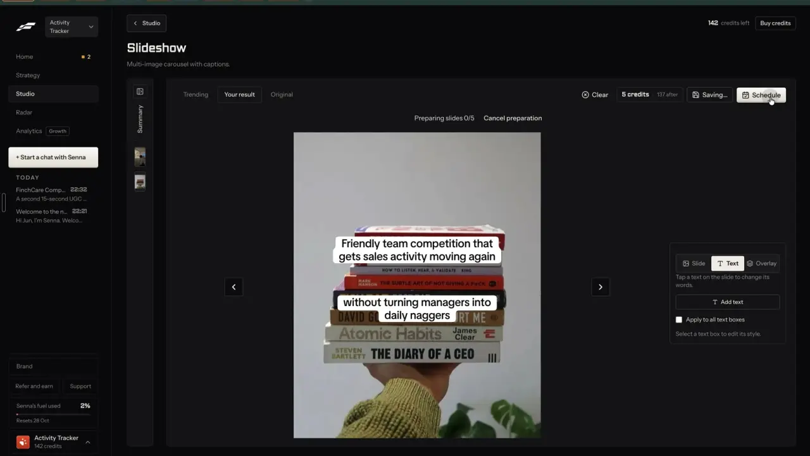

# Schedule in three steps

`publish-schedule` | publish | phase 7 | status: partial | /north-star#publish-schedule

## Leo asked

8 Oct 2026: "an all in one tool for my social media management, and for each person too". Scheduling is where a finished remix leaves the app, so it has to reach every network a brand uses in one pass.

## How the best do it

Fastlane renders the slides before it asks anything. Pressing "Schedule" on a slideshow turns "Save" into "Saving...", and a line above the canvas counts "Preparing slides 0/5", then "Preparing slides 3/5", with a "Cancel preparation" link. Five slides took about 2 seconds. (notes-2.md F13)



Then a modal "Schedule post" with a 3-segment progress bar and "Step 1 of 3 | Where" (notes-2.md F14):

- A connect card when a ticked network has no account: "Connect Your Instagram Account" / "Connect Instagram to schedule Reels directly to your profile." / "Connect Instagram".
- "Select Platform": one bordered row per network with a checkbox, "Instagram", "LinkedIn", "TikTok". A connected row has an account dropdown ("@activity_tracker_") and "+ Add another account".
- TikTok adds "Posting Mode" (see publish-tiktok).
- Footer "Cancel" and "Next". Next stays disabled while a ticked network has no account, with the tooltip "Choose an account to post to Instagram." and a not-allowed cursor.


Leo closed the modal at 2:13, so steps 2 and 3 were not seen (likely When and the caption; unverified). Fastlane charges a slideshow's 5 credits "when you save or schedule".

Others:

- Submagic: pick platforms and a date and time; AI pre-fills each platform's fields (titles, descriptions, tags, captions, first comments); a live mockup per platform in tabs; "Publish Now" or "Start Scheduling". Free gets one Publish Now; scheduling needs Pro or Business. [page](https://www.submagic.co/social-media-scheduler), [API](https://docs.submagic.co/api-reference/publish-project.md)
- Postiz: a "Global" tab goes to every channel, and unlocking a channel's tab tailors it; required fields per channel (YouTube title, subreddit, Pinterest board); validation blocks the save; "Save as Draft", "Add to calendar", "Post Now". [quickstart](https://docs.postiz.com/general/quickstart)
- Quso.ai: "Link" any unconnected platform from inside the scheduler, then write or generate the description; up to 40 accounts, up to 6 months ahead. [help](https://helpdesk.quso.ai/help/how-to-bulk-publish.md), [scheduler](https://quso.ai/products/social-media-scheduler)
- Later: schedule to "up to 10 social profiles at once" with per-profile changes for each network's media rules. [page](https://later.com/social-media-scheduler/)
- Klap: TikTok `privacy_level` must be chosen by the user; LinkedIn PUBLIC or CONNECTIONS; one caption up to 2,200 characters. [docs](https://docs.klap.app/oauth/social-posts)
- Buffer: a separate text box per network in one composer; each version becomes its own post in that channel's queue. [publish](https://buffer.com/publish)
- FMG Suite (adviser market): the post routes to compliance and goes out on approval or at the scheduled time. [source](https://fmgsuite.com/company/in-the-news/fmg-suite-named-best-social-media-distribution-software-for-second-consecutive-year/)

## What we have today

- Post it for me, `src/components/PostItForMe.tsx` (`PostItForMePanel`), opens inline on a scheduled post in My posts (`src/pages/DraftsPage.tsx`), the Calendar post editor (`src/pages/CalendarPage.tsx`) and Write's saved result (`/generate?panel=post`). In My posts and Calendar the open panel is component state (`postOpenId`), so no link reopens it there. It lists only the connected accounts on the draft's own platform; several accounts on that platform can be ticked, all but the ones needing a reconnect start ticked.
- Media: "Carousel slides (n)" drawn to PNGs on send (`carouselPngs` inside PostItForMe.tsx, busy label "Drawing the slides...", no per-slide count and no cancel), "Your imported video/picture", "A file", "Text only". Uploads go browser to Zernio storage with "Uploading 45%" (`uploadAll` in `src/lib/autoPost.ts`).
- When: a button with the draft's day and time ("Tue 21 Oct, 9:00 am"; 09:00 and an "at" time input only when the draft has no time) and "Now". There is no date picker. A passed time says "Its time has passed, so it goes now."
- Caption with a counter, `checkLimits` warnings and `scanCompliance` flags; a red flag blocks. TikTok privacy and switches from the creator's settings; a YouTube title. A team rule disables the button with its reason.
- One blocked reason at a time sits beside the button ("Pick an account to post to.", "Instagram needs a picture or video.", ...). Done closes the panel with a toast ("Scheduled on {Platform}" / "{when}. The chip on the post shows when it's up."); the chip reads Zernio again only on the next load of My posts or Calendar (`useZernioRefresh`, up to 10 due posts).
- Server: `supabase/functions/social/posts.ts` already takes several accounts on different platforms in one post (at most 12 ids, `SOCIAL_PLATFORMS.length * 2`), a caption per platform (`captions`, sent as each entry's `customContent`) and a first comment (`FIRST_COMMENT_PLATFORMS`, not TikTok). Caps `social-schedule` 30 (schedule and retry) and `social-presign` 30 (one per file). Live-tested 17 Oct 2026: 7 slides to TikTok, published in about 80 s.
- Gate: the `social` function serves only `SOCIAL_CONNECT_USERS` (Leo today); the button shows only when `socialConnectShown()`.
- Missing: other networks in the same send, a connect card in place, a typed first comment, steps with one blocked reason each, slides rendered before the choices, and a finished screen.

## Build

Gate: `leoOnly(email)` sees the stepped panel; everyone else keeps `PostItForMePanel` as it is. Read `email` once from `supabase.auth.getSession()`. No new dependency: the steps render inline where the panel sits today, as the panel does now (there is no dialog component in `src/components/ui`).

Files:
- New `src/components/ScheduleSteps.tsx`: the three steps, the preparing line and the finished screen.
- `src/lib/autoPost.ts`: pure `renderEach(items, render, onSlide, signal)` that draws items one at a time, calls `onSlide(done, total)` after each and stops when the signal aborts; `carouselPngs` stays in the component (it needs a canvas) and passes its slide drawer in. Add pure `stepProblem(step, form)` that returns the one reason a step can't go on, built on `platformProblem` and `fileProblem`.
- `src/components/PostItForMe.tsx`, `DraftsPage.tsx`, `CalendarPage.tsx`, `GeneratePage.tsx`: render `ScheduleSteps` in place of `PostItForMePanel` when `leoOnly(email)`.
- `src/lib/draftHistory.ts`: `ZernioLink.platforms` (Data).

### Screens and states

Preparing (carousel drafts only), shown before step 1:

```
Preparing slides 3/7                 [Cancel preparation]
```

Step 1, Where:

```
Schedule post                                   [x]
[====][    ][    ]  Step 1 of 3 | Where
[ ] Instagram   @leotan.sg            Add another account
[x] LinkedIn    Leo Tan               Add another account
[ ] TikTok      Connect TikTok
    Instagram needs a picture or video.        (only when ticked)
Cancel                                          [Next ->]
```

- One row per platform the brand has an account on, plus the draft's own platform when it has none (a connect card in its row). The draft's platform is ticked; others start unticked.
- A platform with several accounts shows them as checkboxes under its row, all ticked except ones that need reconnecting. The account picked as the default on /accounts (publish-accounts) is ticked first.
- TikTok's posting mode sits under its row (publish-tiktok).
- Blocked: Next disabled with one line beside it, from `stepProblem`: "Choose an account to post to {Platform}.", "{Platform} needs a picture or video.", "YouTube takes one video.", "{Platform} takes JPG or PNG pictures." The reason updates within one render of a tick.

Step 2, When:

```
[====][====][    ]  Step 2 of 3 | When
(o) On its day      Tue 21 Oct, 9:00 am
( ) Next open slot  Thu 23 Oct, 8:30 am    (when slots exist, publish-queue)
( ) Pick a time     [date] [time]
( ) Now
Back                                            [Next ->]
```

- Default: the draft's day when still ahead, else the next open slot, else Now.
- A passed time: "That time has passed. Pick a later time, or post now." Next stays disabled.

Step 3, Caption:

```
[====][====][====]  Step 3 of 3 | Caption
[Caption | LinkedIn] [Caption | Instagram]   [Write a version for each network ~US$0.01]
| caption textarea                          1,204 / 3,000 |
| compliance flags and network options for this tab        |
First comment  (publish-comments-followups)
Preview (PostPreview for the open tab)
Back                          [Schedule for Tue 21 Oct, 9:00 am]
```

- The caption tabs belong to publish-per-network: its labels ("Caption | <Network>", "Same as <Network>", "Use the shared caption"), its "Write a version for each network" button, its counters, its per-tab compliance line "Fix the compliance error in the <Network> caption first." and its network options (Instagram placement, LinkedIn poll). This step hosts them and adds nothing to them. Build publish-per-network first, or ship this step with one shared caption box (today's counter and flags) and let per-network fill it later.
- The first caption is `postText(draft, brand)`, as today.
- YouTube adds its title field; TikTok adds its posting mode (publish-tiktok) and, in direct mode, today's privacy and switches.
- publish-comments-followups owns the first comment field under the tabs.
- The button reads "Schedule for {Tue 21 Oct, 9:00 am}" or "Post now".

Sending: the button shows "Uploading 45%", then "Scheduling...". The panel stays open and keeps every field.

Done:

```
Scheduled on LinkedIn and Instagram
Tue 21 Oct, 9:00 am. The chip on the post shows when it's up.
[Open in calendar]  [Done]
```

Failed: the server's sentence in red under the button ("Zernio didn't take it: ...", "Reconnect that account on Social accounts first.", "Too many posts on that account right now. Try again in an hour."), all fields kept, the button reads "Try again". The idempotency key from today's code means a second press never posts twice.

Refused: a team rule or a red compliance flag disables the button with its reason, as today.

Over the daily cap: the server's own line, "You've used all 30 for today. It resets at 8am Singapore time." Files go up first (cap `social-presign`), then `schedule` checks its own cap before Zernio is called. Files already uploaded stay in the panel's memory, so a retry in the same panel sends only the post.

Off or no accounts: as today ("Social accounts aren't switched on for you yet.", "Connect your {Platform} account first.").

### Copy

- Title "Schedule post"; step labels "Step 1 of 3 | Where", "Step 2 of 3 | When", "Step 3 of 3 | Caption"
- Buttons "Next", "Back", "Cancel", "Add another account", "Connect {Platform}", "Open in calendar", "Done", "Cancel preparation", "Try again"
- Preparing "Preparing slides {n}/{total}"
- When options "On its day", "Next open slot", "Pick a time", "Now"
- Blocked lines as listed above, all from `stepProblem` so the tests read them
- Price chip on publish-per-network's "Write a version for each network" while it sits in this step: "~US$0.01" (Leo only, like every north-star price chip)
- Done "Scheduled on {A and B}" / "{when}. The chip on the post shows when it's up."; posting now "Posting to {A and B}" / "It goes out in about a minute."

### Data

- Per-network captions and options are stored as publish-per-network's `DraftEntry.versions`, synced with the draft, so reopening the steps shows them.
- `ZernioLink.platforms?: string[]`: the platforms the post went to, for the calendar card.
- Steps in progress live in component state and the URL (below); the files picked stay in memory as today, and none of this needs a schema change.

### AI and cost

- The only model call in the steps is publish-per-network's "Write a version for each network": `video-assist` mode `captions` (gpt-4.1, about US$0.01 a call) on the existing `video-captions` cap (30 a day), so this item adds no cap.
- No Jev question: which step is blocked is a rule.
- Zernio charges nothing per post; accounts cost money (publish-accounts).
- Every file costs one `social-presign` use, so a 10-slide carousel spends 10 of the 30 a day. Sending one post to three networks still uploads each file once and spends one `social-schedule` use.

### Deep links

- `/drafts?schedule=<post id>&step=where|when|caption` and `/calendar?post=<post id>&schedule=1&step=...` open the steps on that post (`schedule` push, `step` replace). `/generate?draft=<id>&panel=post&step=...` on Write. publish-per-network's `network=<platform>` picks the caption tab inside step 3.
- Add `schedule` and `step` rows for /drafts and /calendar, and `step` to the /generate `panel` row, in docs/deep-links.md. A link to a step the form can't reach yet opens the first blocked step. Files picked on the device are not in the link: a reload keeps the step and captions and asks for the file again.

## Done when

- [ ] On Leo's sign-in, Schedule on a carousel draft shows "Preparing slides n/total", then step 1; other sign-ins see today's panel.
- [ ] Ticking Instagram with no Instagram account disables Next with "Choose an account to post to Instagram."
- [ ] One send of a LinkedIn draft to LinkedIn and Facebook makes one Zernio post with two entries and two different captions, and the chip lists both.
- [ ] Step 3 shows publish-per-network's caption tabs for every ticked network (or one shared box if per-network has not shipped).
- [ ] A red compliance flag in any tab blocks the send with that tab's name.
- [ ] Reloading `/drafts?schedule=<id>&step=caption&network=linkedin` opens step 3 on the LinkedIn tab with the kept captions.
- [ ] The finished screen shows, and "Open in calendar" opens `/calendar?post=<id>`.
- [ ] `npm run build`, the full `npx vitest run`, and a by-eye check at 390 px and 1440 px pass.
- [ ] `src/data/northStar.ts` item flipped with its `ours` line, in the same commit.

## Tests

- `src/lib/autoPost.test.ts`: `stepProblem` returns each blocked line above for its case and null when the step can go on; a post with a video and Instagram plus YouTube passes; WebP with LinkedIn fails with the JPG line.
- `src/lib/autoPost.test.ts`: `renderEach` with a fake drawer calls `onSlide` once per item with the right counts and draws nothing after the signal aborts.
- `src/lib/autoPost.test.ts`: the step a `step` param asks for falls back to the first blocked step when an earlier step can't go on.
- `supabase/functions/social/posts.test.ts`: a schedule with LinkedIn and Facebook accounts and two captions builds one body with `customContent` per entry (existing shape, add the case).
- Prove each case bites by breaking the code once.

## Open questions

- Fastlane pre-ticks Instagram even when it is not connected. This spec ticks only the draft's own platform. Leo decides.
- LinkedIn carousels as a PDF document (PostNitro's "LinkedIn as a document") need Zernio's document posts, unverified against our account.
- "Duplicate to other brands" (Metricool) is left out until an agency runs more than one brand on the same post.

## Related

publish-tiktok, publish-accounts, publish-queue, publish-calendar, publish-comments-followups, publish-per-network, trust-compliance-check, trust-approval, plan-review-queue
